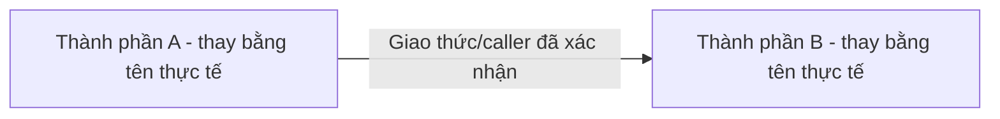

# [Tên kiến trúc hoặc luồng]

Ngày: [YYYY-MM-DD]  
Phạm vi: [Module, luồng và môi trường được mô tả]

## Mục đích và giới hạn

[Vấn đề tài liệu giải thích và những phần chưa có bằng chứng.]

## Hiện trạng có bằng chứng

| Thành phần/hành vi | Trạng thái thiết kế | Trạng thái triển khai/kiểm chứng | Nguồn |
|---|---|---|---|
| [Tên] | [Đã chốt/đề xuất/chưa quyết định] | [Có mã/đã chạy/chưa kiểm chứng] | [Link tương đối tới bằng chứng] |

## Sơ đồ hiện trạng

[Thay sơ đồ minh họa bằng luồng có bằng chứng; ghi nguồn và giới hạn kiểm chứng.]

## Trách nhiệm và contract

[Ai sở hữu dữ liệu/quyết định; endpoint hoặc event, authentication, response và lỗi quan trọng.]

## Luồng xử lý

[Trace luồng thành công và lỗi có ý nghĩa. Dùng sequenceDiagram nếu giúp giải thích thứ tự.]

## Kiến trúc đích hoặc đề xuất

[Chỉ giữ phần này khi có khác biệt với hiện trạng. Gắn nhãn Đã chốt hoặc Đề xuất; nêu vấn đề, phương án, tác động và ADR liên quan. Vẽ sơ đồ riêng khi cần.]

## Kiểm chứng và câu hỏi mở

| Nội dung | Bằng chứng/kết quả | Ngày/môi trường | Giới hạn hoặc cách xác minh tiếp |
|---|---|---|---|
| [Nội dung] | [Code/test/run thực tế] | [Thời điểm và môi trường hoặc chưa chạy] | [Phần chưa xác nhận] |

## Quyết định liên quan

[Liên kết tương đối tới ARCHITECTURE.md, ADR và tài liệu luồng; bỏ mục nếu không cần.]
