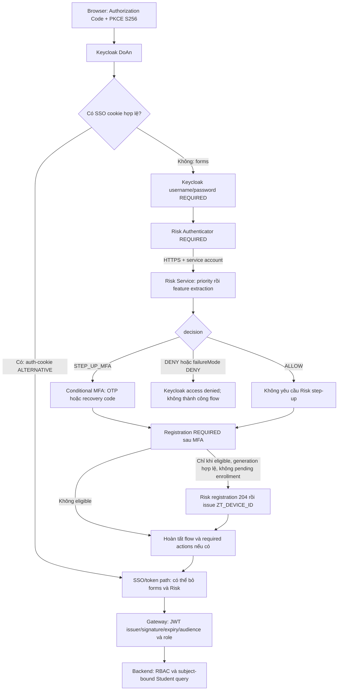

# Nghiệm thu Adaptive Authentication, MFA và RBAC/ownership

Cập nhật 28/10/2026, giờ Việt Nam. Canonical source:
`C:\Users\DELL\Documents\zerotrust\zerotrust`; branch `zerotrust-v4-risk-scoring`;
HEAD lúc bắt đầu `0893c09cebb80ccd9e559d0df00398716cad376f`.

**PASS — A1 LOW/ALLOW trên Browser có correlation đầy đủ.** Evaluation thực tế
lúc 11:19:05 ngày 28/10/2026: score 25.00, LOW, ALLOW, COMPLETE; Keycloak bỏ MFA
và LOGIN_SUCCESS cùng evaluation ID, owner xác nhận form password và tải điểm được.
A2 trusted relogin PASS: evaluation mới cùng subject, 12.50/LOW/ALLOW/COMPLETE.
A3 MFA PASS: 32.50/MEDIUM/STEP_UP_MFA/COMPLETE do mandatory device guard, có OTP
execution SUCCESS, registration 204/cookie và LOGIN_SUCCESS cùng evaluation.
INCOMPLETE/cold-start MFA cũng đã quan sát PASS trong setup A4 (mục 25).
**A4 priority HIGH/DENY PASS**, không cấp session/token mới cho lần bị chặn; test
fixture đã xóa và mọi tập hàng gốc khớp baseline, xem mục 26. Weighted HIGH >=75 và
scored MEDIUM theo dải ngưỡng vẫn NOT VERIFIED.
Hai phiên STUDENT đã đạt 16/16
checks RBAC/ownership đọc-only theo kết quả owner; ADMIN v2 đã đạt 5/5 API quản trị.
Tổng 21/21 checks đã thực thi PASS; một negative case không phù hợp với role set
ADMIN+STUDENT được ghi riêng NOT VERIFIED, không tính thành PASS. Agent không đổi
policy/realm/TLS hoặc reset/revoke trust; A3 có một thiết bị TRUSTED mới từ login/MFA
hợp lệ theo policy. Business data và trust cũ được bảo toàn, xem mục 19.
Trace SPI đã được bổ sung, kiểm thử và triển khai sau phê duyệt (mục 13–16).
Không đổi Risk policy, chạy lại 21 checks RBAC, commit/push hoặc cleanup.

## 1. Kết quả và phạm vi bằng chứng

| Tiêu chí | Trạng thái | Bằng chứng/giới hạn |
|---|---|---|
| Docker canonical | PASS | Baseline 10/10 healthy; tái sử dụng TLS/CRL và frontend acceptance trước |
| Browser Flow gắn Risk | PASS | Realm và override của `zerotrust-spa` cùng bind `zerotrust-browser-recovery`; password và Risk REQUIRED trong forms |
| Source áp dụng ALLOW/STEP_UP_MFA/DENY | PASS | Handler, condition, controller và deployed SPI bytecode có các nhánh tương ứng; chưa thay bằng Browser acceptance |
| Request context đúng thiết kế | PASS trong phạm vi source | Subject lấy từ user đã xác thực; session/client/remote address/UA/device được extractor tạo; giá trị request cụ thể chưa trace |
| Risk evaluation của một login thật | PASS | A1 evaluation 786a59f8-ff90-472f-83dc-a286b5a29bcb gắn enforcement/MFA gate/LOGIN_SUCCESS; history khớp subject mapping |
| LOW → ALLOW trên Browser | PASS | A1 score 25.00, LOW/ALLOW/COMPLETE; form password, không OTP, bảng điểm tải được |
| MEDIUM → STEP_UP_MFA trên Browser | PASS | A3 32.50/MEDIUM/STEP_UP_MFA/COMPLETE do DEVICE_IDENTIFIER_MISSING bắt buộc MFA; OTP execution SUCCESS và LOGIN_SUCCESS cùng evaluation |
| Scored MEDIUM trong dải ngưỡng | NOT VERIFIED | A3 là mandatory guard nâng effective level; không chứng minh score 40–<75 trên Browser |
| INCOMPLETE/cold-start → MFA trên Browser | PASS | Setup A4 lần hai null/MEDIUM/STEP_UP_MFA/INCOMPLETE/TEMPORAL_PROFILE_COLD_START, OTP execution SUCCESS và LOGIN_SUCCESS, không suy từ A3 |
| HIGH → DENY trên Browser | PASS | A4 priority: null/HIGH/DENY/NOT_EVALUATED/REVOKED_DEVICE → ACCESS_DENIED; sessions=0, không success/token mới; fixture đã hoàn nguyên |
| Weighted HIGH >=75 trên Browser | NOT VERIFIED | A4 là priority trước scoring, không dùng làm bằng chứng score >=75 |
| Login và OTP | PASS | A3 owner xác nhận OTP hoàn tất; trace OTP_EXECUTION_SUCCESS → LOGIN_SUCCESS với cùng correlation |
| Trusted-device registration | PASS | A3 OTP thành công → REGISTERED_204 → COOKIE_ISSUED; DB thêm đúng một TRUSTED record thuộc subject owner, trust cũ giữ nguyên |
| Trusted-device relogin | PASS | A2 form password, evaluation mới cùng subject, 12.50/LOW/ALLOW/COMPLETE, không OTP, LOGIN_SUCCESS; kết luận recognition từ guard độc quyền của service đã đối chiếu |
| ADMIN/STUDENT đọc cơ bản | PASS theo owner/ảnh | Token exchange và các GET quản trị quan sát được 200; owner báo STUDENT tải dữ liệu được |
| STUDENT bị chặn ADMIN và ownership | PASS | 16/16 checks thật cho STUDENT-1/STUDENT-3; khác subject tags, baseline mapping và số điểm 6/4 khớp |
| ADMIN read-only API suite | PASS | Owner chạy v2, 5 API GET quản trị 200; phiên có ADMIN+STUDENT, một negative case được skip minh bạch |

Tham chiếu kết quả cũ: [báo cáo consolidation](ZEROTRUST_FINAL_CONSOLIDATION_REPORT.md).
Không sao chép dữ liệu cá nhân, credentials, cookie, token hoặc OAuth callback URL.

## 2. Luồng thực tế theo source và cấu hình đang chạy



Sơ đồ đối chiếu code/config; chưa render trực quan. Nhánh Risk thật chưa có score
trace đầy đủ. Keycloak sở hữu password/OTP/token; SPI không tự kiểm tra password
và không tự tính Risk Score. Risk không truy cập Keycloak credential để xác thực user.

Runtime Browser Flow:

| Thứ tự | Execution | Requirement |
|---|---|---|
| Top 10 | auth-cookie | ALTERNATIVE |
| Top 20 | auth-spnego | DISABLED |
| Top 25–26 | broker redirect/organization | ALTERNATIVE; không có IdP được cấu hình |
| Top 30 | forms | ALTERNATIVE |
| Forms 0 | auth-username-password-form | REQUIRED |
| Forms 10 | zerotrust-risk-authenticator | REQUIRED |
| Forms 21 | Risk step-up MFA subflow | CONDITIONAL |
| MFA 10 | zerotrust-risk-step-up-condition | REQUIRED |
| MFA 30, 50 | OTP / recovery code | ALTERNATIVE trong subflow |
| Forms 22 | zerotrust-device-registration | REQUIRED |

Requirement IDs đã đối chiếu enum của chính Keycloak 26.7.0 đang chạy:
0 REQUIRED, 1 CONDITIONAL, 2 ALTERNATIVE, 3 DISABLED. SPA là public client,
standard flow bật, PKCE S256; implicit/direct grant/service account/device grant/CIBA
đều tắt. Risk config dùng HTTPS nội bộ, caller `zerotrust-risk-caller`, failureMode
DENY, connect timeout 2000ms, socket timeout 3000ms, request pool timeout 500ms.
Không đưa secret của caller vào báo cáo.

## 3. Risk decision và MFA

Score hiện là **Risk Score: cao hơn nghĩa là rủi ro cao hơn**:

`S = 0.25·device + 0.25·network + 0.25·temporal + 0.25·authenticationHistory`

Làm tròn hai chữ số, HALF_UP. Ngưỡng runtime từ chuỗi cấu hình hiện có: medium 40,
high 75. Defaults trong Risk JAR khớp key/value canonical; env/private properties
được đối chiếu, không thấy override policy trong JVM/command/SPRING_APPLICATION_JSON.
Đây là baseline prototype trong source có chú thích TBD, không phải trọng số đã
được nghiên cứu/calibration hoặc chủ đồ án chốt chính thức.

| Điều kiện | score | level/decision |
|---|---|---|
| Priority violation hoặc pending MFA reset | null | HIGH / DENY, NOT_EVALUATED |
| Feature thiếu hoặc cold-start | null | MEDIUM / STEP_UP_MFA, INCOMPLETE |
| Đủ dữ liệu nhưng mandatory step-up | Có tính | Ít nhất MEDIUM/STEP_UP; nếu score ≥75 thì HIGH/DENY |
| Đủ dữ liệu, không guardrail: S <40 | Có tính | LOW / ALLOW |
| Cùng điều kiện: 40 ≤ S <75 | Có tính | MEDIUM / STEP_UP_MFA |
| Cùng điều kiện: S ≥75 | Có tính | HIGH / DENY |

Do đó không suy MEDIUM từ OTP hoặc suy ALLOW từ một subtotal thấp.
Handler lưu evaluation ID/level/dataStatus/decision trong auth notes; STEP_UP thật
có generation mới tạo eligibility. Failure fallback không được tạo trust eligibility;
runtime hiện dùng DENY khi Risk unavailable. Context success của Risk execution chưa
phải thành công OTP hay toàn bộ login.

Registration chỉ sau subflow MFA; skip khi CONFIGURE_TOTP còn pending. Cookie chỉ
issue sau registration 204. Guard generation/pending reset khóa phía Risk. Cookie
ZT_DEVICE_ID có HttpOnly, Secure theo HTTPS context, SameSite=Lax, realm path và
max-age 30 ngày. Server trust cũng hết hạn sau 30 ngày; cookie không tự chứng minh trust.
MFA_RESET-revoked/expired cần MFA và rotation; SECURITY-revoked là priority DENY.

## 4. Các tín hiệu đang dùng — đầu vào nghiên cứu Trust Score

| Feature | Dữ liệu/giá trị đang có | Giới hạn cần nghiên cứu |
|---|---|---|
| Device | missing 80, new 60, pending 50, trusted 0, revoked 100; guardrail riêng | Status/expiry/generation; chưa phải điểm tin cậy liên tục theo thời gian |
| Network | trusted 0, default/elevated 50, high 100; CIDR ưu tiên rồi GeoIP | Có 2 trusted CIDRs, 1 elevated, 1 high; không in địa chỉ mạng; blocked-IP list rỗng |
| GeoIP | Bật, City/ASN mmdb đọc được; country lists rỗng | Context local/Docker NAT không chứng minh vị trí public thật; private IP đi default/CIDR |
| Temporal | 90 ngày, tối thiểu 5/tối đa 200 events; UTC; giờ ±1; ngày 0.10/giờ 0.20 | 0 nếu thường; 50 bất thường ngày hoặc giờ, 100 cả hai; cold-start không phải an toàn |
| Auth history | HMAC counters Redis: subject 3/5, source IP 10/20; score 50/100 | Cửa sổ 15 phút, dedup 1 giờ; chỉ events được listener nhận và phân loại |

Context SPI gồm subject user đã xác thực, root-auth-session + tab, client ID,
connection remote address, UA tối đa 1024 ký tự, device cookie nếu hợp lệ.
Forwarded headers không được tự tin cậy; direct localhost/Docker có thể nhìn thấy
địa chỉ NAT thay cho public client IP. Chưa có request trace để xác nhận từng giá trị
trong login cụ thể; không giả IP để thử HIGH.

Mô hình chưa có numeric Trust Score/decay/reward evidence/calibration độc lập.
Không tự đặt `Trust Score = 100 − Risk Score`. Chưa có ground truth, phân phối score,
ROC/FPR/FNR, đánh giá độ ổn định theo user/network hoặc phiên bản policy trong audit
cho từng evaluation. Đây là đầu vào nghiên cứu tiếp theo, không phải thay đổi đã làm.

## 5. Risk tham gia Browser Flow: bằng chứng và khoảng trống

Đã kiểm tra provider JAR đang chạy và đọc bytecode các lớp RiskAuthenticator,
RiskDecisionHandler, RiskStepUpCondition, TrustedDeviceRegistrationAuthenticator.
Các lời gọi evaluate, apply decision, condition và registration/cookie tồn tại.
Không rebuild để làm kiểm tra này. Local built SPI artifact không có để so hash
toàn bộ class với workspace; source/config/bytecode được phân biệt trong evidence.

History hiện có ghi successful logins và known devices; evidence trước đã quan sát
hai registration TRUSTED sau user login/OTP. Điều này củng cố đường integration,
nhưng không thay thế correlation từng request/response score.

**Lịch sử trước khi thêm trace — BLOCKED, đã giải quyết ở mục 17–26:** Realm EVENTS_ENABLED=0, event expiration=0;
listeners vẫn có jboss-logging và zerotrust-risk-events. Listener Risk vẫn hoạt động
độc lập với việc bật lưu Keycloak EVENT_ENTITY. Risk DB chỉ có success events, devices,
revocations, subject generation và Flyway; không có evaluation audit table.
Log Keycloak/Risk có sẵn đã đọc không chứa evaluation ID/score/level của thành công.
Response có riskScore/reasons nhưng không persist; auth notes không giữ score và
không phải audit lịch sử sau login. Không thể điền điểm thực bằng cách suy ngược từ OTP.

Cập nhật theo yêu cầu tiếp theo của owner: source trace đã triển khai, xem mục 13–15.
Subject tag dùng HMAC với khóa ngẫu nhiên trong bộ nhớ theo tiến trình. Unit tests
và deployment PASS; Browser correlation A1 đã PASS, các case khác chờ nghiệm thu.
Không đổi DTO, scoring, realm hoặc credentials.

## 6. Biên SSO/refresh và nguy cơ diễn giải sai

SSO cookie là ALTERNATIVE trước forms, nên phiên SSO hợp lệ có thể đi thẳng đến
code/token mà không gọi Risk. Refresh token cũng không chạy Browser Flow.
Không thấy OTP trong trường hợp này không chứng minh LOW/ALLOW hoặc nhận diện device.
Đây là giới hạn vận hành hiện có, không tự mở rộng thành continuous authentication.
Nếu yêu cầu nghiên cứu là mọi lần SSO/refresh cũng phải đánh giá Risk, cần quyết định
riêng; chưa sửa flow để đạt một cách hiểu mới của yêu cầu.

Không có Direct Grant/Implicit/CIBA/device grant bật cho SPA để thay đường Browser.
Các đường broker/organization không được coi đã nghiệm thu; runtime không có IdP.

## 7. Checklist Adaptive cho owner

URL `https://localhost:28443/`, Keycloak `https://localhost:28444/realms/DoAn`.
Dùng tài khoản sẵn có; người dùng tự nhập password/OTP. Không gửi callback URL/code,
cookie hoặc token. Không xóa cookie/profile, revoke/reset trust hoặc sửa policy.

| Case | Thao tác | Kết quả/đối chiếu cần có |
|---|---|---|
| A1 Normal login | Logout bằng nút Portal, đăng nhập lại và phải thấy form password | Giờ VN, actor alias, có OTP không, hoàn tất không, token endpoint status; trace eval khi có |
| A2 Trusted relogin | Sau A1 thành công, logout và login lại cùng browser/profile, giữ device cookie | Phải phân biệt SSO với form login; skip OTP chỉ được tính ALLOW khi trace chứng minh dữ liệu COMPLETE và decision ALLOW |
| A3 MFA context | Dùng user/thiết bị có ngữ cảnh tự nhiên yêu cầu MFA, không tạo seed/reset | OTP challenge + hoàn tất; eval reasons/dataStatus quyết định là incomplete/mandatory/MEDIUM; không suy từ OTP |
| A4 HIGH deny | Đã PASS theo phương án priority riêng được duyệt | Chi tiết trial và cleanup ở mục 26; không chạy lại |

Ledger cho mỗi lần: thời điểm (ghi timezone), alias/subject tag, evaluation ID,
factor/reasons, score hoặc null đúng contract, dataStatus, level, decision, password
form có/không, OTP challenge/completion, kết quả Keycloak, token/session có/không.
Hiện các cột eval/score của Browser cũ là NOT VERIFIED, không tự điền.

HIGH: hiện 3 device REVOKED đều là **MFA_RESET**, không phải SECURITY, nên không dùng
để chứng minh priority DENY. Không có blocked IP hiện tại. High-risk network signal
chỉ bắt buộc MFA, không luôn làm tổng score ≥75. Chưa có kịch bản HIGH có thể thực hiện
an toàn/hoàn nguyên và phù hợp giới hạn để xin duyệt thực thi ngay.

Phương án chuẩn bị: sau khi có trace, xác nhận một ngữ cảnh rủi ro thật đã tồn tại;
nếu có SECURITY-revoked device/cookie hợp lệ do owner giữ hoặc nguồn mạng thực đúng
policy và tổng yếu tố thực đạt HIGH, thử một lần sau logout SSO, ghi evidence rồi
trở về browser/thiết bị thường. Không thay trạng thái/policy để chế tạo điều kiện.
Nếu không có điều kiện đó, giữ BLOCKED và lập thí nghiệm được duyệt riêng, nêu rõ
đối tượng, tác động/TTL, điều kiện dừng và cách hoàn nguyên trước khi thao tác.

## 8. API contract và cách thử RBAC/ownership

Gateway và Backend đều chặn `/api/admin/**` theo ADMIN và `/api/students/**` theo
STUDENT. Controller/service có method security; Student `/me` lấy `JWT.sub`, resolve
School mapping rồi query bằng student ID đã resolve. Tham số chủ thể do client gửi
không được dùng để chọn sinh viên ở đường `/me`.

| Phiên thật | Request GET | Mong đợi |
|---|---|---|
| ADMIN | `/api/admin/users`, `/students`, `/student-classes`, `/subjects` dưới prefix `/api/admin` | 200 |
| ADMIN | `/api/admin/students/{valid-student}/scores` | 200 |
| ADMIN thực sự không có STUDENT | `/api/students/me` | 403; tài khoản admin hiện có nhận STUDENT qua default-role nên không dùng làm negative case này |
| STUDENT A/B | `/api/students/me`, `/me/scores`, `/me/scores/summary` dưới `/api/students` | 200, khớp subject mapping/điểm gốc của chính phiên |
| STUDENT | `/api/admin/users`, `/api/admin/students/{other}/scores` | 403 |
| STUDENT | `/api/students/{other}/scores` | 404, không có route chọn người khác |
| STUDENT | `/api/students/me?studentId={other}` và `/me/scores?studentId={other}` | Vẫn chỉ dữ liệu của mình; tham số không chuyển owner |

404 một mình không chứng minh ownership. Helper còn đối chiếu mapping từ baseline,
studentId của từng score, số điểm gốc và thử cả hai STUDENT. Không dùng 401 thiếu
token làm bằng chứng sai role; không giả/sign JWT hoặc dùng service token thay user.

## 9. Hướng dẫn chính xác chạy helper trên Windows

Helper nằm trong ignored private evidence:
`.local-legacy/final-consolidation-evidence/adaptive-auth-acceptance-20261028/rbac-read-only.private.js`.
Nó có mapping/expected counts của 5 STUDENT hợp lệ đang có; không đưa file vào Git
hoặc gửi toàn bộ file cho người khác. Không chứa password/OTP/cookie/access token.

1. Mở Portal, tự đăng nhập ADMIN. Chờ màn hình quản trị và dữ liệu tải xong.
2. Mở PowerShell thường; chép nội dung helper vào clipboard bằng lệnh dưới.
3. Trong đúng tab Portal, nhấn F12 → Sources → `>>` nếu cần → Snippets → New snippet.
   Đặt tên `zerotrust-readonly`, Ctrl+V để dán nội dung. Chọn context `top` của Portal.
4. Ctrl+Enter để chạy. Mở Console, tìm dòng `Ready for a read-only check`.
5. Trong vòng 60 giây, bấm menu quản lý khác (Sinh viên/Lớp/Môn). Với STUDENT,
   đổi lựa chọn Sắp xếp rồi bấm **Lọc kết quả**. Không F5/reload sau khi chạy snippet.
6. Chờ khối `ZEROTRUST_READ_ONLY_ACCEPTANCE` xuất hiện. Chỉ copy khối kết quả này;
   không copy các dòng login URL, lỗi của extension hoặc Network headers.
7. Logout bằng nút Portal, login STUDENT A; chọn lại snippet, Ctrl+Enter và làm bước 5–6.
8. Logout, login STUDENT B khác tài khoản A, lặp lại. Không sửa helper/mappings.

```powershell
Get-Content -Raw -LiteralPath 'C:\Users\DELL\Documents\zerotrust\zerotrust\.local-legacy\final-consolidation-evidence\adaptive-auth-acceptance-20261028\rbac-read-only.private.js' | Set-Clipboard
```

Lệnh PowerShell chỉ đọc file và copy; phần chạy là Ctrl+Enter trong DevTools.
Không chạy helper bằng Node/PowerShell vì cần đúng phiên browser đang đăng nhập.
Nếu browser chặn dán, không nhập `allow pasting`/tắt bảo vệ để vượt chặn; báo bước lỗi,
giữ bài thử NOT VERIFIED. Nếu timeout 60s chưa quan sát request thì chưa test gì;
chạy lại snippet rồi bấm menu/lọc đúng cách. Chỉ chạy một helper mỗi lần và chờ xong.

Helper tạm quan sát Authorization của request API tiếp theo của chính app, khôi phục
`window.fetch` ngay khi nhận request hoặc sau 60s. Chỉ GET cùng origin/prefix `/api/`,
`credentials: omit`, không thao tác cookie/storage/config hoặc dữ liệu. Token chỉ ở
bộ nhớ browser, không hiện/lưu trong output và không gửi ra ngoài origin. Kết quả
chỉ có role, timestamp UTC, subject tag hash, alias, statuses/booleans/counts.
Owner đã gửi output cho hai STUDENT v1 và ADMIN v2; chỉ các checks thực thi trong output
được tính vào 21 PASS. Hướng dẫn này được giữ để tái hiện, không yêu cầu lặp lại.

Helper v2 mong đợi ADMIN có cả ADMIN/STUDENT: 5 positive ADMIN checks; negative
STUDENT-role case nằm trong `not_tested` với NOT VERIFIED, vì tài khoản thực sự có
quyền STUDENT. ADMIN chỉ có ADMIN mới chạy thêm check 403 đó (tổng 6). Mỗi STUDENT
chỉ có STUDENT: 8 checks. `PASS` tổng chỉ tính checks đã chạy; không che mục skipped.
Hai STUDENT phải có alias và subject tag khác nhau. Nếu có false/401/timeout/NOT VERIFIED, giữ nguyên kết quả
để phân tích; không sửa dữ liệu hoặc token để ép PASS. Gửi ba khối, gắn nhãn phiên.

## 10. Findings, đề xuất và phần chưa hoàn thành

1. **PASS — correlation cho A1:** gap ban đầu đã khắc phục bằng trace triển khai,
   evaluation/score/decision/enforcement/LOGIN_SUCCESS thật đã đối chiếu, xem mục 17.
   Các kịch bản chưa thực hiện vẫn giữ trạng thái riêng, không suy từ unit tests.
2. **PASS — live STUDENT RBAC/ownership trong 16 checks:** hai kết quả owner đã được
   đối chiếu private baseline. **PASS — ADMIN suite:** owner v2 5/5 checks. Không yêu cầu
   lặp lại 21 checks đã PASS; skipped case không được gộp vào tổng.
3. **PASS — HIGH priority case:** phương án test subject riêng đã được duyệt,
   thực hiện và cleanup ở mục 26. Weighted HIGH >=75 vẫn NOT VERIFIED, không sửa ngưỡng.
4. **PASS — trusted relogin A2 và SSO observation:** có evaluation mới sau form
   password, cùng subject/cookie/profile theo owner; SSO events riêng không được
   đếm thành evaluation. Refresh-token runtime vẫn NOT VERIFIED.

Chưa tìm thấy bằng chứng một functional bypass mới từ đọc source/config này.
Đây không phải chứng nhận không có lỗ hổng. Không triển khai đề xuất trước khi
owner duyệt; không đổi Trust Score ở nhiệm vụ nghiệm thu.

## 11. Nguồn và evidence

- [SPI context](keycloak-risk-extension/src/main/java/com/zerotrust/keycloak/risk/context/KeycloakLoginContextExtractor.java),
  [Authenticator](keycloak-risk-extension/src/main/java/com/zerotrust/keycloak/risk/authenticator/RiskAuthenticator.java),
  [Decision handler](keycloak-risk-extension/src/main/java/com/zerotrust/keycloak/risk/policy/RiskDecisionHandler.java),
  [MFA condition](keycloak-risk-extension/src/main/java/com/zerotrust/keycloak/risk/authenticator/RiskStepUpCondition.java),
  [Registration](keycloak-risk-extension/src/main/java/com/zerotrust/keycloak/risk/authenticator/TrustedDeviceRegistrationAuthenticator.java).
- [Evaluation pipeline](risk-scoring-service/src/main/java/com/zerotrust/risk/service/RiskEvaluationService.java),
  [Scoring](risk-scoring-service/src/main/java/com/zerotrust/risk/service/RiskScoringService.java),
  [Feature extractor](risk-scoring-service/src/main/java/com/zerotrust/risk/feature/DatabaseBackedRiskFeatureExtractor.java),
  [Policy defaults](risk-scoring-service/src/main/resources/application.properties).
- [Student controller](src/main/java/com/zerotrust/zerotrust/controller/StudentController.java),
  [Student query](src/main/java/com/zerotrust/zerotrust/service/impl/student/StudentQueryService.java),
  [Score service](src/main/java/com/zerotrust/zerotrust/service/impl/ScoreAdministrationServiceImpl.java),
  [Gateway security](gateway/src/main/java/com/zerotrust/gateway/GatewaySecurityConfig.java).
- Private evidence: `.local-legacy/final-consolidation-evidence/adaptive-auth-acceptance-20261028/`:
  baseline, active flow/config, safe policy, existing logs, deployed JAR/bytecode,
  private student aliases/helper. Logs/config chứa dữ liệu riêng tư chỉ ở ignored
  protected folder; không commit/push. Báo cáo public không chứa raw subject/IP/device,
  password, token, cookie hoặc OTP secret.

Kết quả helper/Browser mới sẽ được cập nhật tại đây; không tạo nhiều báo cáo phụ.

## 12. Kết quả owner gửi ngày 28/10/2026 — STUDENT và giới hạn helper ADMIN

| Phiên | Giờ Việt Nam | Alias helper | Subject tag | Kết quả |
|---|---|---|---|---|
| STUDENT A | 10:11:50.284 | STUDENT-1 | d8b9b3f746d2 | PASS 8/8; 6 scores đúng baseline |
| STUDENT B | 10:14:25.807 | STUDENT-3 | c01412e96a25 | PASS 8/8; 4 scores đúng baseline |
| ADMIN v2 | 10:24:23.211 | ADMIN | 9bc9c74e4834 | PASS 5/5 GET; một negative case không phù hợp được skip |

Nguồn: JSON được owner dán sau chạy helper và hai ảnh Console. Subject tags khớp
SHA-256 tag của private School mapping, hai alias khác nhau; expected score counts
khớp baseline 23 scores. Không lưu tên đăng nhập thật từ lời nhắn/ảnh vào báo cáo.

Cả hai STUDENT đều đạt: profile theo subject mapping, tất cả scores thuộc đúng
studentId và đủ số điểm gốc, summary 200, ADMIN users 403, ADMIN foreign scores 403,
foreign Student route 404, query studentId không chuyển chủ thể profile/scores.
HTTP 403/404 màu đỏ trong ảnh là kết quả mong đợi của negative probes. Không coi
401 thiếu token hoặc unit tests là bằng chứng thay cho các kết quả phiên thật này.
Phạm vi target: A thử foreign STUDENT-2, B thử foreign STUDENT-1; không tuyên bố
đã thử mọi cặp tài khoản hoặc mọi biến thể IDOR. Không thử ghi dữ liệu.

**Lỗi helper đã xác nhận:** helper v1 giả định hai role phải loại trừ nhau. Runtime
role graph cho thấy admin được gán ADMIN và `default-roles-doan`; composite default
bao gồm STUDENT. Ứng dụng ưu tiên ADMIN khi có cả hai và chuẩn hóa uppercase.
Không có căn cứ đổi role để làm bài test. Helper v2 chuẩn hóa giống ứng dụng,
cho ADMIN precedence và bỏ negative STUDENT-role case khi token có STUDENT thật.
Nó in `business_roles`, `helper_version: 2`, `not_tested` để phân biệt quyền thực với
bài thử bị bỏ. 5 kiểm tra logic role của helper và syntax check đạt; đó chưa phải
ADMIN live acceptance. Không tạo token/user giả hoặc gọi mạng trong các logic checks.

Bước chạy ADMIN v2 đã hoàn thành lúc 10:24:23.211 giờ Việt Nam, chốt kết quả bên dưới.
Không yêu cầu chạy lại helper ADMIN hoặc STUDENT. Không sửa composite/default role
để làm bài thử.

Evidence private: `owner-student-A-result.json`, `owner-student-B-result.json`,
`student-live-result-validation.json`, `owner-admin-v1-result.json`,
`admin-helper-diagnosis.json`, `composite-role-relationships.private.json`,
`rbac-read-only.v1-before-admin-fix.private.js`, `rbac-read-only.private.js` (v2).

### Chốt RBAC read-only sau ADMIN v2

**PASS — 21/21 checks thực thi:** ADMIN 5 GET trả 200; STUDENT A/B tổng 16 checks
đạt, gồm own-subject/mapping/count, chặn ADMIN, foreign route và chống chuyển owner
bằng query. Các subject tags khớp baseline private; hai STUDENT khác nhau. Đây là
bằng chứng phiên đăng nhập thật do owner chạy, không giả JWT hoặc thay bằng test mock.

**NOT VERIFIED — skipped case:** ADMIN không có STUDENT không được thử với tài khoản
hiện tại vì token có cả hai role. Không remove role để ép test. V2 báo rõ not_tested.
Điều này không làm FAIL các quyền ADMIN đã thử và không làm giảm 16 PASS của STUDENT.
Không suy 21 GET này thành nghiệm thu CRUD ghi, mọi route hoặc mọi biến thể tấn công.

**PASS — preservation sau helper:** schema/row fingerprints năm bảng School khớp
snapshot gốc, 49 rows/23 scores. Helper và agent không ghi nghiệp vụ. Login audit,
Risk history/device và session phát sinh từ thao tác owner được phân biệt riêng.
Evidence: `owner-admin-v2-result.json`, `post-rbac-business-preservation.json`.

## 13. Thiết kế Risk Evaluation Trace trong source

**PASS — implementation/unit tests/deployment và Browser correlation A1.** SPI ghi response
HTTPS từ Risk sau khi HTTP client kiểm echo subject/authentication-session.
Giữ nguyên evaluation UUID do Risk cấp và API contract; không thêm producer log
vào Risk Service, bảng/migration, message broker hoặc hệ thống observability.

Record INFO: marker `ZEROTRUST_RISK_TRACE` và JSON `schema_version: 1`.
Allowlist: `at`, `correlation_id`, `evaluation_id`, `subject_tag`, `client_id`,
`stage`, `outcome`. Evaluation thêm `evaluated_at`, `risk_score` (explicit null),
`risk_level`, `decision`, `data_status`, `reason_codes`, `evaluation_source`.
Unavailable chỉ thêm failure type thuộc allowlist; không xuất exception context.

- Correlation UUID ngẫu nhiên mới cho mỗi response/failure tại Risk step; unavailable
  có evaluation ID/score/level null, source `NO_VALID_RISK_RESPONSE`, không gán HIGH.
- Subject tag: HMAC-SHA256 của realm-scoped subject, rút gọn 128 bit; khóa 256 bit
  ngẫu nhiên chỉ trong bộ nhớ JVM, thay sau restart. Không hash username/plain ID,
  không reuse client secret. Tag này không so trực tiếp với tag SHA-256 helper cũ.
- Trace auth notes độc lập với notes quyết định. Chỉ ba correlation values an toàn
  được đưa vào EventBuilder details. Xóa rõ detail cũ vì `detail(null)` không xóa.
- Không ghi password/OTP, token/code, cookie/device ID, IP/UA/session ID, secrets,
  private keys, raw subject/tên người dùng. Client ID bị giới hạn ký tự/độ dài;
  reasons/stage/outcome chỉ dùng enums, không nhận message tự do từ request.
- Dùng rotation Docker hiện có: `json-file`, `max-size=5m`, `max-file=2`, giới hạn
  theo dung lượng, không cam kết số ngày. Evidence cần trích vào ignored private
  folder trước khi xoay log/recreate; không commit logs/private evidence.

| Trace | Bằng chứng quan sát | Giới hạn |
|---|---|---|
| RISK_EVALUATION/EVALUATED | Response Risk hợp lệ, score/null, level, decision, dataStatus, reasons | Chưa là login success |
| KEYCLOAK_ENFORCEMENT | Risk step success/step-up note hoặc failure ACCESS_DENIED; unavailable tách riêng | Step success chưa là OTP/login success |
| MFA_GATE | Chọn/bỏ subflow hoặc defer sang required action | Chưa là challenge/completion |
| MFA_FORM/CHALLENGE_RENDERED | Trang OTP/recovery render HTTP 200 | Chưa chứng minh browser hiển thị/OTP hợp lệ |
| MFA_INPUT_REJECTED | Trang OTP có lỗi INVALID_TOTP từ Keycloak | Một lần nhập sai; chưa có hook riêng cho recovery failure |
| OTP_EXECUTION_SUCCESS/RECOVERY_EXECUTION_SUCCESS | Đọc SUCCESS của execution trong authentication session | Không gán MFA_COMPLETED từ decision/eligibility; cần browser + LOGIN event |
| REGISTERED_204 | Client đăng ký đã nhận đúng 204 | Chưa là cookie/login thành công |
| COOKIE_ISSUED | Cookie writer hoàn tất sau 204 | Chưa chứng minh relogin ALLOW |
| LOGIN_SUCCESS/LOGIN_ERROR | Event Keycloak thực tế | LOGIN_ERROR có thể còn retry, không chứng minh mọi session cũ đã bị xóa |
| SSO_COOKIE_LOGIN | SSO_AUTH và không có correlation Risk trong forms attempt | Không tạo evaluation LOW mới |
| REFRESH_*_NO_BROWSER_FLOW | Event refresh; correlation/evaluation null | Không gán evaluation browser cũ cho refresh |

Thiếu context/correlation phải ghi null/NOT_OBSERVED, không suy diễn. Chỉ theo dõi
events Portal client `zerotrust-spa`; không đổi realm event persistence. Logging là
best-effort: lỗi sink/serializer/context được cô lập, không đổi DENY/MFA/trust/login.
Không dùng telemetry thiếu làm bằng chứng PASS. Trace chỉ có reason codes, không
tự tạo các component scores hoặc raw signals vốn không có trong API response.

## 14. Files và kết quả kiểm thử

| File/nhóm file trong `keycloak-risk-extension` | Thay đổi |
|---|---|
| `.../trace/RiskEvaluationTrace.java` (mới) | Structured log, keyed pseudonym, correlation, event/SSO/refresh/execution observer |
| `.../policy/RiskDecisionHandler.java` | Trace response/enforcement/unavailable; injectable sink để test lỗi |
| `.../authenticator/RiskStepUpCondition.java` | Quan sát condition, giữ nguyên biểu thức/policy |
| `.../authenticator/TrustedDeviceRegistrationAuthenticator.java` | Quan sát execution, skip/pending/204/cookie/reject/failure, giữ nguyên semantics |
| `.../forms/ZeroTrustLoginFormsProvider.java` | Hook sau render; không đọc input; quan sát OTP rejection |
| `.../listener/RiskEventListener.java` | Observer độc lập trước forwarding/history hiện có |
| `.../authenticator/RiskAuthenticator.java` | Không in exception detail có thể chứa context |
| Tests `RiskEvaluationTraceTest`, `MfaFormTraceTest` (mới) | Correlation, decisions, null, unavailable, privacy, logger failure, MFA/SSO/refresh |
| Báo cáo này, `docs/README.md` | Evidence/checklist và liên kết; chưa commit/push |

**PASS — 64/64 tests cuối của tám suites:** trace 17, form trace 3, handler 5,
authenticator 2, condition 9, registration 8, listener 8, existing forms 12.
Không chạy lại 21 live RBAC checks hoặc suites Portal/Risk/Gateway.

Maven Wrapper/Java 17: `-f keycloak-risk-extension/pom.xml`, goal `package`,
`-Dtest=RiskEvaluationTraceTest,MfaFormTraceTest,RiskDecisionHandlerTest,RiskAuthenticatorTest,RiskStepUpConditionTest,TrustedDeviceRegistrationAuthenticatorTest,RiskEventListenerTest,ZeroTrustLoginFormsProviderTest`.
Lần đầu phát hiện serializer bỏ null đã sửa; lần sau có ba errors ở fixture form
thiếu KeycloakContext. Sửa fixture, chạy riêng `-Dtest=MfaFormTraceTest package`:
3/3 PASS; 61 checks khác đã PASS với production source cuối. Giữ evidence các lần
lỗi, không bỏ assertions/skip để đạt PASS. JAR package thành công.

JAR host SHA-256: `31da5c8c776d05d92a338839823c2f8f5b1229b160111060c22f4db9322d3a23`.
So JAR đang chạy: 50/56 lớp cũ giữ nguyên bytecode, đúng sáu lớp hook thay đổi,
thêm bốn lớp trace nội bộ; không xóa lớp. Bốn service registration resources giữ
nguyên; sáu theme files canonical khớp hash đang chạy. Không thêm provider/execution.

Evidence private: `trace-tests-build.private.log`, `trace-tests-build-2.private.log`,
`trace-tests-build-3.private.log`, `trace-build-verification.private.json`,
`trace-before-deployment-runtime.private.json`, `trace-before-deployment-data.private.json`,
`trace-before-deployment-redis.private.json`. Không đưa các file này vào Git.

## 15. Deployment plan — đã được owner phê duyệt và thực hiện

Chỉ build/recreate **Keycloak** từ canonical context/Dockerfile hiện có sau phê
duyệt. Không build/restart Risk, Backend, Frontend, Gateway hoặc CRL. Project vẫn
`zerotrust-legacy-integration-20261026`; chỉ `up --no-deps --no-build keycloak`,
không dùng migration/init/import profiles. Command vẫn
`kc.sh --config-file=/run/demo/keycloak.conf start --optimized`.

- Image rollback: `sha256:5c183f16222217009fcbbe58ce1c4a6ca747996498e60bd9ec2372f6feb1d65e`.
  Trước build giữ tag `zerotrust-legacy-keycloak:rollback-before-risk-trace-20261028`;
  image mới sẽ ghi ID sau build, trước recreate. Không xóa rollback references.
- Giữ đúng chín container còn lại, mọi mount/volume, TLS/CRL, realm/accounts,
  credentials/OTP, JWT signing keys, policy và Trusted Device state.
- Rủi ro: Keycloak gián đoạn lúc recreate; login đang dở có thể cần làm lại.
  Log tăng trong giới hạn rotation hiện có; subject tag thay sau restart.
- Nếu provider/startup/TLS/auth lỗi: gắn lại image cũ, recreate đúng Keycloak với
  command/mount cũ; không reset/restore database hoặc thay security configuration.
- Sau deploy: kiểm image/provider, 10/10 healthy, HTTPS/OIDC/JWKS và kết nối liên
  quan; đối chiếu dữ liệu/credentials/config/signing/Flyway/trust/Redis với snapshot
  trước. Phân biệt thay đổi session/audit/login history hợp lệ khỏi nghiệp vụ.

**PASS — preflight 10/10 healthy lúc 11:02 ngày 28/10/2026 giờ Việt Nam.** Snapshot
read-only trước deployment xác nhận School gốc 49 rows/23 scores, sáu mappings và
Flyway V1–V5; fingerprint Keycloak/Risk và Redis đã lưu private để đối chiếu sau.
**PASS — image mới đã triển khai**, chi tiết mục 16. **PASS — Browser trace A1**,
chi tiết mục 17. Kết quả A2–A4 và các giới hạn cuối ở mục 26. Chưa commit/push.

Sau deploy mới yêu cầu tối đa bốn case ở mục 7: A1 normal, A2 trusted relogin cùng
profile sau logout, A3 ngữ cảnh MFA thật; chỉ báo alias/giờ VN/password form có hay
không/OTP có hay không/kết quả. Codex đối chiếu JSON trace; không gửi secrets hoặc
callback URL. Không chạy lại helper RBAC. A4 priority đã được duyệt riêng và hoàn
thành ở mục 26; không thao tác state ngoài fixture được duyệt hoặc đổi policy.

## 16. Kết quả triển khai ngày 28/10/2026

Owner duyệt build/triển khai riêng Keycloak và rollback nếu cần. **PASS — build**
từ canonical source snapshot
`109e9cef563c3dada96b8458017029bb843dfcf0542a9db42c60c0c3730b2b18`.
Image mới:
`sha256:2da03f08dad01f10f6b691c0a092c047cc246802aaa485c39b7bec9c35d661c3`.
Rollback giữ nguyên tại `zerotrust-legacy-keycloak:rollback-before-risk-trace-20261028`,
ID `sha256:5c183f16222217009fcbbe58ce1c4a6ca747996498e60bd9ec2372f6feb1d65e`.
Thêm reference image mới `zerotrust-legacy-keycloak:risk-trace-20261028-109e9cef563c`.

Lần thay đầu tiên, guard so sánh danh sách mount theo thứ tự báo `MOUNT_DRIFT` nên
agent rollback ngay. Điều tra xác nhận chỉ thứ tự hai entries mount của **Risk DB**
thay đổi trong Docker inspect; ID container và mọi nguồn/đích/quyền mount giống nhau.
Không có data/runtime mapping drift. Sửa comparator theo nội dung đã sắp xếp,
triển khai lại trong phê duyệt cũ; không sửa Compose, data hoặc authentication code.
Evidence lỗi/rollback vẫn được giữ để kiểm toán, không xóa để che kết quả lần đầu.

**PASS — runtime lúc 11:13:29 giờ Việt Nam:** 10/10 healthy, đúng image mới,
chín container khác giữ nguyên ID/image, mọi mount và private runtime hashes giữ
nguyên. JAR lấy từ container mới khớp toàn bộ class/service registration resources
của artifact đã kiểm thử. Theme canonical khớp bản cũ; không thay TLS/CRL/credentials.

**PASS — kiểm tra liên quan lúc 11:14:48:** Windows native Schannel không dùng
`--cacert` hoặc tùy chọn bypass, Portal 200, OIDC discovery 200 đúng issuer/S256,
JWKS 200 không có private parameters, Gateway thiếu user token vẫn 401.
Keycloak cấp JWT thật cho service account Risk caller, Risk xác minh qua TLS và
trả 400 với payload rỗng theo validation; không tạo evaluation giả/user token hay
ghi Risk history bằng phép thử này. Không chạy lại 21 live RBAC checks.

**PASS — preservation lúc 11:15:02 trước A1:** mọi schema/row fingerprint School,
sáu School–Keycloak mappings, các bảng Keycloak ổn định (realm, users, roles,
credentials/OTP, components/signing, client/flow/config) và toàn bộ năm bảng Risk
khớp trước deployment. School 49 rows/23 scores; Flyway V1–V5, Trusted Device và
subject generation không đổi. Redis 0 keys trước/sau; không so TTL tuyệt đối.
Agent không SQL mutation/import/reset/restore/migration hay thay trust store.
Session/audit/history/trust phát sinh từ A1–A3 sau mốc này là tác động login hợp lệ,
cần đối chiếu riêng, không gộp vào claim fingerprint trước manual tests.

**PASS — trace từ login thật A1**, chi tiết mục 17. Các event
trong unit-test logs không được tính là runtime evidence. Collector chỉ đọc Docker
log của đúng container/image mới, giữ nguyên UUID và allowlisted fields; file thu
thập có timestamp riêng, không ghi đè các kết quả cũ.
LOW/ALLOW, A2 trusted relogin và A3 effective MEDIUM/STEP_UP_MFA PASS;
cold-start MFA và A4 priority HIGH/DENY đã PASS ở mục 25–26; scored MEDIUM và
weighted HIGH vẫn NOT VERIFIED.

Evidence private bổ sung: `trace-build-approved.private.json`,
`trace-built-image.private.json`, `trace-docker-build.private.log`,
`trace-deployment-failed.private.json`, `trace-rollback-diagnosis.private.json`,
`trace-deployment.private.json`, `trace-postdeploy-contracts.private.json`,
`trace-after-deployment-data.private.json`, `trace-after-deployment-redis.private.json`,
`trace-deployment-preservation.private.json`. Không commit/push trong nhiệm vụ này.

## 17. A1 — STUDENT A, 11:19–11:21 ngày 28/10/2026 — PASS

Owner xác nhận cùng browser/profile, giữ cookie device, logout Portal rồi login:
có form username/password, không OTP, login thành công và bảng điểm tải dữ liệu.
Không chạy helper. Collector đọc log từ image Keycloak mới, tìm đúng một evaluation
trong cửa sổ này; đối chiếu thêm Risk success history với private subject mapping
của STUDENT A khớp timestamp LOGIN_SUCCESS. Không suy vai trò/danh tính chỉ từ tag.

| Trường | Bằng chứng thực tế |
|---|---|
| Evaluation ID | `786a59f8-ff90-472f-83dc-a286b5a29bcb` |
| Correlation ID | `546cfe9b-a4c3-45b6-a8c1-0edb918b0b58` |
| Subject tag HMAC | `ea720f68e1cd66287bf93a5923f1df8f` |
| Client | `zerotrust-spa` |
| Risk evaluated at, giờ VN | 11:19:05.871590003 |
| Risk Score | **25.00** |
| Risk Level / Decision / Data Status | **LOW / ALLOW / COMPLETE** |
| Reason codes | `NETWORK_RISK`, `TEMPORAL_RISK` |
| Response trace | 11:19:05.897212095, EVALUATED từ RISK_SERVICE_RESPONSE |
| Keycloak enforcement | 11:19:05.904141139, RISK_STEP_PASSED |
| MFA condition | 11:19:05.906456823, MFA_SUBFLOW_NOT_SELECTED |
| Registration | 11:19:05.907914913, NOT_ELIGIBLE |
| Authentication outcome | 11:19:05.997863935, LOGIN_SUCCESS / CORRELATED |
| Browser outcome | Owner: không OTP, login và tải điểm thành công |

Chuỗi trên giữ nguyên evaluation/correlation/subject tag. **LOW/ALLOW PASS** từ
Risk response thật + enforcement + outcome + browser, không phải vì chỉ thiếu OTP.
Score 25.00 nằm dưới ngưỡng hiện có 40, dữ liệu COMPLETE; không có reasons cold-start,
priority violation hoặc unavailable. Hai yếu tố có contribution theo reason codes
là network và temporal; API không trả từng component score nên không tự điền số
điểm riêng hoặc raw IP/time profile. Các trọng số/ngưỡng giữ nguyên.

`NOT_ELIGIBLE` ở registration chỉ nghĩa flow ALLOW không tạo eligibility đăng ký
thiết bị mới sau step-up; **không** có nghĩa device bị coi untrusted. Agent không
đăng ký/rotate/revoke/reset gì. Fingerprints `known_devices`, `device_trust_revocations`,
`subject_device_trust`, `flyway_schema_history` sau A1 khớp snapshot trước manual.
Source recognition cùng response ALLOW/COMPLETE phù hợp device TRUSTED; A2 riêng
vẫn chờ một lần relogin mới để đối chiếu, chưa tuyên bố quan hệ nhân quả chỉ từ A1.

Trong cùng cửa sổ còn hai events SSO_COOKIE_LOGIN lúc 11:20:18.130533567 và
11:20:38.043548273, `risk_execution=NOT_RUN_SSO_COOKIE`, correlation/evaluation null.
Đây **không** phải hai evaluation LOW mới; không gộp làm A2. Risk success history
ghi ba login events hợp lệ khớp mapping trong cửa sổ, phân biệt khỏi business rows.
SSO bypass forms đã có observation thật; refresh-token path chưa có observation.

Evidence: private `case-A1-accepted.private.json` cùng các `trace-observations-*`
và raw log timestamp tương ứng; kết quả owner giữ nguyên, không ghi đè evidence cũ.
Tiếp theo: A2 đã hoàn thành ở mục 18. Không cần chạy lại A1/A2 hoặc 21 RBAC checks.

### Lỗi giao diện owner phát hiện trong A1 — ghi nhận ngoài phạm vi trace

**FAIL — nút Đặt lại bảng điểm STUDENT theo owner:** bấm khi chưa lọc hoặc bấm lần
hai sau khi reset làm bảng không hiển thị. Source
[`student-score-dashboard.tsx`](frontend/components/student-score-dashboard.tsx)
cho thấy `clearFilters()` bật `scoresLoading=true`, sau đó đặt filters về cùng
object `INITIAL_FILTERS` và page 0. Khi filters/page đã mặc định, dependency của
useEffect không đổi nên không fetch/finally để tắt loading; render ẩn bảng. Cơ chế
này giải thích đúng hai thao tác owner mô tả, không phải trace chứng minh DENY/401
hay mất điểm. Chưa tự tái hiện bằng browser hoặc sửa frontend trong nhiệm vụ này.

Đề xuất tối thiểu: tạo object filters mới mỗi lần reset (`setFilters({ ...INITIAL_FILTERS })`)
để effect chạy ngay cả ở trạng thái mặc định. Cần kiểm chứng trước lọc/nhấn reset
liên tiếp rồi mới xem xét frontend build/deploy riêng khi được duyệt. Hiện frontend,
DB và runtime giữ nguyên; không mở rộng thay đổi source ngoài trace đã được duyệt.

## 18. A2 — Trusted Device relogin STUDENT A — PASS trong contract hiện tại

Owner: 11:29–11:30 ngày 28/10/2026 GMT+7, giữ browser/profile/cookie, logout Portal
rồi login; có form username/password, không OTP, login và tải điểm thành công,
không dùng nút Đặt lại. Thời gian ghi theo phút; trace ở 11:30:31 nằm trong phút
kết thúc owner cung cấp. Không tạo account/device ID giả hoặc thao tác trust.

| Trường | Bằng chứng |
|---|---|
| Evaluation ID mới | `de468eee-fa49-439c-879c-59a57f100234` |
| Correlation ID mới | `5bfe1ad5-f522-4b61-a770-9bcf3359a67c` |
| Subject tag | `ea720f68e1cd66287bf93a5923f1df8f`, giống A1 |
| Risk evaluated at (VN) | 11:30:31.189273695 |
| Response trace | 11:30:31.200562650, EVALUATED/RISK_SERVICE_RESPONSE |
| Score / Level / Decision / Data Status | **12.50 / LOW / ALLOW / COMPLETE** |
| Reason codes | `NETWORK_RISK` |
| Enforcement | 11:30:31.201640283, RISK_STEP_PASSED |
| MFA gate | 11:30:31.202750511, MFA_SUBFLOW_NOT_SELECTED |
| Registration | 11:30:31.204141512, NOT_ELIGIBLE |
| Authentication outcome | 11:30:31.220517213, LOGIN_SUCCESS/CORRELATED |
| Browser | Form password có, OTP không, login/bảng điểm thành công |

**PASS — Risk thực sự chạy ở relogin:** evaluation/correlation khác A1, tag subject
giống A1, đủ evaluation → enforcement → MFA gate → LOGIN_SUCCESS. Risk DB success
history có đúng event ở timestamp này thuộc private mapping STUDENT A. Không dùng
SSO event hoặc việc thiếu OTP làm bằng chứng thay cho evaluation mới.

**PASS — trusted recognition theo contract đang chạy:** code và bytecode từ JAR
Risk đang triển khai đã đối chiếu cho DeviceRecognitionService,
DatabaseBackedRiskFeatureExtractor, RiskEvaluationService. Device thiếu/mới/pending/
expired/MFA-reset đặt mandatory step-up, SECURITY-revoked đặt priority DENY; trạng
thái không COMPLETE cũng không ALLOW. Chỉ nhánh device TRUSTED không kích guard
thiết bị, sau đó còn phải vượt các yếu tố khác mới có ALLOW. Vì response thực tế
là ALLOW/COMPLETE, recognition TRUSTED được kết luận bằng các nhánh bắt buộc này,
kết hợp cookie/profile owner giữ và history mapping; **không** từ việc thiếu OTP.
Trace hiện không có field device-status trực tiếp và không log device ID/fingerprint;
báo cáo nêu rõ đây là kết luận từ trace + semantics độc quyền của service.

Fingerprints known_devices, device_trust_revocations, subject_device_trust và
Flyway khớp snapshot trước A1/A2. Không registration/rotation/revocation/reset mới;
NOT_ELIGIBLE ở registration chỉ do ALLOW không cấp step-up eligibility.

So A1: score 25.00 → 12.50 và A2 chỉ còn NETWORK_RISK, không còn TEMPORAL_RISK.
Không gán việc giảm score cho mức trust tăng; thiết bị đã trusted trong cả hai.
**NOT VERIFIED — phản thực nghiệm chỉ thay device, giữ mọi feature khác cố định.**
A3 dùng ngữ cảnh trình duyệt mới hợp lệ để quan sát guard/MFA, không chế tạo score.

Evidence private: `case-A2-accepted.private.json`, trace observations/raw log
timestamp tương ứng, `*.device-proof.javap.txt` từ deployed Risk JAR.
Các kết quả A1/21 RBAC và runtime/source hiện có được giữ nguyên; không rerun.

### Checklist A3 đã được owner thực hiện — kết quả ở mục 19

Hướng dẫn đã giao và hoàn thành: mở cửa sổ ẩn danh mới bằng Ctrl+Shift+N, vào
`https://localhost:28443/`, dùng STUDENT A hiện có. Không copy cookie từ profile
thường, không xóa/reset cookie/trust của profile thường, không đổi policy. Đây là
đăng nhập thật từ context mới không mang cookie device hiện có; không inject ID/IP
hoặc risk payload. Nếu browser báo lỗi chứng chỉ thì dừng, không bỏ qua cảnh báo.

Owner tự nhập password/OTP, báo giờ VN đến giây nếu được, có form password/OTP,
OTP hoàn tất/login/bảng điểm thành công hay không. Login này ghi history và sau
MFA thành công có thể đăng ký một trusted device mới theo policy hiện có; không
thay/xóa trust cũ. Baseline row hashes đã lưu tại `case-A3-before-manual.private.json`
để đối chiếu phần phát sinh hợp lệ. Không gửi secrets/token/cookie/callback URL.

Đối chiếu score/level/dataStatus/reasons thật ở mục 19: MEDIUM do mandatory guard
khác INCOMPLETE hoặc score trong dải ngưỡng. Không gán completion từ việc thấy OTP.
A4 priority HIGH/DENY đã PASS ở mục 26; không yêu cầu lặp lại A3.

## 19. A3 — Incognito STUDENT A, 11:50–11:51 ngày 28/10/2026 — PASS

Owner xác nhận cửa sổ ẩn danh mới, không cảnh báo chứng chỉ, có form password/OTP,
OTP hoàn tất, login/bảng điểm thành công; không copy/xóa cookie hoặc reset trust.
Collector đọc đúng container/image trace đang chạy; không dùng unit logs. Có một
evaluation mới, cùng subject tag A1/A2; Risk success history khớp private subject
mapping và thời gian LOGIN_SUCCESS. Giờ dưới đây đều là GMT+7 ngày 28/10/2026.

| Trường | Bằng chứng thực tế |
|---|---|
| Evaluation ID | `4551f965-d646-4ff8-b70e-c03fc0fd2df0` |
| Correlation ID | `aa44e952-2251-40f0-9b66-41613b9e078e` |
| Subject tag | `ea720f68e1cd66287bf93a5923f1df8f`, giống A1/A2 |
| Client | `zerotrust-spa` |
| Risk evaluated at | 11:51:04.423963545 |
| Risk Score | **32.50** |
| Level / Decision / Data Status | **MEDIUM / STEP_UP_MFA / COMPLETE** |
| Reason codes | `DEVICE_RISK`, `NETWORK_RISK`, `DEVICE_IDENTIFIER_MISSING` |
| Enforcement | 11:51:04.427821590, STEP_UP_REQUIRED |
| MFA gate | 11:51:04.429066757, MFA_SUBFLOW_SELECTED |
| MFA form | CHALLENGE_RENDERED lúc 11:51:04.496912845 và 11:51:14.041433210 |
| OTP execution | 11:51:34.883485538, OTP_EXECUTION_SUCCESS |
| Risk registration | 11:51:35.042716036, REGISTERED_204 |
| Cookie writer | 11:51:35.043780141, COOKIE_ISSUED |
| Authentication event | 11:51:35.054301910, LOGIN_SUCCESS/CORRELATED và OTP_EXECUTION_SUCCESS |
| Browser | Owner xác nhận OTP hoàn tất, login và bảng điểm thành công |

**PASS — effective MEDIUM → STEP_UP_MFA và OTP:** score 32.50 thấp hơn ngưỡng MEDIUM
40 nhưng thiếu device identifier đặt mandatory step-up. RiskScoringService giữ
score tính được, nâng effective level ít nhất MEDIUM, trả STEP_UP_MFA; Keycloak
thực thi OTP. Đây là guard hiện có, không sửa ngưỡng để đạt PASS. COMPLETE chứng
minh đây không phải nhánh INCOMPLETE/cold-start hoặc Risk unavailable; không coi
case này là thực nghiệm score 40–<75. Hai form render không tự chứng minh OTP sai,
hai evaluations hay hai lần completion; chỉ execution SUCCESS sau đó chứng minh
Keycloak chấp nhận OTP, kết hợp owner confirmation và LOGIN_SUCCESS.

**PASS — registration sau MFA:** chuỗi OTP execution SUCCESS → Risk 204 → cookie
writer → LOGIN_SUCCESS cùng evaluation/correlation. DB thêm đúng một known_device
TRUSTED của STUDENT A trong cửa sổ A3, có first_seen_at/trusted_at đúng thời gian.
Cookie event chứng minh phía server đã issue; không log/đọc/copy cookie hoặc ID
thiết bị từ browser. Chưa kiểm chứng relogin riêng trên device incognito vừa đăng
ký; A2 đã kiểm chứng relogin trên device trusted hiện có, không gộp hai claims.

**PASS — data preservation sau A3 lúc 11:54:48:** School vẫn 49 rows/23 scores,
schema/row/mapping fingerprints khớp baseline; tất cả bảng Keycloak ổn định được
theo dõi (realm/users/roles/credentials/OTP/components/signing/client/flow/config)
khớp trước deployment. So row hashes với snapshot trước A3:

| Bảng Risk | Trước → Sau | Kết quả |
|---|---|---|
| known_devices | 16 → 17 | 16 hàng cũ giữ nguyên, thêm một TRUSTED hợp lệ sau OTP |
| device_trust_revocations | 3 → 3 | Mọi hàng giữ nguyên, không revoke |
| subject_device_trust | 8 → 8 | Mọi hàng giữ nguyên, không reset/tăng generation |
| flyway_schema_history | 5 → 5 | Mọi hàng giữ nguyên, V1–V5 |

So snapshot trước deployment, chỉ authentication_success_events và known_devices
thay đổi do các login/MFA A1–A3 hợp lệ. Redis vẫn 0 keys. Agent chỉ đọc SQL/logs;
không import/reset/migration/restore, không sửa dữ liệu nghiệp vụ hoặc credentials.
Evidence private mới: `case-A3-accepted.private.json`,
`trace-after-A3-data.private.json`, `trace-after-A3-redis.private.json` và trace
observations/raw log timestamp tương ứng. Không ghi đè A1/A2/helper evidence.

## 20. Trạng thái nghiệm thu sau A1–A3 và phần còn mở

| Hạng mục | Trạng thái | Giới hạn |
|---|---|---|
| A1 LOW/ALLOW | PASS | Score 25.00/COMPLETE, enforcement/LOGIN_SUCCESS/browser khớp |
| A2 trusted relogin | PASS | Evaluation mới, 12.50/LOW/ALLOW; recognition theo trace + guard service; không phải SSO |
| A3 mandatory device step-up | PASS | 32.50/MEDIUM/STEP_UP_MFA/COMPLETE; OTP/registration/login đã đối chiếu |
| Scored MEDIUM 40–<75 | NOT VERIFIED | A3 effective level do guard, không phải crossing threshold |
| INCOMPLETE/cold-start MFA | PASS | Đã quan sát thêm trong setup A4 lần hai, mục 25 |
| A4 HIGH/DENY | PASS | Priority REVOKED_DEVICE trên fixture độc lập, Browser DENY và hoàn nguyên xác minh ở mục 26 |
| Weighted HIGH >=75 | NOT VERIFIED | Không sửa features hoặc policy để đạt ngưỡng |
| Priority DENY live | PASS | A4 null/HIGH/DENY/NOT_EVALUATED; không coi là unavailable |
| Risk unavailable failureMode DENY live | NOT VERIFIED | Không shutdown Risk để ép nhánh; source/unit evidence có |
| MFA input failure/recovery flow live | NOT VERIFIED | Không chủ động tạo lần sai OTP; hai render A3 không được coi là failed OTP |
| SSO cookie bỏ forms | PASS | Hai events A1 cửa sổ có null evaluation/NOT_RUN_SSO_COOKIE; không đếm thành LOW mới |
| Refresh token path live | NOT VERIFIED | Trace/source phân biệt, chưa có observation thực tế riêng |
| RBAC/ownership 21 GET checks | PASS | Giữ kết quả cũ, không rerun; skipped ADMIN-only-role case vẫn NOT VERIFIED |
| Nút Đặt lại bảng điểm STUDENT | PASS | Source fix/regression 6/6, image mới triển khai và owner xác nhận tải lại bình thường, hết kẹt; xem mục 22 |

Không tuyên bố toàn hệ thống hoặc toàn bộ mô hình score PASS. Giới hạn ban đầu A4
đã giải quyết bằng test subject/security fixture được owner duyệt riêng, không
đụng trust gốc. Trial và cleanup PASS ở mục 26. Không suy thử nghiệm priority thành
weighted HIGH; không yêu cầu owner chạy lại A1–A3.

Đầu vào nghiên cứu Trust Score: A1/A2 ghi nhận LOW hợp lệ; A3 chứng minh mandatory
device guard vẫn thắng score dưới ngưỡng. Những component values không có trong API
response, nên báo cáo chỉ ghi actual aggregate/reasons và giới hạn suy luận. Chưa
thay đổi mô hình, trọng số, ngưỡng, flow, account/role hoặc TLS. Source trace/docs
vẫn chưa commit/push; chỉ tiếp tục thay đổi ngoài phạm vi khi có yêu cầu/phê duyệt.

## 21. Review Risk Evaluation Trace để chuẩn bị Git

**PASS — review trong phạm vi diff:** sáu lớp hook chỉ bổ sung observer và bỏ
exception detail có thể chứa context; lớp trace mới không tham gia scoring,
authorization, MFA hoặc generation. Risk service/DTO/weights/thresholds/Browser
executions không thay đổi. Condition giữ nguyên phép tính boolean; registration
giữ đúng eligibility/enrollment/generation/204/cookie/error semantics. Notes trace
tách khỏi notes quyết định và không được dùng để cấp quyền.

Evaluation ID giữ UUID của Risk response đã kiểm echo subject/session; correlation
UUID mới tại decision/failure và được chuyển bằng server auth notes/EventBuilder.
Unavailable không tự tạo evaluation HIGH; evaluation/enforcement/form/execution/
LOGIN_SUCCESS được phân biệt. Null score được serializer riêng giữ explicit null.
Subject tag là HMAC với khóa ngẫu nhiên trong RAM, không dùng username/hash dễ đoán
hoặc client secret. Allowlist JSON không có password/OTP/token/code/cookie/device
ID, raw subject/IP/UA/session, client secret hoặc private keys. Logging exceptions
được cô lập, các tests sink failure vẫn giữ DENY/MFA/ALLOW và form response.

**PASS — reuse 64/64 targeted tests:** tất cả hash source/test SPI khớp manifest
`trace-build-verification.private.json`; không chạy lại suites hoặc A1–A3/RBAC.
Bằng chứng live A1–A3 giữ nguyên. Đây là review có phạm vi, không chứng nhận mọi
góc cạnh bảo mật. Không phát hiện lỗi cần sửa thêm SPI; không rebuild Keycloak.
Private evidence/runtime/keystores/credentials vẫn bị ignore và không nằm trong
danh sách commit. Allowlist 15 files được chốt ở mục 24; chưa commit/push.

## 22. Student Reset Filters — source/regression/build/deployment và owner check PASS

Nguyên nhân tại mục 17 được xác minh: React Object.is bailout khi đặt lại đúng
object INITIAL_FILTERS và page 0 làm effect không chạy, trong khi loading đã bật.
Production diff chỉ một dòng trong clearFilters:

```diff
-    setFilters(INITIAL_FILTERS);
+    setFilters({ ...INITIAL_FILTERS });
```

Object mới kích một effect; filters/page cùng batch về mặc định. Giữ nguyên loading
guard, AbortController/active guard và API GET; không đụng ADMIN hoặc authentication.
Mỗi thao tác Reset được chấp nhận chủ động reload một lần; click lúc loading bị
disabled, không nhân đôi request hoặc reload profile/summary. Không viết lại component.

**PASS — 6/6 regression tests** chạy actual TSX, React/ReactDOM thật và DOM trong
bộ nhớ, chỉ mock API/account URL; không giả hooks, không browser auth/HTTP/DB thật.
Bao phủ mặc định/chưa lọc, đã áp dụng filter, reset liên tiếp, trang sau → trang 0,
request pending/nút disabled và lỗi GET → reset retry. Đếm đúng một GET điểm mỗi
click hợp lệ, không request ADMIN/ghi/identity reload. Test ban đầu tái hiện lỗi
Reset mặc định/liên tiếp; giữ log thất bại, sau sửa đạt 6/6.

Thêm dev dependency chính xác `jsdom@26.1.0` (36 packages phụ thuộc, không phải
runtime dependency), tái sử dụng TypeScript và Node test runner hiện có; không thêm
framework browser hoặc environment. Lệnh `npm run test:student-scores`. Test loader
biên dịch source TSX thật sang module trong bộ nhớ và dùng React effect/batching thật.

**PASS — frontend lint/typecheck/Next build:** host typecheck PASS; lint lúc đầu
chỉ ra tên biến module trong test harness (đã đổi thành compiledModule), không
disable rule. Canonical Docker build chạy lại npm check và Next build, tất cả PASS;
còn warning postcss export cũ, không có lint error. Không sửa warning ngoài phạm vi.

- New image: `sha256:ca0f65adff310127d0d0a8b1d92ec049d7131ccef94d8a4f61de44b20ccf6a4e`.
- Source snapshot: `fa41e2a1fce59f868adf9bc524ddb6bb4e24670a6c017018e9c8c75955f9a6db`.
- Rollback: `zerotrust-legacy-frontend:rollback-before-student-reset-20261028`,
  ID `sha256:6a548c25f8946e9bb0e4eb42b9ddde9e1f33ff21e2726ebdc203e37c1645372c`.
- API_BASE_URL vẫn rỗng/same-origin Gateway; Keycloak localhost:28444/DoAn và SPA
  client giữ nguyên. Chỉ build Frontend, không build Backend/Gateway/Risk/Keycloak.

Owner đã duyệt recreate và rollback riêng Frontend. **PASS — deployment lúc
14:14:07 ngày 28/10/2026 GMT+7:** đúng image mới/source label, 10/10 healthy,
chín container khác và mọi mount/private runtime hashes giữ nguyên. Không cần
rollback. Native Windows Schannel lúc 14:16:03: student page 200, API thiếu token
401, OIDC discovery 200, không bypass TLS. Rollback image/reference còn nguyên.

**PASS — owner manual UI check:** sau Ctrl+Shift+R và checklist Reset, owner báo
đã tải lại bình thường, không bị kẹt. Phân trang/request pending được regression
component kiểm chứng; không suy rằng mọi trường hợp đều có dữ liệu live nhiều trang.
Không chạy lại A1–A3/21 checks. Không thay Backend/Gateway/Risk/Keycloak, credentials,
MFA/policy, TLS hoặc dữ liệu điểm.

Evidence private: `student-reset-regression-before.private.log`,
`student-reset-regression-after.private.log`, `student-reset-regression-final.private.log`,
`student-reset-lint.private.log`, `student-reset-typecheck.private.log`,
`student-reset-docker-build.private.log`, `student-reset-build-plan.private.json`,
`student-reset-built-image.private.json`, `student-reset-deployment.private.json`,
`student-reset-postdeploy.private.json`. Các kết quả cũ được giữ nguyên.

## 23. A4 đề xuất — priority HIGH/DENY trên subject thử độc lập

Owner **đã phê duyệt riêng** toàn bộ test subject/security fixture/cleanup hẹp.
**PASS — A4 priority trial và cleanup**, chi tiết mục 26. Preflight chỉ đọc
trước phê duyệt đã kiểm tra
chỉ đọc: provisioner hiện có manage-users/view-realm, Admin API query users trả 200,
username `zt-a4-deny-20261028` chưa tồn tại. Không tạo user/credential/device,
revoke, SQL update/delete hoặc thay policy trước khi được duyệt.

### Phân biệt ba nhánh

| Nhánh | Score/Data Status | Evidence cần có |
|---|---|---|
| Weighted score >=75 | Score số >=75, COMPLETE, HIGH/DENY | Tổng yếu tố thật đạt ngưỡng, không đổi weights/thresholds |
| Priority violation | Score null, NOT_EVALUATED, HIGH/DENY | Reason thực như REVOKED_DEVICE; priority thắng scoring/incomplete |
| Risk unavailable + failureMode DENY | Không có valid evaluation/score/level Risk, NO_VALID_RISK_RESPONSE | Keycloak failure policy, không được gọi là Risk HIGH |

Hiện 40/75 và bốn weights .25 giữ nguyên. IP blocklist trống; network/temporal/
history không đủ tạo weighted HIGH an toàn/reproducible với context thực hiện tại.
API revoke đang có là **MFA reset toàn subject**: tăng generation/pending và ghi
MFA_RESET; không dùng nó để chứng minh security-revoked HIGH hoặc gọi Portal reset
MFA. Entity security revoke có semantics riêng nhưng chưa có endpoint riêng.

### Mục tiêu và giới hạn của phương án

Chứng minh **priority HIGH/DENY do SECURITY-revoked device**, không chứng minh score
>=75 và không shutdown Risk. Tạo **một Keycloak test user riêng**, không School user,
student hoặc scores; không đổi user/role/default-role/flow/policy gốc. Chỉ dữ liệu
Risk của UUID test user được tạo qua login/MFA thật và một controlled fixture update
đúng device mới của test user. Không dùng service/fake JWT làm Browser evidence;
service account chỉ là công cụ quản trị setup/cleanup theo phạm vi được duyệt.

| Bước | Thao tác cụ thể sau duyệt | Điều kiện/giới hạn |
|---|---|---|
| 0 Baseline | Lưu hashes/schema/row sets School, stable Keycloak, Risk, Redis, runtime/mount/keys; kiểm username/UUID không có trong gốc | Dừng nếu drift không giải thích được hoặc trùng subject gốc |
| 1 Test user | Admin API tạo zt-a4-deny-20261028, bật, required action CONFIGURE_TOTP; nhận STUDENT qua default hiện có, không ADMIN | Metadata giả định thử/example.invalid; mật khẩu ngẫu nhiên chỉ ở private local file để owner tự nhập, không in/log/Git; không email ra ngoài |
| 2 Setup browser | Owner dùng **Edge InPrivate riêng**, không ảnh hưởng Cốc Cốc/profile/ẩn danh A3; lần đầu enroll OTP, logout rồi lần hai OTP để đăng ký device theo flow thật | Có thể cần hai login setup vì registration bỏ qua pending enrollment; không sao chép cookie/OTP. Portal chưa có School mapping có thể báo chưa có hồ sơ, đây là giới hạn test user dự kiến |
| 3 Chốt fixture | Xác minh đúng một device TRUSTED của UUID test mới, generation không pending; lưu private before-row/hash | Không lấy/sửa device ID của người thật; device cookie do SPI tạo qua MFA thật |
| 4 Controlled security revoke | SQL transaction có guard UUID test/id/status/hash; đổi đúng device mới sang REVOKED, reason SECURITY, revoked/last-seen timestamp và version theo semantics entity | **Cần phê duyệt rõ ngoại lệ SQL test-only này** vì chưa có security-revoke API. Không gọi reset MFA, không đổi generation, không chạm bất kỳ hàng gốc |
| 5 Fresh deny trial | Logout **chỉ test user** (Portal và Admin API theo UUID nếu cần), xác minh sessions=0 nhưng giữ device cookie; owner login lại đúng password trên cùng Edge InPrivate | Không SSO/refresh; kỳ vọng Risk null/NOT_EVALUATED/HIGH/DENY/REVOKED_DEVICE, Keycloak ACCESS_DENIED trước OTP và không về Portal thành công |
| 6 Evidence | Ghép evaluation/correlation/enforcement/LOGIN_ERROR; không LOGIN_SUCCESS trong trial, Admin sessions vẫn 0; owner báo không có token request mới/redirect thành công | Không gửi response token, cookie, code hoặc callback URL; phân biệt hai LOGIN_SUCCESS setup khỏi trial bị chặn |
| 7 Hoàn nguyên | Logout và DELETE đúng test user qua Admin API; SQL transaction xóa **chỉ** history/devices/subject-state và fixture rows của UUID test đã kiểm không thuộc baseline; xóa mật khẩu thử khỏi file tạm | Không restore/reset DB, không xóa history/trust gốc, không giảm AUTO_INCREMENT. Giữ evidence đã lọc/rollback images/backups; user tự gỡ mục OTP thử trên app nếu muốn |
| 8 Verify | Không còn user/test sessions hoặc Risk rows của UUID test; original row sets/credentials/signing/roles/flows/trust/mappings/scores khớp; 10/10 healthy | Sequence metadata có thể tiến do INSERT rồi DELETE; không coi là mất dữ liệu, không reset sequence để làm hash xanh |

Dự kiến tồn tại 30–60 phút trong phiên owner sẵn sàng thao tác; thu hồi ngay khi
kết thúc hoặc hủy. Keycloak user hiện không có TTL tự xóa: không hứa tự expire;
nếu phiên bị ngắt, manifest private ghi UUID/rows/cleanup và phải cleanup trước
khi tiếp tục việc khác. Chưa tạo account để chờ vô thời hạn. Không lưu mật khẩu
thử trong báo cáo; không yêu cầu owner gửi password/OTP/secret nào.

Rủi ro và điều kiện dừng: nhầm UUID/row, không enroll/register được, quyền DELETE
không đủ, context SSO chưa logout hoặc thiếu session/trace evidence đều dừng trial,
không suy PASS. Nếu user nhập sai credential có thể phát sinh failure counters theo
policy; không chủ động tạo lỗi hoặc tự xóa shared IP counters, phải đối chiếu TTL/
nguồn trước cleanup. Thao tác SQL chỉ cho phép UUID test + ID/hashes đã chốt trong
manifest, không dùng wildcard/where theo trạng thái chung. Nếu cleanup chưa đủ,
giữ A4 BLOCKED và ghi rõ residue; không tuyên bố hoàn nguyên xong.

Phương án này đã được duyệt; tiến độ hiện tại xem bên dưới. Không thêm debug
endpoint hoặc thay policy để ép kết quả. HIGH/DENY chỉ chuyển PASS sau Browser
trial có đủ evidence; hoàn nguyên chỉ PASS sau khi xóa đúng fixtures và đối chiếu.

### Lịch sử A4 progress — tạo account/setup trước trial

Baseline original schema/row hash sets School/Keycloak/Risk, Redis, runtime/source,
original subject IDs đã lưu private trước tạo account. Lúc **14:22:29 GMT+7**, tạo
đúng một Keycloak test user đã duyệt, metadata A4/Acceptance/example.invalid,
required action CONFIGURE_TOTP. Realm composite business role chỉ STUDENT, không
ADMIN, không School mapping/records. Không đổi tài khoản hoặc role gốc.

Mật khẩu ngẫu nhiên chỉ ghi file private local được ignore, không xuất trong tool
output/chat/public report; file đã xóa sau cleanup. Owner đã setup OTP/registration
và trial DENY bằng Edge InPrivate; fixture đã xóa. Portal thiếu School profile
trong setup là dự kiến, không tạo business records để xử lý thông báo này.

Manifest/control/baselines: `a4-fixture-state.private.json`, `a4-control-*.private.json`,
`a4-before-data.private.json`, `a4-before-rowsets.private.json`,
`a4-before-redis.private.json`; tất cả private/ignored, không thuộc commit.

## 24. Một danh sách commit dự kiến — chưa commit/push

Đề xuất **một commit, 15 files**, message:
`feat(auth): add risk tracing and fix student score reset`.

- 7 production SPI files: RiskAuthenticator, RiskStepUpCondition,
  TrustedDeviceRegistrationAuthenticator, ZeroTrustLoginFormsProvider,
  RiskEventListener, RiskDecisionHandler và trace/RiskEvaluationTrace mới.
- 2 SPI tests: forms/MfaFormTraceTest và trace/RiskEvaluationTraceTest mới.
- 4 Frontend files: components/student-score-dashboard.tsx,
  tests/student-score-dashboard.test.mjs, package.json, package-lock.json.
- 2 docs: ADAPTIVE_AUTH_ACCEPTANCE_REPORT.md và docs/README.md.

Loại khỏi commit: toàn bộ .local-legacy/private evidence/runtime, test account
password/OTP/token/cookie, CA/private keys, keystores, DB dumps/backups, node_modules,
.next/target và Docker state. Public report chỉ có pseudonymous tags/evaluation IDs,
không có raw subject hoặc credentials. Deployment/UI/A4/cleanup đã xác minh; đây
là danh sách commit cuối để xin duyệt một lần. Không tự commit hoặc push.


## 25. A4 setup đã xác minh — bằng chứng trước trial DENY

Owner xác nhận cùng Edge InPrivate: setup đầu 14:28–14:30, cấu hình OTP thành công;
logout và setup thứ hai 14:30–14:32 có form password/OTP, OTP hoàn tất, về Portal với
lỗi chưa có School profile như dự kiến. Giữ cửa sổ/cookie, chưa tự thử DENY.
Risk history của đúng UUID test khớp hai LOGIN_SUCCESS dưới đây; credential metadata
có password/otp và không còn required action. Không đọc hoặc log OTP secret.

| Setup | Evaluation ID | Score / level / decision / dataStatus | Kết quả thực tế, giờ GMT+7 |
|---|---|---|---|
| 1 | `f98f3fa2-bc02-4182-9021-f2bd69447afb` | null / MEDIUM / STEP_UP_MFA / INCOMPLETE | Evaluate 14:29:24.877745736; MFA_DEFERRED_TO_REQUIRED_ACTION, ENROLLMENT_PENDING; LOGIN_SUCCESS 14:30:41.608605368; không claim OTP execution ở bước enrollment |
| 2 | `f087b9be-7b1d-4613-a95f-d5c824bf42d7` | null / MEDIUM / STEP_UP_MFA / INCOMPLETE | Evaluate 14:31:25.360310519; MFA_SUBFLOW_SELECTED, CHALLENGE_RENDERED, OTP_EXECUTION_SUCCESS 14:31:29.539482010; 204/cookie rồi LOGIN_SUCCESS 14:31:29.622949820 |

Cùng subject tag HMAC `5592fefb63a4df5934e660b1e9c7c498`, khác các STUDENT thật.
Cả hai reasons gồm DEVICE_IDENTIFIER_MISSING, NETWORK_RISK,
TEMPORAL_PROFILE_COLD_START; score explicit null. **PASS — nhánh INCOMPLETE/cold-start
thực sự yêu cầu MFA**, dựa trên setup thứ hai có OTP execution và Browser confirmation.
Không gọi đây là weighted MEDIUM hoặc HIGH, không lặp A1–A3 để tạo kết quả này.

**PASS — device setup:** cùng correlation
`7d09f6f1-8d5e-41bd-b2f9-21a706a57da1`, REGISTERED_204 14:31:29.609874191 →
COOKIE_ISSUED 14:31:29.610859705 → LOGIN_SUCCESS; DB có đúng một device TRUSTED
của test user, subject generation 0/pending NONE. Các hàng Risk gốc vẫn là subset
nguyên vẹn của snapshot; thiết bị được tạo từ MFA thật, không API giả registration.
Evidence immutable private: `a4-setup-accepted.private.json` và trace observations.

Theo approval A4 đã có, sau khi xác minh setup, operator logout **chỉ** test user
qua Admin API (1 → 0 sessions), rồi SQL guard UUID/PK/status/version/hash cập nhật
đúng một device test sang REVOKED/SECURITY. Generation vẫn 0/pending NONE, không
gọi reset MFA hoặc thay realm/policy/runtime/source. Không sửa user/device gốc.
Manifest chuyển REVOKED_AWAITING_BROWSER_DENY lúc **14:37:03 GMT+7**.

Owner đã thử DENY trong cùng Edge InPrivate, giữ cookie, đúng password; trial và
cleanup PASS ở mục 26. Không gửi body/headers/secrets/callback URL vào báo cáo.

## 26. A4 priority HIGH → DENY và hoàn nguyên — PASS

Owner báo form password có, Access Denied/403 sau password, không OTP, không
về Portal thành công và không có request token mới; ảnh Network lọc token có 0
dòng. Giữ cookie/Edge InPrivate, không reset trust hoặc sửa config. Ảnh gốc chứa
URL thông tin phiên nên chỉ lưu private; không nhúng ảnh hoặc URL vào Git/report.

| Trường | Bằng chứng thực tế |
|---|---|
| Evaluation ID | `ed7f0070-8893-462d-a078-747cf57720a2` |
| Correlation ID | `6016994a-c29c-4148-ac19-5caee150c8af` |
| Subject tag | `5592fefb63a4df5934e660b1e9c7c498`, khớp test setup |
| Evaluated at, GMT+7 | **14:44:47.853220078**, ngày 28/10/2026 |
| Risk Score | **null** |
| Risk Level / Decision | **HIGH / DENY** |
| Data Status | **NOT_EVALUATED** |
| Reason | **REVOKED_DEVICE** |
| Response source | RISK_SERVICE_RESPONSE, có valid evaluation ID |
| Keycloak enforcement | ACCESS_DENIED, 14:44:47.881529919, cùng evaluation/correlation |
| LOGIN_SUCCESS trong trial | Không có trong trace; Risk success history từ trial start cũng 0 |
| Test sessions trước cleanup | **0**, Admin API kiểm tra trước/sau trial |
| Token cho lần bị DENY | Owner/Network không có request token mới, không redirect/login thành công; cùng session/trace evidence |

Owner ghi 14:45–14:48 theo phút; actual trace 14:44:47 khoảng 12 giây trước 14:45.
Correlation được chốt bằng cùng tag của test setup, thời gian sau security revoke
14:37:03, đúng một evaluation/ACCESS_DENIED và trạng thái device/session, không ép
timestamp thành 14:45 hoặc yêu cầu chạy lại bài đã đạt.

**PASS — priority HIGH/DENY:** REVOKED_DEVICE kích priority trước weighted scoring
và INCOMPLETE. Score null/NOT_EVALUATED không phải score >=75. Không phải failureMode
DENY vì đã nhận Risk response hợp lệ với HIGH/DENY/evaluation ID. Trace không có
LOGIN_ERROR event riêng cho nhánh này; không tự thêm hoặc suy diễn event đó. Bằng
chứng ACCESS_DENIED + Browser 403 + không LOGIN_SUCCESS/success history/session/
token mới chứng minh từ chối lần thử. Không tuyên bố mọi token cũ bị vô hiệu hoặc
client khác đã được kiểm chứng. Weighted HIGH vẫn NOT VERIFIED.

### Hoàn nguyên theo allowlist đã được duyệt

Sau khi chốt DENY PASS, chỉ test user được disable/logout/DELETE qua Admin API;
user/credential/role-mapping/attribute/required-action rows của UUID test đều 0.
SQL transaction xóa đúng Risk rows của UUID test đã kiểm không thuộc baseline:

| Fixture | Đã xóa | Còn lại của test subject |
|---|---|---|
| authentication_success_events | 2 login setup | 0 |
| known_devices | 1 security-revoked device thử | 0 |
| subject_device_trust | 1 generation-0 state thử | 0 |
| device_trust_revocations | 0 | 0 |

File mật khẩu tạm đã xóa đúng leaf path trong private evidence sau khi xóa account;
không xóa evidence/backups/archives hoặc rollback images. Không reset/import/restore
DB, không giảm generation hoặc AUTO_INCREMENT, không đổi policy/thresholds,
credentials/OTP/signing/TLS gốc. Test account tồn tại **14:22:29–15:01:00**, 38 phút
31 giây. Owner có thể đóng Edge InPrivate và gỡ đúng mục OTP của test account trên
app; không đụng mục OTP của tài khoản gốc.

**PASS — verification lúc 15:05:40 GMT+7:** mọi original row multiset của School,
các bảng Keycloak ổn định và toàn bộ năm bảng Risk khớp **chính xác** baseline A4;
không có bảng non-exact. Schema khớp sau khi loại sequence metadata; chỉ
AUTO_INCREMENT của authentication_success_events/known_devices tiến do INSERT/
DELETE thử nghiệm, giữ nguyên không reset. Username thử không còn, mọi fixture
Risk/credential đã nêu không còn; Redis values/types khớp (0 keys).

School **49 rows/23 scores**, sáu mappings giữ nguyên. Baseline A4 đã có **18
known_devices**, sau test/cleanup trở lại **18** (không so nhầm với mốc A3 sớm hơn
có 17); revocations 3 và subject states 8, mọi giá trị gốc giữ nguyên. Realm/users/
roles/credentials/OTP/components/signing/client/flow/config fingerprints khớp.
**10/10 healthy**, container/image/mount IDs và private runtime hashes không đổi
so baseline A4; application snapshot vẫn
`fa41e2a1fce59f868adf9bc524ddb6bb4e24670a6c017018e9c8c75955f9a6db`.
Không tạo Docker project/worktree/clone hoặc cleanup Docker/workspace.

Evidence private: `a4-deny-accepted.private.json`, `a4-owner-access-denied.private.png`,
`a4-after-cleanup-data.private.json`, `a4-after-cleanup-redis.private.json`,
`a4-cleanup-verification.private.json`, manifest/control/trace observations.
Deny evidence giữ immutable với cleanup pending tại thời điểm ghi; file verification
và manifest CLEANED_AND_VERIFIED là kết quả hoàn nguyên sau đó. Không ghi đè bằng
chứng ban đầu, không đưa file private hoặc screenshot vào commit.

### Kết luận hiện tại và giới hạn

**PASS:** review/source trace, 64 SPI tests reuse, 6 frontend regression tests,
lint/typecheck/build, Frontend deploy/owner Reset check, A1 LOW, A2 trusted relogin,
A3 mandatory MFA, A4 priority HIGH/DENY, cold-start MFA trong setup A4, registration
sau OTP, 21 RBAC GET checks bảo toàn, dữ liệu/runtime và cleanup fixture. Các kết
quả chỉ áp dụng đúng scope đã nêu.

**NOT VERIFIED:** weighted HIGH >=75, scored MEDIUM 40–<75, Risk unavailable live,
MFA failure/recovery live, refresh-token path live, pure ADMIN không mang STUDENT,
mọi biến thể IDOR/CRUD ghi và relogin riêng trên device incognito mới A3. Không
đánh dấu toàn hệ thống/mô hình Trust Score đã nghiệm thu toàn diện.

Source và tài liệu sẵn sàng để duyệt một commit ở mục 24. Chưa commit/push;
không thay Trust Score hoặc chạy thêm phép thử để lấp các mục NOT VERIFIED.

### Chốt Git theo phê duyệt cuối của owner

Owner đã duyệt **một commit local, đúng 15 files** ở mục 24, message
`feat(auth): add risk tracing and fix student score reset`, **không push**.
Các ghi chú chưa commit ở trên là snapshot trước phê duyệt. Báo cáo này nằm trong
commit được duyệt; mã commit local tra bằng `git log -1 --format=%H`, không nhúng
hash tự tham chiếu vào chính nội dung commit. Source/build snapshot vẫn
`fa41e2a1fce59f868adf9bc524ddb6bb4e24670a6c017018e9c8c75955f9a6db`;
không sửa source hoặc chạy lại tests khi chốt thông tin Git.
