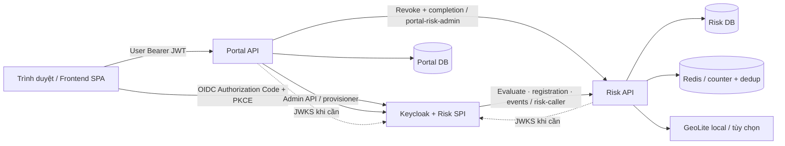
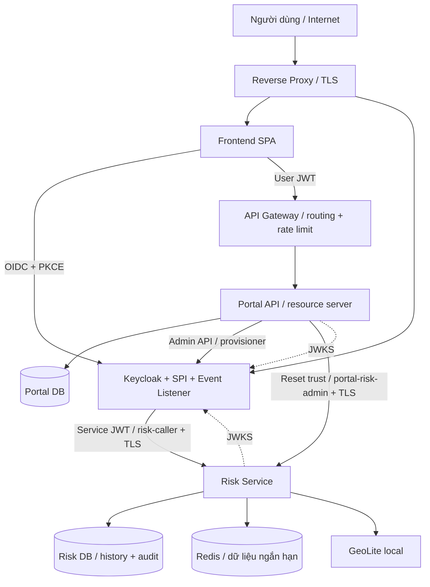
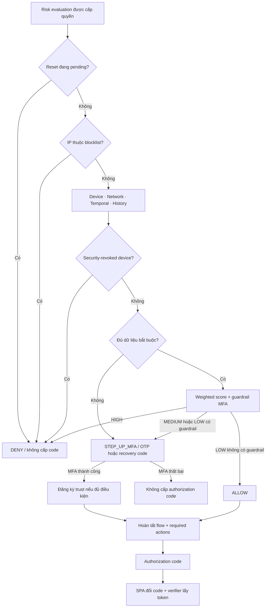

# Kiến trúc ZeroTrust Portal

**Trạng thái quyết định:** Kiến trúc đích đã chấp nhận (Accepted).

**Ngày đối chiếu source:** 2026-10-27. Teacher/schedule được bổ sung trong commit `894e7fc`; source và legacy-data Docker integration đã hợp nhất trong `7ffe0be`. [Legacy integration](docs/operations/LEGACY_INTEGRATION.md) mô tả cấu hình hiện tại; [kiến trúc Development/Demo](docs/architecture/SYSTEM.md) là cấu hình synthetic riêng. Các quyết định bảo mật bên dưới giữ nguyên; kết quả runtime phải được đọc theo ngày và môi trường kiểm chứng.

**Phạm vi:** Trách nhiệm dịch vụ, hiện trạng repository và các quyết định còn mở.

## 1. Mục đích và cách đọc

Hệ thống quản lý học vụ và xác thực thích ứng theo rủi ro đăng nhập. Keycloak
kiểm tra mật khẩu/MFA và phát token; Risk Service đánh giá ngữ cảnh đăng nhập;
Portal API kiểm tra quyền khi đọc/sửa hồ sơ và điểm.

Ranh giới dịch vụ và ba quyết định `ALLOW`, `STEP_UP_MFA`, `DENY` đã chốt.
Policy số, công thức chính thức, trọng số và ngưỡng chưa được phê duyệt hoặc
hiệu chỉnh bằng dữ liệu thực nghiệm. Cấu hình development không thay quyết định này.

| Trạng thái tài liệu | Ý nghĩa |
|---|---|
| Kiến trúc đích đã chốt | Trách nhiệm/ràng buộc cần giữ khi hoàn thiện |
| Đã có trong mã | Có class/config/migration, kể cả thay đổi chưa commit |
| Đã kiểm chứng theo ngày | Có kết quả thực chạy tại ngày và môi trường ghi nhận |
| Chưa triển khai/chưa kiểm chứng | Thiếu implementation hoặc bằng chứng runtime |
| Đề xuất | Phương án chưa chấp thuận, không phải hành vi hiện tại |

Đọc class theo [CODE_FLOW_WALKTHROUGH](docs/development/CODE_FLOW_WALKTHROUGH.md).
Chạy local theo [LOCAL_SETUP](docs/operations/LOCAL_SETUP.md). Mục lục ở [docs](docs/README.md).

## 2. Thành phần và phiên bản

| Thành phần | Trách nhiệm và nguồn |
|---|---|
| Frontend SPA | OIDC + PKCE, UI admin/sinh viên/giảng viên; [PortalRoute](frontend/components/portal-route.tsx), [package.json](frontend/package.json) |
| Portal API | Java 17, Spring Boot 3.5.7, resource server và học vụ; [POM](pom.xml), [SecurityConfig](src/main/java/com/zerotrust/zerotrust/config/SecurityConfig.java) |
| Keycloak SPI | Java 17, Keycloak 26.7.0, chạy trong Keycloak; [POM](keycloak-risk-extension/pom.xml) |
| Risk Service | Java 17, Spring Boot 3.5.7, scoring/history/device trust; [POM](risk-scoring-service/pom.xml) |
| Portal DB | Người dùng, sinh viên, lớp, môn, điểm, giảng viên, phân công và lịch; [entity](src/main/java/com/zerotrust/zerotrust/entity/) |
| Risk DB | Thiết bị, event thành công, generation, audit revoke; [Flyway V1–V5](risk-scoring-service/src/main/resources/db/migration/) |
| Redis Risk | Counter thất bại và marker chống trùng; [failure store](risk-scoring-service/src/main/java/com/zerotrust/risk/repository/RedisAuthenticationFailureStore.java) |
| GeoLite local | City/ASN `.mmdb` tùy chọn; [provider](risk-scoring-service/src/main/java/com/zerotrust/risk/service/MaxMindGeoIpProvider.java) |

Bốn POM độc lập (Portal, Risk, SPI, Gateway), wrapper gốc dùng `-f`; không có parent reactor chung.
Portal dùng Keycloak admin-client **26.0.11**, khác phiên bản SPI **26.7.0**.
Frontend dùng Next.js/React/TypeScript. Candidate Development/Demo dùng scripts Next và standalone Docker build.

## 3. Sơ đồ hiện trạng trong mã

Sơ đồ biểu diễn đường gọi, không xác nhận các tiến trình đang chạy.
[compose.yaml](compose.yaml) trong candidate Development/Demo dựng đủ7 dịch vụ, cùng init/migration jobs. Xem [SYSTEM](docs/architecture/SYSTEM.md) cho Gateway và topology runtime; các khẳng định khảo sát trước packaging trong mục này là mốc lịch sử. SPI không kết nối trực tiếp Risk DB/Redis.
Portal gọi Risk khi reset MFA, không gọi Risk mỗi lần xem điểm.

## 4. Kiến trúc đích đã chốt

Reverse Proxy là điểm vào, xử lý TLS và chuyển tiếp header theo cấu hình tin cậy.
API Gateway định tuyến và rate limit Portal. Repository chưa có manifest chứng
minh deployment đầy đủ hai thành phần này. TLS/mạng riêng, secret manager,
retention và giám sát production phải được xác nhận riêng; profile `prod` không
tự dựng hạ tầng đó.

## 5. Đăng nhập mới và quyết định Risk

1. SPA chuyển browser sang Keycloak bằng Authorization Code Flow + PKCE S256.
2. Keycloak kiểm tra mật khẩu. Sai credential bị từ chối; event gửi Risk bổ sung
   lịch sử, không quyết định password và không làm login thành công.
3. `RiskAuthenticator` thu subject/session/client/IP/User-Agent/device ID;
   dùng service token gọi evaluation API.
4. Risk kiểm tra JWT/caller/role, validation request và reset pending.
5. IP blocklist chạy trước feature extraction; sau đó nhận diện device và lấy
   network, temporal, history. Security revoke thắng mọi scoring.
6. Dữ liệu bắt buộc thiếu tạo `INCOMPLETE` và MFA. Khi đủ dữ liệu, weighted score
   được xét cùng guardrail bắt buộc MFA.
7. SPI áp quyết định: ALLOW hoàn tất execution Risk; STEP_UP mở subflow MFA;
   DENY dừng login. `context.success()` chưa chứng minh cả login đã hoàn tất.
8. Sau MFA thật, registration đủ điều kiện gửi generation về Risk. API 204 mới
   cho phép phát cookie device. `CONFIGURE_TOTP` còn pending khiến bước này bỏ
   qua; enrollment chưa chứng minh MFA đã hoàn tất.
9. Khi cả flow và required actions thành công, Keycloak trả authorization code;
   SPA đổi code cùng PKCE verifier lấy token. LOGIN event gửi độc lập để lưu history.

Nguồn: [controller](risk-scoring-service/src/main/java/com/zerotrust/risk/controller/RiskEvaluationController.java),
[pipeline](risk-scoring-service/src/main/java/com/zerotrust/risk/service/RiskEvaluationService.java),
[extractor](risk-scoring-service/src/main/java/com/zerotrust/risk/feature/DatabaseBackedRiskFeatureExtractor.java),
[decision handler](keycloak-risk-extension/src/main/java/com/zerotrust/keycloak/risk/policy/RiskDecisionHandler.java).
Sơ đồ giả định Browser Flow thật có đúng thứ tự execution. Code provider không
chứng minh realm đã bind flow đó. SSO/refresh có thể không chạy Risk.
Lỗi ghi event không đổi auth result. Lỗi registration sau MFA không phát cookie
mới nhưng cho flow tiếp tục.

## 6. Danh tính và ranh giới tin cậy

| Client | Nơi dùng |
|---|---|
| `zerotrust-spa` | Public client, không secret; user token gọi Portal, audience `zerotrust-api` |
| `zerotrust-provisioner` | Portal gọi Keycloak Admin API để quản lý user |
| `zerotrust-risk-caller` | SPI/listener gọi Risk với `risk:evaluate`, `risk:device:write`, `risk:events:write` |
| `zerotrust-portal-risk-admin` | Portal revoke/completion với `risk:device:revoke`; secret/service account riêng |
| `zerotrust-risk-api` | Resource/audience chứa bốn client role Risk, không phải caller |

Risk kiểm tra chữ ký/JWKS, issuer, `exp`, `nbf`, audience, `azp` và role theo endpoint.
Realm role hoặc role của client khác không cấp quyền Risk.
Portal kiểm tra user JWT, realm role và quyền sở hữu: STUDENT đọc dữ liệu của
mình theo `sub`; TEACHER chỉ đọc/sửa điểm trong phân công lớp/môn thuộc mình;
ADMIN quản lý học vụ. [TeacherAcademicService](src/main/java/com/zerotrust/zerotrust/service/impl/TeacherAcademicService.java)
kiểm tra tài khoản, trạng thái và ownership ở backend. UI ẩn nút không thay quyền backend.
Source đã có Teacher/schedule; dữ liệu legacy chưa có role TEACHER/hồ sơ/phân công thực tế,
nên positive Teacher acceptance trên legacy vẫn chưa được kiểm chứng.
Chi tiết: [RISK_API_SECURITY](docs/security/RISK_API_SECURITY.md).

`ClientConnection.getRemoteAddr()` phụ thuộc proxy tin cậy của Keycloak.
Chuẩn hóa cách viết IP trong Risk ngăn lệch blocklist/counter, không xác nhận
nguồn IP là thật và không thay việc chặn forwarded header giả.

## 7. Dữ liệu, trust và reset MFA

Portal DB lưu hồ sơ/điểm, không lưu password. Keycloak sở hữu credential MFA.
Risk DB lưu HMAC thiết bị gắn subject, event thành công, generation và audit
revoke. Redis lưu HMAC counter/marker với TTL. HMAC là giả danh hóa dữ liệu,
không có nghĩa dữ liệu đã ẩn danh hoàn toàn. Xem [DATA_PRIVACY](docs/security/DATA_PRIVACY.md).

Trạng thái lưu device là PENDING/TRUSTED/REVOKED. Nhận diện thêm MISSING/NEW/
REAUTHENTICATION_REQUIRED. TRUSTED hết hiệu lực sau 30 ngày từ `trusted_at`;
MFA registration tiếp theo có thể cập nhật mốc này. Cookie 30 ngày và trust
server là hai cơ chế khác nhau. Security revoke dẫn DENY; MFA-reset revoke yêu
cầu MFA và ID mới khi reset hoàn tất.

Reset admin theo thứ tự **Risk revoke → Keycloak reset → Risk completion**.
Risk tăng generation/đặt pending trước khi xóa MFA cũ. Registration khóa cùng
subject và kiểm tra generation để login cũ không phục hồi trust. Không có
transaction chung giữa Risk DB, Portal và Keycloak; lỗi giữa các bước phải báo
partial/pending. Chi tiết/class: [MFA_RESET_LIFECYCLE](docs/authentication/MFA_RESET_LIFECYCLE.md).

## 8. Phần đã có và còn thiếu

| Nội dung | Hiện trạng |
|---|---|
| Weighted engine, priority deny, mandatory MFA | Có mã; policy số còn là baseline development |
| CIDR/GeoLite, Temporal Profile, failure history | Có calculator; Network provider mặc định tắt, Temporal có cold-start |
| Device trust, generation, reset orchestration | Có mã/test; provisioning và flow thật cần xác minh theo môi trường |
| Audit | Có `device_trust_revocations`; chưa lưu mọi evaluation/decision |
| Trust Score riêng, location history/impossible travel | Chưa triển khai; response có `riskScore`, không có `trustScore` |
| Redis cache hồ sơ, velocity/rate limiter riêng | Chưa có implementation tương ứng trong Risk |
| Retention/purge, giám sát/cảnh báo | Chưa hoàn thiện; cửa sổ query không tự xóa event cũ |
| Continuous authentication, thu hồi JWT tức thì | Chưa triển khai; không suy ra từ logout/reset trust |

Báo cáo có ngày tại [docs/reviews](docs/reviews/) là bằng chứng lịch sử, không
xác nhận runtime hôm nay. Test unit/MockMvc/H2 không chứng minh Browser Flow,
Redis Lua, MySQL hoặc TLS production. Mốc test xem [DEVELOPMENT_CHECKS](docs/development/DEVELOPMENT_CHECKS.md).

## 9. Quyết định còn mở và quy tắc thay đổi

Chưa chốt policy số/công thức chính thức, chuẩn hóa từng đặc trưng, trọng số,
ngưỡng LOW/MEDIUM/HIGH, Trust Score, tham số đầy đủ priority rules và cách hiệu
chỉnh theo dữ liệu/false positive. Ví dụ `30/25/15/30` hoặc ngưỡng
`0–29/30–69/70–100` không phải policy được phê duyệt.

Giữ các ràng buộc đã chốt:

- Không gộp Risk vào Portal; không đặt scoring trong controller/SPI.
- Keycloak sở hữu password/MFA/token; Portal là resource server stateless,
  không chuyển sang password store hoặc cookie session riêng.
- Portal DB/Risk DB là hai miền dữ liệu; SPI không truy cập Risk DB trực tiếp.
- Không lưu token vào browser storage lâu dài hoặc secret trong `NEXT_PUBLIC_*`.
- Không dùng provisioner/SPA/user token làm Risk caller; revoke dùng danh tính riêng.
- Không bỏ Reverse Proxy/API Gateway hoặc JWT/JWKS trong kiến trúc đích.
- Không tự chọn policy số chính thức, thay weighted scoring bằng ML hoặc đổi
  ranh giới dịch vụ khi chưa được chủ đồ án chấp thuận.
- STUDENT chỉ xem điểm/lịch của mình; TEACHER chỉ quản lý điểm của lớp/môn được
  phân công; ADMIN quản lý học vụ. Mô hình hiện có gắn giảng viên với lớp sinh viên
  và môn học qua teaching assignment; chưa phải hệ thống đăng ký lớp học phần/enrollment.

Đề xuất phải nêu vấn đề, phương án, đánh đổi, tác động và kế hoạch kiểm chứng;
được chủ đồ án chấp thuận rồi cập nhật tài liệu trước hoặc cùng code.
Quyết định mới có tác động kiến trúc được ghi ADR Proposed tới khi có chấp thuận.
Lần cập nhật này diễn giải hiện trạng và quyết định có từ trước, không ban hành
policy số hoặc quyết định kiến trúc mới.
