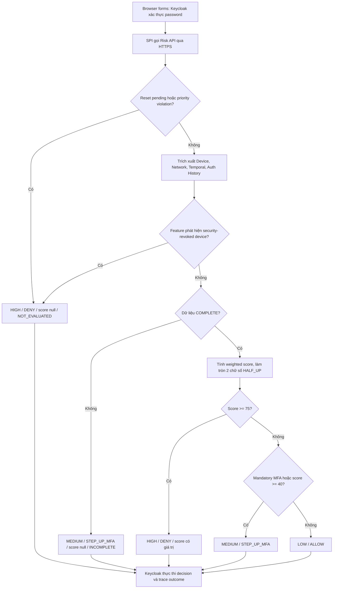

# Trust Score — phân tích baseline và thiết kế thực nghiệm

Khởi tạo 28/10/2026, checkpoint/preflight29/10 và nghiệm thu/cleanup A5–A6 ngày30/10/2026, Asia/Saigon. **B1 đã được duyệt triển khai và kiểm thử source;
source đã hoàn thành, chưa deploy Docker.** Tiến độ sau phê duyệt ở mục13.

Canonical: `C:\Users\DELL\Documents\zerotrust\zerotrust`, branch
`zerotrust-v4-risk-scoring`. HEAD khi nghiên cứu:
`917aeebdb672d04984c4eccc98fc57c5144df943` — commit local Risk Trace/UI;
đây là HEAD lịch sử khi nghiên cứu. B1 đã commit local thành
`40fea6a455a9a43eb9d68bcf86b884fbd23e97cd` sau phê duyệt (mục16);
B0 tiếp tục là mặc định và runtime. A5 PASS ở17.4, A6 PASS/cleanup ở18.5–18.6.

**Ứng viên được duyệt nghiên cứu/triển khai source:** giữ bốn nhóm tín hiệu,
làm mịn Temporal/Authentication History bằng các mốc baseline đã có, thể hiện
Trust Score cùng độ đầy đủ dữ liệu và nguồn quyết định. Giữ trọng số 25% và
ngưỡng 40/75 làm đối chứng ban đầu, chưa coi chúng là tối ưu. Không dùng ML
hoặc một phép đổi tên Risk thành Trust để tuyên bố đóng góp nghiên cứu mới.

9 kiểm tra nghiên cứu offline ban đầu đã PASS qua hai lượt chạy có chọn lọc; A5 = 50.00
và A6 = 75.00 được chứng minh ở pipeline Java với đầu vào kiểm soát. **A5 Browser
trên B0 đã PASS với score50.00 (mục17.4); A6 Browser B0 đã PASS với score82.50
(mục18.5), đều là thực nghiệm controlled fixture đã cleanup.** So sánh tổng hợp cho thấy ứng viên có cả tăng
và giảm mức bảo vệ; chưa có dữ liệu gắn nhãn độc lập để kết luận tốt hơn. Sau duyệt,
76 kiểm tra Risk và26 SPI khác nhau đã PASS qua các lượt mục tiêu; paired replay
B0/B1 production với4.500 cặp đầu vào khớp oracle phân số chính xác (mục13).

**Khuyến nghị sau đánh giá 29/10: giữ B0 trên runtime, tiếp tục B1 offline.**
Đã giải thích đủ42 ca DENY→MFA: Temporal giảm, guard MFA vẫn giữ, không có priority
trong các ca này. Có1 ca MFA→ALLOW không guard cũng cần xem xét. B1 giảm một số
bước nhảy điểm nhưng chưa chứng minh ổn định quyết định hoặc phát hiện tấn công
tốt hơn. Kết quả mới, bộ dữ liệu có nhãn và kế hoạch Browser nằm ở mục14.
Checkpoint Git và read-only preflight trước phê duyệt ở mục15; commit local đã
thực hiện ở16, actual Browser A5/A6 và cleanup ở17–18. Checkpoint/push branch đã
được duyệt cùng hai báo cáo ngày30/10 (mục19); **B1 vẫn chưa deploy**.

## 1. Phạm vi, bằng chứng và trạng thái

Các loại kết luận trong tài liệu:

- **SOURCE:** hành vi đọc được trong mã/cấu hình; không tự chứng minh vận hành.
- **THỰC NGHIỆM OFFLINE:** calculator/pipeline thật với I/O tổng hợp trong bộ nhớ.
- **BROWSER ĐÃ NGHIỆM THU:** tái sử dụng bằng chứng có sẵn, không thử lại.
- **ĐỀ XUẤT/GIẢ THUYẾT:** chưa triển khai, cần dữ liệu và phê duyệt.

| Hạng mục | Trạng thái và phạm vi |
|---|---|
| Baseline source và cấu hình số đang chạy | PASS — đối chiếu JAR, cấu hình mount, environment và JVM arguments chỉ đọc |
| A1 LOW/ALLOW, A2 trusted relogin, A3 mandatory MFA, A4 priority DENY, cold-start MFA | PASS theo [nghiệm thu hiện có](ADAPTIVE_AUTH_ACCEPTANCE_REPORT.md); không chạy lại |
| RBAC/ownership | PASS 21/21 đã thực thi; giữ nguyên giới hạn của báo cáo cũ |
| A5 scored MEDIUM, A6 scored HIGH offline | PASS — component integration, không Spring/HTTP/DB/Redis thật |
| A5 scored MEDIUM Browser B0 | PASS — thực nghiệm có owned history/counter fixture, actual score50.00/COMPLETE, OTP và session (mục17.4); không phải B1 Browser |
| A6 scored HIGH Browser B0 | PASS — actual82.50/COMPLETE/HIGH/DENY, không priority, ACCESS_DENIED, không session mới/token exchange quan sát được (18.5) |
| Risk unavailable Browser; B1 Browser | NOT VERIFIED — không ngắt service hoặc deploy B1 |
| B1 tốt hơn về phát hiện tấn công/giảm MFA hợp lệ | NOT VERIFIED — thiếu ground truth, chưa có đánh giá held-out |
| Source B1 sau phê duyệt | PASS trong phạm vi test ở mục13; chưa chứng minh hiệu quả thực tế tốt hơn |
| Commit/deployment mô hình mới | B1 commit local PASS sau duyệt (mục16); chưa push hoặc deploy; Docker vẫn B0 |

Đọc thêm [kiến trúc](ARCHITECTURE.md), [login](docs/authentication/LOGIN_FLOW.md),
[lifecycle](docs/authentication/MFA_RESET_LIFECYCLE.md),
[API security](docs/security/RISK_API_SECURITY.md),
[consolidation/TLS](ZEROTRUST_FINAL_CONSOLIDATION_REPORT.md).
Kiến trúc đã chốt ranh giới thành phần; công thức/trọng số/ngưỡng chính thức còn mở.

## 2. Baseline thực tế — SOURCE và readback runtime

### 2.1 Pipeline và thứ tự quyết định



Sơ đồ tóm tắt mã hiện có, không phải kiến trúc mới. Priority blocked-IP được
kiểm tra trước extractor; security-revoked device được trả trong extraction rồi
được xử lý trước incomplete/mandatory. Extractor vẫn có thể đọc các feature khác
trước khi trả kết quả. SSO cookie có thể bỏ forms; refresh không chạy Browser Flow.
Risk unavailable là lỗi gọi service và được SPI áp dụng failureMode DENY hiện có,
**không phải** một Risk Evaluation HIGH hợp lệ. Mermaid được kiểm tra cú pháp đọc,
chưa render bằng renderer độc lập trong nhiệm vụ này.

Nguồn:
[controller/reset gate](risk-scoring-service/src/main/java/com/zerotrust/risk/controller/RiskEvaluationController.java),
[pipeline](risk-scoring-service/src/main/java/com/zerotrust/risk/service/RiskEvaluationService.java),
[extractor](risk-scoring-service/src/main/java/com/zerotrust/risk/feature/DatabaseBackedRiskFeatureExtractor.java),
[scorer](risk-scoring-service/src/main/java/com/zerotrust/risk/service/RiskScoringService.java).

### 2.2 Công thức và cấu hình đã xác minh

Với dữ liệu COMPLETE, các giá trị feature thuộc [0,100]:

`R0 = round_HALF_UP_2(0.25 D + 0.25 N + 0.25 T + 0.25 H)`.

- `R0 < 40`: LOW/ALLOW nếu không mandatory.
- `40 <= R0 < 75`: MEDIUM/STEP_UP_MFA.
- `R0 >= 75`: HIGH/DENY, kể cả khi đồng thời có mandatory MFA.
- Mandatory có thể nâng **effective level** lên MEDIUM trong khi score <40.
- Incomplete/cold-start: score null, MFA; priority: score null, DENY.

Readback 28/10: image Risk
`sha256:167274d5b40404e0bb47d763c2e322d5a8ae3c8d2722691d661f66419f2e60ee`;
JAR chạy khớp JAR đã lưu, SHA-256
`e61dbf620633f958ac5d8c1b79e5cfb2f45f9a54561185f7b4fae8961c771b57`.
Đọc JAR properties + cấu hình mount + env + JVM arguments xác nhận các giá trị số
khớp readback trước đó: 4 trọng số 0.25, ngưỡng 40/75, các mốc ở bảng bên dưới.
Không có `SPRING_APPLICATION_JSON`, override `-Drisk.*` trong JVM arguments hoặc
override Risk trên command line được quan sát. Không gọi evaluate API để làm việc này.
Runtime canonical vẫn có 10 container healthy ở lần đọc trạng thái; không recreate.

Mặc định source đặt network/GeoIP disabled; **runtime canonical bật cả hai**.
Có 2 trusted CIDR, 1 elevated CIDR, 1 high CIDR; country policy lists và blocked-IP
list rỗng theo readback hiện có. City/ASN MMDB đã được kiểm tra đọc được ở nghiệm thu
trước. Không công khai địa chỉ mạng hoặc dữ liệu người dùng.

Nguồn số:
[application.properties](risk-scoring-service/src/main/resources/application.properties),
[validation policy](risk-scoring-service/src/main/java/com/zerotrust/risk/config/RiskPolicyProperties.java).
Các comment `TBD/development-only` và [ARCHITECTURE](ARCHITECTURE.md) không cung cấp
bằng chứng hiệu chỉnh tối ưu. **25% là đối chứng đơn giản; chưa tìm thấy cơ sở thực
nghiệm trong source để coi đây là mức quan trọng thực tế bằng nhau.**

### 2.3 Feature, đầu vào, chuẩn hóa và guard

| Nhóm | Tín hiệu thực sự dùng | Điểm baseline | Điều kiện/giới hạn |
|---|---|---|---|
| Device D | Cookie identifier → HMAC theo subject/device → trạng thái DB và `trustedAt` | MISSING 80; NEW 60; PENDING 50; TRUSTED 0; EXPIRED/MFA_RESET reauthentication 60; security REVOKED 100 | Mọi trạng thái ngoài TRUSTED có mandatory MFA hoặc priority DENY. HMAC không phải nhận dạng vật lý thiết bị |
| Network N | Remote address tại Keycloak; CIDR hoặc country từ MMDB local | TRUSTED 0; ELEVATED/default 50; HIGH 100 | Precedence high > elevated > trusted; HIGH network bắt buộc MFA. Public IP ngoài CIDR mới tra GeoIP khi bật; private/loopback dùng default |
| Temporal T | Tần suất weekday và hour gần giờ hiện tại trong lịch sử thành công của subject+client | Cả hai bình thường 0; một bất thường 50; cả hai 100 | 90 ngày, tối đa 200 event, tối thiểu 5; UTC; hour cyclic ±1; bất thường nếu day frequency <0.10 hoặc hour frequency <0.20 |
| Auth History H | Số thất bại theo subject và source IP trong Redis | Subject <3:0, 3–4:50, >=5:100; IP <10:0, 10–19:50, >=20:100; lấy max hai điểm | Mức high của một counter bắt buộc MFA; max tránh cộng hai lần cùng failure. Không phải mô hình xác suất tấn công |

Nguồn:
[DeviceRecognitionService](risk-scoring-service/src/main/java/com/zerotrust/risk/service/DeviceRecognitionService.java),
[NetworkRiskCalculator](risk-scoring-service/src/main/java/com/zerotrust/risk/service/NetworkRiskCalculator.java),
[TemporalRiskCalculator](risk-scoring-service/src/main/java/com/zerotrust/risk/service/TemporalRiskCalculator.java),
[AuthenticationHistoryRiskCalculator](risk-scoring-service/src/main/java/com/zerotrust/risk/service/AuthenticationHistoryRiskCalculator.java).

Chi tiết ảnh hưởng nghiên cứu:

- Redis failure window 15 phút là **TTL từ lần INCR đầu tiên khi count=1**,
  không phải sliding window chính xác của 15 phút gần nhất. Event dedup TTL 1 giờ.
  Counter hết hạn có thể làm H giảm đột ngột; không coi đây là thay đổi danh tính.
  [Redis store](risk-scoring-service/src/main/java/com/zerotrust/risk/repository/RedisAuthenticationFailureStore.java).
- Listener chỉ gửi LOGIN_ERROR thuộc INVALID_USER_CREDENTIALS/USER_NOT_FOUND;
  failure không có user ID chỉ đóng góp IP. Risk-denied không tự tăng failure count.
  LOGIN thành công gồm cả đường SSO có thể được ghi; REFRESH_TOKEN không được ghi
  vào success history. Event hiện chưa mang provenance interactive/MFA.
  [RiskEventListener](keycloak-risk-extension/src/main/java/com/zerotrust/keycloak/risk/listener/RiskEventListener.java),
  [success contract](risk-scoring-service/src/main/java/com/zerotrust/risk/dto/request/AuthenticationSuccessRequest.java).
- Temporal đếm từng event, không đếm số ngày độc lập; 5 SSO login gần nhau không
  tương đương 5 ngày quan sát. Frequency day/hour là hai marginal, chưa mô hình
  joint weekday-hour. UTC nhất quán trong tính toán, nhưng diễn giải ngày/giờ
  theo Việt Nam phải đổi múi giờ; cần chú ý quanh nửa đêm.
- ASN/city/timezone/accuracy radius được provider đọc như metadata; calculator
  hiện **không dùng ASN, khoảng cách địa lý hoặc impossible travel để tính điểm**.
  UA được chuyển trong request nhưng không được bốn calculator dùng để chấm điểm.
  Không mô tả các tín hiệu này là feature đã triển khai.
- MISSING device là **đã quan sát thấy thiếu identifier**, vẫn có điểm 80 và guard;
  không đồng nghĩa feature data unavailable. Redis key không tồn tại được đọc là 0;
  không tự phân biệt được thực sự chưa có failure với mất lịch sử trước đó.

### 2.4 Trusted Device và chất lượng dữ liệu

Trust được đăng ký sau MFA thực, evaluation eligible, generation hợp lệ, Risk trả
204; cookie không phải password hoặc bằng chứng MFA mới. Server trust hết hạn sau
30 ngày từ `trustedAt`; recognition không tự gia hạn theo mọi login. Security revoke
DENY khác MFA_RESET/expired yêu cầu reauthentication. Không tăng điểm tin cậy sau
mỗi ALLOW hoặc sau SSO refresh.

SPI lấy IP từ `getRemoteAddr()` của kết nối Keycloak, không lấy một header client
tùy ý trong extractor. Docker NAT/proxy có thể khiến nhiều người chung một địa chỉ.
Khi đó network và IP failure count là tín hiệu của đường mạng dùng chung; không
chứng minh IP máy người dùng hoặc vị trí thực. Đổi mạng Wi-Fi có thể không đổi N
trong canonical localhost. Không sửa trusted-proxy/header handling trong nghiên cứu.
GeoIP private address dùng default, lookup lỗi trên public IP tạo INCOMPLETE;
AVAILABLE/default không đồng nghĩa có tình báo mạng chất lượng cao.

Cookie bị xóa tạo new/missing và MFA; cookie bị đánh cắp vẫn là rủi ro còn lại.
HMAC bảo vệ giá trị lưu, không ngăn kẻ tấn công sử dụng cookie đã lấy được.
History có thể bị lệch bởi SSO, hoạt động lặp lại, lịch học thay đổi, timezone và
profile poisoning. DB/Redis lỗi, TTL, event delivery thất bại hoặc MMDB cũ cũng
ảnh hưởng feature. Không gán thay đổi score A1→A2 chỉ cho trust: A2 đã mất reason
TEMPORAL_RISK, nên chưa tách được tác động nhân quả của từng feature.

## 3. Ưu điểm, giới hạn và khả năng đạt ngưỡng

Ưu điểm: mô hình cộng tuyến tính dễ kiểm tra; BigDecimal/rounding rõ; guard độc lập;
missingness không mặc nhiên ALLOW; lifecycle trust có revoke/generation; trace
liên kết evaluation với enforcement, OTP và LOGIN_SUCCESS. Hạ tầng hiện có đủ
cho prototype, chưa cần broker hoặc nền tảng observability mới.

Giới hạn: điểm là mức rủi ro quy ước, không phải xác suất; các band thô gây bước
nhảy; equal weights chưa hiệu chỉnh; các feature có tương quan; lịch sử mỏng;
chất lượng IP thấp khi NAT; trace chưa có contribution từng feature/model version/
duration. Không có ground truth tấn công để suy hiệu quả phát hiện.

**SOURCE + OFFLINE — reachability quan trọng:** nếu không priority, không mandatory
và COMPLETE thì D=0 (TRUSTED), N tối đa50, H tối đa50, T tối đa100. Vì vậy
`R0_max = (0+50+100+50)/4 = 50`.

- MEDIUM không guard có thể đạt: `[D,N,T,H]=[0,50,100,50]`, score50.
- HIGH >=75 **không thể** đạt mà đồng thời không có bất kỳ mandatory signal nào
  trong các miền baseline này. Đây là thuộc tính cấu trúc, không phải lỗi cần
  nới policy để sửa.
- Score-driven HIGH vẫn có thể chứng minh: `[0,100,100,100]` →75, COMPLETE,
  không priority. Mandatory chỉ là mức bảo vệ tối thiểu MFA; **không tạo DENY**.
  Bỏ wrapper mandatory trong phép kiểm chứng offline vẫn HIGH/DENY.
- Không có biến thể đầu vào trích xuất nào cho unguarded score40 hay74.99 trong
  lưới band hiện tại; test arithmetic liên tục và test miền feature phải tách nhau.

## 4. Cơ sở lý thuyết và mức áp dụng

Các nguồn đã tra cứu 28/10/2026. Phần dưới là diễn giải, không trích dài nguyên văn.

| Nguồn sơ cấp | Nội dung có thể dựa vào | Không được suy ra |
|---|---|---|
| [NIST SP 800-207 (2020), §2.1, §3.3–3.3.1](https://nvlpubs.nist.gov/nistpubs/specialpublications/NIST.SP.800-207.pdf) | Chính sách động; trust algorithm dùng nhiều nguồn; phân biệt criteria/score và singular/contextual; trọng số do tổ chức cấu hình | Không quy định bốn feature, trọng số25%, thang100 hoặc ngưỡng40/75 |
| [NIST SP 800-63B-4, bản final July2025, §3.2.2, §3.2.5, §5.3](https://nvlpubs.nist.gov/nistpubs/SpecialPublications/NIST.SP.800-63B-4.pdf) | Adaptive techniques hỗ trợ giảm rủi ro; session monitoring là MAY, có yêu cầu đánh giá privacy khi dùng; OTP nhập tay không phishing-resistant | Risk Score/cookie không thay thế yêu cầu authenticator/AAL; prototype này chưa được chứng nhận AAL2 hoặc continuous authentication |
| [OWASP Authentication Cheat Sheet, Adaptive/Risk Based và Reauthentication](https://cheatsheetseries.owasp.org/cheatsheets/Authentication_Cheat_Sheet.html#adaptive-or-risk-based-authentication) | Điều chỉnh yêu cầu theo ngữ cảnh; device/IP/cookie là tín hiệu; cần xử lý độ chính xác và dữ liệu thiếu | Không phải tiêu chuẩn quy định công thức hoặc bộ ngưỡng tối ưu |
| [Freeman et al., NDSS2016, Who Are You?](https://www.ndss-symposium.org/wp-content/uploads/2017/09/who-are-you-statistical-approach-measuring-user-authenticity.pdf) | Mô hình thống kê so lịch sử người dùng/toàn cục; nghiên cứu có dữ liệu login và mô phỏng attacker | Không thể mượn hiệu quả của LinkedIn cho dữ liệu nhỏ của Portal |
| [Wiefling, Dürmuth, Lo Iacono, FC2021, What's in Score](https://arxiv.org/html/2101.10681v1) | Nghiên cứu780 người/1.8năm; feature/configuration cần phù hợp dịch vụ; dùng equal weights để so sánh, không tuyên bố tối ưu | Bốn feature của dự án không giống bộ feature nghiên cứu; không sao chép trọng số giữa dataset |
| [Wiefling et al., TOPS2023, Pump Up Password Security](https://arxiv.org/abs/2206.15139) | Nghiên cứu31.3triệu login; nhấn mạnh cấu hình và cân bằng security/usability/privacy; có dataset tổng hợp để tái hiện | Quy mô và kết quả không đại diện hệ thống localhost |

Phương án B1 dưới đây là **lựa chọn thiết kế riêng của prototype**, không phải công
thức được NIST/OWASP yêu cầu hoặc một bản tái triển khai của Freeman. Đóng góp dự
kiến là mô hình giải thích được, phân tách guard/missingness, công cụ thực nghiệm
và đánh giá có đối chứng trong hệ thống mã nguồn mở; không tuyên bố thuật toán
Trust mới có tính tổng quát khi chưa có bằng chứng.

Dataset ngoài chỉ là tùy chọn, chưa tải hay chạy trong nhiệm vụ này:
[repository tác giả das-group/rba-dataset](https://github.com/das-group/rba-dataset)
mô tả dữ liệu **synthesized**, có nhãn `Is Account Takeover`/`Is Attack IP` và các
đặc điểm sinh ngẫu nhiên. Không dùng `Login Successful` làm ground truth hợp lệ;
không xem `Is Attack IP` là nhãn chắc chắn cho từng cuộc tấn công. Dataset này
thiếu server-side trusted-device/MFA lifecycle tương đương dự án; không tự gán
các feature đó rồi tuyên bố đánh giá đầy đủ mô hình. Nếu dùng phải kiểm tra license,
nguồn nhãn, missingness và domain shift, báo riêng kết quả trên dữ liệu tổng hợp.

## 5. Đề xuất định nghĩa và công thức Trust Score B1

### 5.1 Ý nghĩa và quan hệ Risk–Trust

Trust Score là **chỉ số mức thuận lợi của ngữ cảnh đăng nhập tại một thời điểm**,
trong [0,100], cao nghĩa ít bằng chứng rủi ro theo các tín hiệu đã chọn.
Không phải xác suất đúng danh tính, uy tín lâu dài của con người, credential,
quyền truy cập hoặc Authentication Assurance Level.

Với dữ liệu đầy đủ, đặt:

`R1 = round_HALF_UP_2(sum_i w_i * x_i)`; `Trust = 100 - R1`.

Phép bù chỉ giúp hiển thị thang tin cậy, giữ thứ tự ngược với Risk; **không thêm
thông tin, khả năng phát hiện hoặc tính mới khoa học**. Phần cần kiểm chứng của
B1 là chuẩn hóa hành vi, chất lượng đầu vào, giải thích và đánh đổi quyết định.
Nên giữ Risk Score trên API quyết định hiện có; Trust là biểu diễn dẫn xuất cùng
metadata, tránh hai engine ra quyết định mâu thuẫn.

### 5.2 Chuẩn hóa đề xuất — giữ ít tham số

| Feature B1 | Công thức/miền | Cơ sở và điều cần kiểm chứng |
|---|---|---|
| D1 | Giữ mapping D0 và toàn bộ lifecycle/guard hiện có | Không tự thêm tuổi cookie hoặc cộng trust sau mỗi success; chưa có dữ liệu cho trọng số mới |
| N1 | Giữ mapping N0, kèm source CIDR/GEOIP/DEFAULT và quality flag | IP/country là policy signal; không biến ASN/UA thành feature khi chưa đánh giá |
| H1 | Hàm tuyến tính từng đoạn qua các mốc count0→0, medium→50, high→100; max(subject,IP) | Nội suy giữa các mốc baseline, tránh thêm hệ số tùy tiện; tăng phản ứng trước ngưỡng nhưng có thể tăng MFA hợp lệ |
| T1 | Trung bình mức thiếu hụt tần suất day/hour so với các mốc0.10/0.20 đã có | Giảm bước nhảy tại band; không giả định một chênh lệch nhỏ là rủi ro50. Đây là giả thuyết cần kiểm chứng |

Với failure count `n>=0`, mốc `0<m<h`:

`g(n;m,h) = 50*min(n/m,1) + 50*clip((n-m)/(h-m),0,1)`.

`H1 = max(g(n_subject;3,5), g(n_IP;10,20))`.

Với `p_day=matching_days/n_history`, `p_hour=matching_hours/n_history`, cùng
lookback, UTC, cyclic tolerance và minimum-events hiện có:

`d(p;tau)=clip(1-p/tau,0,1)`;
`T1 = 50*d(p_day;0.10) + 50*d(p_hour;0.20)`.

Do đó D1,N1,T1,H1 đều [0,100]. Không làm tròn từng feature trước tổng; dùng số học
decimal/rational được xác định khi triển khai, rồi làm tròn tổng giống baseline.
Prototype nghiên cứu ban đầu trong `TrustScoreResearchTests` dùng double cho B1,
BigDecimal cho tổng/rounding. Implementation source sau duyệt dùng BigDecimal
DECIMAL128 cho chia và giữ rounding tổng hiện có; kiểm chứng với oracle phân số
nguyên độc lập ở mục13. Không suy tính đúng trên mọi cấu hình từ một lưới hữu hạn.
Baseline luôn gọi chính BigDecimal scorer đang triển khai.

Không thêm Laplace smoothing, EWMA, decay hoặc learning weight ở bản đầu:
chúng thêm hyperparameter và khó đánh giá với lịch sử hiện có. Tần suất vẫn
ước lượng không ổn định ở n nhỏ; min5 được giữ để đối chứng, không được gọi là
đủ tin cậy thống kê. Thực nghiệm sẽ khảo sát n=5/10/20/50/200.

### 5.3 Trọng số, ngưỡng và guard

**Đề xuất nghiên cứu khởi đầu:** `w=(.25,.25,.25,.25)`, ngưỡng40/75, nhằm thay
một nhóm yếu tố tại một thời điểm và quy kết chênh lệch cho normalization.
Giữ bằng nhau là thiết kế đối chứng khi chưa có thông tin về mức quan trọng,
không phải chứng minh các feature độc lập hoặc quan trọng như nhau.
Các mốc normalization cũng chỉ kế thừa policy prototype, chưa được chuẩn hóa
bởi tiêu chuẩn hoặc dữ liệu người dùng.

Khi có dữ liệu và mục tiêu đánh đổi được duyệt, khảo sát trọng số theo grid
`w_i in {.15,.20,.25,.30,.35}`, tổng1; chỉ hiệu chỉnh trên calibration set.
Khảo sát ngưỡng MEDIUM35/40/45 và HIGH70/75/80 ở **offline**; không đổi runtime
hoặc chọn thông số theo test set. Không có nhãn/chi phí độc lập thì chỉ báo
sensitivity và giữ cấu hình đối chứng, không chọn bộ “tối ưu” bằng cảm tính.

Thứ tự bảo vệ giữ nguyên: priority DENY → incomplete MFA → score HIGH DENY →
mandatory MFA → scored MEDIUM MFA → ALLOW. B1 không giảm guard; high Trust không
được vượt priority, reset pending hoặc mandatory MFA. Tính threshold trên Risk
đã round trước, rồi đổi thang:

| Điều kiện số khi COMPLETE | Trust tương đương | Kết quả khi không có guard khác |
|---|---|---|
| R<40 | Trust>60 | ALLOW |
| 40<=R<75 | 25<Trust<=60 | STEP_UP_MFA |
| R>=75 | Trust<=25 | DENY |

Effective MEDIUM do guard không có nghĩa R>=40. Không tự tăng Trust vì OTP đã
hoàn tất; OTP outcome và việc đăng ký device là các sự kiện riêng, có thể làm
feature của **lần evaluation sau** thay đổi. Không diễn giải Trust như lý do
cho phép truy cập dữ liệu ngoài RBAC/ownership.

### 5.4 Thiếu dữ liệu và cập nhật lịch sử

Ghi `a_i=1` nếu feature tính được theo contract, 0 nếu unavailable/cold-start;
coverage `C=sum(w_i*a_i)` trong [0,1]. Đây là **độ phủ tính toán**, không phải xác
suất tin cậy. Device MISSING vẫn a_D=1; network default vẫn có thể a_N=1 nhưng
quality thấp vì NAT. Cần giữ provenance/quality riêng, không đánh đồng C=1 với
đầu vào tốt.

Nếu Risk trả evaluation hợp lệ INCOMPLETE do H/N/T thiếu hoặc cold-start:
Risk/Trust point estimate=null, policy MFA như hiện tại. Lỗi lookup device/DB
làm Risk không trả evaluation hợp lệ vẫn thuộc service failure và SPI failureMode
DENY; không chuyển lỗi đó thành MFA bằng metadata coverage. Không chia lại trọng
số của các feature còn lại và không điền 0.
Có thể hiển thị khoảng khả dĩ:

`L_R=sum_known(w_i*x_i)`; `U_R=L_R+100*sum_missing(w_i)`;
`Trust_interval=[100-U_R,100-L_R]`.

Đây là khoảng theo miền giá trị, **không phải confidence interval thống kê**;
chỉ để giải thích, không thay incomplete policy. Ví dụ phù hợp pipeline hiện có:
biết D=0,N=50 nhưng thiếu T/H, C=.50, Risk∈[12.5,62.5], Trust∈[37.5,87.5],
decision MFA. Ví dụ toán học chỉ biết N=50 cho C=.25 và khoảng[12.5,87.5] được
dùng trong test công thức; không dùng ví dụ này để biến lỗi Device DB thành MFA.
Priority/service failure không được gán điểm0 hoặc100 giả; giữ point null và
decision source riêng.

History tiếp tục cập nhật bằng event thành công đã xác minh, window và TTL
hiện có. Đề xuất cải thiện provenance ở bước riêng: event mang origin
`INTERACTIVE_RISK_EVALUATED`/`SSO_COOKIE`/`UNKNOWN` và MFA outcome quan sát được;
chỉ dùng lịch sử interactive phù hợp cho profile thử nghiệm. Không suy OTP
từ LOGIN_SUCCESS; không relabel event cũ. Cần đánh giá ablation riêng vì lọc SSO
có thể làm profile quay về cold-start/MFA nhiều hơn. Nếu cần lưu metadata thì
thiết kế migration additive sau duyệt, không migration trong nhiệm vụ này.

## 6. So sánh và lý do chọn ứng viên

| Tiêu chí | B0 baseline hiện chạy | B1 ứng viên nghiên cứu | Mô hình thống kê kiểu Freeman, chỉ cân nhắc |
|---|---|---|---|
| Tổng hợp | Weighted sum các band | Weighted sum, hai feature được nội suy | Tỷ lệ thống kê feature cá nhân/toàn cục, cần smoothing và dữ liệu |
| Tính giải thích | Nhóm reason, score tổng | Contribution, input band/frequency, quality, guard source | Giải thích bằng lịch sử/phân bố; triển khai/hiệu chỉnh phức tạp hơn |
| Dữ liệu cần | Ít nhưng profile vẫn cold-start | Không thêm loại dữ liệu cho core; cần đánh giá số lượng | Cần lịch sử đa người có chất lượng, xử lý unseen/sparsity |
| Thiếu dữ liệu | null/MFA | Giữ null/MFA, thêm coverage/khoảng khả dĩ | Không áp dụng khi chưa thiết kế missingness phù hợp |
| Guard và trust lifecycle | Đang nghiệm thu | Giữ nguyên | Chưa thiết kế cho lifecycle hiện tại |
| Hiệu quả đã chứng minh tại Portal | Enforcement A1–A4, không phải accuracy | Source/pipeline/HTTP trong test PASS; runtime và hiệu quả thực tế chưa kiểm chứng | Chưa triển khai, không dùng kết quả công bố làm kết quả của Portal |

Chọn **B1 để nghiên cứu tiếp**, vì tận dụng được calculator, pipeline, trace và
dữ liệu hiện có; ít tham số mới, giải thích/ablation dễ, khối lượng phù hợp 5 tháng.
Không chọn ML hay mô hình likelihood lớn khi chưa có nhãn và phân bố đủ tin cậy.
**Chưa chọn B1 để thay production.** Smoothing có thể giảm cảnh báo đúng: 19 ca
DENY→MFA trong slice tổng hợp bên dưới là tín hiệu bắt buộc xem xét, không phải
thành tích giảm false positive. Nếu không có bằng chứng an toàn hơn, giữ B0.

## 7. Kiểm chứng offline đã thực hiện

### 7.1 Công cụ và tính cô lập

Thêm duy nhất mã nghiên cứu:
[TrustScoreResearchTests](risk-scoring-service/src/test/java/com/zerotrust/risk/audit/TrustScoreResearchTests.java),
tái sử dụng [AuditRiskFixture](risk-scoring-service/src/test/java/com/zerotrust/risk/audit/AuditRiskFixture.java)
có sẵn. Device recognition, network/temporal/history calculators, extraction,
scoring và evaluation service là **mã production thật**; repository/failure store/
GeoIP cung cấp I/O trong bộ nhớ. Các repository không hỗ trợ write, thao tác
ngoài query dự kiến ném AssertionError. Không Spring context, socket, JWT, Docker
test service, MySQL hoặc Redis thật. Chưa chứng minh HTTP wiring/DB concurrency.

Lượt nghiên cứu ban đầu chưa sửa `src/main`, properties hoặc POM. Hàm B1 prototype
ở `src/test` được ghi rõ OFFLINE RESEARCH ONLY; không đóng gói thành application
code. Implementation `src/main` riêng sau duyệt ở mục13; không dùng hàm double
trong prototype làm production scoring.

Java17, từ canonical root:

```powershell
$env:JAVA_HOME='C:\Program Files\jdk-17.0.10'
$env:PATH="$env:JAVA_HOME\bin;$env:PATH"
.\mvnw.cmd --batch-mode --no-transfer-progress -f risk-scoring-service/pom.xml '-Dtest=TrustScoreResearchTests' test
```

Lượt đầu lúc16:02:43 chạy 8 test trước khi thêm slice chi tiết: **8/8 PASS**.
Lượt sau16:05:00 chỉ chạy test mới, không lặp8 test trước:

```powershell
.\mvnw.cmd --batch-mode --no-transfer-progress -f risk-scoring-service/pom.xml '-Dtest=TrustScoreResearchTests#granularBehaviorSliceMeasuresDifferencesWithoutClaimingAttackAccuracy' test
```

**1/1 PASS**, tổng9 test khác nhau; không gọi đây là một lần full-suite9/9.
Lệnh đầu ở source cuối là cách tái hiện toàn bộ9 test sau này, không phải lượt
đã chạy lại. Cảnh báo unavailable trong lượt đầu là lỗi I/O tổng hợp được inject;
không phải Redis/runtime bị lỗi. Compiler warning unchecked đã có ở diagnostic
test khác; không tắt assertion hoặc test. Không chạy lại64 SPI, A1–A4 hay21 RBAC.

### 7.2 Kết quả và cách đọc

| Kiểm tra | Kết quả thực nghiệm |
|---|---|
| Numeric defaults fixture so với source | PASS — weights/thresholds và các mốc feature chính khớp |
| A5 controlled pipeline | PASS — TRUSTED, N50,T100,H50 →50.00/MEDIUM/STEP_UP_MFA/COMPLETE, không mandatory/priority |
| A6 controlled pipeline | PASS — TRUSTED,N100,T100,H100 →75.00/HIGH/DENY/COMPLETE, không priority; scorer thuần cũng DENY; N50 counterfactual →62.50/MFA |
| Missingness | PASS —7 tổ hợp thiếu H/N/T đều null/INCOMPLETE/MFA; cùng7 tổ hợp với security-revoked vẫn null/NOT_EVALUATED/DENY |
| Arithmetic boundaries | PASS —39.99→ALLOW;40→MFA;74.99→MFA;75→DENY; raw39.995 và74.995 được round thành40/75 |
| B1 properties | PASS trong miền thử —bounded, monotonic, đúng các mốc; không bypass mandatory/priority; null không thành ALLOW |
| Khoảng missingness | PASS ví dụ known N50; chưa phải coverage metadata chạy live |

**Grid189**: 7 device states ×3 network ×3 temporal ×3 history bands. Có27 priority
DENY,21 numeric HIGH,130 STEP_UP_MFA,11 ALLOW. Tổng DENY48. Với12 tổ hợp không guard:
score chỉ {0,12.5,25,37.5,50}, 11 ALLOW/1MFA, không HIGH. B1 giống B0 tại các mốc
này,0 thay đổi quyết định; điều đó **không** chứng minh hai mô hình tương đương.

**Slice1.575**: D∈{TRUSTED,MISSING,SECURITY_REVOKED}; N∈{0,50,100}; history20
event trong90 ngày; day matches∈{0,1,2,3,20}; hour matches∈{0,3,4,5,20}; subject
failures0..6, IP failures0. Actual Temporal calculator tính B0 từ chính timestamps.

| Chỉ số trên slice tổng hợp | B0 | B1 |
|---|---:|---:|
| ALLOW | 242 | 234 |
| STEP_UP_MFA | 752 | 771 |
| DENY | 581 | 570 |

Có37/1.575 (2.35%) quyết định khác:9 ALLOW→MFA,1MFA→ALLOW,19DENY→MFA,8MFA→DENY.
525 priority cases đều giữ DENY. Trên1.050 ca có score, chênh lệch tuyệt đối trung
bình3.9694 điểm, lớn nhất15.62. Đây là **score difference**, không phải prediction
error. Không chuyển các tỷ lệ này thành tỷ lệ MFA/attack thực tế của người dùng.

Thuộc tính cục bộ: H0 bước nhảy tối đa50 khi tăng1 subject failure; H1 tối đa25
trên counts0..30. T1 tại p_day=.10,p_hour=.1999 là .025 thay vì T0=50; khi p_hour
đạt .20 thì T1=0. Điều này chỉ chứng minh giảm bước nhảy hàm, chưa chứng minh ổn
định quyết định trên dữ liệu người dùng. Window/TTL vẫn có thể gây nhảy score.

Output tái tạo dưới ignored `risk-scoring-service/target/research/`:

- `baseline-candidate-grid.csv`, SHA256 `72e98ddbba0428ecaa3f3e9b1484b3269e54e1ae986499b959467c09840c4e6c`.
- `granular-behavior-grid.csv`, SHA256 `691e7dcb4a402d4ff81de89c78242f9e5451081ff91b30b4d1eb9fc4d3287bc1`.
- `baseline-summary.json`, `granular-summary.json`; kết quả số đã ghi trong báo cáo này.
- `initial-eight-tests.xml`, `granular-one-test.xml` giữ hai lượt chạy riêng.

Tất cả dữ liệu grid là **SYNTHETIC_CONTROLLED_OFFLINE**, không có tài khoản/IP/
cookie/token thật. Không ghi generated outputs vào Git; source test tái hiện
được thí nghiệm. Thời gian Surefire là thời gian test, không dùng làm latency Risk.

## 8. Thiết kế bộ thực nghiệm tiếp theo

Mỗi record cần `experiment_id, scenario_id, data_kind, seed/fixture_version,
model_version, config_digest, repetition, evaluation_id, subject_tag,
feature_status/source, feature_scores, contribution, calculated_level,
effective_level, guard_codes, decision, dataStatus, duration, observed_outcome`.
Trong offline không tạo ID giống một evaluation Browser đã thực thi. Nhãn scenario
do thiết kế độc lập với điểm, không dùng score B0 sinh nhãn rồi đánh giá B0/B1.

### 8.1 Ma trận tối thiểu

| Nhóm | Biến kiểm soát | Dữ liệu/mức thử | Bằng chứng cần |
|---|---|---|---|
| Feature/device | Một tín hiệu mỗi lần | Trusted/new/missing/pending/expired/MFA_RESET/security-revoked | D, guard, generation; không làm thật trên account gốc |
| Feature/network | CIDR precedence và missingness | Trusted/elevated/default/high; public lookup available/not-found/error; private default | N, source, band, dataStatus; không giả header/IP Browser |
| Feature/time | Tần suất và sample size | Day/hour normal/unusual; n=0,4,5,10,20,50,200; cyclic23↔0 | Matching counts, T0/T1, cold-start, timezone |
| Feature/history | Subject/IP một biến và kết hợp | Subject0,2,3,4,5,6; IP0,9,10,19,20,21 | H0/H1, max không cộng đôi, guard; TTL boundary riêng |
| Decision | Tổng hợp COMPLETE | A5/A6 và LOW, mandatory <40 | Score, calculated vs effective level, decision source |
| Missing/priority | Availability mask và security violation | 7 missing masks; priority trước incomplete | null/MFA khác null/DENY, không zero-impute |
| Fail-safe | Lỗi client/timeout/invalid response | Unit HTTP client/handler cô lập khi cần thay liên quan | failureMode DENY, không đánh đồng với score HIGH; live chưa kiểm chứng |
| Ngưỡng | Numeric rounding | 39.99/40/74.99/75; thêm39.9949/39.995/74.9949/74.995 | Arithmetic vs reachable factors, dùng decimal oracle |
| Temporal/history bias | Provenance và poisoning | B0 all LOGIN vs chỉ interactive có provenance; lặp SSO, lệch lịch | Ablation riêng, không trộn hiệu ứng normalization |

Thực nghiệm factorial là kiểm tra độ phủ logic, không phải lấy mẫu phân bố dân
số. Lặp cùng vector deterministic không tạo thêm quan sát độc lập về accuracy.
Mở rộng offline có seed cố định; không cần environment mới.

### 8.2 A5 — scored MEDIUM

**Đã chứng minh offline:** device TRUSTED hợp lệ, N50, T100 (cả day/hour bất thường),
H50 (subject3 failures, IP dưới high), COMPLETE, không mandatory/priority →R50/MFA.

**Browser đề xuất, chưa thực hiện:** một subject thử độc lập đã qua MFA/register
với device thật, giữ cùng profile; đủ history chỉ thuộc subject/client thử để
T100; context mạng thật phải được Risk nhận là50; subject counter ở medium band
và không gây IP high/shared side effect. Password đúng, OTP nhập thủ công. Cần
trace R50/COMPLETE, không guard reason, OTP challenge/completion, LOGIN_SUCCESS.

Rủi ro: 3 failed logins có thể tác động brute-force policy và counter IP dùng
chung; event timestamps fixture cũng là thay đổi DB thật. **Không cho phép tự
thực hiện.** Nếu cần seed history/counter, phương án riêng phải ghi UUID/các row
và key được sở hữu, baseline, số lượng, TTL, cleanup guard và cách không ghi đè
counter chung. Shared IP không tách được thì không seed/xóa key IP gốc. Chưa có
isolation phù hợp thì giữ Browser NOT VERIFIED, không giảm threshold.

### 8.3 A6 — scored HIGH

**Đã chứng minh offline:** D0,N100,T100,H100 →R75/HIGH/DENY/COMPLETE, không priority.
Network/history high đồng thời mandatory; chúng không giải thích DENY khi score
chưa75. Counterfactual giữ D/T/H, đổi N100→50 cho62.5/MFA chứng minh vai trò ngưỡng.

**Browser đề xuất có điều kiện, chưa được duyệt:** subject/device và lịch sử thử
độc lập như A5; N100 phải đến từ đường mạng/policy thực hiện có, không spoof IP.
Nếu canonical NAT chỉ có N50, vector trusted này tối đa62.5 và không dùng được.
Một vector khác đạt numeric HIGH với N50 là MISSING80,T100,H100 →82.5, nhưng cần
browser/profile thử mới và Hhigh. Cả hai phương án phải xác minh risk-service nhận
đúng context trước, không tự đổi CIDR, trọng số hoặc ngưỡng.

Hhigh cần5 subject failures hoặc20 IP failures: không gây hàng loạt login lỗi trên
tài khoản thật, không tắt brute-force protection. Fixture counter subject-only
nếu được duyệt có thể tránh tạo failed password thật, nhưng chỉ được coi là
**controlled Browser experiment với state fixture**, không dữ liệu tấn công tự
nhiên. Account phải không School mapping; nếu IP shared không đảm bảo và trust
trạng thái không cô lập được thì dừng, không xóa counter/devices gốc.

Trước mọi thay đổi: trình bày kịch bản cụ thể với subject thử, baseline/ownership,
điểm kỳ vọng, thời hạn thử và cleanup; xin duyệt riêng. Chỉ tiếp tục Browser sau
khi có phê duyệt fixture/runtime cần thiết. Nhiệm vụ này **không tạo account,
fixture, counter hoặc device nào**.

Sau khi được duyệt ở nhiệm vụ sau, thu: fresh forms sau logout SSO; evaluation
ID/correlation; R>=75/COMPLETE; reasons khác priority/service failure; ACCESS_DENIED;
không OTP hoàn tất/LOGIN_SUCCESS, session trước-sau, Browser không exchange code
ra token mới trong attempt bị chặn. Không kết luận absence chỉ từ thiếu một log;
đối chiếu session và Browser có cùng cửa sổ thời gian. Rollback xóa chỉ fixture
owned bằng guard, logout/delete test user nếu đã duyệt, đối chiếu multiset dữ liệu
gốc/trust/credentials/keys. Không có cơ chế hẹn tự xóa thì không hứa TTL cho user/DB.

## 9. Phương pháp đánh giá và thu dữ liệu

### 9.1 Câu hỏi nghiên cứu và giả thuyết

1. B1 có giảm biến động score gần band temporal/history mà vẫn giữ monotonicity
   và guard invariants? Đo offline theo từng feature; đã có bằng chứng hàm cục bộ,
   chưa có bằng chứng ổn định hành vi người dùng.
2. B1 thay đổi ALLOW/MFA/DENY trên cùng input thế nào, đặc biệt các downgrade
   DENY→MFA? Đánh giá nhãn độc lập trước khi xem chúng là cải thiện.
3. Mức lịch sử, NAT và missingness ảnh hưởng coverage, tỷ lệ MFA và chất lượng
   giải thích thế nào? Không đồng nhất điểm trung bình thấp với an toàn.
4. Chi phí calculator/HTTP/flow có phù hợp demo và sử dụng nhỏ? Chưa có số latency
   production đầy đủ để đặt SLO cuối cùng.

### 9.2 Chỉ số và định nghĩa

| Chỉ số | Thu thập/diễn giải |
|---|---|
| Phân bố R/Trust | Histogram/ECDF, median/IQR theo model, cohort, source, scenario; null báo riêng, không điền0 |
| ALLOW/MFA/DENY | Số/tỷ lệ trên **cùng eligible attempts**, tách score/mandatory/cold-start/priority/unavailable; overall và unguarded riêng |
| MFA phát sinh/hoàn tất | Yêu cầu, challenge thực xuất hiện, OTP hoàn tất và LOGIN_SUCCESS là bốn biến; một challenge không phải hoàn tất |
| Sensitivity | Thay một feature: Δscore, Δdecision; score linear có ΔR=w_iΔx_i, decision có discontinuity ở threshold |
| Stability | Tỷ lệ decision flip ở perturbation hợp lệ và threshold neighborhood; max/median ΔR; tách TTL, profile update, NAT và missingness |
| Missingness | Coverage C, null rate, MFA theo mask/cold-start, độ rộng khoảng; quality/provenance tách availability |
| Latency | Timer monotonic trong Risk pipeline và SPI HTTP call; p50/p95/IQR, warm/cold, lỗi tách; không dùng clock chênh hai container thay duration |
| Authentication time | Machine time riêng; Browser/password/OTP user elapsed riêng; không gộp tốc độ gõ OTP vào tốc độ scoring |
| Explainability | Tỷ lệ evaluation đủ feature status/contribution/model/guard và correlation; kiểm lại tổng contribution, reason đúng branch; số trường hợp không giải thích được |
| Preservation/security | Guard invariants không regression; fixture cleanup có bằng chứng; downgrade score-driven được review; không log raw context |

Trace hiện có `evaluated_at` được tạo ở cuối scoring, `at` ở Keycloak sau response;
hiệu hai timestamp **không phải** toàn bộ thời gian Risk Evaluation. Chưa có timer
theo feature. Không dùng duration test0.928s/0.831s như độ trễ service. Thiết kế
bổ sung `risk_duration_ms`, `risk_call_duration_ms`, feature contribution/status,
`decision_source`, `calculated_level`, `model_version/config_digest` qua logging
an toàn; chỉ triển khai sau duyệt. API response có raw subject/session để binding;
collector chỉ allowlist dữ liệu đã bảo vệ, không log toàn response/request.

Subject tag dùng HMAC có key bảo vệ; trace hiện key trong process đổi khi restart.
So sánh dài ngày cần tag/key nghiên cứu riêng có retention/quyền truy cập rõ,
không hash username dễ đoán hoặc persist raw IP/UA/cookie. Mapping nhãn nếu cần
giữ riêng ngoài Git; aggregate công khai không đủ để nhận diện lại người dùng.

### 9.3 Khi có nhãn độc lập

Chỉ dùng confusion matrix/Precision/Recall/FPR/FNR khi nhãn legitimacy/attack
được tạo độc lập với scoring và có nguồn kiểm tra. Trước hết đánh giá binary
`intervene = MFA hoặc DENY` và `allow`; sau đó báo DENY riêng vì MFA không có
nghĩa đã ngăn được attacker. Định nghĩa TP=attack bị intervene, FP=legitimate bị
intervene; FPR=FP/N_legitimate, FNR=attack được ALLOW/N_attack. Chia số0 ghi N/A.
Với ma trận3 lớp phải có nhãn yêu cầu hành động độc lập; không suy nhãn3 lớp chỉ
từ nhãn binary. Báo prevalence, denominators và missing labels, không chỉ accuracy.

User tự xác nhận login của mình có thể dùng cho usability trên cohort đồng ý;
OTP hoàn tất không tự là ground truth legitimacy. Controlled adversarial scenario
gắn nhãn điều kiện thử, không chứng minh hiệu quả với tấn công Internet. Dữ liệu
tổng hợp của nghiên cứu ngoài cũng không biến thành ground truth thật của Portal.

### 9.4 Số mẫu, chia dữ liệu và thống kê

- Logic/domain: tái tạo189 grid và1.575 slice đã có; mở rộng n-history,
  counter-IP và boundary bằng seed cố định. Đây là test cases, không “1.764 người”.
- Quan sát người dùng: mục tiêu khả thi **20–30 người tình nguyện ×20–30 fresh
  interactive logins** qua vài tuần, khoảng400–900 attempts; có đồng ý, tách
  tài khoản thử/học vụ và không yêu cầu mật khẩu/OTP. Đây là kế hoạch nguồn lực,
  không bảo đảm đủ power. Nếu chỉ có vài account demo thì giới hạn kết luận ở case study.
- Profile warm-up dùng sự kiện trước attempt đang đánh giá. Không lấy login hiện
  tại hoặc tương lai vào Temporal history. Chia theo người và thời gian, ví dụ
  15 người calibration/10 người evaluation khi có25; người evaluation được warm-up
  bằng prefix của chính họ, đo trên suffix, không đưa suffix vào calibration.
  Cold-start báo riêng. Không random-split các event cùng người giữa train/test.
- B0 và B1 replay **cùng snapshot input** để so sánh paired; không chạy hai login
  nối tiếp rồi coi history/TTL/context không đổi. Tách ablation H-only, T-only,
  H+T; provenance filter là ablation khác. Không vừa tune weights vừa đổi data policy.
- Controlled scenario: tối thiểu5 history seeds ×3 mức history size ×các tình
  huống chính; counts cụ thể chốt theo ma trận, ghi số scenario độc lập. Repeated
  deterministic runs chỉ dùng đo latency, không tăng n độc lập cho detection.
- Timing offline: sau warm-up, dự kiến30 batch, mỗi batch100 evaluations cho
  các branch; ghi máy/JDK/load/cache và median/p95. Endpoint/Browser timing chỉ
  sau duyệt riêng, tuần tự và giới hạn tải. Percentile ở mẫu Browser nhỏ chỉ là
  mô tả, không làm cam kết SLA.
- Báo effect size paired, bootstrap theo **user hoặc history seed**, không theo
  từng retry phụ thuộc; giữ95% interval và kích thước cohort. Pre-register metric
  chính, giữ test set đóng; không chọn best result sau nhiều phép thử rồi gọi xác nhận.
- Không có attack cohort/ground truth đáng tin thì không công bố accuracy/FPR/FNR
  thực tế. Có0 lỗi trên n lần không chứng minh tỷ lệ lỗi bằng0 trong dân số.

### 9.5 Tiêu chí lựa chọn sau thực nghiệm

Điều kiện cứng: không thay priority/mandatory/missing/failureMode invariants; không
lộ dữ liệu; kết quả deterministic/monotonic trong miền; không thêm runtime dependency.
Điều kiện so sánh: review toàn bộ downgrade, kiểm tra paired decision/latency và
friction trên cohort; đặt mức trade-off với chủ đồ án **trước khi mở evaluation set**.
Không tự chọn chi phí attack:legitimate hoặc ngân sách MFA khi chưa có chủ sở hữu
quyết định. Không đủ bằng chứng thì kết luận ứng viên chưa được chứng minh và giữ B0.

## 10. Rủi ro, giả định và giới hạn

1. B1 có thể giảm risk ở một số context đang DENY; source/guard PASS không loại
   bỏ nguy cơ này. Cần review19 downgrade tổng hợp trước mọi đề nghị deployment.
2. Normalization liên tục không làm input count/frequency liên tục trong thực tế;
   history nhỏ vẫn rời rạc. C=1 không khắc phục NAT, poisoning hoặc dữ liệu cũ.
3. Device và network/history tương quan; weighted sum không mô hình tương tác.
   Đừng tăng weight dựa trên frequency alone hoặc entropy đơn thuần rồi gọi causal importance.
4. History all-LOGIN có SSO bias; lọc provenance thay đổi cold-start/rate, cần
   ablation. TTL từ first failure không phải sliding; chưa sửa semantics này.
5. Real device cookie và OTP có thể bị đánh cắp/phishing; Risk không thay Keycloak,
   TLS, JWT, RBAC hoặc ownership. Không tuyên bố AAL compliance từ Trust cao.
6. Chưa có labeled attack data tại Portal; test failures có thể chỉ là gõ nhầm.
   Đổi địa điểm/giờ không mặc nhiên là attacker.
7. SSO/refresh không evaluation mới; nghiên cứu login adaptive, chưa continuous
   authorization hay bảo đảm thu hồi JWT đã phát hành.
8. A6 Browser có thể không đạt trong NAT/policy hiện tại mà không fixture; giữ
   NOT VERIFIED/BLOCKED nếu không cô lập được, không chỉnh threshold để tạo PASS.
9. Trace contribution/duration mới đã có trong source (mục13), chưa deploy;
   provenance persistence chưa triển khai. API không mang component contributions;
   chưa thể hồi suy mọi feature trong log runtime cũ chỉ từ aggregate/reasons.
10. Không thực hiện benchmark tải lớn, đánh giá bảo mật toàn diện hoặc so sánh
    ML; các chỉ số đã đo chỉ thuộc test offline tổng hợp.

## 11. Source cần thay đổi nếu thiết kế được duyệt

| Module | Thay đổi dự kiến tối thiểu | Điều kiện |
|---|---|---|
| Risk Service | Tách chuẩn hóa H/T thành hàm thuần; giữ calculator input/storage; test exact rounding, guards, ablations; version model/config | Duyệt B1 trước; giữ B0 làm đối chứng, không âm thầm đổi mặc định |
| Risk tracing | Safe feature scores/status/source/contribution, calculated/effective level, decision source, monotonic duration | Ưu tiên log nội bộ cùng evaluation ID; không thêm evaluation table/broker |
| Keycloak SPI | Timer lời gọi Risk; correlation với LOGIN/OTP như hiện có; provenance cho success nếu được chọn | Không đổi Browser Flow, role, OTP/trust semantics; test caller/callee nếu đổi DTO |
| Risk success event contract/entity/repository | Metadata origin/MFA-observed và query history thử nghiệm | Chỉ nếu duyệt provenance persistence; migration additive riêng, event cũ UNKNOWN; không reset DB |
| Research tooling/tests | Replay input snapshots, decimal oracle, ablation/sensitivity, aggregate export | Offline, dữ liệu thật/private nằm ngoài Git, giữ seed/version |
| Frontend/Gateway/Portal | Không cần thay đổi để chấm B1 | Trust UI là tùy chọn sau, chưa thêm tính năng ngoài ADMIN/STUDENT |

Không cần thay CA/TLS, JWT keys, credentials, realm, Redis topology hoặc kiến trúc
service. Lượt nghiên cứu ban đầu chỉ thêm báo cáo này, link mục lục và test research.
Sau phê duyệt có các thay đổi source ở mục13; không đổi ranh giới service.

## 12. Thứ tự thực hiện và điểm duyệt

Kế hoạch tối đa5 tháng cho phần nghiên cứu/hoàn thiện, điều chỉnh theo thời gian
còn lại của đồ án; không phải yêu cầu tạo phase/environment mới:

1. **Tuần1–2:** chủ đồ án duyệt định nghĩa, B1 core, guard invariants, mục tiêu
   đánh giá và quyền dùng dữ liệu. Chốt ground truth/consent/retention; giữ B0 nếu chưa duyệt.
2. **Tuần3–5:** implement core sau duyệt, tests decimal/domain/HTTP contracts cần
   thiết; thêm safe observability và replay snapshots; kiểm tra không đổi lifecycle.
3. **Tuần6–10:** thu cohort nhỏ, phân biệt interactive/SSO; đánh giá missingness,
   NAT, TTL và provenance. Không cần xây mới Trust database hoặc nền tảng ML.
4. **Tuần11–14:** calibration/sensitivity và ablation trên input cố định; chốt
   cấu hình trước held-out evaluation. Nếu dữ liệu không đủ, giữ equal-weight và
   viết rõ kết quả mô tả, không tối ưu giả.
5. **Tuần15–17:** đề xuất fixture A5/A6 cụ thể, xin duyệt trạng thái thử/runtime
   riêng; Browser thủ công và cleanup hẹp sau duyệt. Giữ kết quả offline nếu Browser BLOCKED.
6. **Tuần18–20:** đánh giá held-out, intervals/giới hạn, tái hiện, chốt luận văn và
   demo; quyết định giữ B0 hoặc triển khai B1 dựa trên bằng chứng và phê duyệt.

Lượt nghiên cứu đã dừng tại điểm duyệt thiết kế; chủ đồ án sau đó phê duyệt
“Duyệt B1 để triển khai và kiểm thử source”. Phê duyệt này không thay cho fixture
Browser/deployment. A1–A4 và21 RBAC cùng báo cáo cũ được giữ nguyên. Tiến độ source,
kiểm thử và giới hạn của lượt sau phê duyệt được ghi tiếp dưới đây.

## 13. Triển khai source sau phê duyệt — 28/10/2026

### 13.1 Phạm vi hoàn thành

**PASS trong source và kiểm thử; chưa deploy.** `BASELINE_B0` là mặc định, kể cả
khi chưa đặt model. B1 chỉ được chọn bằng `risk.policy.model=CONTINUOUS_B1`;
environment alias là `RISK_SCORING_MODEL`. Không đặt biến này trong canonical
runtime, không sửa Compose entrypoint. Biến ở host không tự chứng minh đã được
chuyển vào container; activation runtime cần cấu hình/deployment được duyệt sau.

| Thành phần | Source đã thay đổi |
|---|---|
| [RiskScoreModel](risk-scoring-service/src/main/java/com/zerotrust/risk/domain/RiskScoreModel.java), [policy](risk-scoring-service/src/main/java/com/zerotrust/risk/config/RiskPolicyProperties.java), [properties](risk-scoring-service/src/main/resources/application.properties) | B0 mặc định/B1 opt-in; model không hợp lệ bị binding reject. Weights/ngưỡng giữ nguyên |
| [BehavioralRiskNormalizer](risk-scoring-service/src/main/java/com/zerotrust/risk/service/BehavioralRiskNormalizer.java) | Hàm thuần H1/T1 bằng BigDecimal DECIMAL128, không I/O/state; chỉ tổng weighted score được quantize về cents |
| [Temporal](risk-scoring-service/src/main/java/com/zerotrust/risk/service/TemporalRiskCalculator.java), [History](risk-scoring-service/src/main/java/com/zerotrust/risk/service/AuthenticationHistoryRiskCalculator.java) | Chọn normalization theo model; giữ query/window/cold-start, highRisk dựa count gốc |
| [RiskFeatureEvidence](risk-scoring-service/src/main/java/com/zerotrust/risk/domain/RiskFeatureEvidence.java), [extraction](risk-scoring-service/src/main/java/com/zerotrust/risk/domain/RiskFeatureExtraction.java), [extractor](risk-scoring-service/src/main/java/com/zerotrust/risk/feature/DatabaseBackedRiskFeatureExtractor.java) | Metadata enum-only về availability/device state/network source; không raw context |
| [RiskScoreTrace](risk-scoring-service/src/main/java/com/zerotrust/risk/trace/RiskScoreTrace.java), [service](risk-scoring-service/src/main/java/com/zerotrust/risk/service/RiskEvaluationService.java), [controller](risk-scoring-service/src/main/java/com/zerotrust/risk/controller/RiskEvaluationController.java) | Best-effort explanation theo evaluation ID, gồm pending-reset gate; không đổi response DTO/action |
| [SPI authenticator](keycloak-risk-extension/src/main/java/com/zerotrust/keycloak/risk/authenticator/RiskAuthenticator.java), [SPI trace](keycloak-risk-extension/src/main/java/com/zerotrust/keycloak/risk/trace/RiskEvaluationTrace.java) | Timer monotonic quanh client call, stage RISK_CALL_TIMING sau enforcement; dùng correlation cũ |
| Tests/fixture | Thêm B1 component/oracle/HTTP tests và timing tests; cập nhật constructor dependencies trong test cũ; không bật QA MySQL/Redis tests |

H1/T1 chuẩn hóa cố định0–100, mốc50/100 theo thiết kế; các property band
`medium-score/high-score` của H/T tiếp tục điều khiển **B0**, không đổi hai mốc
B1. Mốc count/frequency B1 lấy từ properties hiện có. Giữ thuật toán weighted sum,
threshold classification, device/network mapping, MFA/trust semantics. Không thêm
migration/table/dependency. Chưa triển khai provenance persistence/filter history,
trust decay hoặc ML; không giả định event cũ đã có nhãn interactive/MFA.

### 13.2 Trace mới và giới hạn

Risk phát `ZEROTRUST_RISK_SCORE_TRACE` ở INFO/category
`com.zerotrust.risk.trace.RiskScoreTrace`, join với SPI trace bằng evaluation ID:

- Model version và SHA256 `numeric_config_digest`: chỉ model/tham số số/window/
  timezone, không IP/CIDR/country lists, peppers, paths hoặc realm. Đây không phải
  full-policy fingerprint; input source vẫn cần đối chiếu riêng.
- Feature status/score/source/weight/contribution chưa quantize; tổng contribution
  round như scorer để đối chiếu R. Feature unavailable có score/contribution null,
  không ghi fallback0 nội bộ như số đo an toàn.
- Trust point chỉ khi có R; calculated/effective level; decision source
  PRIORITY_RULE/INCOMPLETE_DATA/SCORE_THRESHOLD/MANDATORY_STEP_UP, kèm cờ mandatory.
  Score đã MEDIUM/HIGH được ghi SCORE_THRESHOLD dù đồng thời có guard; chỉ guard
  nâng LOW mới ghi MANDATORY_STEP_UP.
- Coverage/khoảng khi INCOMPLETE; MISSING device vẫn AVAILABLE, metadata không
  quan sát được không thành coverage1. Hai cận được round cùng quy tắc với R để
  chứa reported score sau quantization; không phải statistical confidence interval.
  Priority để score/Trust/bounds/contributions/coverage null, không giả HIGH=100.
- `risk_pipeline_duration_ms` dùng nanoTime, không gồm formatter/logging, toàn bộ
  controller/lifecycle snapshot, HTTP hoặc password/OTP. SPI `risk_call_duration_ms`
  gồm client creation/token acquisition/retries/validation, không phải riêng Risk
  execution hoặc toàn Browser login.

Risk trace mới không nhận subject/session/IP/UA/cookie/token context; dùng ID để
nối với subject tag bảo vệ tại SPI. Không secret/tag key mới. Không quan sát OTP
hoặc login nên không phát MFA_COMPLETED/LOGIN_SUCCESS giả. Call thất bại không bịa
evaluation ID/score và không đổi failureMode. Serialization/logger exception bị
giữ trong telemetry, không log exception message có thể chứa context. Sink lỗi
đã được kiểm tra không thay ALLOW/MFA/DENY.

Có thể tắt logging category khi cấu hình được duyệt; không thay retention/Docker
log driver trong lượt này. Formatter đồng bộ vẫn có overhead, chưa benchmark
production. Kiểm tra duration không âm không phải latency acceptance.

### 13.3 Các kiểm thử đã chạy

**PASS —76 kiểm tra Risk khác nhau và26 SPI khác nhau**, qua các lượt chọn lọc,
không phải một lần full-suite102 tests. Không cộng9 research tests ban đầu,
64 SPI cũ, A1–A4 hay21 RBAC vào con số này.

| Nhóm | Case PASS |
|---|---:|
| DatabaseBackedRiskFeatureExtractorTests | 16 |
| AuthenticationHistoryRiskCalculatorTests | 5 |
| TemporalRiskCalculatorTests | 9 |
| RiskEvaluationServiceTests | 5 |
| RiskScoringServiceTests | 6 |
| RedisAuthenticationFailureStoreTests (mocked Redis) | 11 |
| RiskEvaluationControllerTests (H2/MockMvc) | 3 |
| TrustedDeviceRevocationControllerTests (H2/MockMvc) | 3 |
| [B1ImplementationTests](risk-scoring-service/src/test/java/com/zerotrust/risk/audit/B1ImplementationTests.java) | 13:10 đầu +3 bổ sung; kiểm lại1 case sau sửa nhãn MEDIUM đồng thời mandatory |
| [B1RiskEvaluationControllerTests](risk-scoring-service/src/test/java/com/zerotrust/risk/controller/B1RiskEvaluationControllerTests.java) | 5:4 đầu +1 Temporal wiring/rounding |
| RiskAuthenticatorTest | 4:2 hiện có +2 timing mới |
| RiskEvaluationTraceTest | 22:17 hiện có +5 timing mới |

Các lượt đều0 failure/error/skip. Three-case MVC cũ được chạy lại sau khi mock
failure store: lượt đầu test còn thử đọc Redis localhost và trả connection failure;
đã cô lập để không phụ thuộc Redis của developer. Không dùng lỗi mạng localhost
làm điều kiện để đạt PASS. Các fixture khác chỉ cập nhật dependency constructor.

Component tests dùng calculator/scorer thật và I/O trong bộ nhớ, không network.
HTTP tests dùng MockMvc/profile test H2; test B1 mock failure/history/recognition/
lifecycle I/O. Flyway chỉ chạy trên H2 test, không canonical MySQL. SecurityContext
được inject, không chứng minh JWT signature, Browser hoặc phát token thực.

Trọng tâm PASS: B0 default/invalid model reject; H/T bounded/monotonic/anchors;
A5=50/MFA và A6=75/DENY; mọi7 missing masks của cả hai model vẫn MFA, security
revoke/pending reset vẫn priority DENY. Cold-start Risk/Trust null. HTTP B1 cho
45.83/MEDIUM trên input B0=37.50/LOW; Temporal B1 cho15.625→15.63 thay vì B0=25,
chứng minh Spring wiring cả hai calculator. Response giữ nguyên10 field.

Java17, các lệnh đã chạy từ canonical root; các case bổ sung được chọn bằng
`#methodA+methodB` để không lặp cả nhóm đã PASS:

```powershell
.\mvnw.cmd --batch-mode --no-transfer-progress -f risk-scoring-service/pom.xml '-Dtest=AuthenticationHistoryRiskCalculatorTests,TemporalRiskCalculatorTests,RiskEvaluationServiceTests,DatabaseBackedRiskFeatureExtractorTests' test
.\mvnw.cmd --batch-mode --no-transfer-progress -f risk-scoring-service/pom.xml '-Dtest=B1ImplementationTests,RiskScoringServiceTests,RiskEvaluationControllerTests,TrustedDeviceRevocationControllerTests' test
.\mvnw.cmd --batch-mode --no-transfer-progress -f risk-scoring-service/pom.xml '-Dtest=RedisAuthenticationFailureStoreTests' test
.\mvnw.cmd --batch-mode --no-transfer-progress -f keycloak-risk-extension/pom.xml '-Dtest=RiskAuthenticatorTest,RiskEvaluationTraceTest' test
```

Source cuối có thêm case sau lượt chạy cả class; lệnh ở source cuối là cách tái
hiện sau này, không khẳng định đã full-rerun các class cuối. Lượt targeted bổ sung
được ghi trong session/verification manifest ở target. Surefire XML có thể chỉ
chứa lượt chọn method cuối; không cộng thành một full-suite không có thật.

### 13.4 Paired replay bằng B1 implementation thật

**OFFLINE, không attack ground truth:**5 mức history size10/20/50/199/200 ×2
device states(TRUSTED/MISSING) ×3 network bands ×5 day-match levels ×5 hour-match
levels ×6 subject failure counts0..5 =4.500 input pairs. Timestamp trong90 ngày
và trước evaluation. Cùng snapshot được tính B0/B1, không cập nhật history/trust.

B1 được đối chiếu oracle BigInteger fractions, HALF_UP bằng quotient/remainder,
không gọi production normalizer để tạo kỳ vọng. **4.500/4.500 khớp score và
decision trong miền này**; không phải4.500 user login thật.

| Action | B0 | B1 |
|---|---:|---:|
| ALLOW | 1.180 | 1.059 |
| STEP_UP_MFA | 3.085 | 3.169 |
| DENY | 235 | 272 |

Chuyển quyết định:122 ALLOW→MFA,1MFA→ALLOW,42DENY→MFA,79MFA→DENY; tổng244/4.500.
Không gộp42 downgrade này với19 downgrade của slice khác thành chỉ số security.
Action mix không đại diện người dùng thật; không tính Accuracy/FPR/FNR hoặc kết
luận tốt hơn. Chưa đánh giá held-out/cohort, provenance bias hoặc latency runtime.

Output ignored: `risk-scoring-service/target/research/b1-implementation/paired-replay.csv`
và `paired-summary.json`. CSV SHA256:
`6d7bcbd14f8335039c2cb7e047e91a11aba6500f59649717f86a1de15918e82a`.
CSV/JSON/XML nghiên cứu trước vẫn được giữ, không ghi đè hoặc xóa.

### 13.5 Runtime, dữ liệu và phần còn lại

Inspection chỉ đọc sau sửa source: canonical10/10 healthy. Risk vẫn image
`sha256:167274d5b40404e0bb47d763c2e322d5a8ae3c8d2722691d661f66419f2e60ee`;
Keycloak vẫn `sha256:2da03f08dad01f10f6b691c0a092c047cc246802aaa485c39b7bec9c35d661c3`.
Không build image, restart/recreate, account/fixture, revoke/reset, cleanup hoặc
ghi MySQL/Redis canonical. Không sửa TLS/credentials/signing material, DTO service,
event listener/provenance, MFA/trust lifecycle hoặc database migrations. Frontend/
Gateway/Portal và hai báo cáo nghiệm thu cũ khớp HEAD. Không dùng health như bằng
chứng B1 đang chạy; Docker vẫn dùng source cũ đã nghiệm thu.

**NOT VERIFIED:** B1 Browser, A5/A6 Browser, correlation trace details mới từ
Docker, hiệu quả với ground truth, latency production và các42 downgrade. Bước
tiếp theo không cần deploy là review downgrade, cohort/data labels, ablation và
calibration theo mục9. Chưa có dữ liệu chọn weights tốt hơn. Deployment cần duyệt
riêng image/rollback plan; fixture Browser cần duyệt kịch bản riêng. Hiện hoàn
thành source/tests đã được duyệt; không tự commit/push.

## 14. Đánh giá paired replay và kế hoạch nghiệm thu — 29/10/2026

### 14.1 Phạm vi, nguồn dữ liệu và kiểm chứng mới

Nhiệm vụ này **không sửa source production, chạy Maven tests cũ, gọi Docker/Risk
API hoặc ghi MySQL/Redis**. Dùng nguyên CSV4.500 cặp của mục13, hash
`6d7bcbd14f8335039c2cb7e047e91a11aba6500f59649717f86a1de15918e82a`.
76 Risk/26 SPI tests là kết quả28/10 được tái sử dụng, không phải số test chạy hôm nay.

Thêm một công cụ stdlib trong test/research:
[evaluate_b1.py](risk-scoring-service/src/test/research/evaluate_b1.py).
Công cụ kiểm tra hash input, tái dựng bằng phân số chính xác, đối chiếu score và
decision đã lưu, rồi tính phân bố/attribution/what-if. Nó không import application,
Maven, HTTP, database hoặc Docker; chỉ ghi derived CSV/JSON vào ignored target.

```powershell
python -X utf8 risk-scoring-service/src/test/research/evaluate_b1.py --self-test
python -X utf8 risk-scoring-service/src/test/research/evaluate_b1.py
```

**PASS —3 self-tests mới của công cụ;4.500/4.500 saved pairs khớp phép tái dựng;
244 differences và42 DENY→MFA khớp inventory.** Đây là kiểm tra phân tích dữ liệu
đã có, không phải chạy lại Java pipeline hoặc tạo4.500 login mới.

Output dưới `risk-scoring-service/target/research/b1-evaluation-20261029/`:

- `metrics.json`: thống kê, source hashes, ablation, threshold/stability.
- `decision-differences.csv`: đầy đủ244 ca, component/contribution/counterfactual.
- `deny-to-mfa-42.csv`: đầy đủ42 ca, guard và phạm vi kết luận từng ca.

CSV42 SHA256 `3f1fec7de2f001adacd8005c4fce336f19b97532f28f02ad9217ceef95ebbf46`.
Các output này là dữ liệu dẫn xuất tổng hợp, không report phụ, không đưa vào Git.
CSV/JSON/XML và evidence trước đó được giữ nguyên. Các mục2–13 là bằng chứng và
thiết kế tại mốc trước; mục14 bổ sung đánh giá, không đổi lịch sử nghiệm thu.

### 14.2 Decision differences: nguồn thay đổi và ablation

Ký hiệu `T0/T1`: Temporal, `H0/H1`: Authentication History; D/N và guard giữ nguyên.
Trước rounding: `ΔR=(T1-T0)/4+(H1-H0)/4`. Trong miền baseline này,
`T1<=T0`, `H1>=H0`: Temporal smoothing chỉ có thể giảm điểm, History smoothing chỉ
có thể tăng điểm. Hai hiệu ứng có thể bù nhau. Không gán causal effect cho D/N
khi D/N không đổi; chúng quyết định vị trí score ban đầu và guard.

| Chuyển B0→B1 | n | Temporal giảm | History tăng | Có mandatory | R0 | R1 | Giải thích |
|---|---:|---:|---:|---:|---|---|---|
| ALLOW→MFA | 122 | 83 | 122 | 0 | 37.50 | 40.00–45.83 | History tăng đủ vượt40, kể cả83 ca có Temporal bù giảm; tất cả là scored MEDIUM |
| MFA→ALLOW | 1 | 1 | 0 | 0 | 50.00 | 34.38 | Temporal giảm, không có guard giữ MFA |
| DENY→MFA | 42 | 42 | 1 | 42 | 75.00–82.50 | 59.38–74.69 | Temporal kéo xuống dưới75;1 ca History tăng nhưng không bù hết |
| MFA→DENY | 79 | 45 | 79 | 79 | 70.00 | 75.00–78.33 | History tăng đưa score lên HIGH; tất cả vẫn có guard từ trước |

Ma trận chuyển quyết định, không phải confusion matrix với ground truth; mỗi
dòng có cùng denominator của B0:

| B0 \ B1 | ALLOW | MFA | DENY |
|---|---:|---:|---:|
| ALLOW | 1.058 | 122 | 0 |
| MFA | 1 | 3.005 | 79 |
| DENY | 0 | 42 | 193 |

**4.256/4.500 quyết định không đổi;244/4.500 đổi (5.42%)**. Không có DENY→ALLOW
trong grid. Các tỷ lệ này mô tả grid, không phải error rate hoặc attack detection.

Ablation dưới đây chỉ là phân loại counterfactual trên cùng input/formula, không
đổi source/config hoặc chạy một model runtime khác:

| Normalization | ALLOW | MFA | DENY |
|---|---:|---:|---:|
| B0 | 1.180 | 3.085 | 235 |
| Chỉ đổi Temporal | 1.182 | 3.128 | 190 |
| Chỉ đổi History | 1.015 | 3.120 | 365 |
| B1 đổi cả hai | 1.059 | 3.169 | 272 |

Temporal-only đủ làm cả42 ca DENY→MFA và1 ca MFA→ALLOW; History-only đủ làm122
ALLOW→MFA và79MFA→DENY trong các nhóm tương ứng. Tuy nhiên không cộng effect theo
**action counts**, vì threshold/mandatory là phi tuyến; phép cộng chỉ đúng cho
contribution trước rounding. DENY tổng tăng235→272 không chứng minh B1 an toàn
hơn, cũng như42 downgrade không tự chứng minh có lỗ hổng.

Ca **P001096** cần review riêng: n20, TRUSTED, N50, day/hour matches1/3,
subject failures3; T100→37.5, H50 không đổi. R50→34.38, không mandatory/priority,
nên bỏ MFA. Đây là thay đổi mức xác thực thực chất; nếu là owner đổi giờ thì có
thể giảm phiền hà, nếu là non-owner mô phỏng thì có thể không mong muốn. Chưa có
nhãn để chọn một cách diễn giải. Không gọi nó là bypass guard vì guard không tồn tại.

### 14.3 Review đầy đủ42 DENY→MFA

**Kết luận chung trong phạm vi saved replay:**

- B0 DENY của cả42 ca đến từ score COMPLETE, không phải priority. Fixture chỉ
  dùng TRUSTED/MISSING, priority-rule list rỗng, không reset pending/revoked;
  CSV không phải log một cuộc tấn công hoặc một Browser DENY thật.
- B1 đều scored MEDIUM (59.38–74.69) **và đồng thời có guard MFA**. Trace source
  tương ứng là SCORE_THRESHOLD, kèm `mandatory_step_up_present=true`; không nói
  MFA chỉ do guard hoặc kết luận MEDIUM chỉ vì OTP xuất hiện.
- Không có mandatory→ALLOW, HIGH score của chính model mà không DENY, hay nới
  priority/missingness trong42 ca. Điều này **không** chứng minh MFA tương đương
  DENY hoặc chứng nhận an toàn tấn công;42 ca vẫn là giảm mức hạn chế truy cập.
- Temporal giảm trong42/42; History giữ nguyên41/42, tăng50→75 trongP001697.
  D/N không đổi. ΔR sau rounding từ−15.62 đến−0.31 điểm.

| Nhóm | Vector D,N,T0,H0 | n | Guards | R0 | R1 | Tính khả thi |
|---|---|---:|---|---|---|---|
| G1 | 0,100,100,100 | 30 | NH | 75 | 59.38–74.69 | Có thể về mặt dữ liệu; cần trusted device + mạng HIGH thực, failure/history tương ứng; chưa Browser |
| G2 | 80,50,100,100 | 4 | DH | 82.5 | 66.88–73.75 | Gần ngữ cảnh default network của demo nhưng cần dummy subject/counter/history kiểm soát; chưa Browser |
| G3 | 80,100,100,50 | 5 | DN | 82.5 | 66.88–73.75 | Cần mạng HIGH thật;4 ca f3,1 ca f4; H1=75 ở f4 không phải guard history-high |
| G4 | 80,100,50,100 | 3 | DNH | 82.5 | 73.13 | Day bình thường/hour hiếm; cần mạng HIGH thật và dummy fixture; chưa Browser |

D=missing guard, N=HIGH network guard, H=subject failure-high guard. Đếm có giao:
D12, N38, H37. Không cộng12+38+37 thành số người/ca. D0/TRUSTED và D80/MISSING là
state/risk feature, không phải nhãn legitimate/attack.

**Cơ chế biên75 của G1:** khi D0,N100,H100, `R1=50+T1/4`. B0 gán T0=100 cho
cả vùng day/hour bất thường, nên R0 đứng đúng75. B1 chỉ đạt T1=100 khi cả hai
matching counts bằng0. Với n<=200 hiện tại, chỉ1 matching event đã kéo R1 xuống
dưới75 sau rounding; ví dụP003912 n200, day0/hour1: T1=98.75,
R1=74.6875→74.69, trong khi R0=75. Đây là hệ quả công thức+ngưỡng đã kế thừa,
không phải lỗi làm tròn hoặc một priority violation bị bỏ qua. Nó cho thấy bằng
chứng quen thuộc rất nhỏ có thể đổi DENY thành MFA trong một ngữ cảnh đồng thời
network/failure high. Có chấp nhận trade-off này hay không cần threat model/nhãn độc lập.

Tất cả42 marginal/history tuple tạo được bằng timestamp và state fixture hợp lệ
về mặt cấu trúc; chưa chứng minh xuất hiện với người dùng thật.38 ca cần N100
được cấp bởi CIDR tổng hợp của test, không chứng minh canonical NAT cho phép tạo
mạng HIGH.4 ca N50 cũng chưa là Browser acceptance. Các failure counts có thể bị
Keycloak lockout chặn trước Risk nếu tạo bằng login lỗi thật; không mặc định đường
đến feature vector luôn khả thi. Không tự tạo lỗi password hoặc giả IP để tái hiện.

Bảng toàn bộ42 ca: Pair là số dòng dữ liệu1-based trong CSV gốc (dòng vật lý=Pair+1);
n là history size, d/h là matching counts, f là subject failure count; IP failures0.
Trong cột D: T=TRUSTED(0), M=MISSING(80). T0/T1 và H0/H1 là score feature, hiển thị
2 chữ số; ΔR=reported R1−R0 sau rounding từng tổng. Attribution chính xác nằm trong
CSV dẫn xuất, tránh cộng các component đã round riêng rồi suy sai1 cent.

<!-- BEGIN B1_DOWNGRADE_42_TABLE -->
| Pair | n | D | N | d/h | f | T0→T1 | H0→H1 | R0→R1 | ΔR | Guards |
|---|---:|---|---:|---|---:|---|---|---|---:|---|
| P000312 | 10 | T | 100 | 0/1 | 5 | 100.00→75.00 | 100.00→100.00 | 75.00→68.75 | -6.25 | NH |
| P001212 | 20 | T | 100 | 0/1 | 5 | 100.00→87.50 | 100.00→100.00 | 75.00→71.88 | -3.12 | NH |
| P001218 | 20 | T | 100 | 0/3 | 5 | 100.00→62.50 | 100.00→100.00 | 75.00→65.63 | -9.37 | NH |
| P001236 | 20 | T | 100 | 1/0 | 5 | 100.00→75.00 | 100.00→100.00 | 75.00→68.75 | -6.25 | NH |
| P001242 | 20 | T | 100 | 1/1 | 5 | 100.00→62.50 | 100.00→100.00 | 75.00→65.63 | -9.37 | NH |
| P001248 | 20 | T | 100 | 1/3 | 5 | 100.00→37.50 | 100.00→100.00 | 75.00→59.38 | -15.62 | NH |
| P001518 | 20 | M | 50 | 0/3 | 5 | 100.00→62.50 | 100.00→100.00 | 82.50→73.13 | -9.37 | DH |
| P001542 | 20 | M | 50 | 1/1 | 5 | 100.00→62.50 | 100.00→100.00 | 82.50→73.13 | -9.37 | DH |
| P001548 | 20 | M | 50 | 1/3 | 5 | 100.00→37.50 | 100.00→100.00 | 82.50→66.88 | -15.62 | DH |
| P001666 | 20 | M | 100 | 0/3 | 3 | 100.00→62.50 | 50.00→50.00 | 82.50→73.13 | -9.37 | DN |
| P001690 | 20 | M | 100 | 1/1 | 3 | 100.00→62.50 | 50.00→50.00 | 82.50→73.13 | -9.37 | DN |
| P001696 | 20 | M | 100 | 1/3 | 3 | 100.00→37.50 | 50.00→50.00 | 82.50→66.88 | -15.62 | DN |
| P001697 | 20 | M | 100 | 1/3 | 4 | 100.00→37.50 | 50.00→75.00 | 82.50→73.13 | -9.37 | DN |
| P001728 | 20 | M | 100 | 2/3 | 5 | 50.00→12.50 | 100.00→100.00 | 82.50→73.13 | -9.37 | DNH |
| P001758 | 20 | M | 100 | 10/3 | 5 | 50.00→12.50 | 100.00→100.00 | 82.50→73.13 | -9.37 | DNH |
| P001788 | 20 | M | 100 | 20/3 | 5 | 50.00→12.50 | 100.00→100.00 | 82.50→73.13 | -9.37 | DNH |
| P002112 | 50 | T | 100 | 0/1 | 5 | 100.00→95.00 | 100.00→100.00 | 75.00→73.75 | -1.25 | NH |
| P002118 | 50 | T | 100 | 0/3 | 5 | 100.00→85.00 | 100.00→100.00 | 75.00→71.25 | -3.75 | NH |
| P002136 | 50 | T | 100 | 1/0 | 5 | 100.00→90.00 | 100.00→100.00 | 75.00→72.50 | -2.50 | NH |
| P002142 | 50 | T | 100 | 1/1 | 5 | 100.00→85.00 | 100.00→100.00 | 75.00→71.25 | -3.75 | NH |
| P002148 | 50 | T | 100 | 1/3 | 5 | 100.00→75.00 | 100.00→100.00 | 75.00→68.75 | -6.25 | NH |
| P002166 | 50 | T | 100 | 2/0 | 5 | 100.00→80.00 | 100.00→100.00 | 75.00→70.00 | -5.00 | NH |
| P002172 | 50 | T | 100 | 2/1 | 5 | 100.00→75.00 | 100.00→100.00 | 75.00→68.75 | -6.25 | NH |
| P002178 | 50 | T | 100 | 2/3 | 5 | 100.00→65.00 | 100.00→100.00 | 75.00→66.25 | -8.75 | NH |
| P002478 | 50 | M | 50 | 2/3 | 5 | 100.00→65.00 | 100.00→100.00 | 82.50→73.75 | -8.75 | DH |
| P002626 | 50 | M | 100 | 2/3 | 3 | 100.00→65.00 | 50.00→50.00 | 82.50→73.75 | -8.75 | DN |
| P003012 | 199 | T | 100 | 0/1 | 5 | 100.00→98.74 | 100.00→100.00 | 75.00→74.69 | -0.31 | NH |
| P003018 | 199 | T | 100 | 0/3 | 5 | 100.00→96.23 | 100.00→100.00 | 75.00→74.06 | -0.94 | NH |
| P003036 | 199 | T | 100 | 1/0 | 5 | 100.00→97.49 | 100.00→100.00 | 75.00→74.37 | -0.63 | NH |
| P003042 | 199 | T | 100 | 1/1 | 5 | 100.00→96.23 | 100.00→100.00 | 75.00→74.06 | -0.94 | NH |
| P003048 | 199 | T | 100 | 1/3 | 5 | 100.00→93.72 | 100.00→100.00 | 75.00→73.43 | -1.57 | NH |
| P003066 | 199 | T | 100 | 2/0 | 5 | 100.00→94.97 | 100.00→100.00 | 75.00→73.74 | -1.26 | NH |
| P003072 | 199 | T | 100 | 2/1 | 5 | 100.00→93.72 | 100.00→100.00 | 75.00→73.43 | -1.57 | NH |
| P003078 | 199 | T | 100 | 2/3 | 5 | 100.00→91.21 | 100.00→100.00 | 75.00→72.80 | -2.20 | NH |
| P003912 | 200 | T | 100 | 0/1 | 5 | 100.00→98.75 | 100.00→100.00 | 75.00→74.69 | -0.31 | NH |
| P003918 | 200 | T | 100 | 0/3 | 5 | 100.00→96.25 | 100.00→100.00 | 75.00→74.06 | -0.94 | NH |
| P003936 | 200 | T | 100 | 1/0 | 5 | 100.00→97.50 | 100.00→100.00 | 75.00→74.38 | -0.62 | NH |
| P003942 | 200 | T | 100 | 1/1 | 5 | 100.00→96.25 | 100.00→100.00 | 75.00→74.06 | -0.94 | NH |
| P003948 | 200 | T | 100 | 1/3 | 5 | 100.00→93.75 | 100.00→100.00 | 75.00→73.44 | -1.56 | NH |
| P003966 | 200 | T | 100 | 2/0 | 5 | 100.00→95.00 | 100.00→100.00 | 75.00→73.75 | -1.25 | NH |
| P003972 | 200 | T | 100 | 2/1 | 5 | 100.00→93.75 | 100.00→100.00 | 75.00→73.44 | -1.56 | NH |
| P003978 | 200 | T | 100 | 2/3 | 5 | 100.00→91.25 | 100.00→100.00 | 75.00→72.81 | -2.19 | NH |
<!-- END B1_DOWNGRADE_42_TABLE -->

**Ý nghĩa an ninh:** giữ guard là điều kiện cần, không đủ để chọn B1. DENY chặn
attempt trước OTP; MFA mở thêm nhánh xác thực cần được đánh giá (OTP sai, hết hạn,
throttling/recovery và kết quả đăng ký device). Không suy happy-path OTP PASS từ
A3 thành khả năng chặn mọi non-owner. Chưa có ground truth cho42 ca, nên không
gắn nhãn false positive của B0 hoặc false negative của B1. Giữ nguyên B1 để thu
bằng chứng trước; không thêm hard-DENY rule hoặc đổi threshold chỉ nhằm xóa42 ca.

### 14.4 Phân bố score/decision và stability

Quantile dùng nội suy tuyến tính ở vị trí `(n−1)q`; SD là population SD của grid,
không phải sai số ước lượng hoặc khoảng tin cậy dân số. Trust chỉ là100−Risk.

| Chỉ số | Risk B0 | Risk B1 | Trust B0 | Trust B1 |
|---|---:|---:|---:|---:|
| Mean | 43.8333 | 45.2081 | 56.1667 | 54.7919 |
| SD | 19.2866 | 18.5913 | 19.2866 | 18.5913 |
| Min | 0 | 0 | 5 | 5 |
| P25 | 32.50 | 32.40 | 42.50 | 42.50 |
| Median | 45 | 45 | 55 | 55 |
| P75 | 57.50 | 57.50 | 67.50 | 67.60 |
| P95 | 75 | 76.25 | 87.50 | 87.10 |
| Max | 95 | 95 | 100 | 100 |

Risk tăng1.986 ca, giảm1.392, bằng nhau1.122; mean ΔR=+1.3747,
mean absolute ΔR=3.4068; ΔR min−15.62/max+8.33. SD thấp hơn không chứng minh
ổn định theo thời gian; đây là các context khác nhau, không một time series.

Mean feature: D=40 vàN=50 ở cả hai model; T52→44.997487, H33.333333→45.833333.
Contribution History trung bình tăng3.125 điểm, Temporal giảm khoảng1.750628
điểm trước quantization; reported mean ΔR còn chịu rounding tổng. D=40 là kết
quả grid50% TRUSTED/50% MISSING, không tỷ lệ thiết bị thật của người dùng.

| Decision | B0 | B1 |
|---|---|---|
| ALLOW | 1.180 (26.22%) | 1.059 (23.53%) |
| Yêu cầu STEP_UP_MFA | 3.085 (68.56%) | 3.169 (70.42%) |
| DENY | 235 (5.22%) | 272 (6.04%) |

Đây là action mix của grid, không tỷ lệ MFA thực tế hay hoàn tất OTP. B0 có870
ca score<40 nhưng MFA do guard; B1 có721. Mẫu đều COMPLETE, không có missing/cold
start hoặc priority; 0% missing là do thiết kế, không đo được availability production.

**Phép sensitivity:** giữ các tọa độ khác cố định; đổi1 event đang có từ non-match
sang day-match hoặc hour-match, **giữ n cố định**, không phải thêm login mới.
Failure+1 và N+50 là hai loại perturbation riêng. Các edge phụ thuộc/có thể trùng
context, không phải người dùng độc lập; không tính p-value/Accuracy từ chúng.

| Perturbation | Edges | B0 đổi score | B1 đổi score | B0 đổi decision | B1 đổi decision | Max\|ΔR\| B0/B1 |
|---|---:|---:|---:|---:|---:|---|
| day match+1 | 3.600 | 360 | 2.160 | 35 | 89 | 12.50/12.50 |
| hour match+1 | 3.600 | 360 | 2.520 | 25 | 60 | 12.50/6.25 |
| subject failure+1, f0..4 | 3.750 | 1.500 | 3.750 | 415 | 378 | 12.50/6.25 |
| N0→50 hoặc50→100 | 3.000 | 3.000 | 3.000 | 825 | 825 | 12.50/12.50 |

Day/hour không đổi guard: cộng7.200 edge, B1 đổi149 quyết định (2.07%) so B0=60
(0.83%) trong phép này. B1 mịn hơn về mức nhảy ở nhiều miền nhưng **không ổn định
quyết định hơn trên grid này**. Các tỷ lệ trên không đại diện perturbation người thật.

Trong failure edges,750 edge đổi guard set (f4→5); network có1.500 edge đổi guard
set (N50→100). Nếu chỉ giữ edge có guard set không đổi: failure decision flips
B0/B1=70/199; network=105/185. Tổng failure flips giảm không có nghĩa score-only
classifier ít nhạy hơn: B1 phân tán tác động trước mốc count và thay đổi trạng thái
đã-MFA trước khi guard kích hoạt. Network flips tổng bằng nhau cũng không bảo đảm
các context bị tác động là cùng nhau.

| History n | Max\|ΔR\| khi day+1, B0/B1 | Khi hour+1, B0/B1 | Temporal decision flips B0/B1 trên1.440 edge |
|---|---|---|---|
| 10 | 12.50/12.50 | 12.50/6.25 | 25/44 |
| 20 | 12.50/6.25 | 12.50/3.13 | 35/43 |
| 50 | 0/2.50 | 0/1.25 | 0/33 |
| 199 | 0/0.63 | 0/0.32 | 0/16 |
| 200 | 0/0.63 | 0/0.32 | 0/13 |

B0 bằng0 tại n>=50 là vì các mốc sampled không nằm ngay trước band boundary,
không phải B0 luôn miễn nhiễm nhiễu ở lịch sử lớn. Trong vùng chưa cap, B1 có
`|ΔR_day|<=125/n`, `|ΔR_hour|<=62.5/n` trước rounding. Bước nhỏ dần khi n lớn
không tránh được flip gần threshold, đặc biệt cấu trúc G1 tại75.

Đối chiếu lineage:1.800 day edges,900 hour edges, toàn bộ3.750 failure và3.000
network edges có cả hai endpoint trong replay Java đã lưu. Các temporal endpoint
còn lại là **dự báo công thức offline**, chưa chạy Java hoặc Browser trên đầu vào
mới. Toàn bộ bảng sensitivity là phép phân tích, không cộng vào số tests đã PASS.

### 14.5 Threshold sensitivity — what-if, không đổi policy

Phân loại lại saved scores với guard cũ; đây là bảng giả định cục bộ trong công
cụ phân tích, không sửa cấu hình hoặc chọn threshold mới. A/M/D là counts.

| Medium/High giả định | B0 A/M/D | B1 A/M/D | B0 DENY→B1 MFA |
|---|---|---|---:|
| 35/75 | 885/3380/235 | 937/3291/272 | 42 |
| 39.99/75 | 1180/3085/235 | 1059/3169/272 | 42 |
| **40/75 hiện tại** | **1180/3085/235** | **1059/3169/272** | **42** |
| 40.01/75 | 1180/3085/235 | 1063/3165/272 | 42 |
| 45/75 | 1180/3085/235 | 1180/3048/272 | 42 |
| 40/70 | 1180/2665/655 | 1059/2978/463 | 192 |
| 40/74.99 | 1180/3085/235 | 1059/3166/275 | 42 |
| 40/75.01 | 1180/3120/200 | 1059/3180/261 | 12 |
| 40/80 | 1180/3120/200 | 1059/3285/156 | 44 |

B0 có0 score đúng40,35 score đúng75; B1 có9 score đúng40,11 đúng75. B1 có143
score cách40 không quá1 điểm và57 cách75 không quá1 điểm; B0 tương ứng0/35.
Tăng medium40→40.01 bỏ MFA ở4/9 ca B1 đúng40,5 ca còn lại vẫn có guard. Tăng
high75→75.01 hạ35 DENY của B0 và11 của B1 xuốngMFA. Do đó lựa chọn action nhạy
với vị trí support/rounding của score, không chỉ smoothness của hàm.

Không lấy threshold làm nút chỉnh để hết42 downgrade. Một threshold làm các
count trông đẹp trên chính grid dùng phân tích không phải calibration với nhãn
độc lập; cũng không được tuyên bố tối ưu40/75 vì các kiểm thử số học đã PASS.

### 14.6 History, missingness, NAT và explainability

- **History size:** mỗi n có900 ca nhưng các raw-count levels thay đổi ý nghĩa
  frequency khi n khác nhau. DENY→MFA theo n10/20/50/199/200 là1/15/10/8/8;
  không dùng chúng như một learning curve hoặc kết luận thêm history tự làm B1
  tốt hơn. Cùng match-count1 trên n200 là tần suất thấp hơn trên n10.
- **Window/dynamics:** TTL failure15 phút tính từ lần count đầu, không phải
  sliding window; hết TTL có thể đổi action đột ngột ở cả hai model. Replay giữ
  input cố định, chưa mô phỏng expiry, sự kiện đến muộn, success thay đổi Temporal,
  hoặc MFA/register thay đổi trust cho login sau. Code lifecycle giữ nguyên không
  có nghĩa chuỗi state tương lai của hai decision model giống nhau.
- **SSO:** history hiện có thể ghi LOGIN từ SSO. Nhiều SSO event không tương đương
  nhiều ngày hành vi độc lập; refresh không có evaluation Browser mới. Dữ liệu
  pilot phải loại/categorize path không chạy Risk, không điền score0 cho path đó.
- **Missing/cold-start:** không có trong4.500 rows. Tái sử dụng source và các test
  ngày28/10 cho null/INCOMPLETE/MFA, priority trước missing và cold-start. Không
  chạy lại. Chưa có số liệu missingness rate thực tế; không thêm coverage như một
  hệ số có thể giảm Risk hoặc vượt guard.
- **NAT:** N+50 làm score tăng12.50 ở cả hai model; N100 còn kích hoạt guard.
  Đây là feature policy, không xác suất IP độc hại. Dataset có IP failure count0
  và CIDR test được chọn sẵn; không mô tả failure counter IP dùng chung hay GeoIP
  production. Docker có thể giữ nguyên remote IP khi máy đổi Wi-Fi/4G; không gán
  label “network changed” cho giá trị Risk quan sát nếu N/source không thay đổi.
- **Explainability:** source B0/B1 đều có contribution và decision source ở trace
  mới, nhưng Docker chưa có bản Risk trace details đó. Trace không chứa n/day/hour
  matches hoặc failure counts gốc; cùng T0 có nhiều p khác nhau, không thể dựng
  T1 từ riêng một aggregate/B0 component score. TTL mất count cũ cũng khiến
  snapshot sau login không nhất thiết là input tại evaluation. Không hồi suy
  đủ B1 cho A1–A4 từ log tổng rồi gọi đó là thực nghiệm.

Trong replay,0 mandatory→ALLOW và0 score>=75 mà không DENY cho mỗi model là
**PASS trên miền COMPLETE có trong dữ liệu**. Priority, Risk unavailable,
generation, đăng ký trust và enforcement OTP không được4.500 rows kiểm chứng;
chỉ có bằng chứng source/tests/Browser cũ tương ứng, không nâng thành B1 Browser PASS.

### 14.7 Bộ dữ liệu có nhãn độc lập, phù hợp nguồn lực

**Ba loại dữ liệu phải tách:** (1)4.500 synthetic rows hiện tại để kiểm tra logic;
(2) pilot owner thật để mô tả usability/độ biến động; (3) controlled non-owner/
stress scenarios để kiểm tra threat assumptions. Không gộp thành một attack dataset.

| Scenario family định nghĩa trước khi xem score | Nguồn nhãn | Biến/thao tác đề xuất | Giới hạn |
|---|---|---|---|
| Owner, ngữ cảnh thường ngày | Owner xác nhận attempt của mình; operator đối chiếu alias/time/evaluation | Fresh forms, browser đang dùng, thời gian bình thường, chỉ xem dữ liệu | Self-report/consent, không tự là nhãn “phải ALLOW” |
| Owner, ngữ cảnh mới nhưng hợp lệ | Cùng owner chủ động dùng browser mới hoặc giờ khác | Trusted/untrusted, actual time/network khi thực sự thay đổi | New device có mandatory MFA hợp lệ; không gọi là false positive chỉ vì có OTP |
| Owner có lỗi/ngữ cảnh bất thường | Actor là owner, ý định thử đã ghi trước | Counter/profile controlled trên dummy subject sau duyệt; không tạo hàng loạt password sai thật | Feature fixture là synthetic; không phải attack history thực |
| Non-owner roleplay, chỉ biết dummy password | Operator ghi actor khác owner trước khi thử, có đồng ý và account không School mapping | Profile thử mới, không biết/không nhập OTP | Đây là giả lập credential exposure; guard device có thể giải thích toàn bộ hiệu quả, không quy công cho B1 |
| Non-owner roleplay trên dummy trusted profile | Actor/source nhãn độc lập; không dùng cookie/tài khoản thật của người khác | Profile lab đã có trust, giữ các tín hiệu khác tương đương owner | Có thể không phân biệt được bằng cùng feature vector; không hứa model phát hiện khác actor nếu không có tín hiệu |
| Data unavailable/cold-start | I/O condition xác định độc lập với action | Offline masks, n<5, timeout stub trong harness khi cần thêm case | Nhãn DATA_UNAVAILABLE, không mặc nhiên gán ATTACK hoặc LEGITIMATE |
| High-stress controlled context | Nhãn actor riêng; context được mô tả bằng nguồn sự kiện/policy trước khi xem score | Dummy subject, nhiều tín hiệu bất thường có provenance | “High-stress” không có nghĩa nhãn R>=75 và không tự là tấn công thật |

Pilot nhỏ đề xuất **4–8 người/subject hợp lệ ×12 fresh interactive logins** qua
2–3 tuần,48–96 attempts. Nếu đủ8:5 prefix events/người làm warm-up,7 suffix
events đánh giá; chia4 subject calibration/4 evaluation, tổng28 suffix evaluation
attempts. Đây là feasibility pilot, không đủ để hứa statistical power hoặc đo rare
attack rate. Nếu chỉ có2–4 subject thì giảm quy mô và ghi case-study; không dùng8
người chung2 account rồi coi là8 history subjects độc lập. Dùng account hợp lệ
của chính người tham gia hoặc account thử được duyệt riêng, không tự tạo mới.

Controlled set khởi đầu:6 family trọng tâm ×3 seed/history contexts =18 scenario
instances, review owner/non-owner và expected *minimum protection* từ threat model
trước khi xem score. Repetition của cùng actor/fixture không làm tăng số người
độc lập. Không dùng R>=75, decision DENY, OTP thành công hoặc Login Successful
làm nhãn attack/legitimate. Ambiguous giữ UNKNOWN, không đổi nhãn để B1 thắng.

Expected action cần rubric độc lập: known security-revoked/pending reset phải
DENY theo policy; unknown device tối thiểu MFA; data thiếu xử lý fail-safe theo
contract; legitimate unusual context không tự được gán ALLOW. Nhãn actor và
compliance với rubric là hai trục khác nhau. Nhãn ATTACK chỉ có ý nghĩa **controlled
non-owner roleplay**, không sự cố Internet có ground truth độc lập.

**Điều kiện thu dữ liệu còn thiếu:** để replay B0/B1 trên owner sessions mà không
kích hoạt B1, cần snapshot tại Risk boundary gồm n, day/hour matches, subject/IP
failure counts, device state, network score/source, availability, UTC evaluation
time, model/config version và evaluation ID; label/actor alias giữ riêng. Trace
hiện tại chưa đủ các aggregate đầu vào này. Cần phê duyệt observability/export
riêng, có consent/retention, nếu phải sửa/deploy B0 để thu snapshot. Lượt này không
thêm telemetry production hoặc thu dữ liệu cá nhân. Nếu chưa có snapshot đáng
tin cậy thì pilot comparison giữ NOT VERIFIED; không suy raw inputs từ log tổng.

Labels được chốt trước khi mở B0/B1 outputs; operator và owner đối chiếu bất đồng,
có lý do exclusion rõ. Warm-up chỉ dùng prefix, không đưa suffix vào calibration;
so sánh paired trên cùng snapshot và tách guard-only/scored/priority/missing.
Không tune weights/thresholds trên4.500 rows hoặc held-out evaluation set. Trong
pilot nhỏ, ưu tiên count/paired Δ/action mix, không p-value giả từ hàng nghìn
context phụ thuộc. Accuracy/FPR/FNR/Precision/Recall **chưa tính** vì hiện chưa có
data/ground truth phù hợp; nếu có roleplay sau này phải báo riêng, cùng denominators
và giới hạn, không quảng bá như tỷ lệ phát hiện tấn công thực tế.

### 14.8 A5/A6 Browser plan — đề xuất để duyệt riêng, chưa thực hiện

**Mục tiêu trước mắt là scored A5/A6 trên B0 canonical đang chạy.** Kết quả đó
không chứng minh B1 Browser. B1 Browser cần phê duyệt deployment riêng, không có
trong nhiệm vụ này. Không tạo environment/project/worktree mới.

Đề xuất2 dummy Keycloak subjects độc lập `zt-a5-score-<date>-<suffix>` và
`zt-a6-score-<date>-<suffix>`, STUDENT, không School mapping. UUID cụ thể chỉ có sau
khi được phép tạo; operator phải ghi manifest ownership trước khi seed gì thêm.
Người dùng tự nhập password/enroll OTP; không gửi secrets cho agent. Dùng profile
thử riêng, không thay account/roles/trust gốc. Account A4 đã cleanup không tự được
khôi phục hoặc tái sử dụng phê duyệt cũ.

| Baseline/preflight bắt buộc sau phê duyệt | Điều kiện dừng |
|---|---|
| Ghi canonical image/config/model B0,weights25%,40/75; data/keys/trust gốc; chính xác2 test UUID | Không rõ source/runtime, hoặc có thay đổi ngoài scope thì dừng |
| Setup OTP bằng login thật và đăng ký test device qua204, tương tự setup A4 đã biết | Chưa có device registration thực, reset pending hoặc generation không rõ thì dừng |
| Chỉ đọc setup history của test UUID, matching counts theo UTC/cyclic rule và giờ attempt dự kiến | Không đủ headroom tối đa200 events hoặc sắp đổi hour/day làm fixture không xác định thì dừng/replan trước seed |
| Dùng actual server-observed IP/policy, kiểm tra shared-IP counter riêng tư | Không spoof IP/header, không thay CIDR; IP high hoặc network khác điều kiện A5 thì không coi là ca pure scored A5 |
| Subject failure key mới, absent trước seed; ghi exact owned key và TTL | Key tồn tại không rõ nguồn/concurrent use thì không overwrite; không xóa key IP/event dùng chung |
| Logout SSO riêng test user, authenticated sessions0; giữ device cookie cho A5 | SSO bypass/forms không xuất hiện thì ca không đủ điều kiện, không tính evaluation mới |

**A5:** giữ profile/device test đã TRUSTED, N50 thực, H50 bằng subject count3,
IP không high; tạo history fixture chỉ thuộc UUID thử để cả day/hour unusual.
B0 kỳ vọng `[0,50,100,50]→50/MEDIUM/STEP_UP_MFA/COMPLETE`, **không mandatory/priority**.
Counter được seed trực tiếp đúng subject-owned key mới bằng guard NX/TTL15 phút
nếu được duyệt, không tạo3 password sai thật hoặc đụng counter IP chung.

Không bỏ qua setup successes khi tính profile: m_day/m_hour setup có thể còn nằm
trong window. Chọn n_total có headroom (gợi ý ít nhất40, tối đa200), thêm riêng
các non-matching synthetic event có event IDs owned để m_day/n<.10 và m_hour/n<.20;
không sửa timestamp/xóa lịch sử gốc. Nếu muốn dùng cùng thiết kế sau này cho B1,
cần thêm `T1>=60`, tức trong vùng cả hai unusual,
`n >= (500*m_day+250*m_hour)/40`, và đối chiếu score đã round. Ví dụ m_day=m_hour=2,
n40 cho B0=50 và B1≈40.63. Không mặc định setup xong là matching counts bằng0.

Owner trial tại `https://localhost:28443/`: logout SSO test user, thấy form password,
đăng nhập đúng account; nhập OTP nếu challenge. Cần R40–<75/COMPLETE, không guard
reason, cùng evaluation/correlation → MFA challenge → OTP execution SUCCESS →
LOGIN_SUCCESS, registration/session nếu có. OTP xuất hiện đơn lẻ không đủ PASS.
LOGIN_SUCCESS tạo thêm history hợp lệ của **test user**, phải ghi lineage riêng.

**A6:** account thứ hai setup OTP/trust hợp lệ trong profile1, sau đó trial bằng
profile2 thực sự độc lập/cookie trống, ví dụ Edge Guest. Hai cửa sổ InPrivate của
cùng browser không được mặc định là hai cookie stores độc lập. Không copy/xóa
cookie gốc hoặc revoke/reset device để ép trạng thái. Server trust của profile1
giữ nguyên; trial profile2 tự nhiên MISSING.

Với N50 thực, subject count5 và T100, B0 kỳ vọng `[80,50,100,100]→82.50/HIGH/DENY/
COMPLETE`. Có device/history mandatory nhưng chúng chỉ yêu cầu MFA; **DENY phải
do score>=75**, không priority. Nếu N100 thật thì score95; nếu N0 thì tối đa70
trên vector này, ca A6 không khả thi và phải giữ BLOCKED, không thay policy.
Seed subject-owned count5 mới với NX/TTL sau duyệt, không gây5 failed logins hoặc
tắt Keycloak brute-force protection. History fixture tính từ setup events như A5.

Nếu sau này làm B1 trên cùng thiết kế N50, cần `T1>=70` để R1>=75, tương đương
`n >= (500*m_day+250*m_hour)/30` trong vùng cả hai unusual; gợi ý n>=64 nhưng phải
tính từ counts thật và không vượt200. Đây chỉ là thiết kế reachability, chưa B1
runtime acceptance. Không dùng chọn fixture theo score làm dữ liệu đánh giá hiệu
quả với nhãn độc lập ở mục14.7.

Owner thấy form password, nhập đúng account và bị DENY trước OTP; nếu có OTP thì
dừng, không nhập để che một ca không đạt HIGH. Thu evaluation ID,R>=75,dataStatus
COMPLETE,reason codes không priority/unavailable; Keycloak ACCESS_DENIED, không
LOGIN_SUCCESS, không authenticated user session mới và không token exchange mới
của attempt. Auth attempt/session tạm của Keycloak không đồng nghĩa authenticated
user session. Không kết luận “không token” chỉ từ vắng một log; đối chiếu Browser
Network tên/status (không body/headers), session và trace cùng thời gian.

**Tác động, rủi ro và cleanup cần nằm trong approval cụ thể:**

- Tạo đúng2 test users/OTP/trusted-device qua flow hợp lệ, seed success-history
  rows có event IDs riêng và subject counters mới; dữ liệu này là fixture có
  lineage, không giả là hành vi người dùng tự nhiên hoặc attack thật.
- Toàn bộ state thuộc2 UUID thử, không School data/mapping và không đổi model,
  weights/thresholds/flow/TLS. Setup/login có audit/session/history bình thường.
  Typo password có thể cập nhật counter IP dùng chung; không được hứa rollback
  toàn Redis bit-for-bit hoặc xóa key IP để che lỗi. Nếu xảy ra thì ghi nhận,
  dừng/review attempt và để semantics TTL tự hoạt động.
- Seed sau setup; trial trong TTL15 phút và kiểm tra TTL đủ trước bắt đầu. Thời
  gian operator tổng dự kiến45–60 phút, credential entry thủ công. Keycloak user/
  history rows không có TTL tự xóa; cần cleanup explicit trong cùng phiên.
- Logout/revoke sessions **chỉ test users**, xóa đúng2 test users, Risk rows thuộc
  UUID thử/seed event IDs/known-device/state phát sinh của họ, và key subject-owned
  đúng manifest. Dùng compare/ownership guard; khác expected state thì dừng thao
  tác xóa, giữ evidence để điều tra. Không chạm key IP hoặc rows của user khác.
- Đối chiếu School49 rows/23 scores và mappings theo baseline thực tế trước test,
  original account/credential/OTP/signing/trust fingerprints, canonical volumes/
  images; phân biệt audit/session/TTL bình thường với business/credential mutation.
  Giữ evidence DENY/MFA sau cleanup. Không dùng phê duyệt A4 cũ cho plan này.

**Trạng thái:** plan có điều kiện khả thi về mặt source/ownership; actual network,
shared-IP counters và fixture headroom chưa preflight trong lượt này. A5/A6 Browser
vẫn NOT VERIFIED; nếu preflight không thỏa thì BLOCKED đúng ca. Chưa tạo account,
fixture hoặc xin người dùng nhập password/OTP trong nhiệm vụ phân tích này.

### 14.9 Khuyến nghị lựa chọn và thực nghiệm đưa vào đồ án

1. **Giữ B0 runtime.** Đây là lựa chọn bảo toàn baseline đã nghiệm thu, không phải
   kết luận B0 có attack accuracy cao hơn. B1 chưa đủ bằng chứng để làm mô hình
   chính thức hoặc activate trên runtime chỉ vì tests PASS.
2. **Tiếp tục B1 offline, giữ nguyên version hiện tại** để so sánh có thể tái
   hiện; không tự sửa weights/thresholds hoặc thêm guard để xóa42 differences.
   Review1MFA→ALLOW và4 nhóm downgrade bằng threat scenarios/nhãn độc lập trước.
3. **Chưa cần sửa mô hình ngay.** Nếu chủ đồ án đặt yêu cầu mới “không bao giờ
   giảm protection so B0”, B1 hiện không đáp ứng. Một phương án *chưa duyệt/chưa
   triển khai* là lấy action nghiêm hơn giữa B0/B1: trên grid này thành1058ALLOW,
   3128MFA,314DENY. Nó giữ cả lỗi/friction của B0 và tăng hạn chế, không tự là cải
   tiến khoa học; đây là đổi decision policy cần thiết kế/phê duyệt riêng.
4. **Dữ liệu cần thêm:** labels actor/legitimate-unusual được chốt độc lập,
   feature snapshot đúng evaluation time, provenance SSO/interactive, MFA thực
   và outcome âm tính, source/network visibility, latency quan sát. Chưa có
   các dữ liệu này thì không có cơ sở chọn weights hay tuyên bố B1 tốt hơn.
5. **Nên đưa vào luận văn:** baseline/source+guard contract; A1–A4 bằng chứng thật
   đã có;4.500 paired replay; ablation hai feature; review đủ42 và1 case bỏ MFA;
   chứng minh smooth score không bảo đảm ổn định decision; threshold/NAT/missingness
   limits; A5/A6 khi được duyệt và thực hiện. Pilot48–96 sessions là tùy nguồn lực,
   nếu chưa làm phải trình bày như kế hoạch, không tạo số liệu.

**Kết luận có giới hạn:** B1 phù hợp tiếp tục nghiên cứu offline/kiểm thử kiểm soát
có phê duyệt; chưa đủ bằng chứng để thay B0 hoặc tuyên bố an toàn triển khai thực
tế. Không có deployment, source scoring change, database mutation, cleanup,
commit/push hoặc chạy lại A1–A4/21 RBAC/76 Risk/26 SPI trong nhiệm vụ29/10 này.

## 15. B1 source checkpoint và A5/A6 read-only preflight — 29/10/2026

### 15.1 Kết luận và giới hạn của lần kiểm tra

Đã đọc toàn bộ báo cáo và review working tree trên canonical repository. Docker
ban đầu chưa có Engine; sau khi chủ đồ án bật Docker Desktop, kiểm tra chỉ đọc
được tiếp tục. Agent không start/restart/recreate/build container nào.

| Hạng mục | Kết quả tại mốc khoảng17:13–17:22 GMT+7 ngày29/10 |
|---|---|
| B1 source checkpoint | PASS trong phạm vi review;30 file ứng viên, chưa stage/commit/push |
| Source B0 default | PASS — enum/config vẫn BASELINE_B0; B1 chỉ opt-in |
| Runtime B0 | PASS — image/JAR/config số khớp readback28/10; không có B1 class trong JAR đang chạy |
| Canonical Docker | PASS —10/10 healthy, không đổi container/image trong preflight |
| A5/A6 reachability | Khả thi có điều kiện theo source và đường HTTPS hiện tại; Browser NOT VERIFIED |
| IP của Browser login mới và history counts của test subjects | NOT VERIFIED — chưa tạo subjects hoặc chạy login thử |
| TLS/CRL | PASS ở các kiểm tra hiện tại; có hạn bảo trì CRL nêu tại15.4 |
| Account/fixture/Redis writes | Không thực hiện; preflight chỉ SELECT/read-only transaction, GET/SCAN/TTL/DBSIZE và HTTPS GET |

Đây không phải nghiệm thu lại A1–A4/RBAC hoặc bằng chứng B1 hiệu quả hơn. Không
gộp source B1 chưa deploy vào kết luận runtime B0 đã kiểm chứng.

### 15.2 Git, review và bằng chứng tái sử dụng

- Branch: `zerotrust-v4-risk-scoring`; HEAD vẫn
  `917aeebdb672d04984c4eccc98fc57c5144df943`.
- So với upstream ref **đã lưu tại local**, ahead1/behind0; upstream đang trỏ
  `0893c09`. Không fetch, nên đây không phải xác nhận remote mới nhất.
- Index rỗng.21 file tracked sửa và9 file mới; không reset/stash/checkout đè.
  Lượt này chỉ cập nhật báo cáo này trong các file ứng viên Git.
-14 file production,14 file test/research và2 tài liệu. Không có thay đổi
  Portal/Frontend/Gateway, API DTO, Flyway, Compose hoặc Browser Flow trong checkpoint.
- Tất cả Java source/test và properties ứng viên khớp SHA-256 checkpoint trước
  phân tích paired replay.28/30 file ứng viên giống nguyên trạng mốc đó; khác biệt
  là báo cáo nghiên cứu mở rộng và công cụ offline `evaluate_b1.py` đã review.
- Tái sử dụng manifest76 Risk/26 SPI **distinct tests** ngày28/10,0 failure/error/
  skipped, không chạy lại. Đây là các lượt chọn lọc đã ghi, không phải một full
  suite mới. Các nghiên cứu offline và3 self-tests của công cụ phân tích giữ
  nguyên kết quả, không chạy lại hay ghi đè CSV/XML/JSON.
- Hash5 source/fixture trong metrics vẫn khớp; CSV4.500 pairs và CSV42 downgrade
  giữ nguyên hai hash ở13/14. `git diff --check` không có lỗi whitespace;
  Python research được parse cú pháp, không thực thi replay.

**Review B1:** chỉ làm mịn H/T khi chọn CONTINUOUS_B1; BASELINE_B0 giữ đường band
cũ. Trọng số/ngưỡng, thứ tự priority → missing → score/mandatory, lifecycle
generation/OTP/device không đổi. Pending-reset đi qua cùng scorer DENY/null để
thêm trace. Trace numeric allowlist không nhận LoginContext/raw identifiers;
timing SPI dùng correlation có sẵn, không tự tạo MFA_COMPLETED/LOGIN_SUCCESS.
Sink lỗi được chặn để không đổi authentication result. Model B1 vẫn có những
trade-off ở14.2–14.6; review checkpoint không xóa42 downgrade hay1 MFA→ALLOW.

**Review dữ liệu nhạy cảm:** không phát hiện private-key block, JWT literal,
cloud access-key literal hoặc khớp21 giá trị secret hiện có được đối chiếu kín
trong30 file ứng viên. Giá trị test/canary và IP tài liệu là dữ liệu tổng hợp.
Đây là review có phạm vi, không chứng nhận không thể có mọi loại secret.
`.local-legacy/`, `**/*.private.*`, target/log/cache vẫn bị ignore; đã xác nhận
evidence mới và metrics sinh ra không vào candidate list. Không log/in giá trị
secret khi đối chiếu.

**Allowlist30 file cho một commit duy nhất, chưa stage:**

Production Risk (12):

```text
risk-scoring-service/src/main/java/com/zerotrust/risk/config/RiskPolicyProperties.java
risk-scoring-service/src/main/java/com/zerotrust/risk/controller/RiskEvaluationController.java
risk-scoring-service/src/main/java/com/zerotrust/risk/domain/RiskFeatureEvidence.java
risk-scoring-service/src/main/java/com/zerotrust/risk/domain/RiskFeatureExtraction.java
risk-scoring-service/src/main/java/com/zerotrust/risk/domain/RiskScoreModel.java
risk-scoring-service/src/main/java/com/zerotrust/risk/feature/DatabaseBackedRiskFeatureExtractor.java
risk-scoring-service/src/main/java/com/zerotrust/risk/service/AuthenticationHistoryRiskCalculator.java
risk-scoring-service/src/main/java/com/zerotrust/risk/service/BehavioralRiskNormalizer.java
risk-scoring-service/src/main/java/com/zerotrust/risk/service/RiskEvaluationService.java
risk-scoring-service/src/main/java/com/zerotrust/risk/service/TemporalRiskCalculator.java
risk-scoring-service/src/main/java/com/zerotrust/risk/trace/RiskScoreTrace.java
risk-scoring-service/src/main/resources/application.properties
```

Production SPI (2):

```text
keycloak-risk-extension/src/main/java/com/zerotrust/keycloak/risk/authenticator/RiskAuthenticator.java
keycloak-risk-extension/src/main/java/com/zerotrust/keycloak/risk/trace/RiskEvaluationTrace.java
```

Test/research (14):

```text
keycloak-risk-extension/src/test/java/com/zerotrust/keycloak/risk/authenticator/RiskAuthenticatorTest.java
keycloak-risk-extension/src/test/java/com/zerotrust/keycloak/risk/trace/RiskEvaluationTraceTest.java
risk-scoring-service/src/test/java/com/zerotrust/risk/audit/AuditRiskFixture.java
risk-scoring-service/src/test/java/com/zerotrust/risk/audit/B1ImplementationTests.java
risk-scoring-service/src/test/java/com/zerotrust/risk/audit/TrustScoreResearchTests.java
risk-scoring-service/src/test/java/com/zerotrust/risk/audit/redis/RedisRiskAuditTests.java
risk-scoring-service/src/test/java/com/zerotrust/risk/audit/redis/RedisRiskHarness.java
risk-scoring-service/src/test/java/com/zerotrust/risk/controller/B1RiskEvaluationControllerTests.java
risk-scoring-service/src/test/java/com/zerotrust/risk/controller/RiskEvaluationControllerTests.java
risk-scoring-service/src/test/java/com/zerotrust/risk/repository/RedisAuthenticationFailureStoreTests.java
risk-scoring-service/src/test/java/com/zerotrust/risk/service/AuthenticationHistoryRiskCalculatorTests.java
risk-scoring-service/src/test/java/com/zerotrust/risk/service/RiskEvaluationServiceTests.java
risk-scoring-service/src/test/java/com/zerotrust/risk/service/TemporalRiskCalculatorTests.java
risk-scoring-service/src/test/research/evaluate_b1.py
```

Tài liệu (2): `docs/README.md`, `TRUST_SCORE_RESEARCH_AND_EXPERIMENT_PLAN.md`.

Commit message đề xuất:
`feat(risk): add opt-in B1 scoring and offline evaluation`.
Chỉ xin duyệt commit local; push là hành động riêng chưa được phép. Không đưa
runtime/evidence riêng tư, CSV/JSON/XML sinh ra, dumps, credentials, keys hoặc
keystores vào commit. Không dùng `git add .` thay cho allowlist.

### 15.3 Runtime, NAT/Redis và cơ chế subject thử

Risk image vẫn `sha256:167274d5b40404e0bb47d763c2e322d5a8ae3c8d2722691d661f66419f2e60ee`;
JAR `/app/application.jar` SHA-256 vẫn
`e61dbf620633f958ac5d8c1b79e5cfb2f45f9a54561185f7b4fae8961c771b57`.
Config mount/env/command line đọc kín khớp toàn bộ safe numeric policy28/10:
weights0.25,40/75, D80/60/50/0/100, N0/50/100, Temporal90d/min5/max200/UTC/±1h,
History3/5 và10/20. Không có model override hoặc JVM `risk.*` override. Model B1
chưa tồn tại trong image này; không chỉ dựa vào việc env không đặt B1 để suy B0.
Risk/Keycloak/Gateway/application mounts và Compose labels vẫn canonical đã biết;
Redis giữ label working-directory lịch sử của worktree cũ nhưng data mount là
volume canonical, không build/bind source từ worktree đó. Không sửa label/container.

**NAT:** mở một HTTPS Discovery GET hợp lệ và giữ connection ngắn để đọc peer tại
Keycloak qua `/proc/net/tcp*`, không gọi evaluate/login/token. Peer quan sát được
là địa chỉ không public; đối chiếu policy hiện tại dự kiến **N50/DEFAULT_POLICY**.
Không thấy proxy override trong environment. Extractor dùng `getRemoteAddr()`;
đây là bằng chứng đường HTTPS hiện tại, **chưa phải LoginContext của Browser mới**.
Không công khai raw IP/CIDR; setup sau duyệt phải đối chiếu lại peer/context và
trace, không giả IP/header hay đổi mạng policy để đạt điểm.

**Redis:** TLS client dùng CA và mật khẩu sẵn có ở trong container, không in
credentials; DBSIZE=0, không có failure keys. Key IP ứng với peer HTTPS cũng
absent (GET rỗng, TTL=-2). Snapshot này chỉ đúng tại thời điểm đọc, không bảo đảm
counters tương lai bằng0. Subject key là
`<prefix>:failure:subject:HMAC-SHA256(pepper, "subject" + NUL + UUID)`;
IP key dùng scope `ip` và normalized address. Failure TTL15 phút, dedup1 giờ;
key subject không có client suffix, nên UUID thử phải riêng biệt toàn hệ thống.
Không seed/xóa IP key hoặc dùng password sai để tăng counter chung.

**Provisioning:** SQL chỉ đọc xác nhận `zerotrust-provisioner` enabled,
confidential, service accounts enabled, có `manage-users`/`view-realm`; SPA vẫn
public. Cơ chế Admin API đã dùng và cleanup A4 có bằng chứng cũ. Preflight này
không xin service token hay POST create để thử lại; quyền tạo HTTP hôm nay chưa
được thực thi. Không có user khớp prefix A5/A6 dự kiến. Hai user sẽ được tạo trực
tiếp Keycloak sau duyệt, không gọi Portal provisioning và không có School mapping.

**State quan sát:** School6 users/5 students/23 scores; Risk18 devices,8 subject
states,3 revocations,93 success-history rows. Chưa có UUID A5/A6 nên chưa thể
đếm actual setup/day/hour của họ; không seed fixture lên subject thật để bù chỗ
trống này. Không đổi OTP/trust/roles của các tài khoản gốc.

**Event evidence:** realm hiện `EVENTS_ENABLED=0`; không có LOGIN rows phù hợp
trong EVENT_ENTITY. Vì vậy kế hoạch dùng **Keycloak event listener/structured trace
đang có**, session readback và Browser Network, không hứa lấy persisted LOGIN
event từ DB hoặc tự bật event persistence. Tail log Keycloak vẫn có49 trace rows
cũ; không gọi chúng là evaluation mới của preflight. Không thấy startup-failure
markers trong300 dòng cuối Risk/Keycloak ở mốc đọc. B1 Risk component/details
trace và timing SPI mới chưa deploy; không yêu cầu deploy chúng chỉ để làm A5/A6.
Docker logging Risk/Keycloak hiện giới hạn json-file5MiB ×2 file/container; cần
thu filtered evidence ngay sau từng case để tránh rotation mất correlation,
không tăng retention hay sao chép raw log nhạy cảm vào Git.

### 15.4 TLS/CRL chỉ đọc và hạn bảo trì

- Windows `curl.exe` Schannel, verification mặc định, GET Gateway/Discovery đều
  HTTP200; không dùng insecure/no-revoke. Windows X509Chain `RevocationMode=Online`,
  `RevocationFlag=ExcludeRoot`, `VerificationFlags=NoFlag` build cả hai leaf thành
  công, không ChainStatus error. Root hiện có đúng thumbprint đã được duyệt;
  không import/gỡ/sửa trust store.
- Leaf lấy từ endpoint thực qua strict chain/hostname verification; SAN localhost
  và service name đúng, EKU serverAuth, không bị revoke. Cả hai hết hạn
  **24/01/2027 14:32:00 GMT+7**.
- CRL issuer khớp CA, chữ ký hợp lệ, còn hạn. `thisUpdate`28/10/2026 01:48:27;
  `nextUpdate` **04/11/2026 01:49:27 GMT+7** (03/11 18:49:27 UTC).
- CDP có hai URL: `http://localhost:28445/ca.crl` cho Windows và
  `http://crl:8080/ca.crl` cho Docker. Windows lấy URL đầu HTTP200; Risk container
  lấy URL nội bộ thành công. Cả hai byte-for-byte khớp CRL mount. Host Windows
  không resolve `crl` là giới hạn dự kiến của URL thứ hai, không phải Schannel
  failure khi CDP localhost và revocation validation đã thành công.

**Cần bảo trì riêng trước nextUpdate** nếu tiếp tục demo sau thời điểm đó. Lượt này
không gia hạn CRL/certificates, đổi trust store/DNS/hosts hay hứa có auto-renewal.
Nếu buổi A5/A6 diễn ra sau hạn mà CRL chưa được bảo trì, dừng để xử lý TLS hợp lệ.

### 15.5 Kế hoạch A5/A6 cụ thể để duyệt, chưa thực hiện

Phạm vi đề nghị: chỉ hai user thử `zt-a5-score-20261029-01` và
`zt-a6-score-20261029-01`, STUDENT, không School mapping, trên canonical B0.
Tạo username phải còn absent; không tái sử dụng account trùng tên. Không thêm
role mới, sửa realm/Browser Flow, đổi score/policy, deploy hoặc sửa tài khoản gốc.
Mỗi user được người dùng tự setup password/OTP, login đủ để có MFA thực và device
registration204. Portal báo chưa có hồ sơ School là kết quả phù hợp của account thử.

| Thuộc tính | A5 scored MEDIUM | A6 scored HIGH |
|---|---|---|
| Device trial | Giữ đúng profile/cookie đã TRUSTED sau setup | Profile mới/cookie store độc lập thực sự; tự nhiên MISSING; giữ nguyên profile setup |
| Network yêu cầu | N50, không HIGH guard | N50 để kỳ vọng82.50; N100 thật cho95; N0 không đạt75 trên vector này, dừng |
| Temporal | T100 từ history chỉ thuộc UUID thử+SPA | T100, cùng cách tính nhưng subject riêng |
| Subject failure fixture | Key mới absent, NX count3, EX900 | Key mới absent, NX count5, EX900 |
| IP failure | Chỉ đọc; dưới20, đúng peer; không sửa | Chỉ đọc và hợp lệ; không dùng shared counter để tạo HIGH |
| Vector/score B0 | `[0,50,100,50]` → **50.00** | `[80,50,100,100]` → **82.50** |
| Data/status | COMPLETE, MEDIUM, STEP_UP_MFA | COMPLETE, HIGH, DENY |
| Guards | Không priority, **không mandatory** | Không priority; device/history mandatory có thể hiện diện, chỉ ép MFA chứ không tạo DENY |
| Browser expected | Password → OTP nhập tay → Portal; dữ liệu School không tồn tại là phù hợp | Password → ACCESS_DENIED/403; không OTP/login Portal/token exchange mới |

**History headroom:** đọc toàn bộ success events thực của từng test UUID/client
trong90 ngày, tính `m`, `m_day`, `m_hour` tại evaluation UTC dự kiến và cyclic±1h.
Chọn tổng n với `n>=m`, `n>=5`, `n>10*m_day`, `n>5*m_hour`, `n<=200`.
Khởi điểm A5 n40, A6 n64; tăng chỉ khi counts thực yêu cầu và vẫn<=200. Nếu không
đạt thì dừng/replan, không sửa/xóa successes đã có hoặc đổi threshold. Chỉ thêm
`n-m` event fixture có event_id riêng, subject/client chính xác, timestamp trong
window và trước attempt, khác weekday và ngoài hour±1 của khoảng thử. Kiểm tra
tie/order/window và chuyển hour/day trước seed; không coi lịch sử tổng hợp trước
thời điểm account được tạo là hành vi người dùng thật. Tối đa200 row fixture mỗi
subject theo cap, số thực phải chốt trong manifest sau setup, trước ghi.

**Không rút gọn A6 thành priority test:** phải có score số>=75 và COMPLETE,
không `REVOKED_DEVICE`, `MFA_RESET_IN_PROGRESS`, blocked-IP/priority, không
NOT_EVALUATED hoặc unavailable fallback. HIGH với score null không đạt A6.
A5 loại mọi device/EXCESSIVE_AUTHENTICATION_FAILURES/HIGH_RISK_NETWORK guard,
cold-start/unavailable; OTP đơn lẻ không chứng minh score-driven MEDIUM.

**Bằng chứng bắt buộc cho từng attempt:**

1. Sau duyệt: ghi baseline original data/config/trust và manifest của hai UUID;
   setup thật, xác nhận registration204/generation/OTP. Logout riêng test user,
   authenticated user sessions=0 trước trial; phải thấy forms, không SSO bypass.
2. Trước trial: snapshot read-only số events/day/hour, trusted/missing context,
   actual peer/policy source và subject/IP counts+TTL. Chỉ test actor dùng UUID,
   không concurrent login; TTL còn đủ (tối thiểu5 phút) để tới Risk evaluation.
   Nếu hết hạn/đổi hour/day/concurrent event/counter tăng thì abort case, không
   diễn giải vector cũ như input tại evaluation.
3. Thu `ZEROTRUST_RISK_TRACE`: timestamp, evaluation ID/correlation, protected tag,
   risk_score/level/decision/data_status/reasons và KEYCLOAK_ENFORCEMENT. Source+
   fixture snapshots giải thích components vì image Risk cũ chưa log contribution;
   không tự điền `decision_source`/model-detail fields mà runtime chưa phát ra.
4. A5 cần MFA gate/form, OTP execution SUCCESS và AUTHENTICATION_EVENT LOGIN_SUCCESS
   cùng lineage, Browser quay Portal và authenticated session mới. HTTP token
   endpoint status chỉ quan sát tên/status; không copy payload/headers hoặc token.
5. A6 cần enforcement ACCESS_DENIED + Browser403/error, không MFA hoàn tất, không
   LOGIN_SUCCESS/session mới cho test UUID trong cửa sổ attempt. Đối chiếu listener
   events/logs, GET sessions chỉ test user, Browser Network không token exchange.
   Không có persisted EVENT_ENTITY không tự là bằng chứng không token; nếu thiếu
   một trục bằng chứng quan trọng, giữ NOT VERIFIED.

Không coi A5/A6 score/challenge đúng trên unit tests hoặc HTTP thiếu token là
Browser PASS. Không yêu cầu người dùng gửi password/OTP/QR/token/cookie hoặc URL
chứa authorization code. Dự kiến45–60 phút với thao tác thủ công; có thể tách hai
case tuần tự trong cùng workflow, seed counter ngay trước từng trial, không seed
cả hai rồi để TTL hết trong lúc setup.

### 15.6 Ownership manifest, bảo toàn và hoàn nguyên sau khi được duyệt

Manifest riêng tư phải được ghi **trước mọi fixture write**: run ID, đúng hai
username/UUID tạo mới, realm/client/role, tập original UUID bị cấm tác động,
khẳng định School mapping absent, ownership marker, timestamps setup, device row
IDs/generation, history event IDs/PKs/timestamps, exact subject HMAC keys, value3/5,
TTL/deadline và trạng thái cleanup. UUID/key chưa tồn tại trong preflight nên
không điền giá trị giả hoặc hứa đã xác minh ownership của một fixture chưa tạo.

| Tài nguyên | Được tạo/thay đổi sau duyệt | Cleanup có guard |
|---|---|---|
| Keycloak | Đúng2 test users, password/OTP của họ, role STUDENT, sessions setup/trial | Xác nhận UUID/username/marker, ngoài original set và không School mapping; logout/sessions riêng rồi delete đúng2 UUID |
| Risk history | Setup/login events và tối đa200 synthetic rows/test subject | Manifest event IDs duy nhất; xóa rows chỉ subject thử và event set đã ghi/đối soát; rows lạ thì dừng để điều tra |
| Risk trust | Device/state chỉ của test UUID, sinh qua flow hợp lệ | Xác nhận PK+subject/generation, inventory các row thuộc UUID; delete trong transaction theo ownership, không revoke/reset trust gốc |
| Risk tables liên quan | `authentication_success_events`, `known_devices`, `subject_device_trust`; kiểm tra `device_trust_revocations` dù không chủ động tạo revocation | Chỉ rows có subject UUID thử, PK/event/operation đã đối soát; không đụng Flyway hoặc user khác |
| Redis | Đúng2 key `failure:subject` mới, seed bằng SET NX EX900 | Key/value/ownership manifest phải khớp; xóa compare-and-delete có guard hoặc xác nhận đã tự expire; không wildcard/FLUSH/IP/event shared cleanup |
| School/config/TLS/images | Không thay đổi | Chỉ đối chiếu; không restore/reset dữ liệu hay recreate runtime |

Rủi ro chính: setup chưa register trust, cookies của hai InPrivate dùng chung,
NAT/context đổi, counter hết TTL/concurrency, timestamp qua ranh giới giờ/ngày,
password gõ nhầm làm tăng IP counter dùng chung. Có lỗi thì dừng đúng case; không
sửa IP counter để che tác động. Session/audit/history setup thuộc test UUID là
phát sinh được dự kiến; TTL, access logs và sequence AUTO_INCREMENT không hứa
hoàn nguyên bit-for-bit. Không reseed sequence hoặc xóa audit để làm baseline khớp.

Trước ghi phải lưu fingerprints original School data/mappings, realm/users/roles/
credential+OTP/signing, Risk history/trust không thuộc hai UUID và configs; sau
cleanup so cùng phạm vi, phân biệt hoạt động người dùng bình thường nếu đồng thời
có. Lượt preflight này không ghi dữ liệu nên không cần rollback DB. Khi thử đã
được duyệt, lỗi giữa chừng vẫn phải cleanup hẹp; ownership không chắc thì giữ
evidence và dừng thao tác xóa. Không có TTL tự xóa Keycloak user/history; phải xác
minh explicit cleanup và giữ evidence trong cùng workflow.

### 15.7 Điểm dừng phê duyệt

1. **Commit local:** duyệt đúng30 file ở15.2 với message đã nêu; không push.
2. **A5/A6 controlled Browser:** duyệt riêng hai test subjects, setup thủ công,
   owned history/counters và cleanup15.5–15.6. Không cho phép deploy B1 hoặc đổi
   policy. Trước seed phải đạt các điều kiện live nêu trên; không đạt thì BLOCKED.

Cả hai hành động đang chờ phê duyệt; không hành động nào đã thực hiện. Kết quả
A1–A4,21 RBAC,76 Risk/26 SPI và toàn bộ evidence nghiên cứu cũ được bảo toàn.

## 16. Thực hiện sau phê duyệt checkpoint và A5/A6 — 29/10/2026

Mục15 ghi trạng thái **trước phê duyệt**. Sau đó chủ đồ án đã duyệt riêng commit
local30 file và thực nghiệm A5/A6/cleanup theo15.5–15.6; không duyệt push/deployment.

### 16.1 Commit local — PASS

Đã xác nhận HEAD/branch/index và SHA-256 cả30 file vẫn khớp checkpoint được duyệt,
stage đúng allowlist, rồi commit:

`40fea6a455a9a43eb9d68bcf86b884fbd23e97cd`

`feat(risk): add opt-in B1 scoring and offline evaluation`

Commit gồm đúng30 file; working tree sạch ngay sau commit. **Không push**;
không rerun76 Risk/26 SPI, A1–A4 hoặc21 RBAC checks. Cập nhật tiến độ mục16 này
được ghi sau commit, chưa nằm trong commit đó và chưa tự commit thêm.
Docker vẫn B0; không build/redeploy hoặc kích hoạt CONTINUOUS_B1.

### 16.2 Baseline và provisioning đã thực hiện

Đã lưu evidence riêng tư, không đưa vào Git:

- Ownership manifest với run ID, original UUID set, usernames/UUID mới, trạng thái
  từng thao tác và giới hạn fixture/counter/cleanup đã được duyệt.
- Snapshot/fingerprints baseline School49 business rows/23 scores,6 School–Keycloak
  mappings; Risk93 success events,18 devices,8 subject states,3 revocations và
  Flyway V1–V5. Redis baseline0 key.10 users ban đầu trong realm được bảo vệ.
- Row-hash multisets original Keycloak/School/Risk, config/runtime file hashes và
  container/image references để đối chiếu sau cleanup. Không lưu secrets vào báo cáo.

Đã tạo đúng hai user `zt-a5-score-20261029-01`, `zt-a6-score-20261029-01` qua
provisioner Admin API hiện có, business role chỉ STUDENT, không School mapping.
Mỗi user ban đầu có1 password credential, chưa có OTP/session, được yêu cầu
CONFIGURE_TOTP; người dùng tự enroll và nhập OTP trong Browser. Service-account
token chỉ dùng quản lý hai user thử, không dùng thay bằng chứng Browser login.

**Ownership marker:** Keycloak hiện bỏ custom unmanaged attributes khỏi user
representation. Không thay User Profile/realm để sửa việc này. Guard dùng UUID
từ POST Location đã lưu ngay sau create, absent trong original set, exact
username/email thử/firstName A5 hoặc A6/lastName `Scored Acceptance`, cùng School
mapping absent. Sau khi tạo A5, guard custom-attribute ban đầu đã dừng ở bước
kiểm tra; chỉ đọc lại user, xác nhận các trường built-in rồi tiếp tục role
assignment cho đúng UUID đã ghi. Không tạo account trùng hoặc sửa user gốc.

Passwords thử được sinh ngẫu nhiên và chỉ ghi vào file riêng tư có ACL explicit
cho user Windows hiện tại/SYSTEM/Administrators, không kế thừa nhóm đọc khác.
Không in passwords/tokens ra tool output/báo cáo; file sẽ được gỡ trong cleanup
đã duyệt. Không yêu cầu người dùng gửi password/OTP/QR/token/cookie.

**PASS trong phạm vi kiểm tra sau provisioning:** original row-hash multisets
của USER_ENTITY/CREDENTIAL/roles/realm/signing components/Browser Flow/config vẫn
còn nguyên; các rows thêm thuộc hai user thử. Toàn bộ Risk table row counts/hash
chưa thay đổi sau create; chưa có history fixture, device fixture hoặc Redis key
được seed. Không sửa credentials/OTP/signing material/Trusted Device gốc.

### 16.3 Trạng thái nghiệm thu và bước người dùng tiếp theo

| Hạng mục | Trạng thái hiện tại |
|---|---|
| A5/A6 accounts, ownership và baseline | PASS cho phần chuẩn bị đã mô tả |
| A5 setup OTP/trusted device | NOT VERIFIED — chờ thao tác thủ công |
| A5 history/counter fixture | Chưa tạo; chỉ được seed sau setup/headroom/context đạt điều kiện |
| A5 scored MEDIUM Browser | NOT VERIFIED |
| A6 setup/trial fixture và scored HIGH Browser | NOT VERIFIED — chưa yêu cầu thao tác |
| Cleanup hai user/fixture | Chưa đến bước; users/credentials thử đang tồn tại có chủ đích trong workflow đã duyệt |

Tiếp theo **chỉ setup A5**: dùng Edge InPrivate thử nghiệm riêng tại
`https://localhost:28443/`, login A5 và tự cấu hình OTP; logout Portal, login lần
hai trong cùng cookie store và hoàn tất OTP thực; quay Portal rồi logout thêm
lần nữa, giữ cửa sổ/device cookie và chưa login lần ba. Portal báo chưa có hồ
sơ School là phù hợp. Ghi thời gian GMT+7, forms/OTP/outcome/logout; không chạy
helper RBAC hoặc gửi thông tin xác thực. Chưa làm A6. Agent sẽ đối chiếu trace,
history/registration204 và session trước khi tính/seed owned history/counter.
Chưa gán setup MFA này thành A5 scored MEDIUM PASS.

## 17. Đối chiếu setup A5 và chuẩn bị scored MFA — 30/10/2026

### 17.1 Setup thực tế — PASS trong phạm vi OTP/registration/logout

Người dùng báo hai lần login A5 có password form, lần đầu cấu hình OTP, lần hai
hoàn tất OTP, đều quay Portal rồi logout; giữ Edge InPrivate/device cookie.
Thời gian người dùng ghi12:33–12:36 GMT+7. Máy chủ/DB ghi **00:35–00:36 ngày30/10
GMT+7** (17:35–17:36 UTC29/10). Cách ghi đồng hồ12 giờ chưa được xác nhận; giữ
nguyên cả self-report và server timestamps, không sửa đồng hồ hệ thống để khớp.

Đối chiếu chỉ đọc đúng UUID A5 trong manifest với2 success-history events:
LOGIN_SUCCESS trace lệch timestamp DB tương ứng dưới1 giây, mỗi event có đúng
một trace phù hợp; hai evaluation có cùng protected subject tag. Không dùng
service-account token làm bằng chứng Browser login.

| Lần setup | Risk Evaluation ID | Kết quả Risk | Evidence Keycloak |
|---|---|---|---|
| Lần1 | `ed14bf37-957a-40c3-9e2a-23f89cd25194` | score null, MEDIUM/STEP_UP_MFA, INCOMPLETE; DEVICE_IDENTIFIER_MISSING/NETWORK_RISK/TEMPORAL_PROFILE_COLD_START | ENROLLMENT_PENDING, LOGIN_SUCCESS00:35:28.920 GMT+7; mfa_execution NOT_OBSERVED, không tự gọi CONFIGURE_TOTP là OTP execution thành công |
| Lần2 | `23dc9e65-9281-417b-9d13-01081d93eeea` | score null, MEDIUM/STEP_UP_MFA, INCOMPLETE, cùng reasons cold-start | OTP_EXECUTION_SUCCESS, REGISTERED_204, COOKIE_ISSUED, LOGIN_SUCCESS00:36:02.237 GMT+7, cùng correlation |

DB xác nhận1 device của A5 ở TRUSTED, trustedAt00:36:02.038 GMT+7, generation0,
không pending reset; Keycloak có1 password +1 OTP credential và **0 authenticated
sessions** sau logout. Không đọc password/OTP secret hoặc cookie. Đây là setup
MFA/trust hợp lệ; **chưa chứng minh A5 scored MEDIUM** vì score null/INCOMPLETE.

### 17.2 Owned history fixture đã tạo theo phê duyệt

Đã kiểm tra lại runtime/config B0 và ownership, không School mapping, OTP/trust
đã xác minh, logged-out state; subject counter absent. HTTPS Discovery GET với
chain/hostname validation và phép đọc connection mới tại Keycloak cho network
prediction N50/DEFAULT_POLICY; counter IP tương ứng absent/count0. Không giả IP,
thay headers/CIDR hoặc gọi Risk evaluate ngoài Browser để tạo score mong muốn.

Tại planning: A5 có2 success events thật, cả2 cùng weekday/hour bucket của UTC
evaluation window. Thêm đúng **38 synthetic success-history rows thuộc duy nhất
A5/zerotrust-spa**, event IDs/timestamps/PKs và lineage ghi trong ownership manifest
trước và sau ghi. Single INSERT có guard số lượng/PK events có sẵn; readback40
rows đúng event allowlist. Không UPDATE/DELETE history có sẵn.

Sau insert: n40, day_matches2, hour_matches2 → B0 Temporal100. Timestamps fixture
được chọn khác weekday và ngoài hour±1 của toàn cửa sổ dự kiến; đã kiểm tra
reachability trước seed, cap200 không bị vượt. Đây là **controlled history fixture**,
không mô tả38 rows như hành vi đăng nhập thật hoặc dữ liệu tấn công. A6 chưa setup
hoặc seed history/counter trong bước này.

Vector kỳ vọng của A5 sau seed subject count3:
`[D0, N50, T100, H50] → 50.00/MEDIUM/STEP_UP_MFA/COMPLETE`, không mandatory/priority.
Đây là **tính toán từ source + input fixture**, chưa phải response Risk của lần
Browser scored trial. Network/context và kết quả thực phải đối chiếu lại ở trace.

**Preservation PASS trong phạm vi readback00:48:42 GMT+7:** row-hash multisets
Risk history/devices/subject states/revocations khi loại đúng hai test UUID khớp
baseline hoàn toàn; Flyway giữ nguyên. School users/mappings và23 scores khớp
fingerprints trước thử. Original Keycloak credential rows và signing component
config/realm vẫn được bảo toàn; OTP mới chỉ thuộc A5. Runtime file hashes, Risk
image và container references không đổi. Không commit/push thêm hoặc chạy lại
tests/acceptance cũ.

### 17.3 Scored trial vẫn NOT VERIFIED, chờ thao tác Browser

Trạng thái tại thời điểm chuẩn bị trước trial; kết quả thực tế sau đó ở17.4.

Đã seed đúng subject key A5 đã manifest bằng SET NX count3/EX900 ở bước cuối
trước lời nhắc Browser. Seed lúc **00:50:11 ngày30/10/2026 GMT+7**, readback value3,
TTL899 giây; deadline khoảng **01:05:10 GMT+7**. Các điều kiện history/device/
network/session được kiểm tra lại trước seed và đạt; không overwrite key đang
tồn tại. Không ghi counter IP/shared/event, không đụng A6. Mốc này là fixture
preparation, không phải một evaluation hoặc bằng chứng scored MFA đã thành công.

Người dùng tiếp tục ở **đúng Edge InPrivate/device cookie đã setup**, login A5
một lần qua password form, nhập OTP khi được yêu cầu rồi giữ trạng thái Portal
để agent đối chiếu session/trace. Portal không có hồ sơ School là phù hợp. Cần
báo giờ theo dạng24 giờ, có form password/challenge/OTP completion/Portal outcome;
không gửi password, OTP, token, cookie, QR hoặc URL chứa code.

Nếu đến muộn sau deadline hoặc window/context thay đổi, chưa login và báo lại;
không tự retry để ép kết quả. Muốn PASS phải có evaluation score50/COMPLETE,
không guard/priority, enforcement STEP_UP_REQUIRED, OTP execution SUCCESS,
LOGIN_SUCCESS và authenticated session của đúng A5. OTP đơn lẻ hoặc setup2
không đủ. Evidence này sẽ được thêm sau trial; cleanup owned state tiếp tục
theo manifest/phê duyệt sau khi kết thúc hai case.

### 17.4 A5 scored MEDIUM → MFA → LOGIN_SUCCESS — PASS

Người dùng báo giữ đúng Edge InPrivate/cookie A5, có password form, OTP hoàn tất,
quay Portal với thông báo chưa có hồ sơ School, không lỗi khác và giữ phiên mở.
Self-report ghi12:51–12:52 GMT+7; server ghi **00:52:30–00:52:37 ngày30/10 GMT+7**.
Giữ nguyên khác biệt cách ghi giờ như17.1; không thay timestamp để khớp.

| Trường | Bằng chứng thực tế |
|---|---|
| Evaluation ID | `7e95c97e-3f60-449f-bfc5-444dfd7fc3f9` |
| Correlation ID | `ed576dc3-179e-497b-9f27-cac6529340cc` |
| evaluated_at | 2026-10-29T17:52:30.943164283Z, tương ứng00:52:30.943 ngày30/10 GMT+7 |
| Risk Score / Level / Decision | **50.00 / MEDIUM / STEP_UP_MFA** |
| Data Status / Source response | **COMPLETE / RISK_SERVICE_RESPONSE** |
| Actual reasons | NETWORK_RISK, TEMPORAL_RISK, AUTHENTICATION_HISTORY_RISK; không device/mandatory/priority/unavailable/cold-start reason |
| Keycloak enforcement | STEP_UP_REQUIRED00:52:30.979 GMT+7, cùng evaluation/correlation |
| MFA gate/form | MFA_SUBFLOW_SELECTED → CHALLENGE_RENDERED, không suy chỉ từ lời người dùng báo OTP |
| OTP completion | OTP_EXECUTION_SUCCESS00:52:37.593 GMT+7 |
| Registration | REGISTERED_204 → COOKIE_ISSUED00:52:37.685–37.686 GMT+7 |
| Authentication outcome | LOGIN_SUCCESS00:52:37.696 GMT+7, risk_execution CORRELATED, OTP_EXECUTION_SUCCESS |
| Session readback | 1 authenticated user session của đúng A5, client zerotrust-spa, tại00:54:25 GMT+7; trước trial là0 |

**Decision Source = SCORE_THRESHOLD, là kết luận đối chiếu, không phải trường
log được phát ra bởi image B0 hiện tại.** Căn cứ: source/scorer B0, score50 trong
[40,75), COMPLETE, prior owned device TRUSTED, Network50 không HIGH, subject
count3 dưới high5, IP count0. Không có mandatory/priority reason, không service
fallback; Keycloak thực thi decision Risk tương ứng. Chưa deploy Risk details
trace nên không tự thêm field `decision_source` hoặc component fields vào log gốc.

Tại evaluation thực, replay **chỉ đọc** timestamp history đã lưu với cutoff
17:52:30.943 UTC cho đúng40 events, day_matches2/hour_matches2, Temporal100;
LOGIN_SUCCESS17:52:37.696 UTC nằm sau cutoff, không được đưa ngược vào feature.
Counter được seed trước evaluation, còn trong deadline; readback sau trial vẫn
count3/TTL644 giây, không có reset/overwrite trong lúc thử. Vector được giải thích
`[0,50,100,50]`, tổng50; đây là controlled fixture trên runtime B0, không dữ liệu
tấn công tự nhiên hay chứng minh B1 hiệu quả hơn.

History sau trial là41 rows:2 setup thật +38 fixture +1 LOGIN_SUCCESS thật của
A5. Event mới khớp LOGIN_SUCCESS trace trong1 giây và được thêm vào ownership
manifest để cleanup hẹp; không đụng history gốc. Evidence filtered trace và session
readback giữ riêng, không lưu raw token/cookie/password/OTP. Người dùng chưa báo
riêng HTTP status token endpoint; **quan sát token HTTP riêng NOT VERIFIED**,
không tuyên bố đã kiểm token payload hoặc chữ ký lần nữa. Login success và phiên
mới đã được xác nhận qua các trục độc lập nêu trên.

**Tiếp theo A6:** logout A5, dùng cùng Edge InPrivate thử làm profile setup A6,
login tài khoản A6 đã có để tự configure OTP; logout/login lần hai và hoàn tất
OTP thực, logout cuối rồi giữ profile/cookie. Chưa mở Guest hoặc thử DENY.
Agent sẽ xác nhận ownership/trust/registration204, history headroom và sessions0
trước khi seed A6. Trial A6 sau đó cần một cookie store độc lập thực sự, tự nhiên
MISSING; không copy/xóa/revoke trust để tạo HIGH. A6 vẫn NOT VERIFIED, chưa tạo
history/counter fixture A6. Cleanup cuối workflow vẫn theo15.6.

## 18. Setup A6, fixture và kiểm tra hoàn nguyên — 30/10/2026

### 18.1 Setup OTP/trust — PASS; logout được chuẩn hóa về0 phiên

Người dùng báo hai lần login A6 có password form; lần đầu cấu hình OTP, lần hai
hoàn tất OTP, quay Portal rồi logout, giữ Edge InPrivate/cookie. Thời gian báo
12:57–12:59 GMT+7; server ghi00:58–00:59 ngày30/10 GMT+7, giữ riêng khác biệt
cách ghi giờ như17.1, không thay system clock.

| Setup | Evaluation ID | Risk response | Keycloak outcome |
|---|---|---|---|
| Lần1 | `e6682639-22f0-450c-8cfa-dff4487a0698` | null/MEDIUM/STEP_UP_MFA/INCOMPLETE; NEW_DEVICE, NETWORK_RISK, TEMPORAL_PROFILE_COLD_START | LOGIN_SUCCESS00:58:54.774 GMT+7; mfa_execution NOT_OBSERVED, không gán enrollment thành OTP execution |
| Lần2 | `9add2ee7-8e41-473d-a135-40ef148b65be` | cùng trạng thái cold-start, không numeric HIGH | OTP_EXECUTION_SUCCESS, REGISTERED_204, COOKIE_ISSUED, LOGIN_SUCCESS00:59:34.826 GMT+7, cùng evaluation/correlation |

Hai success events của đúng UUID A6 khớp timestamp trace tương ứng dưới1 giây,
cùng protected subject tag khác A5. DB có1 device TRUSTED, trustedAt00:59:34.801
GMT+7, generation0, không pending reset;1 password và1 OTP credential. Setup
dùng cùng cookie store thử trước đó nên NEW_DEVICE của subject mới là phù hợp;
không coi setup này là scored HIGH hoặc một Guest trial.

**Chênh lệch logout cần ghi nhận:** API tại01:01:40 GMT+7 vẫn có1 session A6/
zerotrust-spa, dù người dùng báo logout cuối. Đọc lại vẫn còn1; agent đã dùng
Admin logout **đúng UUID A6 được sở hữu**, trong phạm vi logout/revoke test
sessions đã duyệt, và xác nhận0. Không reset OTP, revoke trust hoặc đổi generation.
Không kết luận nguyên nhân Portal logout từ một quan sát; root cause còn
NOT VERIFIED, nếu cần tái hiện phải đánh giá riêng, không sửa frontend/policy
để làm A6 đạt. Baseline0 session của trial được tạo minh bạch bằng thao tác trên.

### 18.2 History fixture A6 và preflight — PASS trong phạm vi chuẩn bị

Đã đọc lại ownership/OTP/trust/sessions0, runtime/config B0 và HTTPS/network.
Không School mapping; prefix key subject mới absent. Network prediction N50/
DEFAULT_POLICY, IP counter0. Giữ nguyên trusted device của profile setup.

Thêm đúng **62 synthetic history rows** có event IDs/PKs riêng thuộc A6/SPA,
single INSERT với guard2 existing setup events; readback đúng64 event allowlist.
Không UPDATE/DELETE history có sẵn. Trong cửa sổ dự kiến: n64, day_matches2,
hour_matches2 → B0 Temporal100, COMPLETE có thể đạt. Timestamps fixture không
matching weekday/hour±1; là controlled context, không dữ liệu tấn công tự nhiên.

Sau khi seed subject-only count5/NX/EX900 ở bước cuối, vector của **Guest/cookie
store độc lập chưa có identifier** được kỳ vọng:
`[80,50,100,100] → 82.50/HIGH/DENY/COMPLETE`.
MISSING device và history-high có mandatory MFA guard, nhưng guard chỉ là MFA
floor; **DENY phải đến từ score>=75**. Không revoke device/đổi policy/threshold
hoặc dừng Risk. Nếu tiếp tục dùng InPrivate setup với trust thì D0 cho62.50,
không phải ca A6 mong muốn; mở thêm InPrivate cùng browser không bảo đảm tách cookie.

### 18.3 Hoàn nguyên: ownership dry-run đã xác nhận, chưa xóa

Read-only dry-run01:08:45 GMT+7 xác nhận hai UUID đều ngoài original set,
username/email/built-in markers đúng manifest, role business chỉ STUDENT,
School mapping absent và các tập PK/event/HMAC/version khớp:

| Phạm vi owned được đối chiếu | A5 | A6 |
|---|---:|---:|
| History rows | 41 (38 fixture +3 login thật) |64 (62 fixture +2 login thật) |
| Device rows |1 |1 |
| Subject trust state |1, generation0/no pending |1, generation0/no pending |
| Revocation rows |0 |0 |
| Subject counter trước seed A6 | đã expire tự nhiên | absent; chưa overwrite |

Counter key được tính lại theo đúng HMAC subject/pepper hiện có và khớp manifest;
không nhầm IP/event/shared key. Phương án sau trial: logout/delete đúng hai users
qua provisioner; xóa chỉ Risk rows/PK/event sets của hai UUID đã đối chiếu; key
counter chỉ compare-and-delete khi value đúng hoặc xác nhận đã expire; gỡ đúng
file password thử, giữ evidence. Mismatch/row lạ thì dừng thao tác xóa để điều
tra, không wildcard/force hoặc đụng tài nguyên gốc. Chưa thực hiện cleanup trong
dry-run; cleanup PASS chỉ được ghi sau thao tác và đối chiếu thực.

Readback01:10:02 GMT+7: original Risk row-hash multisets ngoài hai test UUID khớp
baseline cho history, known devices, subject states, revocations; Flyway giữ
nguyên. Runtime hashes/image/container references không đổi, B0 vẫn chạy.
Không commit/push hoặc chạy lại tests/acceptance cũ.

### 18.4 A6 scored HIGH Browser — NOT VERIFIED, chờ trial

Trạng thái lúc chuẩn bị; kết quả actual trial và cleanup sau đó ở18.5–18.6.

Đã seed đúng key subject A6 mới bằng SET NX count5/EX900 lúc **01:11:45 ngày
30/10/2026 GMT+7**, readback value5/TTL899; deadline khoảng **01:26:44 GMT+7**.
Không ghi counter IP/shared/event, không overwrite key hoặc thay risk policy.
Đây là preparation, chưa phải evaluation/Browser HIGH PASS.

Sau seed counter mới và ghi deadline, người dùng mở **Edge Guest** độc lập:
Win+R → `msedge --guest https://localhost:28443/`; phải thấy nhãn Guest/Khách,
giữ nguyên Edge InPrivate setup. Không Ctrl+Shift+N tạo thêm InPrivate, không
copy/xóa cookie. Nếu Guest không mở đúng hoặc TLS cảnh báo thì dừng.

Ở form password, có thể bật F12 → Network → Preserve log, clear danh sách rồi
lọc token; chỉ quan sát tên/status, không body/headers. Login A6 đúng một lần.
Kỳ vọng Access Denied/HTTP403 trước OTP, không quay Portal đăng nhập thành công,
không request token mới. Nếu OTP xuất hiện thì dừng, không nhập hoặc retry.
Giữ Guest ở trang kết quả và profile setup để agent đối chiếu.

Chỉ PASS khi actual Risk score>=75/COMPLETE/valid response, reasons không priority,
trace enforcement ACCESS_DENIED, không LOGIN_SUCCESS, session0 trước/sau và Browser
không token exchange của attempt. Không tự coi fixture/preflight, HIGH score null
hoặc sự vắng mặt một log là bằng chứng DENY đầy đủ. Decision Source nếu suy từ
source/response/fixture phải ghi là inferred; image B0 chưa emit trường đó.

### 18.5 A6 scored HIGH → DENY — PASS

Người dùng báo đúng Edge Guest, giữ InPrivate setup nguyên vẹn, có password form,
nhập password một lần, bị Access Denied/HTTP403, không OTP/Portal success hoặc
token request mới, không retry; thời gian01:14–01:16 ngày30/10/2026 GMT+7.

| Tiêu chí | Kết quả và bằng chứng |
|---|---|
| Evaluation / correlation | `31feb709-acd7-461e-b735-592e3987f28b` / `ff8ac481-62ce-4cdd-9efb-8b9dcc084cf9` |
| Evaluation time | 2026-10-29T18:15:44.633035809Z = **01:15:44.633 ngày30/10 GMT+7** |
| Risk Score | **82.50**, actual Risk response, không phải giá trị tự điền từ fixture |
| Data Status | **COMPLETE** |
| Risk Level / Decision | **HIGH / DENY**, evaluation_source RISK_SERVICE_RESPONSE |
| Decision Source | **SCORE_THRESHOLD — inferred** từ source B0, response và fixture; image chưa emit field này |
| Priority | Không có priority reason/violation; score không null và status không NOT_EVALUATED; không phải unavailable fallback |
| Actual reasons | DEVICE_RISK, NETWORK_RISK, TEMPORAL_RISK, AUTHENTICATION_HISTORY_RISK, DEVICE_IDENTIFIER_MISSING, EXCESSIVE_AUTHENTICATION_FAILURES |
| Keycloak enforcement | **ACCESS_DENIED01:15:44.692 GMT+7**, cùng evaluation/correlation/subject tag đã bind từ setup |
| MFA | Không MFA gate/form/challenge/completion trong trace của attempt; người dùng không thấy OTP |
| LOGIN_SUCCESS/history | Không LOGIN_SUCCESS trong trace thu được của attempt; không success event mới, history A6 giữ64 rows |
| Authenticated session | **0 trước và0 sau**; readback sau trial01:17:42 GMT+7 |
| Token exchange | Người dùng quan sát Network không có request token mới; Guest bị403 và không quay Portal thành công |

Tại evaluation thực, history read-only với cutoff18:15:44.633 UTC cho n64,
day_matches2/hour_matches2 → T100; giữ đúng lineage, không đưa event tương lai vào
feature. Subject counter seed trước attempt, chưa hết deadline; sau trial vẫn
value5/TTL541 giây. D80 từ identifier MISSING, N50 từ policy/context đã preflight,
H100 từ count5, nên `[80,50,100,100]→82.50`. Device/history mandatory guard có
hiện diện nhưng chỉ ép tối thiểu MFA; scorer chỉ tạo DENY vì weighted score>=75.
Không coi mandatory hoặc priority HIGH là thay thế cho ca numeric HIGH này.

Absence được đối chiếu từ **Browser + enforcement trace + sessions + history**,
không chỉ sự vắng mặt một log. Không thu raw token, authorization code hoặc
payload token endpoint, và realm không persist EventEntity; không tuyên bố có
global token-issuance audit hoặc đã kiểm lại JWT signature. Kết luận giới hạn ở
attempt Guest cụ thể: bị chặn trước hoàn tất authentication, không thấy token
exchange/login success/session mới. Đây là controlled context trên **B0**, không
dữ liệu tấn công tự nhiên hoặc bằng chứng B1 tốt hơn.

### 18.6 Cleanup và bảo toàn — PASS

Cleanup đã được chủ đồ án duyệt cùng A5/A6 và thực hiện sau khi thu evidence:

- Guard UUID ngoài original set, đúng username/email/built-in marker và không
  School mapping; logout chỉ test users khi cần, delete đúng2 user qua Admin API,
  GET sau delete404. Không gọi realm-wide logout hoặc sửa user gốc.
- Risk transaction READ COMMITTED khóa/đối chiếu exact owned history event/PK
  sets, device fingerprint/status/version và generation0/no pending trước ghi;
  xóa có count guards, commit sau xác nhận không còn rows test. Không xóa row lạ.
- **105 history rows** đã xóa: A5=41 (38 synthetic +3 login thật), A6=64 (62
  synthetic +2 login thật). **2 device rows +2 subject state rows** đã xóa;
  không có test revocation rows. Không UPDATE/DELETE history/trust gốc.
- A5 counter đã tự expire; A6 counter còn value5 được compare-and-delete đúng
  exact subject key. Không wildcard/flush/IP/event-key cleanup. Redis sau cùng0 key.
- Hai user/Risk fixtures được loại bỏ lúc01:24:43 GMT+7; sau preservation
  verification, gỡ đúng file plaintext password thử tại01:28:56 GMT+7. Giữ nguyên
  filtered evidence, baseline và ownership/action manifests riêng tư; không đưa
  credentials/runtime/private evidence vào Git.

**Đối chiếu hoàn tất01:27:17 GMT+7:** toàn bộ24 row-hash multisets và normalized
schemas đã chọn ở baseline khớp lại sau cleanup:

| Phạm vi | Sau cleanup |
|---|---|
| School business data |49 rows, **23 scores**; users/students/classes/subjects/scores cùng fingerprints gốc |
| School–Keycloak mappings |6 mappings giữ nguyên, vẫn tồn tại trong Keycloak |
| Keycloak | Original realm user set khớp (10 users gồm service users); stable USER_ENTITY/CREDENTIAL/roles/mappings/REALM/CLIENT/signing COMPONENT/CONFIG/Browser Flow/config/required-actions/user-attributes khớp baseline |
| Risk | **93 success events,18 devices,8 subject states,3 revocations** gốc; fingerprints khớp |
| Flyway | V1–V5/checksums/success giữ nguyên |
| Redis |0 key như baseline; chỉ exact test subject counters được xử lý |
| Docker/runtime/TLS |Cùng10 container IDs và image IDs,10/10 healthy, runtime file hashes giữ nguyên; strict Windows Schannel HTTPS Gateway/Discovery HTTP200 sau cleanup |
| Source/Git |B1 vẫn local commit40fea6a, chưa push/deploy; chỉ báo cáo này còn modified sau commit; không rerun tests cũ |

Normalized schema comparison bỏ phần sequence AUTO_INCREMENT theo phương pháp
đã dùng ở baseline; không reseed sequence, restore/reset/import DB hoặc xóa
audit để ép khớp. Session/cache/log/sequence phát sinh hợp lệ không bị mô tả là
byte-for-byte unchanged. Các user thử và fixtures đã hết; Browser Guest/InPrivate
có thể đóng. OTP/password/Trusted Device/signing material **gốc** vẫn được bảo toàn.

**Còn NOT VERIFIED:** Browser model B1, hiệu quả phát hiện tấn công/FPR/FNR với
ground truth độc lập, Risk unavailable Browser, nguyên nhân Portal logout A6
còn1 session đã ghi ở18.1. Không mở rộng scope để sửa những mục này, không kết
luận toàn hệ thống hoặc B1 deployment PASS từ A5/A6. Khuyến nghị giữ B0 runtime
và tiếp tục đánh giá B1 như14.9. Trạng thái Git tại18.6 là mốc lịch sử trước
checkpoint bổ sung ở mục19.

## 19. Final Git/workspace checkpoint — 30/10/2026

**PASS — bảo toàn nghiên cứu và runtime:** chủ đồ án đã duyệt xóa đúng linked
worktree legacy/marker0 byte/wrapper rỗng, và commit hai báo cáo rồi push branch
hiện tại. Git chuẩn gỡ worktree/registration thành công, không force; backup ZIP
và ref rollback giữ nguyên. Chi tiết inventory, allowlist, dung lượng thực tế
và hậu kiểm nằm trong [báo cáo consolidation](ZEROTRUST_FINAL_CONSOLIDATION_REPORT.md#kết-quả-thực-hiện-và-hậu-kiểm--30102026).

Hậu kiểm09:14:05–09:14:38 GMT+7: source snapshot khớp, B1 source commit40fea6a
không đổi; Docker cùng10 container/image IDs,10/10 healthy; **B0 tiếp tục chạy**.
School49 rows/23 scores/6 mappings, Risk93 history/18 devices/8 subject states/
3 revocations/Flyway V1–V5 giữ nguyên. Toàn bộ24 critical rowsets và normalized
schemas khớp; credentials/OTP/signing/config/Trusted Device gốc được bảo toàn.
Runtime file hashes không đổi; native Schannel Gateway/Discovery HTTP200. Không
chạy lại A1–A6,21 RBAC hoặc76 Risk/26 SPI tests và không build/deploy.

Commit tài liệu được duyệt: chỉ báo cáo này và báo cáo consolidation, message
`docs: finalize adaptive acceptance and workspace inventory`; nối tiếp917aeeb và
40fea6a, sau đó push fast-forward chỉ `zerotrust-v4-risk-scoring`. Không đưa
private evidence/credentials/runtime/generated outputs vào Git. Kết quả local
HEAD=remote và working tree sạch được kiểm tra sau push, lưu riêng và thông báo
khi hoàn tất; CI mới chưa được coi PASS trong nội dung chuẩn bị commit này.

Các Git snapshots archive/Demo giữ nguyên; release source có65 staged paths vẫn
BLOCKED cho cleanup. Không suy cleanup worktree đồng nghĩa mọi source lịch sử
đã bị xóa. A1–A6 evidence,4.500 paired replays và giới hạn kết luận chất lượng
B1 được giữ nguyên. B1 Browser/ground truth/Risk unavailable Browser vẫn
NOT VERIFIED. **CRL cần bảo trì trước04/11/2026 01:49:27 GMT+7**, ưu tiên03/11;
lượt checkpoint này không thay TLS/trust store hoặc chính sách bảo mật.
