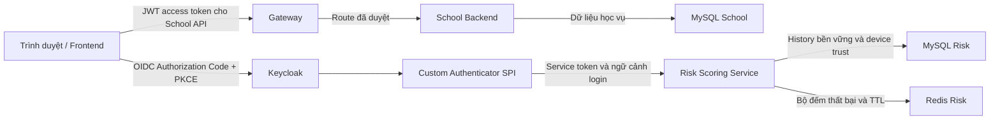

# Kịch bản bảo vệ ZeroTrust Adaptive Authentication

**Bản nháp PD-R18 · 08/11/2026 · Dùng evidence nếu Public Demo chưa sẵn sàng**

Dùng synthetic accounts và kết quả có ngày. Public Demo đang **NO-GO**. Buổi bảo vệ có thể dùng slide/hình/receipt đã lưu mà không khởi động Lab hay đổi dữ liệu. Nếu owner đã duyệt một rehearsal cô lập khác, chỉ trình bày kết quả live quan sát được ở môi trường đó. [Master Roadmap](production-readiness/PUBLIC_DEMO_ROADMAP.md) · [Runbook synthetic cũ](demo/DEMO_RUNBOOK.md) · [Observatory demo 5–8 phút](testing/RISK_OBSERVATORY_DEMO_5_8_MIN.md)

## 1. Kiến trúc và luồng đăng nhập

Keycloak xác minh danh tính bằng mật khẩu và OTP khi flow yêu cầu. OIDC chạy trên OAuth 2.0. Browser dùng Authorization Code + PKCE để ràng buộc code với client đã tạo verifier. JWT access token cung cấp claims cho Gateway/School API; resource server kiểm chữ ký, issuer, audience, expiry và quyền. Xác thực trả lời người dùng là ai. Phân quyền quyết định vai trò nào được gọi API và dữ liệu thuộc về ai. [Login flow](authentication/LOGIN_FLOW.md) · [Security config Portal](../src/main/java/com/zerotrust/zerotrust/config/SecurityConfig.java)

SPI chạy sau bước password trong Browser Flow đã kiểm chứng và gọi Risk bằng service identity. Risk trả quyết định; Keycloak thực thi nhánh cho qua, OTP hoặc từ chối. Đăng ký Trusted Device là bước sau bằng chứng MFA thành công và binding đúng subject/session, lưu state server và cấp cookie theo flow. Browser không có quyền gọi Risk API trực tiếp. [Risk API contract](security/RISK_API_SECURITY.md) · [Candidate runtime](production-readiness/evidence/PD-02-02_CANDIDATE_RUNTIME_CLOSEOUT.md)

Đây là cấu trúc đã triển khai trong repo và đã có evidence trên candidate Quay cô lập. Public Demo bổ sung ingress/TLS, trusted proxy, quota, private operator access và School account SELECT-only. Source và candidate evidence có scope riêng; production rollout và runtime DHI chưa nghiệm thu. Backend academic read-only chặn thao tác ghi học vụ trong profile Public Demo, đồng thời giữ role/ownership khi đọc. Local synthetic cũ có thể dùng cấu hình khác. [Backend read-only](production-readiness/evidence/PD-02-01_BACKEND_READ_ONLY.md) · [Gateway/ingress](production-readiness/evidence/PD-02-05_ABUSE_LIMITS_TRUSTED_PROXY.md)

## 2. B0 và các nhánh quyết định

| Nhóm | Tín hiệu |
|---|---|
| D — Device | Cookie thiết bị đối chiếu state server theo subject, thời hạn và revocation/generation. |
| N — Network | Ngữ cảnh IP, CIDR, GeoIP khi dùng được và policy mặc định. |
| T — Time | Mẫu ngày/giờ từ các lần đăng nhập thành công. |
| H — History | Tần suất thất bại theo tài khoản và IP trong cửa sổ Redis. |

B0 tính `Risk = 0,25D + 0,25N + 0,25T + 0,25H`, làm tròn hai chữ số trước khi phân mức. Điểm cao là rủi ro cao. Đây là điểm policy để điều khiển xác thực, không phải xác suất đã hiệu chuẩn. [B0 contract](../risk-scoring-service/src/main/java/com/zerotrust/risk/config/PublicDemoB0Contract.java) · [Scoring](../risk-scoring-service/src/main/java/com/zerotrust/risk/service/RiskScoringService.java)

| Điều kiện | Hành vi |
|---|---|
| Priority DENY | Ưu tiên trước weighted decision. DENY, score null, `NOT_EVALUATED`. |
| Missing Data | Risk còn trả kết quả hợp lệ nhưng tín hiệu chưa đủ. `INCOMPLETE`, score null, STEP_UP_MFA. |
| LOW, Risk < 40 | ALLOW khi không có mandatory MFA khác. |
| MEDIUM, 40 ≤ Risk < 75 | STEP_UP_MFA. |
| HIGH, Risk ≥ 75 | DENY. |
| Mandatory MFA | Với dữ liệu COMPLETE, LOW hoặc MEDIUM có thể được nâng lên effective MEDIUM/STEP_UP_MFA. HIGH giữ DENY. |
| Risk Service unavailable | Candidate Public Demo dùng failure mode DENY. Timeout hoặc response lỗi không phát token. Đây là nhánh kỹ thuật riêng với Missing Data. |

[Risk evaluation](../risk-scoring-service/src/main/java/com/zerotrust/risk/service/RiskEvaluationService.java) · [Keycloak enforcement](../keycloak-risk-extension/src/main/java/com/zerotrust/keycloak/risk/policy/RiskDecisionHandler.java)

## 3. Kịch bản demo có thể trình bày ngay

Chuẩn bị sẵn hình Observatory đã lọc, receipt Quay và trang tóm tắt B0. Đánh dấu từng minh họa **HISTORICAL**, **CONTROLLED** hoặc **LIVE** theo xuất xứ. Với browser, người thao tác tự nhập credential ngoài vùng trình chiếu. Dùng logout/fresh login khi cần phân biệt flow mới với SSO. Giữ raw trace, cookie, token, QR và ID riêng tư ngoài màn hình.

| Ca | Chuẩn bị và thao tác | Kết quả mong đợi | Evidence và phương án khi offline |
|---|---|---|---|
| 1. Đăng nhập hợp lệ | Fresh browser với synthetic student. Mở School, đăng nhập ở Keycloak, theo callback. | OIDC code/PKCE thành công, UI School tải theo role. | Dùng [receipt Browser Quay](../target/pd-02-02-runtime/browser-suite-results.txt) và sơ đồ. Kết quả theo đúng candidate/ngày. |
| 2. Yêu cầu OTP | Chọn ca đã có execution proof trong evidence. Nếu live thì dùng actor/flow đã duyệt, không ép fixture. | OTP đúng hoàn tất, OTP sai không phát token và không cấp trust. Enrollment là required action riêng. | Trình bày [receipt PD-R14](../target/pd-02-02-mitigation/regression-receipt.txt) hoặc các ca A3/A5 trong [Observatory acceptance](testing/RISK_OBSERVATORY_ACCEPTANCE_2026-11-03.md). |
| 3. Thiết bị tin cậy | Dùng một phiên đã OTP thật và có evidence register. So sánh login sau với cookie còn hiệu lực, rồi đối chiếu ca revoke đã lưu. | Cookie và state hợp lệ có thể giảm D; LOW còn phụ thuộc guard. Revoke làm mất trust theo lifecycle. | Dùng [runtime receipt](production-readiness/evidence/PD-02-02_CANDIDATE_RUNTIME_CLOSEOUT.md). Không trình bày việc bypass OTP như kết quả luôn đúng. |
| 4. MEDIUM Risk | Chiếu ca synthetic score **40,00** đã lưu. Giải thích ngưỡng và next action. | MEDIUM, STEP_UP_MFA. | Dùng [receipt PD-R14](../target/pd-02-02-mitigation/regression-receipt.txt). Phân biệt ca mandatory score 15,00 và ca numeric 40,00. |
| 5. HIGH Risk → DENY | Chiếu ca synthetic score **82,50** và kết quả enforcement đã lưu. | HIGH/DENY, không có code/token. | Dùng [receipt PD-R14](../target/pd-02-02-mitigation/regression-receipt.txt). Priority DENY là ca riêng, score null. |
| 6. STUDENT xem dữ liệu của mình | Dùng actor synthetic hoặc response đã lọc. So sánh request hợp lệ và ca bị chặn theo role/ownership. | Student thấy hồ sơ/điểm của chính subject, Admin route bị từ chối. | Dùng [candidate API evidence](production-readiness/evidence/PD-02-02_CANDIDATE_RUNTIME_CLOSEOUT.md). Không mở dữ liệu người thật. |
| 7. ADMIN chỉ đọc học vụ | Chọn UI Public Demo và API test có GET hợp lệ, write deny, DB grants SELECT-only. | Đọc danh sách/điểm theo role. Ghi học vụ bị chặn ở backend và DB account. | [PD-02-01](production-readiness/evidence/PD-02-01_BACKEND_READ_ONLY.md) + [PD-02-07](production-readiness/evidence/PD-02-07_PUBLIC_DEMO_UI_OBSERVATORY.md) + receipt SQL cũ. Không dùng lane sửa điểm của local demo để minh họa Public Demo. |
| 8. Observatory | Mở ảnh hoặc HTML evidence đã lọc. Chọn đúng evaluation và cộng D/N/T/H. | Xem score, reason và enforcement timeline; ví dụ LIVE-L1 12,50 LOW/ALLOW có ngày 03/11. | [Evidence LIVE-L1](testing/RISK_OBSERVATORY_ACCEPTANCE_2026-11-03.md) · [Bộ hình](../presentation/risk-observatory-evidence-20261103-L1/README.md). Người xem Public Demo không được mở raw operator view. |

Gợi ý thời lượng 7 phút: 1 phút kiến trúc, 1 phút login/MFA/trust, 2 phút MEDIUM/HIGH và guard, 1 phút RBAC/read-only, 1 phút Observatory, 1 phút giới hạn. Khi thiếu receipt live, chuyển sang hình/receipt cũ có nhãn. Hình LIVE-L1 là lần chạy ngày 03/11, không dự đoán điểm lần login mới.

## 4. Câu hỏi hội đồng

| Câu hỏi | Câu trả lời |
|---|---|
| Tại sao Adaptive Authentication? | Rủi ro đổi theo thiết bị, mạng, giờ và lịch sử. Policy có thể thêm bước MFA hoặc chặn theo ngữ cảnh, giảm việc áp dụng cùng một friction cho mọi login. |
| Tại sao Keycloak? | Keycloak chịu trách nhiệm xác thực, session, OTP và phát token theo chuẩn. SPI đưa quyết định Risk vào flow, School Backend tập trung phân quyền dữ liệu. |
| Tại sao sau mật khẩu? | Sau khi xác minh password, flow biết subject để tra history/trust chính xác. Nhánh thất bại được ghi riêng cho history; Risk evaluation của bước thành công giữ nguyên thứ tự Browser Flow đã kiểm. |
| Tại sao Redis và MySQL? | Redis phục vụ bộ đếm tần suất thất bại và TTL với độ trễ thấp. MySQL giữ dữ liệu bền vững như history/trust và School/Keycloak schema tách quyền. |
| Tại sao ba mức? | B0 dùng hai ngưỡng 40 và 75 để phân ba mức rủi ro, tương ứng ALLOW, STEP_UP_MFA và DENY. Bốn tín hiệu đóng góp 25% mỗi tín hiệu. |
| Tại sao cần MFA? | Password có thể bị lộ. OTP tăng yêu cầu chứng minh quyền sở hữu yếu tố thứ hai trong nhánh policy; enrollment tạo yếu tố, verification mới là bằng chứng sử dụng. |
| Trusted Device có rủi ro gì? | Cookie bị lấy, thiết bị chia sẻ hoặc trust stale có thể hạ tín hiệu sai. Cần state theo subject, OTP proof, TTL, revocation/generation và các guard vẫn có hiệu lực. |
| Nếu Risk Service chết? | Trong candidate fail-closed DENY, Keycloak không phát token. Missing Data là Risk còn đáp ứng và yêu cầu step-up với score null. |
| Chống brute-force thế nào? | Bộ đếm thất bại theo account/IP ảnh hưởng H và priority policy theo cấu hình. Gateway/ingress giới hạn request, body, trusted peer/IP. Hiệu lực production phải kiểm trên hạ tầng đích. |
| Public Demo có an toàn chưa? | Public Demo hiện NO-GO. Có kết quả tốt trên candidate Quay và các test source, còn thiếu kết quả runtime DHI cùng các release/operations gates theo roadmap. |
| Hạn chế? | B0 heuristic, phụ thuộc chất lượng tín hiệu và môi trường synthetic. Trust/counter thay đổi theo thời điểm; chưa chứng minh độ chính xác hoặc tỷ lệ false positive ngoài dữ liệu đã thử. |
| Hướng B1? | Trình bày B1 như hướng nghiên cứu tiếp theo để so sánh chính sách trên tập dữ liệu có nhãn, đo false positives/negatives và giải thích được quyết định. Demo và nghiệm thu hiện dùng B0. |

Nguồn đọc thêm: [Architecture hiện tại](architecture/SYSTEM.md) · [MFA reset lifecycle](authentication/MFA_RESET_LIFECYCLE.md) · [Privacy](security/DATA_PRIVACY.md).

## 5. Rehearsal Academic Demo PD-R19

Khởi động profile `zt-academic-demo` theo runbook. Mở `https://portal.academic-demo.test:19443` từ browser profile đã cấu hình tên và trust của CA staging. Kiểm đủ tám dịch vụ healthy trước khi vào buổi trình diễn. Chủ đồ án cấp tài khoản synthetic qua kênh riêng và chuẩn bị ứng dụng OTP. Dùng cùng phiên khi minh họa thiết bị đã biết. Dùng cửa sổ riêng tư cho ca thiết bị mới. [Startup và restart](../deploy/academic-demo/README.md) · [Hướng dẫn giảng viên](demo/ACADEMIC_DEMO_TEACHER_GUIDE.md)

PD-R19 có receipt browser về PKCE S256, OTP, logout, STUDENT/ADMIN và học vụ chỉ đọc qua HTTPS local. Risk API synthetic đã ghi LOW `0,00`, MEDIUM `40,00`, HIGH `82,50`, Mandatory MFA ở `15,00`, Priority DENY, Missing Data và trust revoke. Browser thực tế chặn đăng nhập khi Risk Service dừng. Trình bày các ca numeric bằng receipt riêng nếu hành vi browser trực tiếp thay đổi theo tín hiệu. [Browser](../target/academic-demo/browser-alpine.log) · [Risk](../target/academic-demo/risk-final.log) · [Outage](../target/academic-demo/risk-outage.log)

Khi VPS hoặc Internet gặp lỗi, chuyển sang profile local đã kiểm. Nếu máy staging cũng không sẵn sàng, dùng hình Observatory đã lọc và receipt trong mục 3. Giữ nhãn xuất xứ và thời điểm của từng ca. [Trạng thái release](production-readiness/evidence/ACADEMIC_DEMO_RELEASE.md)

## 6. Rehearsal Linux PD-R20

Chọn một lane trước buổi demo. Dùng profile PD-R19 tại máy staging, hoặc gói Linux với lock/PKI tương ứng khi đã được cấp quyền. Chạy status và smoke đọc. Tám service cần healthy gồm ingress, Gateway, frontend, School, Risk, Keycloak, MySQL và Redis. Kiểm Portal HTTPS và discovery issuer trước khi mở trình duyệt. Sau đó dùng STUDENT và ADMIN synthetic để minh họa OTP, quyền đọc, và Trusted Device. Dùng receipt B0 để trình bày điểm 0, 40 và 82,5 ổn định. [Quy trình Linux](../deploy/academic-linux/README.md) · [Kết quả rehearsal](production-readiness/evidence/ACADEMIC_DEMO_RELEASE.md#pd-r20--gói-linux-và-quyết-định-còn-mở)

| Triệu chứng | Xử lý nhanh |
|---|---|
| Cảnh báo TLS hoặc issuer sai | Kiểm hostname Portal/Auth, SAN và CA. Dùng hostname trong lock. Nếu PKI đích thiếu, chuyển về profile local đã có CA. |
| Portal lỗi hoặc hiện 502 | Kiểm health ingress, Gateway và frontend rồi mới restart đúng project theo lock. Giữ MySQL/Redis volumes và snapshot. |
| OTP lỗi hoặc score đổi | Kiểm giờ thiết bị và fresh session. Dùng evidence đã lưu để giải thích ca numeric/Trusted Device khi điều kiện live khác. |
| VPS hoặc access gate không vào được | Chuyển sang PD-R19. Nếu local cũng không sẵn sàng, dùng hình Observatory đã lọc và kết quả có thời điểm. |

Ca dừng Risk/Redis và restore chạy trong rehearsal riêng. Cấp mật khẩu và thiết lập OTP qua kênh riêng. Chỉ trình chiếu timeline đã lọc. [Hướng dẫn giảng viên](demo/ACADEMIC_DEMO_TEACHER_GUIDE.md)
