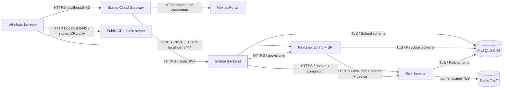

# Kiến trúc Development/Demo

Parent baseline source: `894e7fcb1adb960e7c1c057b0d0713fcb2307c26`; cấu hình đóng gói nằm trên branch `zerotrust-v4-risk-scoring`. Ranh giới đã chốt vẫn nằm trong [ARCHITECTURE](../../ARCHITECTURE.md).

`init` tạo CA, keys, credentials và realm/schema input một lần. MySQL entrypoint áp School DDL và dữ liệu synthetic chỉ khi volume trống. `migrate` dùng đúng Risk JAR build từ source, Flyway V1–V5, toolchain Java17.0.10 và checksum V5 **661092940**. Khi V5 pending, job kiểm tra không có connection của runtime writer rồi mới đặt precondition writers-quiesced; application chưa được start. Risk runtime chỉ có SELECT/INSERT/UPDATE, giữ Flyway validate khi startup. School dùng `ddl-auto=validate`.

Các container chạy lâu dài chờ health có ý nghĩa. Health Keycloak management chỉ ở mạng container; không publish. Gateway8443, Keycloak8444 và CRL8445 bind loopback. CRL server chỉ mount thư mục CRL công khai, user10001, read-only, không có secret; cần cho Schannel kiểm tra revocation. Không có fault proxy, QA image, JAR override hoặc QA volume trong Compose. Hai named volumes chính: `zerotrust-demo-mysql-final`, `zerotrust-demo-redis-final`.

Portal/Backend/Risk/Gateway giữ kiểm tra issuer, expiry, audience, role và subject/ownership. Keycloak giữ password/OTP/token. Service accounts cho evaluate/events/device và revoke tách biệt; không dùng token provisioner thay risk-caller. Frontend không persist access token; Gateway bỏ cookies ở boundary API.

Phiên bản được giữ: Spring Boot3.5.7, Java17; SPI Keycloak26.7.0, Backend admin-client26.0.11; Next16.2.6/React19.2.6, Node24.16.0. Các digest upstream dùng trong Dockerfiles/Compose; không nâng dependency security để phục vụ demo. Công thức/ngưỡng Risk giữ nguyên development baseline. CIDR synthetic của mạng Demo được cấu hình riêng, không spoof địa chỉ nguồn.

Đã có build/health và focused acceptance trong [completion report](../demo/COMPLETION_REPORT.md). Browser thủ công và cài CA Windows cần người trình bày xác nhận. Sơ đồ Mermaid mô tả cấu hình hiện tại; chưa render độc lập.
