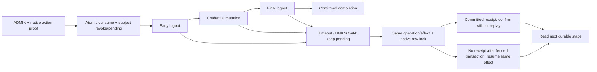

[Mục lục](../README.md) · [Phase1 lịch sử](D10_PHASE1_OFFLINE_REMEDIATION.md) · [Acceptance hiện tại](../../target/full-function-20261111b/post-cutover-functional-acceptance-20261113/ACCEPTANCE.md)

# D-10 — strict revocation, implementation offline

**Owner đã chọn B cho engineering offline ngày13/11/2026. Không phải authorization deploy. D-10 UNRESOLVED đến khi native acceptance trên runtime được deploy hoàn tất. D-17 PENDING; G8 INTERNET_NO_GO.**

Runtime Full-Function vẫn là SHADOW/V7/B0. Tài liệu này mô tả source candidate và fixture D10 riêng, không thay bằng chứng acceptance owner đã PASS. Public-network history/calibration vẫn PENDING; dữ liệu synthetic không được cộng vào calibration.

## Contract đã chốt

- Access TTL300/skew60; SSO idle1800/max28800. ADMIN reset cần native factor≤300s, nonce single-use theo mutation và binding actor/client/authentication attempt/SID/action/target. Không suy proof/epoch từ `iat` hoặc `auth_time`.
- Gateway và Backend xác minh JWT rồi gọi authority trên mọi protected API. MySQL writer là authority; không cache positive decision, không đọc replica hoặc truy cập Risk DB trực tiếp từ SPI/Gateway.
- Revocation có hiệu lực tại **commit của transaction Risk**. Request authorization/issuance bắt đầu sau commit phải thấy revoke hoặc fail-closed. Request đã bắt đầu trước commit có thể hoàn tất; token cũ được ký/trả muộn vẫn bị API từ chối khi authorization mới bắt đầu sau commit. Không tuyên bố zero-window cho in-flight request.
- Protected JWT thiếu/incompatible/stale/revoked claims→401; role không đủ→403; authority/transport/service credential không xác minh được→503. Internal Risk dùng409 cho context bị reject để không nhầm service-JWT401 thành lỗi user; caller map409→user401, service401/403→503.
- Password/MFA reset và disable/re-enable tăng subject epoch, revoke toàn bộ sessions và device generation. Logout/refresh reuse dùng SID đã được native xác minh. Device revocation chưa có device→SID mapping: fallback subject-wide, không đoán mapping từ cookie/header.

## Implementation

| Biên | Source và hành vi |
|---|---|
| Authority | [SecurityAuthority](../../risk-scoring-service/src/main/java/com/zerotrust/risk/securitystate/SecurityAuthority.java), [V8](../../risk-scoring-service/src/main/resources/db/migration/V8__strict_security_authority.sql), [V9](../../risk-scoring-service/src/main/resources/db/migration/V9__strict_session_client_bindings.sql). Epoch, SID tombstones, client bindings, tickets, proofs và operation/effect stages bền vững. No-op writer update + row lock/READ_COMMITTED; read-only replica không thể authorize. V7 pending không bị tự supersede. |
| Internal API | JWT issuer/audience/expiry + exact `azp` và role `security:authorize/issue/reset`. Ba client Gateway/Portal/issuer tách biệt. TLS phải xác minh CA/hostname; không redirect mang credential. Gateway/SPI không có Risk JDBC. |
| API gates | [Backend filter](../../src/main/java/com/zerotrust/zerotrust/security/StrictSecurityStateFilter.java), [Gateway](../../gateway/src/main/java/com/zerotrust/gateway/GatewaySecurityConfig.java). Bind signed `sub/sid/azp/zt_sec_sid/zt_sec_epoch/zt_sec_ver=1`; legacy JWT không được upgrade. Backend kiểm cả URI alias/encoded prefix. Chỉ cache service credential trong bộ nhớ, giới hạn body/deadline và chờ refresh; không cache verdict. |
| Issuance | [StrictTokenGate](../../keycloak-risk-extension/src/main/java/com/zerotrust/keycloak/risk/strict/StrictTokenGate.java): native TokenPostProcessor trước encode/sign/cached response. Fresh ticket lấy trước password validation; code/SSO/refresh/offline kiểm epoch/SID. Refresh đọc binding từ signed request refresh token, không upgrade từ session note mới. Cookie bị revoke chỉ chuyển sang primary/factor flow mới; outage không chuyển sang nhánh này. |
| MFA publisher | [NativeFlowGuard](../../keycloak-risk-extension/src/main/java/com/zerotrust/keycloak/risk/strict/NativeFlowGuard.java) bọc callback native OTP/recovery success; giữ native CredentialValidator type. Không publish từ challenge, password, enrollment hoặc LOGIN listener. Nonce đi qua standard `claims.id_token.zt_action_proof.value`; hook phát claims vào access/refresh token sau authority xác minh attempt/code/SID. Refresh giữ timestamp gốc. |
| Consumer | [FreshAdminMfaGuard](../../src/main/java/com/zerotrust/zerotrust/security/FreshAdminMfaGuard.java), [StrictResetOrchestrator](../../src/main/java/com/zerotrust/zerotrust/security/StrictResetOrchestrator.java). Role/factor/action/target/subject/client/SID kiểm trước reset effect; proof consume + revoke cùng transaction. Retry trả operation đã có, không tạo lần reset/epoch mới từ nonce đã dùng. |
| Native mutation | [NativeEffects](../../keycloak-risk-extension/src/main/java/com/zerotrust/keycloak/risk/strict/NativeEffects.java), [transaction listener](../../keycloak-risk-extension/src/main/java/com/zerotrust/keycloak/risk/strict/NativeMutationListenerFactory.java). Local JPA user lock từ trước admission đến commit; credential/required actions và receipt cùng native transaction. External user changes revoke/quarantine trước native commit; lỗi authority đặt rollback-only. Chỉ positive committed receipt/after-completion mới clear pending. |

Service-account bootstrap exemption chỉ dành cho allowlist + native service-account/client link; không áp vào protected Portal API. Scope native đã thiết kế là local JPA; federation/broker/flow mới cần verification riêng. Candidate chặn bulk partial import và realm deletion chưa có subject fencing. Direct DB/offline CLI changes và thay policy/control plane không phải đường mutation thông thường được bảo đảm; phải đi qua controlled maintenance riêng.

## Reset và failure contract

Stages: REVOKED → mỗi effect DISPATCHED → ACCEPTED → DONE → COMPLETED. Worker dùng durable effect ID và exact subject/epoch/current stage; không dựa in-memory lock hoặc lease expiry. Concurrent workers có thể thấy effect cũ: native admission từ chối; worker đọc stage hiện tại ở lượt sau. Không supersede unresolved operation, giảm generation/epoch, tự hết pending hoặc restore credential.

Foreground204 chỉ khi completion đã confirmed.503 là visible pending/unknown; worker có thể hoàn tất sau đó, kể cả self-reset đã revoke JWT của actor. Receipt đọc trực tiếp từ native JPA dưới row lock, không dựa cache UserModel. Native rollback không có receipt giữ pending; replay cùng effect chỉ được admission trong operation hiện hành sau khi native lock đã fence transaction trước. External rollback không có positive receipt tiếp tục quarantine; không auto-clear theo sự vắng mặt.

## Evidence và giới hạn

Fixture: [driver](../../deploy/full-function/d10_isolated.py), [native checks](../../deploy/full-function/d10_native_check.py), output `target/d10-phase2-20261113/`. Namespace cố định `zt-d10-offline-20261113`; fresh CA/accounts/stores, no host listener, không mount owner private state. Fault proxy chỉ có trong fixture/helper, không ở release images.

- Exact native services JAR SHA256 `564b6055e4a29df6ef0cdbd907c93bf54c9a5779e6ede9689403073e5d7caade`; khác Maven cùng nhãn26.8.2. Exact-byte callback-order test và browser/native evidence phải đọc riêng.
- `native.json`/`native.log`: các case thực chạy, gồm native OTP/recovery, API, code/SSO/refresh/offline, native mutation, outage, UNKNOWN/receipt/process restart và đo tải. Không coi mock/H2 là native.
- `migration.json`, `migration-latest.json`: synthetic V7→V8/V9, checksum V1–V7 giữ. Không migrate active DB.
- `preservation-before.json`, `preservation-after.json`: container ID/image/start/restart/running của mọi container ngoài D10 fixture. Không so hoặc export credential secret columns.
- Phase1 `verification.json` 201 tests là checkpoint lịch sử; chỉ tái sử dụng phần không đổi, không cộng vào tổng Phase2. Tổng Phase2 lấy latest XML từng class, không cộng trùng rerun.
- Gateway429 dưới load là abuse gate đang hoạt động. Đo offered/accepted/throttled riêng; Backend benchmark vẫn đi qua strict Backend gate. Không tắt gate để có số đo đẹp, không ngoại suy local fixture thành SLO Internet.

## Kết quả chốt Phase2 — 13/11/2026

**Offline implementation và targeted/native tests: PASS. D-10 runtime: UNRESOLVED.** [verification.json](../../target/d10-phase2-20261113/verification.json) là receipt tổng hợp; [native.json](../../target/d10-phase2-20261113/native.json) chứa18 case native, không trộn vào acceptance owner hoặc Network v2 calibration.

| Phạm vi | Kết quả mới |
|---|---|
| Targeted Java | **457 PASS, 0 failure/error/skip**: Risk196, Portal179, Gateway13, SPI69. Các rerun cùng class chỉ lấy XML cuối. Maven Java17/offline; logs `target/d10-{risk,portal,gateway,spi}-targeted.log` và `target/d10-portal-strict-final.log`. |
| Frontend | **12 PASS**, typecheck và production build PASS; exact Node24.22.2/npm11.21.2. Cộng Java thành **469 targeted tests**. Đây là unit/UI component checks và build, chưa là browser E2E của SPA reset mới. |
| Native exact pin | **18/18 PASS** trên disposable local-JPA Keycloak26.8.2/MySQL/Redis/TLS: fresh ADMIN/STUDENT OTP, signed epoch/SID, API200/403/401/ownership cả Gateway và direct Backend; code/SSO/refresh/offline và logout/reuse; native admin/self password, disable/re-enable. |
| Strict race/outage |32 API concurrent với refresh/revoke;23 request bắt đầu sau commit, **0 ALLOW**. Revoked JWT còn hạn, all-subject sessions và paused code bị chặn; other subject còn truy cập. Redis down không stale allow; read-only MySQL trả503; Risk down chặn hai API gates và native refresh, restart không hồi sinh tombstone. Unit kiểm epoch cùng giây, legacy claims, idempotency và V7 pending. |
| Fresh factor | OTP fail không publish; native OTP/recovery success→signed proof→**Portal guard thật**. Refresh giữ timestamp gốc. Enrollment/ordinary login không invent action proof; consumed recovery code bị từ chối. Unit kiểm stale/future/wrong action/target/subject/client/SID trước mutation. |
| Durable reset | Inject mất credential confirmation và HTTP reply **sau native commit**; pending giữ `CREDENTIAL_MUTATION_ACCEPTED`; restart **chỉ fixture Backend**, worker đọc committed receipt và hoàn tất. Credential admission thành công đúng1 lần, proof retry không thêm epoch/mutation. Self reset hoàn tất dù actor JWT bị revoke;503 vẫn là visible pending đến khi DB xác nhận COMPLETED. |
| Schema | Synthetic V7→V8→V9 PASS; checksum V1–V7 giữ nguyên. Active ledger đọc lại vẫnV7, không migrate active. |
| Preservation | **9 active services** giữ exact container ID/image/start/running/restart; **211 container ngoài fixture** khớp hoàn toàn trước/sau. Receipt tổng hợp có đủ9 pin.16 protected-table hashes tái sử dụng acceptance cũ, không hash/export lại secret columns. |

Đo thực40 request concurrency1 qua TLS ingress + Gateway authority + Backend authority + DB: **p50 96,42ms; p95 167,80ms; max178,84ms**. Gateway offered80 request/C4 trong1,779s:35 HTTP200 và45 HTTP429,44,98 offered req/s; không gọi44,98 là successful throughput. Direct Backend strict80/80 HTTP200/C4 trong2,387s:33,51 req/s. Budget đề xuất cho rehearsal cùng cấu hình: p95≤250ms ở tải tuần tự, p99≤500ms và0 authorization503 ở≤10req/s/C4 khi authority khỏe; cần đo một workload đúng budget trong Phase3, chưa gọi đó là SLO đã nghiệm thu.

`native-config.json` xác minh effective TTL300, SSO1800/28800, rotation/maxReuse0. Không chờ8 giờ để chứng minh wall-clock SSO max; không suy config thành expiry wait-test. New SPA challenge→reauth→confirm E2E còn phải kiểm ở controlled acceptance. Scope federation/broker/direct-DB/CLI/control-plane changes chưa hỗ trợ như human mutation thông thường; device mapping chưa có nên revoke subject-wide. Không tự thêm retention cleanup cho tombstones.

## Controlled deployment sau authorization riêng

Chỉ seal release binding khi tests/contract của artifact cuối PASS. Binding/controller D10 riêng, không dùng Network v2 binding hay owner request cũ. Pin artifact/config/flow/schema/client roles; từ chối fault proxy/test helper trong config release.

Đã seal [D10 offline binding](../../deploy/full-function/d10-release/binding.offline.json) với5 candidate image IDs, JAR/source/evidence hashes; [read-only verifier](../../deploy/full-function/d10-release/validate.py) PASS. [Contract và kế hoạch checkpoint/cutover/rollback](../../deploy/full-function/d10-release/README.md) riêng; `deployment_authorized=false`, chưa publish registry. Không có executor active được cấp quyền trong packet này.

Trình tự đề xuất: owner chấp nhận maintenance/force fresh login → checkpoint encrypted backup có retention/access control → quiesce writers và đóng protected ingress/direct access → additive migration → provision dedicated service roles/TLS → issuer gate + reviewed native flow → Backend + Gateway gates → verify legacy JWT fail-closed, fresh MFA/HTTP/native lifecycle → mở traffic. B0/Network v2 SHADOW/retention=false giữ. Public health/JWKS và machine bootstrap phải hoạt động độc lập với human authority để tránh deadlock.

Rollback không restore DB/realm/session/MFA/device trust cũ hoặc giảm epoch. Chỉ rollback sang pin còn strict-compatible; nếu chưa có, giữ maintenance fail-closed và sửa candidate. Không trở về bearer-only. Acceptance native trên runtime đích, owner deployment authorization và các gap được ghi cuối report là điều kiện trước khi đóng D-10.

**Readiness:** sẵn sàng để owner review packet và cấp quyền chuẩn bị controlled Phase3; **chưa GO thực thi**. Còn maintenance executor/checkpoint được review, binding exact live flow/config/TLS/service roles và reserved receipt attribute protection, deployment authorization và native acceptance runtime đích. Approval cần cho maintenance/force fresh login/fail-closed rollout và tài khoản test riêng; không cần chọn lại B. D-17 PENDING; G8 INTERNET_NO_GO; public-network/COLD_START/calibration PENDING.
