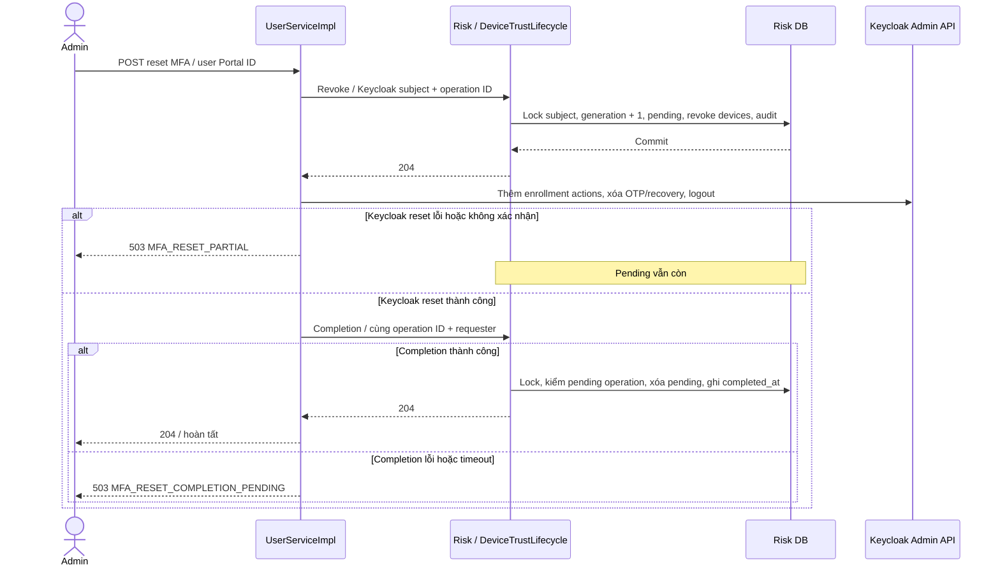

[Mục lục tài liệu](../README.md) · [Trang dự án](../../README.md)

# Reset MFA và vòng đời thiết bị tin cậy

**Ngày đối chiếu mã:** 2026-10-05.

**Trạng thái:** Có implementation trong Portal/Risk/SPI; provisioning và rollout
realm thật chưa được xác nhận lại trong lần rà soát này.

## 1. Reset giải quyết vấn đề gì?

Khi người dùng mất cả OTP lẫn recovery code, admin đã xác minh danh tính có thể
reset MFA. Reset phải xóa credential cũ **và** thu hồi device trust cũ. Nếu chỉ
xóa OTP tại Keycloak, một device vẫn TRUSTED có thể không bị yêu cầu MFA ở lần
đánh giá sau.

`POST /api/admin/users/{id}/mfa/reset` yêu cầu ADMIN, user Portal tồn tại và ACTIVE.
`id` là UUID user trong Portal DB. Portal ánh xạ sang `keycloak_user_id`; Risk
dùng **subject UUID của Keycloak**, không dùng Portal user ID hoặc student ID.
Password được giữ nguyên. Reset không phải chức năng mở khóa brute-force.

Nếu còn một recovery code chưa dùng, user có thể xác thực bằng code đó và vào
Account Console để cấu hình lại MFA. Đây là đường self-service của Keycloak;
không đồng nghĩa đã chạy orchestration thu hồi trust của Portal.

## 2. Class tham gia và trách nhiệm

| Class | Vai trò |
|---|---|
| [AdminController](../../src/main/java/com/zerotrust/zerotrust/controller/AdminController.java) | Nhận endpoint admin, gọi UserService; trả 204 sau toàn bộ use case thành công |
| [UserServiceImpl](../../src/main/java/com/zerotrust/zerotrust/service/impl/UserServiceImpl.java) | Kiểm user ACTIVE, lấy requester từ security context, tạo operation UUID; điều phối revoke → reset → complete |
| [RiskDeviceAdminClient](../../src/main/java/com/zerotrust/zerotrust/risk/RiskDeviceAdminClient.java) | Token riêng portal-risk-admin; POST revoke/completion; yêu cầu 204, refresh/retry 401 một lần |
| [RiskAdminProperties](../../src/main/java/com/zerotrust/zerotrust/risk/RiskAdminProperties.java) | URL/secret/timeout; mặc định HTTPS, HTTP chỉ khi override local |
| [IdentityProviderGateway](../../src/main/java/com/zerotrust/zerotrust/identity/IdentityProviderGateway.java) và [KeycloakIdentityProviderGateway](../../src/main/java/com/zerotrust/zerotrust/identity/keycloak/KeycloakIdentityProviderGateway.java) | Tách orchestration khỏi thư viện Admin API, chuyển reset sang KeycloakUserClient |
| [KeycloakUserClient](../../src/main/java/com/zerotrust/zerotrust/identity/keycloak/KeycloakUserClient.java) | Thêm required actions, xóa credential MFA cũ, logout session; không đổi password |
| [TrustedDeviceRevocationController](../../risk-scoring-service/src/main/java/com/zerotrust/risk/controller/TrustedDeviceRevocationController.java) | Validate subject/operation/requester ở hai POST Risk |
| [DeviceTrustLifecycle](../../risk-scoring-service/src/main/java/com/zerotrust/risk/service/DeviceTrustLifecycle.java) | Khóa subject, tăng generation, pending, revoke, audit và completion idempotent |
| [KnownDeviceEntity](../../risk-scoring-service/src/main/java/com/zerotrust/risk/entity/KnownDeviceEntity.java) | Phân biệt reason SECURITY/MFA_RESET; revoked row không tự trust lại |
| [RiskEvaluationController](../../risk-scoring-service/src/main/java/com/zerotrust/risk/controller/RiskEvaluationController.java) | Trả generation; pending reset trả DENY/MFA_RESET_IN_PROGRESS |
| [TrustedDeviceRegistrationService](../../risk-scoring-service/src/main/java/com/zerotrust/risk/service/TrustedDeviceRegistrationService.java) | Kiểm generation/pending dưới cùng subject lock trước khi tạo trust |
| [RiskDecisionHandler](../../keycloak-risk-extension/src/main/java/com/zerotrust/keycloak/risk/policy/RiskDecisionHandler.java) | Giữ generation trong auth-note; đánh dấu rotate khi cần reauthentication |
| [TrustedDeviceRegistrationAuthenticator](../../keycloak-risk-extension/src/main/java/com/zerotrust/keycloak/risk/authenticator/TrustedDeviceRegistrationAuthenticator.java) | Sau MFA gửi generation, sinh ID mới khi cần; 409 làm cookie cũ hết hạn |

## 3. Contract và thứ tự bắt buộc

Portal dùng `zerotrust-portal-risk-admin`, audience `zerotrust-risk-api` và
client role `risk:device:revoke`. Caller SPI `zerotrust-risk-caller`, SPA và
provisioner không được gọi revoke/completion. Các endpoint:

```text
POST /internal/v1/subjects/{subjectId}/trusted-devices/revocations
POST /internal/v1/subjects/{subjectId}/trusted-devices/revocations/completion
```

Cả hai nhận body sau và trả 204 khi thành công:

```json
{
  "operationId": "11111111-1111-4111-8111-111111111111",
  "requestedBy": "admin-username-example"
}
```

Operation ID do Portal tạo, không do browser chọn. Requester lấy từ
`Authentication.getName()`: converter Portal ưu tiên `preferred_username`,
fallback `sub`; không được mặc định đây luôn là UUID subject admin. Risk tin
danh tính máy riêng của Portal cung cấp giá trị này, không xác minh một admin
user JWT thứ hai. Đọc [converter](../../src/main/java/com/zerotrust/zerotrust/security/KeycloakJwtAuthenticationConverter.java)
khi đối chiếu audit/requester.



Nếu revoke không được xác nhận, Portal trả 503 và không gọi Keycloak reset.
Risk DB transaction chỉ bao phủ dữ liệu Risk; không rollback remote Keycloak.
`KeycloakUserClient` thêm `CONFIGURE_TOTP` và `CONFIGURE_RECOVERY_AUTHN_CODES`,
giữ required actions khác, rồi xóa credential MFA và logout. Lỗi giữa các lời
gọi Keycloak có thể khiến một phần thay đổi đã áp dụng.

## 4. Generation chặn đăng ký trust từ login cũ

`trustGeneration` là số phiên bản trust theo subject, bắt đầu từ 0.
Ví dụ login nhận generation 7, sau đó admin reset làm generation thành 8.
Dù login cũ hoàn tất MFA, request registration mang 7 bị từ chối 409.

`DeviceTrustLifecycle.requireGeneration` yêu cầu transaction đang tồn tại
(Propagation.MANDATORY). Registration và revoke cùng SELECT FOR UPDATE trên
row `subject_device_trust`; lock giữ tới commit registration. Vì vậy:

- Registration commit trước reset: reset sau đó thu hồi device vừa tạo.
- Reset commit trước registration: generation cũ hoặc pending làm registration 409.

Snapshot evaluation chỉ giữ lock trong transaction ngắn, không giữ khóa tới
cuối login. Generation bảo vệ **tạo trust**, không thu hồi ALLOW/JWT đã cấp.

Một operation lặp cùng subject/requester không tăng generation lần hai.
Operation ID đã gắn subject/requester khác bị 409. Completion cũ không xóa pending
của operation mới; completion đã hoàn tất có thể lặp idempotent.
Bấm reset lại trên Portal tạo **operation mới**, không phải API resume cùng ID.

## 5. Trạng thái device và hiệu lực trust

| Lưu DB / nhận diện | Hành vi |
|---|---|
| Không có cookie → MISSING | Bắt buộc MFA, xóa cookie không bypass guardrail |
| Có ID nhưng chưa có row → NEW | Bắt buộc MFA |
| PENDING | Bắt buộc MFA |
| TRUSTED còn hạn | Không có device guardrail; các nguồn khác vẫn có thể yêu cầu MFA/DENY |
| TRUSTED quá 30 ngày | REAUTHENTICATION_REQUIRED, MFA và ID mới |
| REVOKED / MFA_RESET | REAUTHENTICATION_REQUIRED sau completion, MFA và ID mới |
| REVOKED / SECURITY hoặc reason không phải MFA_RESET | DENY |
| Subject reset pending | DENY khi Risk evaluation thành công, registration 409 |

`KnownDeviceEntity.trust` cập nhật `trusted_at` khi registration MFA thành công
lại. Hạn trust là 30 ngày từ mốc đó; không phải mọi API request đều gia hạn trust.
Cookie ZT_DEVICE_ID có TTL riêng 30 ngày, là định danh chứ không phải credential.

`CONFIGURE_TOTP` còn pending làm SPI bỏ qua registration. Sau khi user hoàn tất
enrollment, một lần login MFA thành công tiếp theo mới có thể tạo trust.
Fallback MFA khi Risk unavailable không có eligibility/generation để tạo trust.

## 6. Lỗi, phục hồi và giới hạn

| Mã lỗi Portal (HTTP 503) | Trạng thái biết được | Cách xử lý |
|---|---|---|
| RISK_DEVICE_REVOCATION_FAILED | Chưa xác nhận revoke; Keycloak reset chưa được gọi | Kiểm kết nối/token/config, phục hồi rồi retry |
| MFA_RESET_PARTIAL | Revoke đã xác nhận; Keycloak reset lỗi | Pending giữ lại; phục hồi Keycloak rồi retry reset |
| MFA_RESET_COMPLETION_PENDING | Keycloak reset thành công; completion chưa xác nhận | Kiểm operation/audit và kết nối Risk; phục hồi rồi retry |

Timeout không chứng minh remote chưa commit. Tra operation ID trong log Portal
và `device_trust_revocations` trước khi điều tra; không xóa pending thủ công để
né quy trình. Reset đồng thời có thể supersede operation; completion cũ lỗi rõ
ràng. Tránh nhiều admin reset cùng subject và retry sau khi ổn định.

Pending block chỉ áp dụng ở flow thực sự gọi được Risk. Nếu policy outage là
STEP_UP_MFA, không thể bảo đảm pending vẫn chặn login khi Risk unavailable.
JWT đã phát, SSO/refresh bỏ qua Risk không bị vô hiệu tức thì. Fresh MFA cho
admin, continuous authentication và kiểm tra revocation mỗi API request là phần
chưa triển khai, không phải bảo đảm của reset hiện tại.

## 7. Provisioning và rollout cần thực hiện ở môi trường đích

1. Thêm client role không composite `risk:device:revoke` vào zerotrust-risk-api.
2. Tạo confidential OIDC client zerotrust-portal-risk-admin: bật client
   authentication/service account, tắt standard/implicit/direct grant.
3. Tắt Full Scope Allowed, giới hạn scope/role mapper; cấp riêng role revoke,
   không kế thừa quyền Risk khác.
4. Map audience zerotrust-risk-api và client role vào
   `resource_access.zerotrust-risk-api.roles`.
5. Lưu secret riêng phía Portal; không đưa vào frontend/log/Git.
6. Kiểm token azp/aud/role và xác nhận token này bị 403 ở evaluation/events/registration.

Portal cần `PORTAL_RISK_BASE_URL`, `PORTAL_RISK_TOKEN_URI`,
`PORTAL_RISK_CLIENT_ID`, `PORTAL_RISK_CLIENT_SECRET`; Risk cần
`RISK_JWT_REVOKE_CLIENT_ID` khớp. HTTP chỉ cho local khi
`PORTAL_RISK_ALLOW_HTTP=true`. Root `.env` phải được launcher nạp, Spring không
tự đọc file này cho mọi tiến trình. Xem [LOCAL_SETUP](../operations/LOCAL_SETUP.md).

Sao lưu DB, triển khai [Flyway V4](../../risk-scoring-service/src/main/resources/db/migration/V4__device_trust_revocations.sql),
SPI hỗ trợ generation, provisioning client riêng rồi Portal/frontend tương ứng.
Không dùng SPI cũ đăng ký device không có generation. Xác minh post-MFA
authenticator nằm sau MFA thật trước khi cho phép nhớ device.

## 8. Kiểm chứng

Đọc [DeviceTrustLifecycleTests](../../risk-scoring-service/src/test/java/com/zerotrust/risk/service/DeviceTrustLifecycleTests.java),
[UserServiceImplTest](../../src/test/java/com/zerotrust/zerotrust/service/impl/UserServiceImplTest.java)
và [TrustedDeviceRegistrationAuthenticatorTest](../../keycloak-risk-extension/src/test/java/com/zerotrust/keycloak/risk/authenticator/TrustedDeviceRegistrationAuthenticatorTest.java).

Staging cần kiểm tra: establish trust → reset → old trust revoked → enrollment
→ login MFA mới/ID mới; login dừng trước reset nhận 409; expiry 30 ngày; security
revoke vẫn DENY; Risk/Keycloak outage và completion timeout không báo success.
H2/mock không xác nhận Flyway/MySQL thật, Redis, Browser Flow hay logout session
runtime. Không có provisioning/deployment được thực hiện bởi lần sửa tài liệu này.
