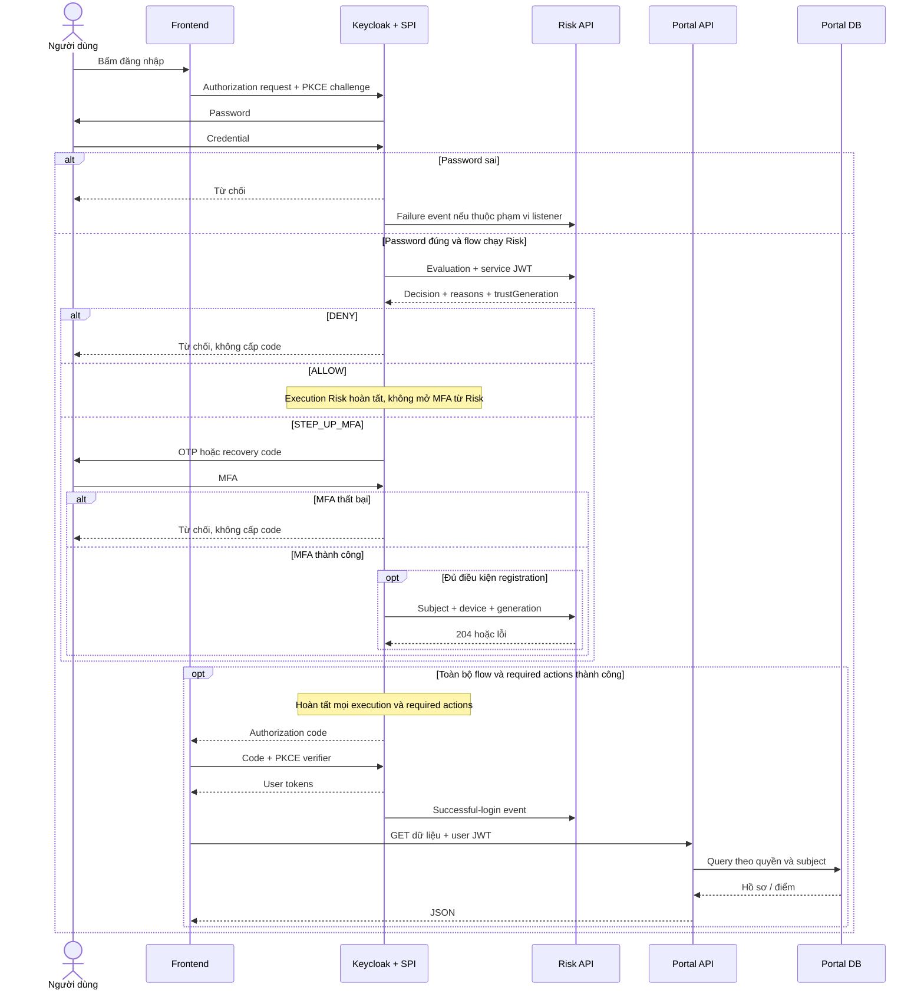
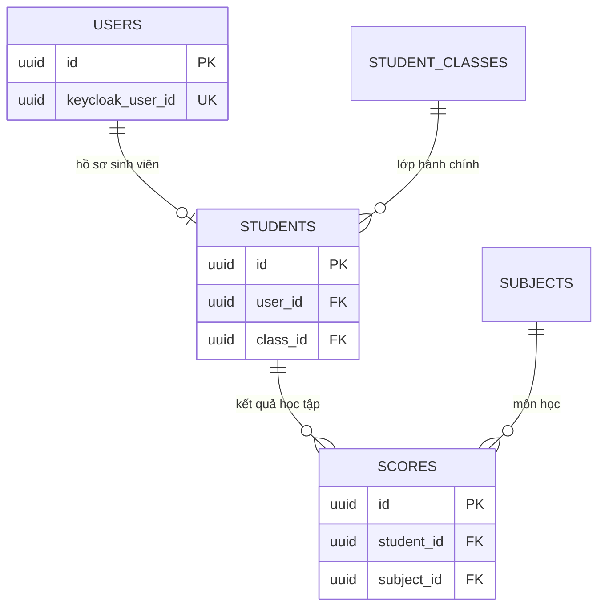

[Mục lục tài liệu](../README.md) · [Trang dự án](../../README.md)

# Đọc mã hệ thống: từ đăng nhập đến dữ liệu học vụ

**Ngày đối chiếu:** 2026-10-05.

**Phạm vi:** Mã trong working tree; không xác nhận realm/deployment hiện tại.
Tài liệu giải thích các class chính theo đường gọi, thay vì liệt kê mọi getter,
factory helper hoặc type do framework sinh. Quyết định kiến trúc ở
[ARCHITECTURE](../../ARCHITECTURE.md); reset chi tiết ở
[MFA_RESET_LIFECYCLE](../authentication/MFA_RESET_LIFECYCLE.md).

## 1. Những khái niệm cần biết

| Khái niệm | Cách hiểu trong dự án |
|---|---|
| Xác thực | Keycloak chứng minh người dùng qua password và MFA |
| Phân quyền | Portal/Risk quyết định token được phép gọi thao tác nào |
| SPI | Interface mở rộng Keycloak; JAR cung cấp Authenticator/Event Listener |
| Factory | Tạo provider và công bố metadata cho Keycloak; không chấm điểm |
| DTO | Dữ liệu JSON tại biên HTTP; khác entity lưu DB |
| Domain/record | Dữ liệu và kết quả nội bộ có invariant; Java record sinh accessor |
| Controller | Nhận request, validation và điều phối service; security filter chạy trước |
| Service | Thực hiện use case/logic; transaction đặt ở thao tác persistence phù hợp |
| Repository | Đọc/ghi DB; không gọi Keycloak thay service |
| Properties | Bind biến cấu hình vào object và kiểm tra khi khởi động |
| Guardrail | Điều kiện bắt buộc DENY/MFA, không bị weighted score thấp bỏ qua |
| Auth-note | Dữ liệu tạm của lần login Keycloak; không phải credential hay device trust |
| Subject (`sub`) | ID user Keycloak; khác ID user/student trong Portal DB |
| Generation | Số phiên bản trust của subject; chặn registration từ login trước reset |
| Idempotent | Lặp cùng thao tác hợp lệ không tạo tác dụng phụ lần hai |

Có hai loại Bearer token: **user token** của SPA gọi Portal và **service token**
của workload gọi Risk. Audience là dịch vụ đích, `azp` là client xin token.
Token hợp lệ không tự cấp quyền trên mọi endpoint.

## 2. Đường đi tổng quát



Sơ đồ không mô tả thời điểm event tuyệt đối so với token exchange; listener là
telemetry, không phải điều kiện phát token. MFA thất bại không đi tiếp nhánh
thành công. SSO/refresh có thể bỏ qua Browser Flow, nên không phải mọi lần mở
Portal đều gọi Risk. Portal chỉ gọi Risk ở use case reset trust/MFA.

## 3. Frontend: nơi bắt đầu và dùng token

| File/component | Trách nhiệm và điểm cần đọc |
|---|---|
| [page.tsx](../../frontend/app/page.tsx) | `HomePage` chỉ render `PortalRoute area="root"`; không chứa login orchestration |
| [PortalRoute](../../frontend/components/portal-route.tsx) | `bootstrap` init Keycloak; đọc role để chọn UI/route; login/logout; xử lý phiên hết hạn/offline |
| [keycloak.ts](../../frontend/lib/keycloak.ts) | Singleton `getKeycloak`; `initializeKeycloak` dùng check-sso + PKCE S256; `accountSecurityUrl` mở Account Console |
| [api.ts](../../frontend/lib/api.ts) | `apiFetch` refresh trước request; gộp refresh đồng thời; retry đúng một lần sau 401 |
| [admin-api.ts](../../frontend/lib/admin-api.ts) | `portalRequest` đọc envelope/lỗi; type và helper query dùng chung UI |
| [AdminPortal](../../frontend/components/admin-portal.tsx) | Màn hình quản trị; điều phối view, thao tác quản trị và reset MFA |
| [StudentScoreDashboard](../../frontend/components/student-score-dashboard.tsx) | Lấy tài khoản, hồ sơ, summary và trang điểm qua API; filter/pagination chỉ đổi query |

`PortalRoute` chuyển admin đến `/admin`, sinh viên đến `/student/scores`.
UI kiểm tra role để hiển thị, backend vẫn là nơi quyết định quyền. API tổng hợp
`/api/students/me/scores/summary` tính trên toàn bộ kết quả của sinh viên; các ô
summary không chỉ tính từ trang điểm hiện tại.

Token chỉ nằm trong memory của tab. Request Portal dùng Bearer và
`credentials: "omit"`. Refresh lỗi xóa token cục bộ; logout Keycloak thất bại
cũng chỉ xóa token cục bộ, chưa chứng minh SSO server đã kết thúc.

## 4. Keycloak SPI: thu ngữ cảnh và áp quyết định

### 4.1. Class trên đường evaluation

| Class | Vai trò |
|---|---|
| [RiskAuthenticatorFactory](../../keycloak-risk-extension/src/main/java/com/zerotrust/keycloak/risk/authenticator/RiskAuthenticatorFactory.java) | Đăng ký `zerotrust-risk-authenticator`, metadata cấu hình; dựng dependencies bằng HTTP provider Keycloak |
| [RiskAuthenticator](../../keycloak-risk-extension/src/main/java/com/zerotrust/keycloak/risk/authenticator/RiskAuthenticator.java) | `authenticate` đọc config → extract context → gọi client → giao handler; lỗi client áp failureMode, lỗi config/context/runtime deny |
| [RiskAuthenticatorConfigResolver](../../keycloak-risk-extension/src/main/java/com/zerotrust/keycloak/risk/config/RiskAuthenticatorConfigResolver.java) | Chuyển cấu hình execution thành URL, timeout, token config, failure mode; reject cấu hình không hợp lệ |
| [KeycloakLoginContextExtractor](../../keycloak-risk-extension/src/main/java/com/zerotrust/keycloak/risk/context/KeycloakLoginContextExtractor.java) | `extract` lấy user ID, root session + tab ID, client, remote IP, User-Agent và cookie; không tự đọc X-Forwarded-For |
| [CookieDeviceIdResolver](../../keycloak-risk-extension/src/main/java/com/zerotrust/keycloak/risk/context/CookieDeviceIdResolver.java) | Đọc device cookie hợp lệ hoặc trả thiếu; cookie không chứng minh đã MFA |
| [ClientCredentialsTokenProvider](../../keycloak-risk-extension/src/main/java/com/zerotrust/keycloak/risk/client/ClientCredentialsTokenProvider.java) | Xin service token, dùng cache và refresh trước hạn; không dùng user token |
| [ServiceTokenCache](../../keycloak-risk-extension/src/main/java/com/zerotrust/keycloak/risk/client/ServiceTokenCache.java) | Cache service token của workload, không phải cache phiên user |
| [HttpRiskScoringClient](../../keycloak-risk-extension/src/main/java/com/zerotrust/keycloak/risk/client/HttpRiskScoringClient.java) | Gửi JSON/Bearer; kiểm tra status, JSON, kích thước, timeout, correlation subject/session; retry 401 một lần |
| [RiskScoringClientException](../../keycloak-risk-extension/src/main/java/com/zerotrust/keycloak/risk/client/RiskScoringClientException.java) | Biểu diễn lỗi HTTP/network/response để handler chọn hành vi outage |
| [RiskDecisionHandler](../../keycloak-risk-extension/src/main/java/com/zerotrust/keycloak/risk/policy/RiskDecisionHandler.java) | `handle` xóa note cũ rồi áp ALLOW/STEP_UP/DENY; `handleUnavailable` xử lý outage riêng |
| [RiskAuthenticationNotes](../../keycloak-risk-extension/src/main/java/com/zerotrust/keycloak/risk/policy/RiskAuthenticationNotes.java) | Tên note decision, step-up, eligibility, generation, evaluator config ID và rotate device |
| [RiskStepUpCondition](../../keycloak-risk-extension/src/main/java/com/zerotrust/keycloak/risk/authenticator/RiskStepUpCondition.java) | `matchCondition` đọc step-up note để mở conditional MFA subflow |

`HttpRiskScoringClient` dùng pool do Keycloak quản lý, không tự đóng pool.
Nó không tự kiểm chứng toàn bộ quan hệ score/level/decision và response không có
client ID để correlation; service caller và response contract là ranh giới tin cậy.

### 4.2. Từ auth-note đến MFA và cookie

Flow cần cấu hình trong realm:

```text
Username Password Form                         REQUIRED
ZeroTrust Risk Evaluation                     REQUIRED
Risk step-up MFA                              CONDITIONAL
  Condition - ZeroTrust step-up required      REQUIRED
  OTP Form                                    ALTERNATIVE
  Recovery Authentication Code Form           ALTERNATIVE
ZeroTrust Remember Device after MFA           REQUIRED
```

Đây là thứ tự yêu cầu, không phải xác nhận binding realm đang chạy. OTP/recovery
là authenticator có sẵn của Keycloak. Risk SPI không tự xác minh mã.
`context.success()` của Risk chỉ hoàn tất execution Risk.

| Tình huống | Note và tác động |
|---|---|
| ALLOW | Không mở MFA từ Risk, không tạo eligibility registration |
| STEP_UP thật, generation hợp lệ | Mở MFA; có eligibility/generation để post-MFA registration |
| STEP_UP thật, thiếu generation | MFA vẫn được yêu cầu; không đủ điều kiện đăng ký trust |
| Outage, failureMode DENY | Dừng flow |
| Outage, failureMode STEP_UP_MFA | Mở MFA; không có eligibility/generation giả để tạo trust |
| DENY | Error page/ACCESS_DENIED; không có code/token từ nhánh này |

### 4.3. Class đăng ký device

| Class | Vai trò |
|---|---|
| [TrustedDeviceRegistrationAuthenticator](../../keycloak-risk-extension/src/main/java/com/zerotrust/keycloak/risk/authenticator/TrustedDeviceRegistrationAuthenticator.java) | Kiểm eligibility; lấy generation/rotation/config ID rồi xóa note dùng một lần; bỏ qua khi CONFIGURE_TOTP pending; gọi Risk rồi phát cookie |
| [TrustedDeviceRegistrationAuthenticatorFactory](../../keycloak-risk-extension/src/main/java/com/zerotrust/keycloak/risk/authenticator/TrustedDeviceRegistrationAuthenticatorFactory.java) | Đăng ký `zerotrust-device-registration`; không lưu thêm bản secret, dùng evaluator config |
| [SecureRandomDeviceIdGenerator](../../keycloak-risk-extension/src/main/java/com/zerotrust/keycloak/risk/context/SecureRandomDeviceIdGenerator.java) | Sinh ID ngẫu nhiên 256 bit, không lấy thông tin nhận diện phần cứng |
| [KeycloakDeviceCookieWriter](../../keycloak-risk-extension/src/main/java/com/zerotrust/keycloak/risk/context/KeycloakDeviceCookieWriter.java) | Phát/xóa ZT_DEVICE_ID theo realm; HttpOnly, SameSite=Lax, Secure theo secure context |

Nếu cần rotation, bỏ ID cũ và sinh ID mới. Registration trả 204 mới phát cookie.
409 làm cookie cũ hết hạn. Lỗi registration vẫn cho execution tiếp tục sau MFA,
không cấp trust mới. Vị trí post-MFA trong flow là điều kiện bảo mật cần kiểm tra
ở realm thật; eligibility note một mình không xác minh OTP.

## 5. Risk API: validation, scoring và dữ liệu

### 5.1. Biên bảo mật và request

| Class | Trách nhiệm |
|---|---|
| [RiskApiSecurityConfig](../../risk-scoring-service/src/main/java/com/zerotrust/risk/config/RiskApiSecurityConfig.java) | Stateless; decoder signature/issuer/time/exp/aud; authorization azp + role theo route; từ chối HTTP khi requireHttps |
| [RiskApiSecurityProperties](../../risk-scoring-service/src/main/java/com/zerotrust/risk/config/RiskApiSecurityProperties.java) | Cấu hình issuer/JWKS/audience, caller thường, caller revoke và HTTPS |
| [RiskJwtAuthenticationConverter](../../risk-scoring-service/src/main/java/com/zerotrust/risk/security/RiskJwtAuthenticationConverter.java) | Chỉ lấy client role hợp lệ thuộc configured audience; không lấy realm/other-client role |
| [IpAddressValidator](../../risk-scoring-service/src/main/java/com/zerotrust/risk/validation/IpAddressValidator.java) | Validation literal dùng chung parser; trường bắt buộc do NotBlank xử lý |
| [IpAddressNormalizer](../../risk-scoring-service/src/main/java/com/zerotrust/risk/validation/IpAddressNormalizer.java) | Chuẩn hóa IPv4/IPv6 từ địa chỉ số; không DNS; reject hostname/scope ID/mapped IPv6 |
| [RiskEvaluationRequest](../../risk-scoring-service/src/main/java/com/zerotrust/risk/dto/request/RiskEvaluationRequest.java) | DTO context; `toDomain` dùng thời điểm server nhận, không nhận score từ caller |
| [RiskEvaluationController](../../risk-scoring-service/src/main/java/com/zerotrust/risk/controller/RiskEvaluationController.java) | Snapshot generation/pending; pending trả DENY/MFA_RESET_IN_PROGRESS; nếu không gọi pipeline |
| [RiskEvaluationResponse](../../risk-scoring-service/src/main/java/com/zerotrust/risk/dto/response/RiskEvaluationResponse.java) | Echo subject/session, kết quả và trustGeneration; không trả raw device/IP |

Controller snapshot khóa subject trong transaction ngắn; khóa được nhả trước
scoring. Generation bảo vệ registration, không phải khóa giữ xuyên suốt login
hay cơ chế hủy JWT/ALLOW đã cấp trước reset.

### 5.2. Thứ tự quyết định

```text
RiskEvaluationController: pending reset? -> DENY
RiskEvaluationService.evaluate:
  priority IP rule vi phạm?              -> DENY
  extract features
  feature priority violation?            -> DENY
  dataStatus != COMPLETE?                -> STEP_UP_MFA, score null
  mandatoryStepUpReason có?              -> weighted score, tối thiểu MFA
  còn lại                               -> weighted score -> LOW/MEDIUM/HIGH
```

| Class | Đầu vào, xử lý và đầu ra |
|---|---|
| [PrioritySecurityRuleEvaluator](../../risk-scoring-service/src/main/java/com/zerotrust/risk/rule/PrioritySecurityRuleEvaluator.java) | Chạy rule, lấy vi phạm đầu tiên |
| [BlockedIpPrioritySecurityRule](../../risk-scoring-service/src/main/java/com/zerotrust/risk/rule/BlockedIpPrioritySecurityRule.java) | Chuẩn hóa blocklist khi khởi động; Set lookup IP đã chuẩn hóa, trả BLOCKED_IP_ADDRESS |
| [RiskEvaluationService](../../risk-scoring-service/src/main/java/com/zerotrust/risk/service/RiskEvaluationService.java) | Giữ thứ tự deny → incomplete → guardrail → score |
| [DatabaseBackedRiskFeatureExtractor](../../risk-scoring-service/src/main/java/com/zerotrust/risk/feature/DatabaseBackedRiskFeatureExtractor.java) | Gộp bốn nhóm factor, reasons, dataStatus, priority/mandatory reason; không gọi Keycloak |
| [RiskScoringService](../../risk-scoring-service/src/main/java/com/zerotrust/risk/service/RiskScoringService.java) | Weighted sum, làm tròn HALF_UP 2 số; phân loại; xây kết quả deny/incomplete/complete |
| [RiskPolicyProperties](../../risk-scoring-service/src/main/java/com/zerotrust/risk/config/RiskPolicyProperties.java) | Trọng số tổng bằng 1, medium < high, IP blocklist; policy số development |

Mỗi factor ở [RiskFactors](../../risk-scoring-service/src/main/java/com/zerotrust/risk/domain/RiskFactors.java) nằm trong [0,100].
Công thức mã hiện tại: `device*wDevice + network*wNetwork + temporal*wTemporal
+ history*wHistory`. Baseline bốn weight 0.25, medium 40, high 75 là tham số thử
nghiệm. Guardrail ở score LOW nâng tối thiểu MFA; score HIGH vẫn DENY.
Mã không tính/ trả Trust Score riêng.

| dataStatus | Ý nghĩa |
|---|---|
| COMPLETE | Nguồn bắt buộc khả dụng, có weighted score; không có nghĩa an toàn hoặc ALLOW |
| INCOMPLETE | Thiếu nguồn/cold-start, score null và STEP_UP_MFA |
| NOT_EVALUATED | Bị chặn trước scoring, score null và DENY |

### 5.3. Bốn nhóm đặc trưng

| Nhóm/class | Nguồn và cách tính | Lỗi/giới hạn |
|---|---|---|
| [DeviceRecognitionService](../../risk-scoring-service/src/main/java/com/zerotrust/risk/service/DeviceRecognitionService.java) | Cookie ID → HMAC subject+device → tìm row; xét status, reason và trusted_at | Không có cookie không bypass MFA; security revoke DENY, reset/expiry cần MFA |
| [DeviceFingerprintHasher](../../risk-scoring-service/src/main/java/com/zerotrust/risk/service/DeviceFingerprintHasher.java) | HMAC-SHA256, ghép subject và device bằng NUL; không lưu raw device ID | Pepper server-side; thay pepper ảnh hưởng nhận diện |
| [NetworkRiskCalculator](../../risk-scoring-service/src/main/java/com/zerotrust/risk/service/NetworkRiskCalculator.java) | CIDR high → elevated → trusted; không match thì default hoặc GeoLite country | Provider tắt/IP lỗi/lookup cần thiết unavailable tạo dữ liệu thiếu; high bắt buộc MFA |
| [IpCidr](../../risk-scoring-service/src/main/java/com/zerotrust/risk/service/IpCidr.java) | Parse/mask byte địa chỉ + prefix; kiểm membership IPv4/IPv6 | Là parser CIDR riêng; không khẳng định mọi literal API đều được network parser hỗ trợ |
| [GeoIpProvider](../../risk-scoring-service/src/main/java/com/zerotrust/risk/service/GeoIpProvider.java) và [MaxMindGeoIpProvider](../../risk-scoring-service/src/main/java/com/zerotrust/risk/service/MaxMindGeoIpProvider.java) | City/ASN mmdb local; country policy chấm điểm, city/ASN là metadata transient | Không persist location; ASN optional; file nạp vào memory lúc startup, không tự reload/staleness check |
| [TemporalRiskCalculator](../../risk-scoring-service/src/main/java/com/zerotrust/risk/service/TemporalRiskCalculator.java) | History subject+client; tần suất cùng thứ và giờ gần nhau theo timezone; lệch cả hai dùng high, một dùng medium | Chưa đủ mẫu COLD_START; DB lỗi UNAVAILABLE; không có location history/impossible travel |
| [AuthenticationHistoryRiskCalculator](../../risk-scoring-service/src/main/java/com/zerotrust/risk/service/AuthenticationHistoryRiskCalculator.java) | Đọc counter subject/IP; map score và lấy max để tránh tính đôi | Redis lỗi unavailable; dải high bắt buộc MFA; không thay Keycloak brute-force protection |

Extractor dùng 0 làm giá trị nội bộ khi nguồn thiếu, nhưng đồng thời đánh dấu
INCOMPLETE. Pipeline không sử dụng các số 0 này để kết luận LOW.

### 5.4. Device trust và persistence

| Class | Trách nhiệm và invariant |
|---|---|
| [KnownDeviceEntity](../../risk-scoring-service/src/main/java/com/zerotrust/risk/entity/KnownDeviceEntity.java) | PENDING/TRUSTED/REVOKED, unique subject+hash, Version; trust cập nhật trusted_at, revoke security/reset có reason riêng |
| [KnownDeviceRepository](../../risk-scoring-service/src/main/java/com/zerotrust/risk/repository/KnownDeviceRepository.java) | Tìm device theo subject+HMAC, lấy toàn bộ device của subject để revoke |
| [TrustedDeviceController](../../risk-scoring-service/src/main/java/com/zerotrust/risk/controller/TrustedDeviceController.java) | Nhận subject/device/trustGeneration; 204 khi service hoàn tất |
| [TrustedDeviceRegistrationService](../../risk-scoring-service/src/main/java/com/zerotrust/risk/service/TrustedDeviceRegistrationService.java) | Transaction: kiểm generation dưới lock → HMAC → trust/create row; revoked không tự trust lại |
| [DeviceTrustLifecycle](../../risk-scoring-service/src/main/java/com/zerotrust/risk/service/DeviceTrustLifecycle.java) | Snapshot, requireGeneration, revoke, complete; khóa subject để serialize registration/reset |
| [TrustedDeviceRevocationController](../../risk-scoring-service/src/main/java/com/zerotrust/risk/controller/TrustedDeviceRevocationController.java) | Hai POST revoke/completion theo Keycloak subject UUID, không phải Portal user ID |

Xem [MFA_RESET_LIFECYCLE](../authentication/MFA_RESET_LIFECYCLE.md) để hiểu
pending, idempotency, generation race và phục hồi partial failure.

### 5.5. Event history

| Class | Đường xử lý |
|---|---|
| [RiskEventListener](../../keycloak-risk-extension/src/main/java/com/zerotrust/keycloak/risk/listener/RiskEventListener.java) | LOGIN và LOGIN_ERROR credential-related của client cấu hình; bỏ technical/lockout/client khác; lỗi telemetry không đổi auth result |
| [RiskEventListenerFactory](../../keycloak-risk-extension/src/main/java/com/zerotrust/keycloak/risk/listener/RiskEventListenerFactory.java) | Đăng ký zerotrust-risk-events và dựng token/client cache |
| [BrowserFlowRiskConfigLocator](../../keycloak-risk-extension/src/main/java/com/zerotrust/keycloak/risk/config/BrowserFlowRiskConfigLocator.java) | Tìm evaluator trong Browser Flow/subflow để dùng lại config, không tạo secret thứ hai |
| [AuthenticationFailureController](../../risk-scoring-service/src/main/java/com/zerotrust/risk/controller/AuthenticationFailureController.java) và [AuthenticationFailureService](../../risk-scoring-service/src/main/java/com/zerotrust/risk/service/AuthenticationFailureService.java) | Validation failure event → failure store; record idempotent |
| [RedisAuthenticationFailureStore](../../risk-scoring-service/src/main/java/com/zerotrust/risk/repository/RedisAuthenticationFailureStore.java) | Lua SET NX dedup + INCR counters + TTL trong cùng thao tác |
| [AuthenticationHistoryKeyHasher](../../risk-scoring-service/src/main/java/com/zerotrust/risk/service/AuthenticationHistoryKeyHasher.java) | HMAC scoped event/subject/IP; chỉ scope IP chuẩn hóa địa chỉ trước hash |
| [AuthenticationSuccessController](../../risk-scoring-service/src/main/java/com/zerotrust/risk/controller/AuthenticationSuccessController.java) và [AuthenticationSuccessService](../../risk-scoring-service/src/main/java/com/zerotrust/risk/service/AuthenticationSuccessService.java) | Nhận event thành công, dùng thời gian Keycloak và thời gian Risk ghi nhận |
| [AuthenticationSuccessEventRepository](../../risk-scoring-service/src/main/java/com/zerotrust/risk/repository/AuthenticationSuccessEventRepository.java) | INSERT IGNORE event unique; query timestamp theo subject/client/time window |

Failure window mặc định 15 phút; TTL được đặt khi counter mới tạo, không gia hạn
mỗi lần INCR. Dedup marker mặc định 1 giờ. Đây là cửa sổ counter theo TTL hiện
có, không phải sliding window chính xác. Nếu listener thiếu event ID, UUID fallback
không đảm bảo dedup giữa hai lần phát riêng. Success history window không phải
retention/purge: query cũ không tự xóa row. Đổi IP hashing có lưu ý rollout trong
[README Risk](../../risk-scoring-service/README.md).

## 6. Portal: bảo vệ và cung cấp học vụ

### 6.1. JWT, quyền và dữ liệu của chính người dùng

| Class | Trách nhiệm |
|---|---|
| [SecurityConfig](../../src/main/java/com/zerotrust/zerotrust/config/SecurityConfig.java) | Stateless resource server; JWKS/issuer/time/aud; realm ADMIN/STUDENT theo path; CORS origin cụ thể |
| [JwtAudienceValidator](../../src/main/java/com/zerotrust/zerotrust/config/JwtAudienceValidator.java) | Audience Portal phải chứa zerotrust-api |
| [KeycloakJwtAuthenticationConverter](../../src/main/java/com/zerotrust/zerotrust/security/KeycloakJwtAuthenticationConverter.java) | Chuyển realm role thành ROLE_ADMIN/ROLE_STUDENT và authorities |
| [UserController](../../src/main/java/com/zerotrust/zerotrust/controller/UserController.java) + [UserServiceImpl](../../src/main/java/com/zerotrust/zerotrust/service/impl/UserServiceImpl.java) | /api/users/me theo JWT sub, kiểm trạng thái ACTIVE; nhánh reset admin gọi Risk và Keycloak |
| [StudentController](../../src/main/java/com/zerotrust/zerotrust/controller/StudentController.java) | /me, /me/scores/summary, /me/scores; lấy user UUID từ sub, không nhận ID sinh viên để chọn người |
| [StudentQueryService](../../src/main/java/com/zerotrust/zerotrust/service/impl/student/StudentQueryService.java) | Tìm hồ sơ sinh viên gắn Keycloak ID; query phân trang/chi tiết và mapping |
| [ScoreAdministrationServiceImpl](../../src/main/java/com/zerotrust/zerotrust/service/impl/ScoreAdministrationServiceImpl.java) | Query điểm đúng student, kiểm role/ACTIVE, filter/sort; summary toàn bộ kết quả; CRUD/batch admin |
| [ScoreCalculator](../../src/main/java/com/zerotrust/zerotrust/service/impl/ScoreCalculator.java) | Tính điểm học vụ và grade; khác hoàn toàn RiskScoringService |

`subjectId` query ở endpoint điểm là **ID môn học** để lọc, không phải subject
Keycloak. `sub` của token mới xác định người đang đọc dữ liệu.
Điểm học vụ dùng công thức trong ScoreCalculator; không được nhầm trọng số điểm
môn học với trọng số rủi ro đăng nhập.

### 6.2. Admin và tích hợp Keycloak

| Class | Vai trò |
|---|---|
| [AdminController](../../src/main/java/com/zerotrust/zerotrust/controller/AdminController.java) | Endpoint quản trị lớp/môn/sinh viên/điểm/user; gọi administration service |
| [StudentAdministrationServiceImpl](../../src/main/java/com/zerotrust/zerotrust/service/impl/StudentAdministrationServiceImpl.java) | Façade quản trị sinh viên, chuyển việc cho các service chuyên trách |
| [StudentCreationService](../../src/main/java/com/zerotrust/zerotrust/service/impl/student/StudentCreationService.java) | Validate local → tạo user Keycloak → gán STUDENT → lưu Portal; lỗi sau tạo có cleanup bù |
| [StudentUpdateService](../../src/main/java/com/zerotrust/zerotrust/service/impl/student/StudentUpdateService.java) | Update profile Keycloak khi cần, giữ snapshot để restore nếu lưu Portal lỗi |
| [StudentPersistenceService](../../src/main/java/com/zerotrust/zerotrust/service/impl/student/StudentPersistenceService.java) | Transaction ghi user/student, flush và map DTO; không giữ transaction DB xuyên remote call |
| [SubjectAdministrationServiceImpl](../../src/main/java/com/zerotrust/zerotrust/service/impl/SubjectAdministrationServiceImpl.java) | Quản lý danh mục môn học |
| [StudentClassAdministrationServiceImpl](../../src/main/java/com/zerotrust/zerotrust/service/impl/StudentClassAdministrationServiceImpl.java) | Quản lý lớp hành chính; không phải lớp học phần |
| [IdentityProviderGateway](../../src/main/java/com/zerotrust/zerotrust/identity/IdentityProviderGateway.java) | Interface tách use case khỏi thư viện Keycloak; create/update/role/reset |
| [KeycloakIdentityProviderGateway](../../src/main/java/com/zerotrust/zerotrust/identity/keycloak/KeycloakIdentityProviderGateway.java) | Adapter ủy quyền cho KeycloakUserClient/KeycloakRoleClient |
| [KeycloakUserClient](../../src/main/java/com/zerotrust/zerotrust/identity/keycloak/KeycloakUserClient.java) | Admin API quản lý user/credential/required actions/logout; reset không đổi password |
| [KeycloakRoleClient](../../src/main/java/com/zerotrust/zerotrust/identity/keycloak/KeycloakRoleClient.java) | Gán realm role theo gateway |
| [RiskDeviceAdminClient](../../src/main/java/com/zerotrust/zerotrust/risk/RiskDeviceAdminClient.java) | Client riêng revoke/completion, cache token, retry 401 một lần, yêu cầu 204 |
| [RiskAdminProperties](../../src/main/java/com/zerotrust/zerotrust/risk/RiskAdminProperties.java) | URL/secret/timeout của portal-risk-admin, HTTPS mặc định |

Transaction Portal không rollback được remote Keycloak/Risk. Cleanup/restore là
thao tác bù có thể lỗi; không phải transaction phân tán bảo đảm nhất quán tuyệt
đối. Cập nhật đồng thời qua nhiều dịch vụ vẫn cần review riêng.

### 6.3. Entity và envelope

[UserEntity](../../src/main/java/com/zerotrust/zerotrust/entity/UserEntity.java) lưu Keycloak ID, profile và trạng thái;
[StudentEntity](../../src/main/java/com/zerotrust/zerotrust/entity/StudentEntity.java) nối user với
[StudentClassEntity](../../src/main/java/com/zerotrust/zerotrust/entity/StudentClassEntity.java).
[ScoreEntity](../../src/main/java/com/zerotrust/zerotrust/entity/ScoreEntity.java) nối student với
[SubjectEntity](../../src/main/java/com/zerotrust/zerotrust/entity/SubjectEntity.java) và kỳ/năm học.
Repository query/mapping chạy theo transaction và cấu hình tắt Open Session in View.



Sơ đồ rút gọn từ entity, không liệt kê mọi cột/index. Một user có thể không có
hồ sơ sinh viên; student thuộc một lớp hành chính. Score hiện unique theo
`(student_id, subject_id)`, **không** theo bộ student/môn/kỳ/năm học; thêm kỳ/năm
vào DTO không tạo nhiều bản ghi cùng môn cho một sinh viên. Nếu cần lịch sử học
lại nhiều kỳ thì phải đề xuất đổi mô hình/schema, chưa phải hành vi hiện tại.
Portal hiện dùng Hibernate ddl-auto theo cấu hình, chưa có Flyway như Risk.
Keycloak subject trong Risk là giá trị ID liên dịch vụ, không có foreign key
database trực tiếp sang Keycloak hoặc Portal DB.

DTO request/response không phải entity. Portal trả [ApiResponse](../../src/main/java/com/zerotrust/zerotrust/model/response/ApiResponse.java)
và [PageResponse](../../src/main/java/com/zerotrust/zerotrust/model/response/PageResponse.java); lỗi nghiệp vụ qua
[ErrorCode](../../src/main/java/com/zerotrust/zerotrust/exception/ErrorCode.java)/[WebException](../../src/main/java/com/zerotrust/zerotrust/exception/WebException.java).
Risk có response/exception handler riêng, không áp envelope Portal lên Risk.

## 7. Cách kiểm tra và những giới hạn dễ hiểu nhầm

| Câu hỏi | Kết luận từ mã |
|---|---|
| Có cookie là bỏ MFA? | Không; server trust và các guardrail khác vẫn quyết định |
| TRUSTED luôn ALLOW? | Không; Network tắt, history/temporal thiếu hoặc guardrail khác vẫn yêu cầu MFA |
| Mọi REVOKED đều DENY? | Security revoke DENY; MFA_RESET cần reauthentication sau completion |
| Enrollment TOTP tạo trust ngay? | Không; registration bỏ qua CONFIGURE_TOTP pending |
| Reset vô hiệu mọi JWT ngay? | Không; JWT đã phát và SSO/refresh bỏ Risk không được kiểm tra generation mỗi request |
| GeoLite quá cũ tự fail-safe? | Không có age check; operator phải cập nhật, restart và kiểm tra lookup |
| Query history 90 ngày xóa dữ liệu cũ? | Không; purge job là phần cần hoàn thiện |
| Test H2/mock chứng minh production? | Không; MySQL/Redis/Keycloak thật cần staging riêng |

Test có ích để đọc: [RiskEvaluationServiceTests](../../risk-scoring-service/src/test/java/com/zerotrust/risk/service/RiskEvaluationServiceTests.java),
[DatabaseBackedRiskFeatureExtractorTests](../../risk-scoring-service/src/test/java/com/zerotrust/risk/feature/DatabaseBackedRiskFeatureExtractorTests.java),
[DeviceTrustLifecycleTests](../../risk-scoring-service/src/test/java/com/zerotrust/risk/service/DeviceTrustLifecycleTests.java),
[IpAddressNormalizerTests](../../risk-scoring-service/src/test/java/com/zerotrust/risk/validation/IpAddressNormalizerTests.java),
[RiskDecisionHandlerTest](../../keycloak-risk-extension/src/test/java/com/zerotrust/keycloak/risk/policy/RiskDecisionHandlerTest.java),
[TrustedDeviceRegistrationAuthenticatorTest](../../keycloak-risk-extension/src/test/java/com/zerotrust/keycloak/risk/authenticator/TrustedDeviceRegistrationAuthenticatorTest.java)
và [StudentControllerSecurityTest](../../src/test/java/com/zerotrust/zerotrust/controller/StudentControllerSecurityTest.java).

Đặt breakpoint theo luồng: PortalRoute → RiskAuthenticator → RiskEvaluationController
→ RiskEvaluationService → extractor/calculator → RiskDecisionHandler → registration.
Khi xem điểm: StudentController → ScoreAdministrationServiceImpl → repository.
Khi reset: UserServiceImpl → RiskDeviceAdminClient → DeviceTrustLifecycle → KeycloakUserClient.
Không chụp/log token, secret, raw IP hoặc device ID khi debug.
