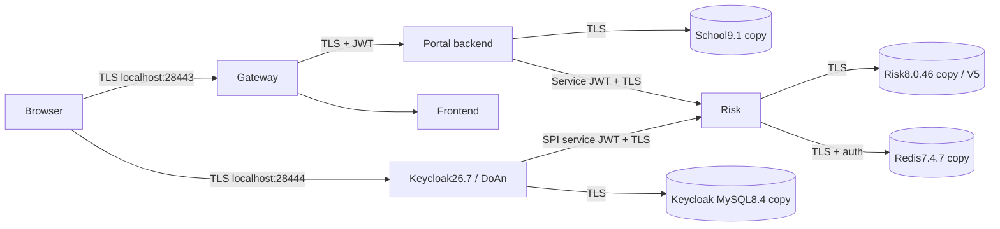

# Legacy-data Docker candidate

> Cập nhật 30/10/2026: runtime canonical dùng source ADMIN/STUDENT; B0 tiếp tục chạy,
> B1 chưa deploy. TLS/CDP đã sửa và CRL vừa gia hạn theo phê duyệt: CRLNumber1793327448,
> NextUpdate **06/11/2026 09:30:48 GMT+7**; không restart service. Windows Schannel,
> Java HTTPS có kiểm tra thu hồi, Docker10/10 và bảo toàn dữ liệu PASS. Xem
> [báo cáo tổng hợp](../../ZEROTRUST_FINAL_CONSOLIDATION_REPORT.md#tlscrl-maintenance--november2026)
> để biết phạm vi và giới hạn cache/evidence. Kiểm tra CRL hằng ngày/trước demo,
> gia hạn khi còn≤2 ngày, khoảng04/11/2026 09:30:48 GMT+7 cho bản này. Các trạng thái
> acceptance bên dưới thuộc lịch sử đã ghi ngày; cấu hình synthetic chỉ để tham
> chiếu, không phải môi trường cần tạo lại.

Status 2026-10-26: approved copy migrations/import completed; focused ADMIN/STUDENT
password+OTP, JWT/RBAC and trusted-device relogin verified. Full acceptance remains
NOT_VERIFIED because manual Windows browser confirmation and a real HIGH login are outstanding.

Current scope confirmed by the owner on 2026-10-27: ADMIN/STUDENT score viewing and
score administration only. Teacher, teaching assignments and timetables have been removed
from source and are not acceptance requirements. Historical runtime results below belong
to their dated builds; rebuilding and deploying the changed source is a separate step.
One source codebase supplies three configurations:

| Configuration | Purpose | Data/bootstrap |
|---|---|---|
| compose.yaml, scripts/demo/demo.ps1 | Existing synthetic development profile | Explicit Demo fixtures in deploy/demo/fixtures.py |
| compose.legacy.yaml, scripts/legacy | Isolated legacy integration candidate | Verified backups/official exports; no fixture seed or bootstrap admin |
| compose.primary.example.yaml | Future primary template | Requires explicitly selected release/state; no cutover configured |

Existing Java/frontend/Gateway Dockerfiles are reused. The historical internal mount
name /run/demo is retained for image compatibility; it points to the new private legacy
configuration, never .local-demo or QA volumes.

## Một checkout source cho phát triển và triển khai

IntelliJ, Codex và lệnh Compose phải dùng cùng một checkout của branch
`zerotrust-v4-risk-scoring`. Bốn Maven project độc lập là `pom.xml`,
`risk-scoring-service/pom.xml`, `gateway/pom.xml` và `keycloak-risk-extension/pom.xml`;
frontend ở `frontend/`. Trong IntelliJ, mở thư mục gốc và liên kết thêm ba POM con
vào Maven nếu IDE chưa nhận diện; dùng JDK 17. Docker build lấy source từ checkout
này; container đang chạy dùng image đã build, không tự thay đổi khi sửa file trong IDE.
Private runtime storage nằm ngoài Git và không phải một bản source khác.

## Các ràng buộc vận hành đã hợp nhất từ source cũ

`ScoreEntity` dùng `scores.version` để phát hiện hai transaction cùng cập nhật một
bản ghi. Transaction xung đột rollback và API trả `409 CONCURRENT_MODIFICATION`;
người dùng cần tải lại dữ liệu trước khi quyết định sửa tiếp. Không tự động retry
PATCH vì có thể ghi đè thay đổi chưa được người dùng xem. Cơ chế này chưa có
`If-Match`/version gửi từ form để phát hiện form cũ nếu transaction sau chỉ bắt đầu
khi transaction trước đã commit. Xem [mapping](../../src/main/java/com/zerotrust/zerotrust/entity/ScoreEntity.java)
và [kiểm thử concurrency](../../src/test/java/com/zerotrust/zerotrust/service/impl/ScoreUpdateConcurrencyTest.java).

Candidate legacy đã có cột version; start thông thường không chạy lại SQL/DDL.
Khi chuẩn bị một database khác, đối chiếu schema và kế hoạch migration trước khi
dùng [migrate_score_version.sql](../../database/migrate_score_version.sql).
SQL cập nhật điểm trực tiếp cũng phải tăng version; xem
[recalculate_score_results.sql](../../database/recalculate_score_results.sql).
Deployment hiện có dùng JPA `validate`; không dùng schema auto-update để thay migration.

Keycloak admin client có pool và timeout cấu hình qua các biến sau:

| Biến | Mặc định | Phạm vi |
|---|---|---|
| `KEYCLOAK_CONNECT_TIMEOUT` | `3s` | Thiết lập kết nối |
| `KEYCLOAK_READ_TIMEOUT` | `5s` | Đọc dữ liệu từ Keycloak |
| `KEYCLOAK_CONNECTION_CHECKOUT_TIMEOUT` | `3s` | Chờ connection trong pool |
| `KEYCLOAK_CONNECTION_POOL_SIZE` | `10` | Số connection tối đa |

Timeout là giới hạn từng giai đoạn, không phải thời hạn tổng của một thao tác.
Định dạng, giới hạn và validation theo
[KeycloakAdminProperties](../../src/main/java/com/zerotrust/zerotrust/config/KeycloakAdminProperties.java)
và [application.properties](../../src/main/resources/application.properties).
Các kiểm thử pool dùng HTTP server giả lập, không thay thế kiểm thử tải Keycloak thật.

## Boundaries and outstanding decisions

- Source/operational/frozen restore databases are never application test destinations.
- The original 2026-10-26 deployment added three empty teaching tables and a ledger.
  They are retained as historical data; the score portal does not map or use them.
  New provisioning performs a read-only School check with no additive DDL.
  Five existing tables/49 rows, scores.version and six BINARY16 subjects must remain identical.
- Initial V5 inspection found one DoAn subject with two TRUSTED devices and no
  subject_device_trust row/reset audit. The owner approved exactly one generation-zero
  initialization on the new copy; immutable V5/checksum661092940 then migrated and
  validated successfully. Source/frozen data remains unchanged. Future runs must never
  generalize this reconciliation to other subjects or reimport into this existing copy.
- Two non-realm trust IDs (generation0, no devices/audits) and five events for one of
  those IDs remain unchanged. Their provenance is unresolved; never delete/remap them.
- The historical check found no TEACHER role or teaching data in the legacy dataset.
  No new role, account or mapping is required; only ADMIN/STUDENT belong to the current scope.
- Existing ADMIN and STUDENT credentials were supplied privately and verified through
  normal password+OTP login. No replacement account or credential reset was needed.

## Keycloak supported-database rehearsal

Use exact Keycloak26.7.0. The CLI import image keeps the original provider/theme; the
runtime image uses published source. Their only behavioral bytecode difference is the
published BrowserFlowRiskConfigLocator check that ignores disabled executions.
Service-loader text and six theme files differ only in line endings. Do not regress that
source hardening to make the old binary hash match.

Target is a fresh MySQL8.4.13 database, pinned by digest. Current official guidance supports
[MySQL8.4 LTS](https://www.keycloak.org/server/db). Import original CLI exports with all nodes
stopped, then export again and compare realm/user IDs, roles/groups/clients/service accounts,
flows, password/OTP/recovery credential hashes and signing-key component state before
changing candidate endpoints. See [official CLI limitations](https://www.keycloak.org/server/importExport).
Sessions, user/admin events, workflow state and revoked-token state are not transferred by
CLI export/import; original full H2/filesystem backups remain available. No direct SQL conversion.

Only after comparison passes: change two authenticator URLs, SPA redirects/origin/PKCE
and realm TLS requirement/canonical frontendUrl on the candidate. The imported legacy
frontendUrl otherwise overrides the HTTPS hostname with HTTP8180. Keep failureMode DENY, credentials, roles,
flow bindings and user IDs. No import-realm on ordinary runtime startup; no Demo seeding.

Raw client JSON differs because official import materializes default logout URIs,
userinfo mapper flags, default protocol and secrets on built-in bearer-only clients.
The comparator retains raw results and compares these specific effective defaults;
all original service secrets, IDs, grants, audiences, redirects and flows stay strict.

## Verified candidate topology



Core network is internal. Only Gateway/Keycloak/public CRL use the separate edge bridge
for loopback host access. DB/Redis have no host ports. All bound URLs are new candidates;
Keycloak blocks host.docker.internal. Expected issuer https://localhost:28444/realms/DoAn,
internal JWKS https://keycloak:28444/realms/DoAn/protocol/openid-connect/certs, Portal
audience zerotrust-api and Risk audience/caller roles remain unchanged. Original peppers,
client secrets, Redis namespace and network policy are preserved; no synthetic credentials.
Original City/ASN GeoIP datasets are copied privately with hashes and Linux runtime paths;
GeoIP remains enabled, with no remote lookup or silent fallback to a disabled feature.
CLI exports and automation admin credentials are separate from steady-state application mounts.

## Commands and execution guard

Prerequisites: Docker Compose/BuildKit, Java17 for local tests, Python3.11+ for host
orchestration. Database clients/cryptography run in the tools image built from committed packaging.
Private state and source backup directory are explicit parameters, outside Git.

### Clone, resolve configuration and build from source

Use the release containing this guide. All build contexts are `.` relative to the
repository; Dockerfiles compile Java/SPI and frontend from source. No QA02C or synthetic
Demo JAR is required. The existing `deploy/demo` directory supplies shared Dockerfiles,
not a second application source tree. Only an explicitly selected migration import
image uses the preserved original provider/theme as private BuildKit inputs.

The public `.env.legacy.example` contains no secrets. Keep the actual env file and
prepared legacy runtime outside Git. `LEGACY_STATE_DIR` may be absolute or relative;
relative paths resolve from the Compose project directory, not the env-file directory
or shell working directory. Always specify the project/file/env explicitly:

```powershell
$Repo = (Get-Location).Path
$PrivateEnv = 'PATH_TO_YOUR_PRIVATE_COMPOSE_ENV'
# Source-only validation; does not need private service env files or data.
docker compose --project-directory "$Repo" --project-name zerotrust-legacy-integration-20261026 --env-file "$Repo\.env.legacy.example" -f "$Repo\compose.legacy.yaml" --profile legacy config --no-env-resolution --quiet
# Full configuration validation requires the prepared external runtime files.
docker compose --project-directory "$Repo" --project-name zerotrust-legacy-integration-20261026 --env-file "$PrivateEnv" -f "$Repo\compose.legacy.yaml" --profile legacy config --quiet
# Build steady-state images only. This does not start services or restore data.
docker compose --project-directory "$Repo" --project-name zerotrust-legacy-integration-20261026 --env-file "$PrivateEnv" -f "$Repo\compose.legacy.yaml" --profile legacy build backend risk frontend gateway keycloak crl
```

Do not run an unqualified `docker compose up` from this repository: the default
`compose.yaml` is the separate synthetic development configuration. Building source
does not restore private data. A different host requires an approved restore from
the preserved backups into its own empty volumes; a clone cannot recreate legacy
passwords/OTP/data without those private inputs. Existing deployments use the safe
start/status/stop helper below, which never creates containers or imports data.

For this existing candidate, use only:

```powershell
python -X utf8 scripts/legacy/operate.py start
python -X utf8 scripts/legacy/operate.py status
python -X utf8 scripts/legacy/operate.py stop
```

These commands verify ownership and operate on existing container IDs only. They do
not create/delete volumes or containers, run SQL, import realms, build or seed data.
The steady Risk service explicitly disables application-start Flyway; JPA remains
`ddl-auto=validate`. The separate approved migration job still applies and validates
immutable V1–V5 before first start. No schema migration is skipped or repaired.
Do not run prepare_plan or execute again against an environment with an execution journal.

Initial provisioning below is for a separately approved, empty destination, never restart:

```powershell
# Bootstrap is separate and requires its original private provider/theme inputs.
# These commands are NOT part of ordinary start or a routine rebuild.
python scripts/legacy/prepare_plan.py --source "$Preservation" --private "$Private"
python scripts/legacy/rehearse.py check --plan "$Private\execution-plan.private.json"
# execute requires the one owner approval; the generated approval file defaults to false.
python scripts/legacy/rehearse.py execute --plan "$Private\execution-plan.private.json" --approval "$Private\runtime\approval\owner-approval.private.json"
```

No commit/push, primary deployment, frozen restore change or source cutover is performed.
The approval binds exact source/config hashes, image IDs, backups, destinations, grants,
one optional reconciliation row and test budgets. A failed invariant stops the run;
do not clean/repair, reset credentials or alter security contracts.

## Acceptance and rollback

Migration success alone is not LEGACY_DOCKER_INTEGRATION_VERIFIED. Focused Browser/API
acceptance covers real LOW/MEDIUM/HIGH outcomes, MFA, Student ownership and Admin authorization,
logout/relogin, persistence and TLS/JWT/RBAC without bypass. Keep original grade rows unchanged.
Real HIGH reproduction remains an explicit gap, never synthetic PASS. Teacher mapping is outside the project scope.
Manual Windows browser remains NOT_VERIFIED until the owner confirms it.

### Manual Windows demo checklist — owner confirmation pending

Use the existing QA-only Firefox executable/profile described in the local completion
report; its NSS certificate store trusts only the candidate CA. The owner also approved
trusting the exact project CA in Windows CurrentUser Root on 28/10/2026 for this machine.
Do not install another CA or change LocalMachine Root without separate approval. Do not
accept a certificate warning, disable hostname validation or save passwords.
Open `https://localhost:28443/` and use existing credentials supplied privately.

- ADMIN: sign in, use the existing authenticator OTP when requested, view users/classes/subjects and the score sheet.
- Sign out completely, then STUDENT: sign in with the old password/OTP, check own personal information and grades.
- A trusted device may correctly skip OTP on relogin. To demonstrate the OTP challenge, use the preserved, privately prepared separate QA browser profile without an issued device cookie; do not revoke existing devices or reset OTP.
- Confirm Student cannot open Admin resources; sign out and sign in again, checking the expected account and page.
- Review Admin management screens. Do not save changes to the 49 preserved rows merely to demonstrate buttons; a write demonstration needs an explicitly approved disposable record and cleanup plan.

No manual PASS is recorded until the project owner confirms these steps.

### Phạm vi xem điểm và bảo toàn dữ liệu cũ

Chủ đồ án xác nhận ngày 27/10/2026 chỉ dùng ADMIN/STUDENT. Không tạo role/tài khoản
Teacher, không cần phân công giảng dạy hoặc dữ liệu lịch học để nghiệm thu. Source
không còn API `/api/teachers/**`, `/api/admin/teachers`, `/api/admin/teaching-assignments`,
`/api/admin/schedules` và `/api/students/me/schedule`.

Nếu bản cài trước đã có các bảng mở rộng hoặc role cũ, giữ nguyên chúng cùng dữ liệu
và migration ledger; việc gỡ source không tự xóa hay thu hồi tài khoản trên Keycloak.
Không chạy SQL DROP, reset volume hoặc import lại realm. Runtime JPA validate chỉ dùng
năm entity học vụ gốc; `scores.version` vẫn được giữ để chống ghi đè điểm.

Provisioning mới dùng job `school-check` với [school_validate.py](../../scripts/legacy/school_validate.py)
để đối chiếu schema/row hash của năm bảng gốc bằng truy vấn chỉ đọc. Job tạo bảng
Teacher cũ đã được loại khỏi Compose. Các SQL cũ được giữ như [lịch sử migration](../../database/migrations/school/README.md).
Plan/approval cho một destination mới phải được chuẩn bị lại với scope
`score-portal-admin-student`; không tái sử dụng approval của kế hoạch mở rộng cũ.
Start/stop thông thường của candidate hiện có vẫn không chạy provisioning hoặc migration.

### Real HIGH limitation

Existing actor tests observed normal MFA/trusted-device paths. No safe HIGH condition
was reproduced on their real network/device context. A security-revoked device requires
its original raw cookie; stored HMACs cannot recover that cookie. Do not revoke old
trusted devices, forge forwarding headers/IP context or change thresholds to obtain
HIGH. Keep real HIGH Browser NOT_VERIFIED until an authorized actor has a genuine
applicable risk signal and a separately agreed, non-destructive test can demonstrate it.

TLS uses an internal self-signed CA in Docker/Java bundles and a dedicated QA Firefox
profile. On 28/10/2026 the owner separately approved adding its public certificate to
Windows CurrentUser Root for the current user. LocalMachine Root is unchanged. This
makes applications using that store trust TLS certificates issued by this CA, rather
than limiting trust to one Portal tab. CA/leaf AKI/SKI, SAN and usages remain required.
The current CA SHA1 thumbprint is 5DFA54E7FE9DC555E0A56BAE2DA635B05187ADA0. Verify
that identity against the preserved CA before any import. Fresh deployments have their
own CA identity and require their own trust decision; bootstrap never installs Windows roots.

On partial DDL/import failure, stop only this candidate project and retain its volumes/logs.
Do not attempt reverse MySQL DDL or Flyway repair/clean. Recover from the verified backup
into a reviewed clean candidate destination; original/frozen backups remain untouched.
Initial database integration did not install Windows certificates. The later, separately
approved CurrentUser CA import is recorded below. Never remove pre-existing certificates
or another project's containers/volumes.

See [School migration contract](../../database/migrations/school/README.md).

## Windows TLS và bảo trì CRL

Gateway/Keycloak phục vụ Windows tại `https://localhost:28443` và
`https://localhost:28444`. Chứng chỉ mới dùng một DistributionPoint với hai URI
của cùng CRL DER: `http://localhost:28445/ca.crl` cho Windows và
`http://crl:8080/ca.crl` cho Docker. Đây là các địa chỉ thay thế theo
[RFC 5280 §4.2.1.13](https://www.rfc-editor.org/rfc/rfc5280.html#section-4.2.1.13).
Không đổi DNS/hosts, không mở CRL ra ngoài loopback Windows. Thay đổi Windows trust
store cần phê duyệt riêng; CA hiện tại đã được chủ đồ án duyệt trong CurrentUser Root
ngày 28/10/2026. Backend/Risk tiếp tục dùng SAN và CDP nội bộ hiện có.

`prepare.py` chỉ chuẩn bị một destination mới. Không chạy lại để sửa TLS của
runtime đã có dữ liệu. Công cụ sau chỉ đọc hoặc tạo ứng viên riêng, không cài
chứng chỉ, không restart và không tác động database:

```powershell
# $Runtime: runtime_directory từ CANONICAL_COMPOSE_ENTRYPOINT.json riêng tư.
# $PkiPython: Python có cryptography >= 44; dùng môi trường PKI hiện có.
& $PkiPython -X utf8 deploy/legacy/tls_material.py --state $Runtime --check
# Kiểm tra mỗi ngày khi sử dụng và trước buổi demo; gia hạn khi còn <= 2 ngày.
# Gia hạn CRL: giữ nguyên mọi entry thu hồi, tăng CRLNumber, ký bằng CA cũ.
& $PkiPython -X utf8 deploy/legacy/tls_material.py --state $Runtime --output .local-legacy/tls-renewal-YYYYMMDD
```

CRL mới có hạn tối đa 7 ngày và không vượt hạn CA. Manifest ghi hash đầu vào,
file ứng viên và file `before/` để rollback. Thư mục output phải mới, nằm trong
`.local-legacy` bị Git/Docker ignore và phải có ACL riêng tư tương đương runtime.
Không commit output, CA key, keystore, mật khẩu hoặc evidence riêng tư.
Chỉ thêm `--reissue-public-certificates` khi đã review việc cấp lại Gateway/Keycloak;
giữ nguyên private keys, SAN, EKU, thời hạn và CA. Không dùng thao tác này để
thay thế chứng chỉ đã bị thu hồi hoặc đã hết hạn.

Trước khi cài, đối chiếu **toàn bộ** `inputs_sha256` với runtime, kiểm tra chữ ký,
issuer, hạn CRL, SAN/EKU, key matching và danh sách thu hồi. Xin duyệt nhóm thay
đổi runtime. Cài đúng allowlist `changes` và giữ bản `before/`; chỉ CRL đổi thì
HTTP server đọc file mới ngay, không cần restart. Khi đổi leaf, restart đúng
Gateway/Keycloak hiện có và kiểm tra Windows Schannel mặc định bằng
`curl.exe --cacert "$Runtime/public-ca/ca.crt" https://localhost:28443/`
cùng OIDC discovery tại Keycloak. Kiểm tra kết nối Gateway→Backend/Keycloak và
Backend→Risk; nếu lỗi, khôi phục allowlist `before/` rồi restart đúng hai service.
Không dùng tùy chọn bỏ xác minh hay bỏ kiểm tra thu hồi. Không sửa MFA/JWT keys.

### Kiểm tra Windows native trust sau phê duyệt CurrentUser CA

Thêm public CA vào Windows Root là quyết định riêng của chủ máy; không tự làm cho
máy mới và không dùng để bỏ qua TLS verification. Chỉ cài CA đã xác minh fingerprint,
không cài server leaf hoặc private key. Ghi snapshot CurrentUser/LocalMachine roots
trước/sau để chứng minh chỉ thêm một CA vào CurrentUser và giữ các root khác nguyên vẹn.
Nếu rollback, chỉ gỡ đúng thumbprint đã được workflow thêm, có journal xác nhận nó
không tồn tại trước đó. Không xóa một root chỉ dựa trên tên subject.

Sau import đã được duyệt, kiểm tra kho native, không chỉ định `--cacert`:

```powershell
curl.exe --disable --noproxy "*" --fail --show-error https://localhost:28443/
curl.exe --disable --noproxy "*" --fail --show-error https://localhost:28444/realms/DoAn/.well-known/openid-configuration
curl.exe --disable --noproxy "*" --fail --show-error https://localhost:28444/realms/DoAn/protocol/openid-connect/3p-cookies/step1.html
```

Giữ revocation mặc định. Native X509Chain dùng System trust, Online/ExcludeRoot,
NoFlag phải hợp lệ và chain kết thúc tại CA đã duyệt. Sau đó người dùng reload
Portal để xóa trạng thái init thất bại trong bộ nhớ trang; nếu browser còn cache
lỗi chứng chỉ, lưu công việc rồi đóng/mở lại. Không chấp nhận cảnh báo HTTPS.
HTTP 200 và chain hợp lệ chưa xác nhận user login/OTP hoặc Adaptive Browser Flow;
những mục đó cần thao tác thật và log tương ứng. Kết quả hiện tại nằm trong báo cáo
tổng hợp duy nhất `ZEROTRUST_FINAL_CONSOLIDATION_REPORT.md` ở gốc repository.

### Frontend phải gọi API qua Gateway

Canonical frontend build đặt `API_BASE_URL` thành chuỗi rỗng và Dockerfile ánh xạ
nó vào `NEXT_PUBLIC_API_BASE_URL` trước Next build. Browser gọi `/api/...` theo
cùng HTTPS origin của Portal. Không để bundle fallback sang `http://localhost:8080`
ở canonical Docker. Các biến `NEXT_PUBLIC_*` được đóng gói lúc build; chỉ đổi env
của container đã build không sửa bundle hiện có. Cần build lại đúng Frontend,
kiểm tra compiled chunks và giữ rollback image trước khi duyệt recreate.
Sau đổi image, người dùng reload trang để lấy bundle mới; không sửa credentials,
CORS hoặc RBAC nhằm làm một API origin sai trở thành hợp lệ.

## Demo bảo vệ — checklist canonical hiện có (30/10/2026)

Kết quả nghiệm thu cuối nằm trong
[báo cáo tổng hợp](../../ZEROTRUST_FINAL_CONSOLIDATION_REPORT.md#final-system-acceptance--demo-readiness--30102026).
B0 là mô hình runtime; B1 chỉ là ứng viên nghiên cứu đã lưu source, chưa deploy
và chưa có bằng chứng tốt hơn. Frontend sửa Logout đã deploy sau phê duyệt ngày
30/10, image `ec28b638e7db…`, rollback `ca0f65adff31…`; L1 normal Logout trên image
cũ PASS, L2 Browser trên image mới chờ xác nhận. Một TIMEOUT Risk tạm thời đã
fail-closed, nguyên nhân chưa xác định; không nới policy hoặc tự tăng timeout.

1. Mở Docker Desktop, chờ Engine sẵn sàng. Trong PowerShell:

   ```powershell
   Set-Location 'C:\Users\DELL\Documents\zerotrust\zerotrust'
   python -X utf8 scripts/legacy/operate.py status
   # Chỉ khi các canonical containers hiện có đang stopped:
   python -X utf8 scripts/legacy/operate.py start
   ```

   Cần10/10 healthy. Helper chỉ start các container đã có; nếu thiếu/sai owner,
   dừng và điều tra, không tạo project khác, chạy init/import hay compose down -v.

2. Kiểm tra HTTPS/CRL bằng quy trình bảo trì ở trên và native Schannel Portal/
   Discovery. Hạn hiện tại06/11/2026 09:30:48 GMT+7; chuẩn bị gia hạn từ04/11/2026
   09:30:48 GMT+7. Không vượt cảnh báo HTTPS, tắt revocation hoặc tự thêm CA.
3. Vào `https://localhost:28443/`, tự login ADMIN và OTP khi được yêu cầu.
   Mở quản lý tài khoản/sinh viên/lớp/môn/điểm, lọc và xem điểm. Dữ liệu gốc chỉ
   đọc, không bấm Lưu/Xóa/Reset MFA. CRUD được minh họa bằng kết quả integration
   tests H2 riêng; muốn demo ghi thật cần fixture/ownership/rollback được duyệt.
4. Nhấn Đăng xuất một lần, hoàn tất xác nhận tại Keycloak nếu có; về màn hình
   login, mở lại protected route để kiểm tra không tự trở lại dữ liệu. Nếu vẫn
   còn phiên, ghi thời điểm và tên/status logout request, không copy query,
   cookies/token. Chưa tuyên bố logout PASS chỉ vì giao diện quay về root.
5. Login STUDENT hiện có, tự nhập OTP nếu yêu cầu. Xem hồ sơ/bảng điểm chính mình,
   lọc/Đặt lại; giải thích subject mapping và quyền read-only. Màn hình ADMIN
   không render cho STUDENT; backend/gateway vẫn là nơi quyết định truy cập.
6. Minh họa Adaptive bằng trace đã lọc, không mở raw private evidence khi chiếu:
   A1 LOW25/ALLOW; A2 trusted12.5/ALLOW; A3 mandatory guard32.5/MFA;
   A4 priority HIGH/DENY score-null; A5 scored MEDIUM50/MFA;
   A6 scored HIGH82.5/DENY. Đối chiếu evaluation/correlation, decision source,
   enforcement và outcome; không suy MEDIUM từ OTP. Không tạo lại A5/A6,
   revoke device hoặc cố gây thất bại đăng nhập chỉ để demo.
7. Giải thích B0 có bốn nhóm25%, ngưỡng40/75; mandatory/priority và fail-safe
   độc lập điểm. B1 làm mịn Temporal/History, giữ default B0 và chưa deploy.
   Dữ liệu nghiên cứu là synthetic/controlled, không gọi là dữ liệu tấn công
   thực hay Accuracy/FPR/FNR. Trình bày decision differences và giới hạn nhãn
   từ báo cáo nghiên cứu, không chỉ chọn kết quả thuận lợi.
8. Kết thúc: logout người dùng, lưu kết quả đã lọc. Nếu cần dừng hệ thống:

   ```powershell
   python -X utf8 scripts/legacy/operate.py stop
   ```

   Không xóa containers/volumes/backups hoặc dùng source archive thay canonical.
