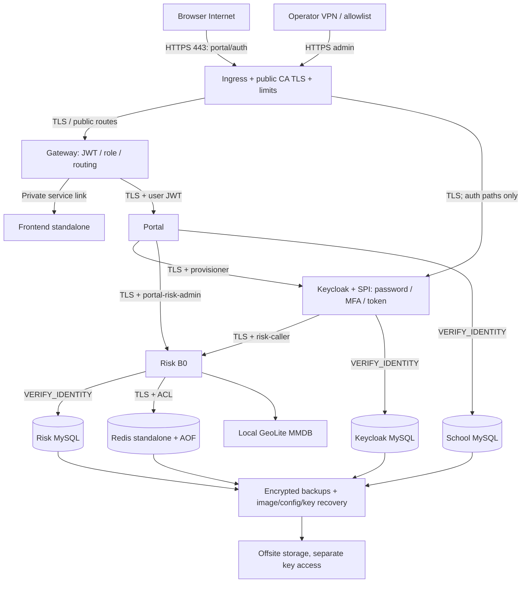
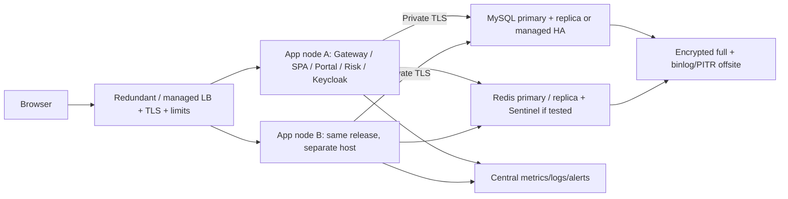

# Kiến trúc Production đề xuất

**06/11/2026; baseline c401e17; Proposed, chưa triển khai/chưa được chấp thuận. Overall hiện tại NO-GO.** Phạm vi ADMIN/STUDENT và B0. [Readiness](PRODUCTION_READINESS_REPORT.md), [inventory hiện trạng](BASELINE_INVENTORY.md), [security](SECURITY_AUDIT.md). Không mặc định nhà cung cấp, không bắt buộc Kubernetes.

## Giả định để lập kế hoạch

| Yếu tố | A — quy mô nhỏ | B — tăng trưởng/khôi phục nhanh |
|---|---|---|
| Tài khoản / active sessions | Giả định 500–2.000 / 20–50 | Giả định 5.000–20.000 / 100–300 |
| Workload để nghiệm thu | 5 API req/s steady, 20 burst; 0,2 auth/s steady, 2 burst | 30 API req/s steady, 100 burst; 1 auth/s steady, 5 burst |
| Dữ liệu | School/Risk/Keycloak tổng nhỏ hơn 20 GB, log có quota | Growth và index/data/backup sizing theo đo thực |
| Availability đề xuất | 99,5%/tháng, có maintenance; host fail phải restore | 99,9% chỉ khi topology/failover và vận hành đã chứng minh |
| Recovery đề xuất | RPO24h/RTO4h chỉ nếu chủ dữ liệu chấp nhận | RPO15m/RTO60m với PITR/replication/rehearsal |
| Nhân sự | Ít nhất primary + backup operator, lịch xử lý sự cố rõ | On-call, patch/failover/restore owner và capacity planning |

Đây là **giả định/test targets, không phải capacity đã đo hay SLA/SLO được duyệt**. Số tài khoản không chuyển trực tiếp thành RPS; enrollment/MFA/password hashing và NAT/burst phải mô phỏng riêng. Hệ thống ghi điểm chính thức có thể không chấp nhận RPO24h: khi đó A phải bổ sung binlog/PITR và backup phù hợp, hoặc chọn B.

## A — Một Linux server chạy Compose

Đề xuất khởi điểm **8 vCPU/16 GiB RAM/200–250 GB NVMe**, persistent disk và encrypted offsite backup. 4vCPU/8GiB chỉ là pilot sau benchmark: giới hạn memory Lab hiện cộng **5.3125 GiB**, chưa tính OS/Docker/cache/ingress/monitoring/backup; không đủ căn cứ hứa cùng sizing chịu được Production. Chốt actual request/limit/heap theo peak RSS/GC/pools; chừa 25–30% headroom và disk cho binlog/AOF/backup staging.

Sơ đồ Proposed, không phải topology đã chạy. Runtime source chứng minh các đường API/JWT/TLS cơ bản; ingress/monitoring/offsite Production chưa tồn tại. Mermaid được kiểm cú pháp/source, chưa render bằng engine đồ họa trong audit.

Service gồm 10 vai trò Lab hiện hữu và ingress; giữ CRL service nếu internal PKI dựa CRL, không mang authority/private key vào HTTP document root. CRL endpoint công khai chỉ chứa public material đã allowlist; health phải kiểm freshness/signature, không chỉ HTTP200. Tối giản CRL image là cải thiện có thể làm sau khi policy PKI chốt.

- **Mạng:** chỉ ingress public443, port80 nếu cần ACME/redirect; admin/VPN allowlist. Không publish School/RiskDB/KeycloakDB/Redis/Risk API/management ports. Tách ingress, application, identity/risk và data networks theo đường cần thiết; host firewall vẫn cần kiểm chứng ngoài Compose. Không dùng external volumes/network Lab.
- **TLS:** public CA cho portal/auth; internal PKI cho Java/MySQL/Redis, hostname VERIFY_IDENTITY. Gateway→frontend trên cùng host/private network có thể là HTTP exception được ghi nhận; nếu yêu cầu encryption toàn tuyến thì TLS hoặc local proxy, cần test Next path. Đưa sang host khác phải mã hóa link này.
- **Domain/OIDC:** ví dụ tài liệu `portal.example.invalid` và `auth.example.invalid` chỉ là placeholder. Chọn domain thật, canonical issuer đồng nhất; internal JWKS/token route có thể khác hostname kết nối nhưng cert/issuer không nới validation. Exact redirects `/` và silent-check-sso.html, exact logout origin; không wildcard. SPA NEXT_PUBLIC_* là build-time, cần rebuild đúng domain.
- **Secrets:** independent prod identities/peppers/passwords/signing keys/CA. Secret store theo provider hoặc encrypted file vault trên host có ACL/mount RO; app đọc reference qua prepared runtime files. Không đặt secret trực tiếp vào Compose được commit hoặc ENV image. Bootstrap/admin/provisioner/risk-caller/portal-risk-admin tách quyền; app DB DML, migrator DDL, backup account riêng. Secret mounts không tự mã hóa disk.
- **Persistence:** data volumes có nhãn prod/environment mới, owner và backup scope; không bind NTFS world-writable server.cnf trong Linux deployment. MySQL LTS/version tương thích Keycloak chọn sau thử logical migration; Redis standalone tránh CROSSSLOT script hiện có.
- **Risk database migration:** V5 Java hiện chỉ nhận MySQL8.0.46; đề xuất LTS khác không có nghĩa Flyway fresh-install chạy được ngay. Thử reviewed bootstrap/upgrade/import-ledger hoặc installer mới trước, giữ applied migration immutable và kiểm bytecode checksum khi patch JDK. Đây là PR-011 blocker, không thực hiện migration trong audit.
- **Vận hành:** restart/supervisor, drain/graceful shutdown, readiness thật, external uptime/TLS/backup alerts, central logs có retention; metrics JVM/DB/Redis tối thiểu. Có thể dùng hosted monitoring để giảm công vận hành, chưa quyết định vendor.
- **Backup/rollback:** full data + runtime/key/image inventory theo recovery point nhất quán; encrypted offsite, rehearsal stack riêng. Không rollback DB binary/downgrade datadir. Image digest N-1 giữ trong registry/offsite, app/schema compatibility được thử.

**Chi phí:** dự trù ngân sách nội bộ khoảng **2–4 triệu VND/tháng** cho compute/disk/backup/monitoring quy mô A; đây là planning envelope chưa phải báo giá thị trường. Chưa gồm nhân công, thuế, egress đột biến, domain/PKI theo lựa chọn và DR compute. Lấy ít nhất hai báo giá cùng thông số/region/support/backup trước mua; nếu budget thấp hơn, giảm cohort theo benchmark hoặc thay RTO, không bỏ backup/secrets.

**Giới hạn:** host/disk/network/DB/Redis đều SPOF. Restart policy khôi phục process, không khôi phục host mất. Maintenance/backup cold gây downtime. Không gọi A là High Availability.

## B — Nhiều máy chủ, không mặc định Kubernetes

Tối thiểu để tách tài nguyên: application host và data host trên private network. **Hai host chỉ tách app/data vẫn có SPOF ở từng host, chưa HA.** Để chịu app host failure: hai app nodes qua LB; mỗi node chạy Gateway/Frontend/Portal/Risk/Keycloak theo capacity, config/secret/image digest thống nhất.

- **Sizing dự kiến để thử:** hai app nodes khoảng4vCPU/8–12GiB mỗi node; data primary/replica khoảng4vCPU/16GiB mỗi node hoặc managed equivalent, storage/IOPS theo query/redo/binlog. Không cam kết số liệu này đủ chịu tải B. LB, backup object storage và monitoring không đặt duy nhất trên một app host nếu yêu cầu HA.
- **Keycloak:** clustering/caches/discovery đúng phiên bản, shared supported DB, private transport; cần [caching/node discovery](https://www.keycloak.org/server/caching) và [production configuration](https://www.keycloak.org/server/configuration-production). Không mở cluster/management ports Internet. Thử restart node giữa login/MFA; session consistency/sticky behavior không suy từ có hai container.
- **MySQL:** primary+replica với failover thủ công giảm RTO nhưng không bảo đảm tự HA/RPO0. Tự động failover cần quorum/fencing/consistency được kiểm chứng hoặc managed HA; không promote hai primary. Có thể dùng một MySQL cluster cho ba schema với account tách biệt sau compatibility/load test; đây là lựa chọn chưa chốt, không hợp nhất DB trong audit.
- **Redis:** standalone primary/replica+Sentinel có ít nhất3 voters trên fault domains phù hợp, test async replication loss. Không chọn Redis Cluster cho Lua hiện tại. Counter loss policy/backup recovery phải công khai.
- **Scaling:** app stateless không đồng nghĩa toàn hệ thống stateless; Keycloak sessions, JWT/JWKS caches, service token pools, Redis counters và subject locks cần capacity/consistency tests. Horizontal replicas cộng connection pools, phải giữ total DB connections dưới server budget.
- **Operational cost:** config rollout, PKI, cluster networking, failover, backups và on-call phức tạp hơn. Dự trù nội bộ **6–15 triệu VND/tháng hoặc hơn**, không phải báo giá, phụ thuộc managed services/HA/fault domain; nhân công chưa tính. Lấy báo giá và thử failover trước cam kết99,9%.

## So sánh và khuyến nghị có điều kiện

| Tiêu chí | A | B |
|---|---|---|
| Triển khai/vận hành | Đơn giản, Compose/systemd/supervision phù hợp đội nhỏ | LB/replicas/data replication, cần vận hành có kinh nghiệm |
| Availability | Một host, downtime khi hỏng/maintenance | Tốt hơn chỉ khi bỏ SPOF cả LB/data/control plane |
| Data safety | Backup/PITR vẫn bắt buộc | Replication không thay backup; failover cần fencing |
| Scaling | Vertical, giới hạn một host/IO | Horizontal app, data/query/locks vẫn giới hạn |
| Rollback | Một release lock; có thể downtime | Rolling chỉ khi schema/protocol tương thích; canary có gate |
| Phù hợp hiện trạng | Có điều kiện cho cohort nhỏ | Khi cần uptime/RPO/RTO tốt hơn và có nhân lực |

**Khuyến nghị:** sau khi đóng blocker, bắt đầu A cho Production nhỏ nếu chủ hệ thống chấp nhận SPOF/downtime và recovery targets đã diễn tập. Nếu đây là sổ điểm chính thức cần mất dữ liệu tối đa15phút/không dừng khi hỏng host, chọn B hoặc A kèm PITR với downtime được chấp nhận; không gọi A đáp ứng HA. Chưa nên mua hạ tầng trước khi chốt workload, dữ liệu, budget và mức vận hành.

Các quyết định bắt buộc nằm cuối [GO/NO-GO](PRODUCTION_GO_NO_GO.md). Tiếp theo: [deployment](PRODUCTION_DEPLOYMENT_PLAN.md), [operations](PRODUCTION_OPERATIONS_RUNBOOK.md), [rollback](PRODUCTION_ROLLBACK_PLAN.md).
