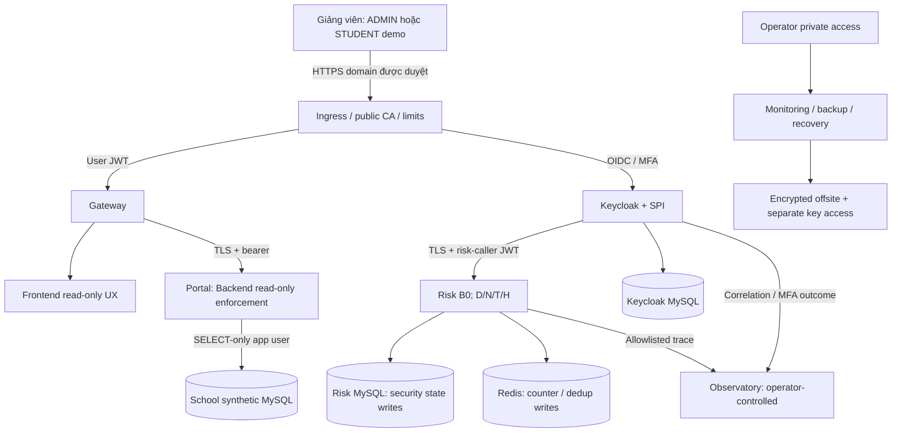
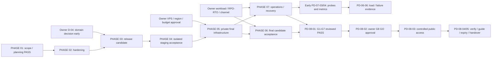

# PUBLIC DEMO PRODUCTION — MASTER ROADMAP

**SINGLE SOURCE OF TRUTH FOR PUBLIC DEMO PRODUCTION PROGRESS**

Chủ dự án chốt phạm vi ngày **06/11/2026**. Đây là tài liệu duy nhất quản lý phase, task, finding, gate, quyết định, rủi ro và tiến độ Public Demo. Các báo cáo audit/test/release là nguồn bằng chứng, không phải tracker thay thế. Đọc tài liệu này trước mọi nhiệm vụ Public Demo, kể cả khi bắt đầu chat Codex mới.

## 0. Progress Dashboard

| Chỉ số | Giá trị tại checkpoint PD-R23 |
|---|---|
| Overall Program Status | **PARTIAL — RC PROPOSED: DHI + MySQL 8.4.13. Source snapshot đã kiểm local, SOURCE NOT_FROZEN chờ duyệt commit, CI NOT_VERIFIED trên remote. D-14/D-17 PENDING. Libacl1 OPEN. VPS NOT_DEPLOYED / INTERNET NO-GO**. [EV-PD-AD-05](evidence/ACADEMIC_DEMO_RELEASE.md#pd-r23--source-freeze-và-sẵn-sàng-triển-khai) |
| Academic Demo local | **STAGING VERIFIED** trên loopback, tám dịch vụ đã healthy. Internet **NO-GO**. [EV-PD-AD-01](evidence/ACADEMIC_DEMO_RELEASE.md) |
| Academic Demo Linux | **PACKAGE VERIFIED** trên rehearsal Linux amd64. Bundle, smoke, restart và encrypted backups đã kiểm. VPS/PKI thật chưa nghiệm thu, teacher access NO-GO. [EV-PD-AD-02](evidence/ACADEMIC_DEMO_RELEASE.md#pd-r20--gói-linux-và-quyết-định-còn-mở) |
| Current Phase | **PHASE 02 — PRODUCTION HARDENING & SECURITY REMEDIATION: PARTIAL, 6/8 PASS và 1/8 PARTIAL** |
| Next Phase | **PHASE 03 — PRODUCTION RELEASE STANDARDIZATION**, sau khi Phase 02 đạt acceptance |
| Completed Phases | PHASE 01; không có phase kỹ thuật nào PASS |
| Pending Phases | PHASE 02, 03, 04, 05, 06, 07, 08 |
| Tổng task | **50** |
| TODO / IN_PROGRESS / PASS | **33 / 0 / 11** |
| PARTIAL / BLOCKED / NOT_VERIFIED / NOT_APPLICABLE | **1 / 5 / 0 / 0** |
| Findings còn mở | **18/18**; chưa có FIXED hoặc MITIGATED FOR PUBLIC DEMO |
| Applicable P1 blockers còn mở | **14**: PR-001–PR-013 và PR-015; tính cả gate thiếu evidence, không phải14 exploit |
| G1 / G2 / G3 / G4 / G5 / G6 / G7 | **PARTIAL / PARTIAL / PARTIAL / PARTIAL / PARTIAL / NOT_VERIFIED / PARTIAL**. Full restore và rollback synthetic đã kiểm ở PD-R22, scheduled/offsite và nghiệm thu trên host đích còn mở. |
| G8 — Final Release Decision | **BLOCKED** bởi G1–G7 và phê duyệt mở public chưa có |
| Next Recommended Task | Owner review allowlist PD-R23 để commit và chạy CI đúng SHA. D-14/D-17 và disposition còn mở theo PD-02-02. D-04 cần chốt để build frontend đúng hostname và nghiệm thu host. **PD-02-08** chờ PD-02-02 PASS. [EV-PD-AD-05](evidence/ACADEMIC_DEMO_RELEASE.md#pd-r23--source-freeze-và-sẵn-sàng-triển-khai) |
| Owner Decisions Pending | **15**, D-01–D-14 và D-17. Quyền thử D-14/D-17 đã duyệt. Còn quyết định artifact release, đường bootstrap V5, D-04 hostname và phê duyệt mở access. |
| Baseline audit Git SHA | `c401e17029d64f9a96738d845b8c0ad0f03fc164` — audit06/11, NO-GO |
| Current Git SHA | `c223276e8a223251ae6df8c7b3381436c54195b2` — HEAD thực tế PD-R23. Build PD-R22 giữ đúng SHA và app inputs. Snapshot PD-R23 chờ commit. |
| Git / Lab hiện tại | Branch ahead 7 theo tracking ref. `presentation/` ngoài allowlist. Lab và PD-R19 đối chiếu trong evidence PD-R23. |
| Public URL / release candidate | **NOT_PROVISIONED / PROPOSED (rehearsal .test)** |
| Last Updated | **08/11/2026, Asia/Saigon (GMT+7), PD-R23** |

Dashboard tính theo PASS / (tổng task − NOT_APPLICABLE) từ Master Task Tracker tại mục 9. PD-R23 giữ **11/50 = 22% khối lượng task**. Phase 02 có 6 PASS, 1 PARTIAL, 1 TODO. Guava/FTS5 vẫn là Category A trên candidate Quay.

## 1. Project Objective

Đưa ZeroTrust Adaptive Authentication lên **Public Demo Production** có domain/HTTPS hợp lệ trên Linux để giảng viên đánh giá đồ án. Giảng viên là người trải nghiệm, **không phải role TEACHER** trong hệ thống. Hệ thống không phải sổ điểm học vụ chính thức; School Portal chỉ dùng dữ liệu synthetic và chức năng học vụ chỉ đọc.

Kết quả cuối: URL được owner duyệt mở, tài khoản demo được cấp có kiểm soát, trải nghiệm ADMIN/STUDENT + Adaptive Authentication B0/MFA/Trusted Device, Observatory theo phạm vi riêng tư, security/capacity/recovery đã nghiệm thu, có người vận hành và ngày kết thúc dịch vụ. Roadmap được chốt không có nghĩa hệ thống đã đáp ứng các kết quả đó.

## 2. Approved Scope

Nguồn phê duyệt: yêu cầu chủ dự án06/11/2026 trong chat lập roadmap (E-PD-01). Quyết định mới về Public Demo/B0 là chính sách cho công việc tiếp theo; các câu “numeric policy chưa chốt” trong audit/ARCHITECTURE là mốc lịch sử, **không chỉnh audit để đổi NO-GO thành GO**.

| Phạm vi đã duyệt | Contract bắt buộc |
|---|---|
| Public Demo; không người dùng học vụ thật | Synthetic academic data, tài khoản demo giới hạn, public signup tắt mặc định |
| ADMIN / STUDENT | ADMIN đọc danh mục/bảng điểm; STUDENT chỉ đọc hồ sơ/điểm của mình; JWT/RBAC/ownership giữ nguyên |
| Academic read-only | Backend/API chặn thêm/sửa/xóa điểm, sinh viên, lớp, môn và provisioning học vụ trên public deployment; ẩn nút chỉ là UX bổ trợ |
| Adaptive stack | Keycloak + custom SPI + Risk Service + Spring Cloud Gateway + JWT/OAuth2/OIDC + MFA + Trusted Device + MySQL/Redis + Risk Observatory |
| B0 chính thức | D/N/T/H mỗi nhóm25%; LOW Risk<40, MEDIUM40≤Risk<75, HIGH≥75 |
| Security invariants | Mandatory MFA, Priority DENY, Missing Data, fail-closed giữ nguyên; B1 chỉ nghiên cứu, không deploy |
| Hosting | Single Linux Server + Docker Compose là ưu tiên ban đầu, chưa chọn/mua VPS/domain, không yêu cầu HA/Kubernetes |
| Isolation | Không copy DB/Redis/volumes/accounts/secrets/signing keys/CA từ Lab; không chuyển Lab thành Production |
| Internet baseline | Authentication/authorization/MFA/JWT/TLS/secrets/network/limits/dependency/backup/monitoring/regression vẫn bắt buộc |
| Lifecycle | Có backup/restore/monitoring, cấp quyền và expiration; có thể dừng khi hết mục đích bảo vệ |

### Contract read-only — source đã triển khai PD-02-01, deployment chưa verified

PD-02-01 đã hiện thực **deployment mode riêng** cho Public Demo trong working tree, không sửa quyền vận hành Lab. Hai marker bắt buộc là `PUBLIC_DEMO_MODE=public-demo` và `PUBLIC_DEMO_ACADEMIC_READ_ONLY=true`; profile `public-demo` không có fallback, mode cũng bind độc lập profile. Filter sau JWT/URL authorization dùng handler MVC thực và annotation phân loại để default deny. **PD-R2:90 tests mới/full Portal417 PASS; PD-R3:90 vẫn PASS trong Portal420 sau dependency updates**, đều CONTROLLED OFFLINE; xem [EV-PD-02-01-01](evidence/PD-02-01_BACKEND_READ_ONLY.md). Chưa chứng minh effective mode/SELECT-only grants trên deployment. Không lấy `@Transactional(readOnly=true)`, CORS hoặc Gateway route làm bằng chứng chặn ghi.

- Backend xác thực JWT trước; unauthenticated vẫn401. Authenticated ADMIN/STUDENT gọi academic write endpoints phải bị403 theo contract được test, không ghi School DB. Method/path chưa allowlist phải default deny; kiểm PATCH/POST/PUT/DELETE, batch, method override/path variants và direct Backend bypass Gateway. HEAD chỉ tương đương đọc; OPTIONS chỉ phục vụ preflight, không miễn authorization cho request thực.
- Allowlist đọc dựa trên các controller thực hiện hữu; giữ role/ownership. Không dùng blanket GET cho endpoint mới có side effect. School application DB account SELECT-only là lớp bảo vệ bổ sung cần chứng minh ở staging; migrator/seed credential tách khỏi app running và không public.
- **Không biến toàn hệ thống thành read-only:** Keycloak login/session/MFA/enrollment/logout và Risk event/trust/counter/history vẫn cần ghi trạng thái bảo mật. Những API nội bộ đó chỉ caller đúng JWT/role/private network được gọi.
- Public `POST /api/admin/users/{id}/mfa/reset` không mặc nhiên được mở vì caller có ADMIN. **PROPOSED — NOT APPROVED cho D-10:** đóng thao tác quản trị danh tính nhạy cảm qua Portal public, dùng quy trình operator/private reset và enrollment được duyệt. Academic account provisioning vẫn thuộc write-deny đã duyệt. PD-02-01 không tự thay lifecycle/authorization MFA reset; phần policy/operator này thuộc PD-02-04/06 và phải chốt trước go-live. Không tắt MFA/Trusted Device để giữ School read-only.
- Khi có evidence chặn ghi ở source và đúng candidate/live deployment, PR-005 mới có thể ghi **MITIGATED FOR PUBLIC DEMO — read-only boundary**. Không ghi FIXED concurrency; nếu mở CRUD lại phải reopen. PR-015 giảm phần audit thay đổi điểm nhưng retention/privacy/security audit vẫn áp dụng.

Không dùng dữ liệu synthetic làm lý do bỏ backup privacy: IP/ngữ cảnh truy cập, credential/MFA/session/signing state của người demo vẫn nhạy cảm. Observatory không tự thành dashboard public; mặc định operator kiểm soát bản xuất đã lọc, phương án cho giảng viên xem theo D-13.

## 3. Out-of-Scope và giới hạn thực thi

Không có TEACHER/teaching assignment/scheduling, học vụ thật, public registration, academic CRUD public, B1 deployment, thay công thức/trọng số/ngưỡng B0, continuous-authentication/instant JWT revocation được hứa khi chưa triển khai, HA/Kubernetes mặc định hoặc tạo hệ thống theo dõi tiến độ thứ hai.

**PD-R1 planning / PD-R2 PD-02-01 là lịch sử. PD-R3 được owner giao riêng PD-02-02:** cho phép dependency manifests/lockfiles/build configuration, compatibility adjustments và regression trực tiếp; không nâng server Keycloak. Đã chạy host JDK17.0.21/Node24.22.2 và build/smoke local frontend/tools/JRE test images; containers disposable network-none, không staging/Compose project hay source directory copy. Không thực hiện PD-02-03–08, sửa business/API/B0/MFA/trust logic, source/runtime Lab, DB/Redis/realm/CA/secrets, start/restart/recreate Lab, DNS/firewall/cloud/public traffic, commit/push hoặc xóa user untracked/backup/archive. Historical audit, PD-02-01 source và evidence giữ nguyên byte.

**PD-R4: owner giao riêng PD-02-03**, cho phép tối thiểu source/config + isolated tests và evidence/roadmap. Đã thêm effective configuration startup validation, School metadata/grants guard, Risk writable schema policy và deployment preflight fragment. Không thực hiện PD-02-04–08, đổi engine/V5/B0/server/platform, tạo runtime/image/worktree/source copy, chạm Lab hoặc commit/push/deploy. PD-02-01 Java/tests và PD-02-02 source/build/tests/evidence được bảo toàn; hai PD-02-01 resource properties được mở rộng có chủ đích, xem EV-PD-02-03-01.

**PD-R5: owner giao riêng PD-02-04** source review/hardening và isolated security regression. Đã pin B0 cho Public Demo; kiểm JWT/OIDC/caller; fix response contract/HTTP-attempt correlation/strict JSON, MFA proof +subject/session binding và event ID redelivery. Không đổi public reset policy D-10, B0 calculators, failureMode, realm/Browser Flow, dependencies/server/engine/V5, Lab/runtime/image/commit/push/deploy hoặc làm PD-02-05–08. EV-PD-02-04-01 ghi rõ source fixes khác live acceptance; PR-012/017 OPEN, G3 PARTIAL.

**PD-R6: owner giao riêng PD-02-05** source/config/isolated HTTP. Đã triển khai bounded Gateway admission/body/header/pool/deadlines, trusted socket/single-XFF normalization; ingress auth/token/static/API contracts và native NGINX TLS loopback tests. Không deploy hoặc đổi Lab/realm/flow/server/platform/engine/V5/B0/MFA/trust/JWT/nonce/JSON/Event ID, không PD-02-06–08/commit/push. D-06 rates **PROPOSED — NOT APPROVED**; PR-003/004 OPEN, G2/G3/G5 PARTIAL. Current Docker daemon unavailable nên metadata Lab NOT_VERIFIED, không suy trạng thái từ PD-R5.

**PD-R7: owner giao riêng PD-02-06**, thực thi06–07/11/2026 source/config/isolated tests. Đã thêm fixed SPI secret-file/startup checks, local secret/caller separation, safe rollback/config errors, secret/account/ACL contracts, signed service-role matrix và native age synthetic primary/escrow/tamper tests. D-10 vẫn PENDING, current ADMIN reset không đổi; không operator endpoint/real credential rotation/account/realm/Lab/runtime/deploy/commit/push hoặc PD-02-07/08. PR-006/010/012 OPEN, G2/G3 PARTIAL/G7 PARTIAL chỉ source crypto preparation; no actual backup/restore/permissions proof.

**PD-R8: owner giao riêng PD-02-07**. Public Demo UI học vụ chỉ đọc, giữ xác thực và thao tác bảo mật hiện hành. Ingress/Gateway chặn đường dẫn operator, trình xuất offline chỉ chiếu các trường đã duyệt. [EV-PD-02-07-01](evidence/PD-02-07_PUBLIC_DEMO_UI_OBSERVATORY.md) ghi hai production build cục bộ, UI/API tests và giới hạn runtime. D-10/D-13 tiếp tục PENDING.

**PD-R9: owner giao tiếp tục PD-02-02.** Vá minimatch trong frontend dev graph, chạy lại frontend build/tests và quét Maven/OSV, npm, PyPI cùng các base images công khai theo digest. [EV-PD-02-02-02](evidence/PD-02-02_PLATFORM_DECISION_AND_CLOSEOUT.md) đề xuất Spring Boot 4.1.2/Cloud 2025.1.4 và Keycloak 26.8.2. Candidate SPI compile/test đạt cô lập. Các quyết định và runtime riêng còn PENDING.

**PD-R10: owner duyệt D-15, D-16 và D-16-RUNTIME có điều kiện.** Boot 4.1.2, Cloud 2025.1.4/Gateway 5.0.4 đã migrate trên Java 17. Keycloak 26.8.2 có candidate SPI/profile và image recipe riêng, provider augmentation cục bộ đạt. [EV-PD-02-02-03](evidence/PD-02-02_CONTROLLED_PLATFORM_MIGRATION.md) ghi rõ Docker blocker cho image/runtime và rollback. D-10/D-13 PENDING.

**PD-R11: owner giao tiếp tục PD-02-02 từ PD-R10.** D-16-RUNTIME đã thực thi trên private bridge, dữ liệu/realm/keys/accounts/volumes synthetic riêng. Candidate build, scan, Chrome, MySQL/Redis native, faults và logical restore có bằng chứng. Scope giữ các điều kiện D-16-RUNTIME. [EV-PD-02-02-04](evidence/PD-02-02_CANDIDATE_RUNTIME_CLOSEOUT.md)

**PD-R12: owner giao residual security và Redis health.** Risk readiness dùng ACL History thay INFO, kiểm Redis 7.4.12 Alpine trên bridge candidate hiện có. So sánh exact MySQL 8.0.46 images, giữ V5 và mở packet owner theo scope. [EV-PD-02-02-05](evidence/PD-02-02_RESIDUAL_SECURITY_CLOSEOUT.md)

**PD-R13: owner giao deep Keycloak security và decision packet.** So sánh vendor metadata, exact image/JVM/native analysis và safe probes trên candidate D-16. D-17 chưa duyệt đổi artifact. D-14 đề xuất MySQL 8.4 LTS. [EV-PD-02-02-06](evidence/PD-02-02_KEYCLOAK_D17_SECURITY_REVIEW.md)

**PD-R14–R15.** Receipt PD-R14 ghi hồi quy có giới hạn và lần shutdown chưa hoàn tất ở `probe`. PD-R15 đối chiếu artifact công khai và metadata chỉ đọc, giữ trạng thái D-17 PENDING. [EV-PD-02-02-07](evidence/PD-02-02_VENDOR_PATCH_VERIFICATION.md)

**PD-R16.** Chỉ xác minh tĩnh DHI theo digest và kiểm quyền đọc với Buildx/Scout. Registry trả 401; Scout yêu cầu đăng nhập. Không tải layers hoặc thay runtime. [EV-PD-02-02-08](evidence/PD-02-02_DHI_EXACT_ARTIFACT_VERIFICATION.md)

**PD-R17.** Registry access PASS sau owner đăng nhập. Cosign xác minh signed index, Scout xác minh CycloneDX và SLSA. Phạm vi dừng ở manifest/attestations; native rootfs chờ quyền tải layers. [EV-PD-02-02-08](evidence/PD-02-02_DHI_EXACT_ARTIFACT_VERIFICATION.md)

**PD-R18.** Owner duyệt tải và phân tích tĩnh layers của exact DHI Linux amd64. Hoàn tất triage base, chuẩn bị ma trận DHI/rollback, checklist PD-02-08 và runbook bảo vệ. Thử nghiệm DHI cần D-17. [EV-PD-02-02-09](evidence/PD-02-02_DHI_ROOTFS_SECURITY_VERIFICATION.md) · [Kế hoạch thử nghiệm DHI](evidence/PD-02-02_DHI_RUNTIME_TRIAL_PLAN.md) · [Chuẩn bị PD-02-08](evidence/PD-02-08_REGRESSION_READINESS.md) · [Runbook bảo vệ](../DEFENSE_DEMO_RUNBOOK_DRAFT.md)

**PD-R19 — Academic Demo 14 ngày.** Owner giao staging synthetic và chuẩn bị release có kiểm soát, mục tiêu khoảng 22/11/2026. Giữ MFA, authz, B0, TLS, secrets, School read-only, cô lập, backup/restore và ngày thu hồi. CI công khai và vận hành/DR dài hạn thuộc full-production gates. Owner duyệt artifact/rủi ro, host và thời hạn trước khi mở access. [EV-PD-AD-01](evidence/ACADEMIC_DEMO_RELEASE.md)

**PD-R20.** Owner giao chuẩn bị deploy Linux và kiểm rehearsal cô lập. Giữ image Keycloak/MySQL và state PD-R19. Scope gồm profile Linux, lock/bundle, kiểm TLS, smoke, backup và hướng dẫn access. Host/DNS/PKI thật và teacher GO cần owner. [Gói Linux](../../deploy/academic-linux/README.md) · [EV-PD-AD-02](evidence/ACADEMIC_DEMO_RELEASE.md#pd-r20--gói-linux-và-quyết-định-còn-mở)

Task tương lai cần được giao trong một yêu cầu thực thi riêng. Scope/B0/read-only đã được duyệt ở đây, không hỏi lại những quyết định đó; approval cho chi phí, VPS/domain, secret/account vận hành, Git publication và public cutover vẫn phải đúng hành động/packet cụ thể và quyền đã được cấp trong phiên tương ứng. Roadmap không tự cấp quyền deploy hay mutate Lab.

## 4. Architecture Strategy

**Đã duyệt hướng:** một Linux server + Compose; **chưa triển khai** ingress/production network/runtime. Mỗi environment có DB/Redis/realm/CA/secrets/signing keys/synthetic accounts riêng. Dùng chung canonical source và Dockerfiles, không clone/source copy để tách môi trường. `compose.lab.yaml`/private image lock hiện tại không là manifest Public Demo; scripts ops hiện có ràng buộc Lab, không chạy nguyên lệnh với mục đích Production.

Sơ đồ **target planning**, không là runtime đã kiểm chứng. Keycloak sở hữu password/MFA/token; SPI không truy cập DB/Redis trực tiếp; Portal không tự phát JWT. Public ingress chỉ mở routes cần thiết; admin/management/DB/Redis/Risk private. Proxy overwrite forwarding headers + Keycloak trust allowlist + direct bypass denied; không chỉ bật `proxy-headers` rồi tin mọi client.

| Tham số lập kế hoạch | Giá trị đề xuất — NOT APPROVED | Quyết định/kiểm chứng |
|---|---|---|
| Cohort | 10 tài khoản, tối đa5 phiên đồng thời, không shared password/MFA | D-05/D-06/D-10; số thật phải được duyệt |
| Workload ban đầu để đo | 5 API read req/s steady,10 burst; synthetic auth0,1/s steady,1/s burst có giới hạn | PD-06-01; không tự coi tải người thật bằng API rate |
| Latency/error targets gợi ý | Risk HTTP p95≤500ms; read API p95≤1s; auth processing p95≤3s không tính người nhập OTP; unexpected error<1% | PROPOSED — NOT APPROVED; owner chốt trước đo, ghi p50/p95/p99 và timeout |
| VPS sizing | Chọn sau staging baseline; xem phương án A audit như đầu vào, không giữ mặc định8vCPU/16GiB như requirement | PD-04-06 → PD-05-01/02 → PD-06-06; phải tính5,3125GiB memory limits Lab + headroom nếu giữ topology tương tự |
| RPO/RTO | RPO24h/RTO4h cho demo ngắn hạn có thể xem xét; identity/security state vẫn cần reconciliation | D-08, chưa cam kết/PASS; không mặc định PITR hoặc HA bắt buộc nếu target khác chưa duyệt |
| Availability/lifetime/budget | UNKNOWN | D-03/D-07/D-08; không kế thừa99,5%/99,9% hay chi phí audit thành SLA/báo giá |
| Observatory | Operator private + bản xuất allowlist cho phiên demo | D-13; không public raw logs/device/token/IP |

DomainD-04 cần được quyết định **sớm hơn build args PD-03-03**; không cần mua/chạy VPS để sửa Backend read-only. Staging có thể cần build variant hostname riêng: cùng source SHA nhưng digest/build args khác phải được ghi; PD-06 phải nghiệm thu đúng **prod variant + config cuối**. Không lấy staging variant hoặc image frontend localhost làm proof prod.

Sizing ban đầu dựa staging smoke/metrics, sau đó đo trên VPS pre-public ở Phase06. Nếu thiếu capacity, owner duyệt resize/giảm cohort rồi lặp affected tasks/evidence; không tạo phase mới hoặc dependency vòng, không tự phát sinh chi phí.

## 5. Baseline Assessment

| Nội dung đối chiếu mới | Kết quả và giới hạn | Evidence |
|---|---|---|
| Git | Branch đúng, HEAD vẫnc401e17; local upstream ahead3. docs/README.md modified, audit directory và hai Observatory docs/presentation untracked từ trước | E-PD-02; không commit/push/reset/stage |
| Lab metadata | PD-R13 đối chiếu metadata 24 container ngoài candidate, gồm 10 Lab Exited. Cùng internal bridge, candidate đã dừng sau probe. | [EV-PD-02-02-06](evidence/PD-02-02_KEYCLOAK_D17_SECURITY_REVIEW.md) |
| Backend | PD-R1: ADMIN CRUD còn mở. PD-R2: đã thêm Public Demo mode/handler allowlist/filter; LAB defaults giữ; chưa deploy | E-PD-04 historical baseline; EV-PD-02-01-01 source/JPA/H2 verification |
| Build / Compose / CI | PD-R3: compatible dependency patches, JDK17.0.21/Node24.22.2/npm11.21.2 và Dockerfile patch layers; CI chỉ đổi bước cài npm, chưa remote run; Lab Compose/private lock không đổi | EV-PD-02-02-01; historical E-PD-04/E-H01 không là acceptance của dependency mới |
| Audit06/11 | NO-GO;1.136 Java pass/123skip; Lua/micro/stale-edit/migration proxy có bằng chứng giới hạn | E-H01/E-H02; **HISTORICAL VERIFIED** khi tái sử dụng, không test lại Public Demo |
| Dependencies | PD-R3 fresh scans: Java367→368 coords, runtime matched28→2 (3 feature-specific advisories NOT APPLICABLE source); npm15→8 entries, 0C/0H/8M; Keycloak/server/OS/support blockers còn mở | EV-PD-02-02-01 và JSON inventories/triage; không sửa historical register |
| DB migration | Risk SQLV1–V4 + JavaV5 hard-pinMySQL8.0.46, checksum661092940, DDL không atomic | E-H04/E-PD-04; fresh8.4 không tự chạy được; không sửa applied V5 |
| Auth/Observatory/restore | Có nghiệm thu Lab theo ngày; weighted HIGH/timeout/restore full app và các nhánh chưa có evidence vẫn chưa đủ | E-H05/E-H06; mới scope approval không đóng technical gates |

Các nguồn baseline đã đối chiếu gồm 9 tài liệu Production bắt buộc, dependency/evidence/test results, README/ARCHITECTURE/CURRENT_RUNTIME/RUNBOOK/ENVIRONMENTS/RESTORE/BUILD_PIPELINE/Observatory/Adaptive reports, source security/controllers/config/migrations, Compose/Dockerfiles/CI. **PD-R2 đã có remediation PD-02-01 chưa commit** và evidence riêng; audit đang untracked, không giả commit c401e17 chứa audit hoặc source mới. Không truy vấn remote CI trong task này; số ahead theo local remote-tracking ref.

## 6. Production Findings Matrix — PR-001 đến PR-018

Severity/status gốc lấy [SECURITY_AUDIT](SECURITY_AUDIT.md). Trạng thái finding dùng **OPEN / FIXED / MITIGATED FOR PUBLIC DEMO / NOT_APPLICABLE** với điều kiện riêng; không thay enum task. Hiện **tất cả OPEN**. Scope approval không thay implementation evidence; PD-R2 đã có evidence source/tests PD-02-01 nhưng chưa có Staging/final deployment proof. P1 count14 giữ nguyên đến khi đủ điều kiện đóng từng finding; PR-014/017 là P2 có thể block gate theo kết quả thực tế, không tự nâng/hạ severity gốc.

| Finding | Mô tả; severity gốc; bằng chứng gốc | Áp dụng Public Demo / cần làm | Mitigation hoặc phần giảm scope và lý do | Tasks / phase | Evidence bắt buộc và điều kiện đóng | Hiện tại |
|---|---|---|---|---|---|---|
| PR-001 | Dependency/advisory + thiếu image scan; P1; TEST VERIFIED version/source reachability, exploit NOT VERIFIED | Có; triage/patch compatible train, all-image/OS/JDK/Keycloak scans | [EV-PD-02-02-08](evidence/PD-02-02_DHI_EXACT_ARTIFACT_VERIFICATION.md) xác minh signed index, exact amd64 binding và signed CycloneDX/SLSA. SBOM có một Guava 33.7.2-jre, zlib khớp bản vá Debian. SQLite/ELF native inventory và rescan còn mở. Candidate Quay giữ hai disposition OPEN. | [EV-PD-02-02-09](evidence/PD-02-02_DHI_ROOTFS_SECURITY_VERIFICATION.md) xác minh DHI rootfs exact amd64 và quét Trivy 0 Critical / 3 High. Guava/zlib PATCHED, SQLite FTS5 NOT_APPLICABLE, hai High không áp dụng do thành phần vắng mặt, CVE-2026-54369 libacl1 OPEN. Candidate Quay giữ Guava/FTS5 OPEN. | Exact locks/SBOM/advisory scope/date/fix/reachability/waiver + regression + digest; không blanket waiver | OPEN |
| PR-002 | Prod inherits DB defaults; P1; SOURCE REVIEWED FAIL | Có; fail-fast prod env/TLS/validate/nonroot/readonly School user | PD-R4 effective DB/security config fail-fast + School startup TLS/grants parser PASS ở EV-PD-02-03-01; no root/update/auto-create/seed path. Actual MySQL/TLS/grants và fresh isolation vẫn chưa verified | PD-02-03, PD-04-02, PD-05-05;02/04/05 | Missing/insecure config negative tests + effective config/grants; no accidental schema update | OPEN |
| PR-003 | Domain/PKI/IP proxy chưa prod; P1; PD-R6 source/isolated HTTP PASS, runtime NOT_VERIFIED | Có; issuer/redirect/cert/CA/trusted proxy/admin isolation | EV-PD-02-05-01: single-ingress socket/CIDR/XFF contract, native TLS header/routing negatives và Gateway peer/IP tests PASS; final DNS/PKI/private interfaces/Keycloak native/browser acceptance chưa có | PD-02-05, PD-03-03, PD-05-03/04, PD-06-02/07;02/03/05/06 | Domain TLS/OIDC chain/cookie + forged/direct/IPv6/NAT tests; exact candidate | OPEN |
| PR-004 | Baseline thiếu rate/body limits; P1; PD-R6 source/isolated HTTP controls PASS | Có; ingress/Gateway/auth abuse quotas,413/429/deadlines | EV-PD-02-05-01: Gateway subject quota/actual-body/timeout + native ingress auth/token/concurrency413/429 PASS. Rates D-06 PROPOSED; no deployed guardrails/capacity/failure acceptance, chưa mitigation closure | PD-02-05, PD-05-04, PD-06-06;02/05/06 | Bounded burst/chunked/body/auth rate tests, no fail-open, target-resource envelope | OPEN |
| PR-005 | Stale grade overwrite; P1; TEST VERIFIED FAIL H2 | Áp dụng cho public nếu boundary read-only trên target chưa được chứng minh. Giữ yêu cầu kiểm soát stale overwrite khi CRUD được mở. | Backend deny academic writes tại EV-PD-02-01-01. [EV-PD-02-07-01](evidence/PD-02-07_PUBLIC_DEMO_UI_OBSERVATORY.md) xác nhận UI/adapter read-only và rerun direct Backend denial. Còn School SELECT-only và write-denial witness trên exact candidate. Root concurrency bug giữ OPEN. | PD-02-01/07/08, PD-04-04, PD-06-03;02/04/06 | ADMIN/STUDENT writes/batch/direct Backend đều denied, School state không đổi, deployment mode proven → MITIGATED FOR PUBLIC DEMO, không FIXED; mởCRUD phải reopen | OPEN |
| PR-006 | Backup tar.gz chưa encrypted/offsite; P1; runtime chưa khắc phục, PD-R7 source/synthetic crypto PASS | Có; mớiProd cũng có MFA/signing/session data nhạy cảm | EV-PD-02-06-01 secret refs/redaction guards +native age primary/escrow/wrong-key/tamper/no-overwrite PASS; no actual backup/schedule/offsite/key custody/full restore, không FIXED | PD-02-06, PD-07-01/02/06;02/07 | Encrypted scheduled/offsite backup, separate key access, decrypt+restore và freshness alert | OPEN |
| PR-007 | DB restore chưa full app/DR/rollback; P1; HISTORICAL DB/full app NOT VERIFIED | Có; restore riêngPublic Demo, không phụ thuộc chữa Lab checksum | Có thể chấp nhận RPO/RTO demo khác khiD-08 duyệt; không miễn security-state reconcile | PD-03-06, PD-07-02/06/07;03/07 | Fresh restore full app/MFA/keys/data/TLS/nonemptyRedis, measured targets + rollback; không call LabDRPASS | OPEN |
| PR-008 | Restart=no/probe401 không DB-ready; P1; VERIFIED FAIL readiness | Có; new manifest supervision/readiness/drain | Single server chấp nhậnSPOF có owner, không hứaHA | PD-05-02/06, PD-07-03, PD-06-06;05/06/07 | App/dependency restart/recovery tests trên môi trường riêng, readiness đúng semantics | OPEN |
| PR-009 | Observatory chưa monitoring/alerts; P1; SOURCE REVIEWED FAIL | Có; minimal metrics/alert routing/owner | [EV-PD-02-07-01](evidence/PD-02-07_PUBLIC_DEMO_UI_OBSERVATORY.md) có ingress/Gateway deny operator paths và projection có allowlist. Monitoring, uptime/TIMEOUT/backup alerts và operator access/delivery/ack chưa nghiệm thu. | PD-06-07, PD-07-04/07;06/07 | Correct-attempt trace + synthetic alert→delivery→ack, access/redaction/retention | OPEN |
| PR-010 | Local release/CI/provenance gates chưa đủ; P1; VERIFIED historical | Có; exact SHA CI/reviews/locks/digests/N-1 | Không dùng old CI/local build thay release proof. EV-PD-02-06-01 thêm private Git/build-context exclusions và bounded source/history scan; không có remote CI/image-layer/RC lineage proof; commit/push vẫn cần quyền | PD-03-01/02/04/05, PD-08-01;03/08 | Current RC CI/scans/artifacts/digest lineage/approval; không chỉ push là đóng | OPEN |
| PR-011 | DB lifecycle/School migration/RiskV5pin; P1; SOURCE + metadata characterization TEST | Có; fresh synthetic schema/ledger + reviewed supported-engine path | Runtime/migrator/provisioner tách theo source contract; Public Demo runtime validate-only/Flyway off. V5 checksum661092940 và4class bytes giữ; D-14/real-engine installer/grants/partial-DDL proof vẫn cần, không sửa applied history | PD-02-03, PD-03-06, PD-04-02, PD-05-05;02/03/04/05 | Clean/upgrade/partial-DDL restore + checksum/toolchain + readonly grants thực tế; không repair appliedV5 | OPEN |
| PR-012 | Realm/session/B0 chưa prod acceptance; P1; SOURCE/HISTORICAL/prod NOT VERIFIED | Có; **B0 numeric đã owner duyệt trong yêu cầu này**, các nhánh khác chưa đạt | [EV-PD-02-02-06](evidence/PD-02-02_KEYCLOAK_D17_SECURITY_REVIEW.md) xác nhận candidate realm/provider readback, Chrome code/PKCE/OTP và UserInfo, targeted rejects. PD-R11/R12 giữ full scoped B0/nonce/trust/caller evidence. Final FGAP, grants/session/keys và D-10 còn pending. | PD-02-04/06, PD-04-03/05, PD-06-02/04/05;02/04/06 | B0 exact readback + fresh MFA/enrollment/recovery/trust/oldtoken/session/key/grants on RC; không đổipolicyđểPASS | OPEN |
| PR-013 | Chưa capacity/failure evidence; P1 gate; NOT VERIFIED | Có nhưng workload nhỏ được chốt ởD-05/06 | Không dùng “ít user” hoặc scoring micro để tuyên bố HTTP/login capacity | PD-04-06, PD-06-01/06;04/06 | Approved workload/SLO + count/concurrency/duration/percentiles/errors/timeouts/resources/fault recovery | OPEN |
| PR-014 | Redis memory/AOF/loss/cluster; P2; config VERIFIED/Lua TEST | Có; standalone/memory/persistence/loss semantics | Không cầnRedisCluster/Sentinel/HA ban đầu; không dùng Redis disposable khiH phụ thuộc counter | PD-04-02/05, PD-05-05, PD-06-06, PD-07-06;04/05/06/07 | NonemptyTTL/dedup/AOFrestart/backup/memory errors + recovery policy; conditional blockG4/5/7 | OPEN |
| PR-015 | Grade-change audit/retention; P1; SOURCE REVIEWED FAIL | **Một phần scope giảm**: không public grade edit; context/security logs vẫn nhạy cảm | [EV-PD-02-07-01](evidence/PD-02-07_PUBLIC_DEMO_UI_OBSERVATORY.md) bổ sung read-only UI, Backend regression và filtered export. Retention/purge/privacy/security audit chưa nghiệm thu. Quyết định deferred grade-write audit còn phụ thuộc deployment proof. | PD-02-01/07, PD-06-03, PD-07-01/05, PD-08-05;02/06/07/08 | Split closure: deniedwrites proof + approved/tested retention/redaction/purge/access; không blanket resolved cả finding | OPEN |
| PR-016 | Container hardening không đồng đều; P2; VERIFIED metadata | Có; minimum nonroot/caps/resources/logging và patched runtime | [EV-PD-02-02-06](evidence/PD-02-02_KEYCLOAK_D17_SECURITY_REVIEW.md) giữ NSS linkage trên candidate cũ. [EV-PD-02-02-08](evidence/PD-02-02_DHI_EXACT_ARTIFACT_VERIFICATION.md) đối chiếu DHI Debian 13, Temurin 21, UID/GID 65532, startup/augmentation và contract mount. Native providers, TLS và rootfs runtime chưa nghiệm thu. | [EV-PD-02-02-09](evidence/PD-02-02_DHI_ROOTFS_SECURITY_VERIFICATION.md) kiểm OCI config và rootfs Debian 13, Temurin 21, UID/GID 65532, entrypoint và JAR thực tế. [Kế hoạch thử nghiệm DHI](evidence/PD-02-02_DHI_RUNTIME_TRIAL_PLAN.md) ghi các điểm cần điều chỉnh/kiểm runtime, gồm UID, augmentation, TLS, mount và health. | Inspect + boot/temp/TLS tests + resource peaks; residual exceptions owner-recorded | OPEN |
| PR-017 | Sync best-effort auth events; P2; SOURCE REVIEWED | Có; bounded latency/loss metric/counters behavior | Assign-once fallback Event ID và redelivery/concurrency/unknown-commit tests PASS EV-PD-02-04-01; synchronous best-effort vẫn mất event khi503/process loss, H consistency không được bảo đảm; no durable replay/exactly-once, vẫn cần metrics/architecture review | PD-02-04, PD-06-06/07, PD-07-04;02/06/07 | Delay/error/duplicate/recovery tests + monitoring + explicit residual decision; nếu ảnh hưởngguards/SLO thì blockG3/5/6 | OPEN |
| PR-018 | Docs stale/runtime/history pointers; P3; SOURCE REVIEWED | Có; PublicDemo chỉ có SSOT này, pointer từ README | Không sửa audit NO-GO lịch sử; ghi superseding scope decisions ở đây | PD-01-01/03/05, PD-03-05, PD-08-05;01/03/08 | Valid pointers + current release/env/source references khi handover; planning alone chưa đóng hết operational docs gap | OPEN |

Các sub-advisory giữ IDJ-/N- ở [dependency register](DEPENDENCY_FINDINGS.md), không mất trace khi tổng hợp PR-001. Read-only requirement gắn PR-005/015/002; source đã có PD-02-01, deployment chưa verified, không tạo PR-019 chỉ để theo dõi cùng requirement. Nếu phát hiện lỗi độc lập mới, thêm risk/finding có source, giữ 18 PR gốc nguyên vẹn và cập nhật count.

### Advisory matrix tại PD-R13

| Artifact | Critical / High raw | Disposition tại checkpoint |
|---|---:|---|
| Keycloak 26.8.2 | 0 / 4 | Guava 33.7.2 có patch cấp thư viện, FTS5 enabled và NSS indirect path. Cả hai OPEN trên candidate. CA mitigated, CLI trigger loại trừ. D-17 PENDING. [EV-PD-02-02-06](evidence/PD-02-02_KEYCLOAK_D17_SECURITY_REVIEW.md) |
| Risk PD-R12, Portal và Gateway | 0 / 0 mỗi image | Risk rebuild và rescan. Portal/Gateway giữ digest PD-R11. |
| Redis | 6 / 74 → 0 / 0 | Docker Official 7.4.12 Alpine amd64 candidate, TLS/ACL/health/Lua/AOF PASS. Bookworm 1/34 không chọn. |
| MySQL 8.0.46 | Docker Official 2 / 112, Oracle alternate 1 / 77 | Fixture giữ V5. Hai digest 8.0.46 chưa đủ điều kiện release. D-14 đề xuất logical 8.4 LTS, exact 8.4.13 mới xác minh metadata. |
| Tools | 0 / 1 | TEST-ONLY. Preflight guard chặn dạng tham chiếu fixture đã biết. |
| Frontend Node / npm CLI | PD-R10 base 1 / 34 OS và 0 / 6 CLI | Giữ npm app audit/build PD-R10. Final frontend image scan thuộc PD-03-04. |

Digests, đường thực thi, fix và disposition từng record trong [EV-PD-02-02-05](evidence/PD-02-02_RESIDUAL_SECURITY_CLOSEOUT.md) và [ma trận 199 records](evidence/PD-02-02_RESIDUAL_ADVISORIES.csv).

## 7. Eight-Phase Roadmap

Tên và số8phase cố định theo owner; task ID ổn định, không phải thứ tự chạy tuyệt đối. Chỉ chạy khi dependencies/authority sẵn sàng. Estimate deadline/effort **UNKNOWN** đến khi có capacity người thực hiện và owner dates, không tự đặt ngày go-live.

| Phase (tên nguyên bản) | Mục tiêu / tasks | Deliverables | Entry → exit/acceptance | Trạng thái |
|---|---|---|---|---|
| **PHASE 01 — PUBLIC DEMO SCOPE & REQUIREMENTS** | Chốt scope/B0/read-only và traceability; PD-01-01–05 | Approved scope, ma trận 18 findings, tracker 50 task, 8 gates và decision log | Owner request + baseline hiện tại → đủ nội dung bắt buộc, links/DAG/counts hợp lệ; đủ bắt đầu source hardening trước khi chọn provider | **PASS — planning only** |
| **PHASE 02 — PRODUCTION HARDENING & SECURITY REMEDIATION** | Sửa source/config/security áp dụng cho Public Demo; PD-02-01–08 | Hardened source, security regression và remediation evidence | Phase 01 PASS + yêu cầu thực thi → blocker được xử lý hoặc có mitigation hợp lệ từng finding; giữ B0; runtime proof ở Phase 04/06, chưa đóng G3/G4 khi thiếu evidence | **PARTIAL — PD-02-01/03/04/05/06/07 PASS, PD-02-02 PARTIAL, PD-02-08 TODO do còn prerequisite** |
| **PHASE 03 — PRODUCTION RELEASE STANDARDIZATION** | Source freeze, CI, build profiles, scans, SBOM, digests, migration contract; PD-03-01–06 | RC variant manifests, CI/test/scan reports, provenance và N-1 | Phase02 acceptance + D-04 trước domain build → CI đúng RC SHA, images/config truy vết được, không applicable security blocker chưa xử lý | TODO; PD-03-03 BLOCKED |
| **PHASE 04 — ISOLATED STAGING ENVIRONMENT** | Fresh runtime/stores/realm/keys/synthetic, real-engine/read-only/failure tests; PD-04-01–06 | Staging độc lập, acceptance report và baseline metrics | Phase03 RC → migrations/OIDC/B0/MFA/trust/RBAC/backend write-deny verified với dữ liệu synthetic, Lab nguyên vẹn | TODO |
| **PHASE 05 — PUBLIC DEMO INFRASTRUCTURE PREPARATION** | VPS/domain được duyệt, Linux/network/TLS/admin secrets/private data; PD-05-01–06 | Infrastructure config/manifests/network diagram/TLS/readiness | Owner purchase/access approval + staging baseline → final host/config verified; **chưa mở giảng viên/public app traffic** | TODO; owner decisions BLOCKED |
| **PHASE 06 — PRODUCTION CANDIDATE ACCEPTANCE** | Final variant/config login/security/B0/read-only/proxy/Observatory/load/failure; PD-06-01–07 | Functional/security/adaptive/performance evidence của candidate | Phase04 accepted + Phase05 ready + approved targets → từng nhánh bắt buộc được test trên final candidate, không dùng log cũ thay proof | TODO; PD-06-01 BLOCKED |
| **PHASE 07 — OPERATIONS, BACKUP, MONITORING & RECOVERY** | Backup/alerts/restart/probes/retention/restore/rollback/handover; PD-07-01–07 | Runbook, encrypted offsite/full restore/alert/rollback evidence | Chuẩn bị song song05/06; actual tests cần candidate/host riêng → phát hiện/khôi phục/handover đạt D-08; bắt buộc trước08 | TODO; PD-07-01 BLOCKED |
| **PHASE 08 — PUBLIC DEMO GO-LIVE & HANDOVER** | Final review/owner GO/controlled access/postchecks/guide/expiry; PD-08-01–05 | URL được duyệt, teacher guide, release acceptance, GO record và handover | G1–G7 PASS + owner G8 approval → scoped HTTPS access và public postchecks/guide thành công, không applicable blocker, ops sẵn sàng | TODO; go-live not authorized |

PD-R2 có **CONTROLLED OFFLINE source/tests verified cho PD-02-01**, không có Public Demo runtime acceptance mới. Các phần kỹ thuật chưa thực hiện vẫn NOT_VERIFIED; một source task PASS không làm Phase 02 hoặc G3/G4 PASS. Phase 07 không được bỏ qua vì synthetic; SingleServer không làm HA thành acceptance bắt buộc.

## 8. Dependency Graph

Đây là DAG lập kế hoạch, không runtime health. Phụ thuộc task chính xác ở tracker: PD-07-03/04 không phụ thuộc Phase06PASS nên có thể cung cấp monitoring choPD-06-06; PD-07-07 handover đợiPD-06-07report. Không dùng edgePhase06→toànPhase07rồiPhase07→Phase06 gây vòng. Phase04baseline hỗ trợ initial sizing, không đợi fullPhase06load để muaVPS. Domain có thể quyết định trướcPhase05thựcthi, tránh domain-build circular dependency. Chưa render Mermaid thành ảnh; kiểm structure/IDs trong documentation QA.

<!-- MASTER_TASK_TRACKER -->

## 9. Master Task Tracker — bảng task duy nhất

**Status chỉ dùng:** TODO, IN_PROGRESS, PASS, PARTIAL, BLOCKED, NOT_VERIFIED, NOT_APPLICABLE. TODO là chưa bắt đầu và có thể đang đợi dependencies theo lịch; BLOCKED là đã chỉ rõ input/decision bên ngoài làm task không thể đi tiếp. IN_PROGRESS chỉ khi có thực thi đang diễn ra. PASS cần toàn bộ acceptance + evidence đúng phạm vi. PARTIAL phải nêu phần còn thiếu; NOT_VERIFIED không được tính PASS; NOT_APPLICABLE cần lý do/phê duyệt/tác động, không xóa task. Không dùng DONE.

**Approval legend:** `EXEC` = task tương lai cần được giao phạm vi thực thi riêng, không được thực hiện trong lượt planning; không hỏi lại scope/B0 đã duyệt. Quyền source/test đã có trong yêu cầu thực thi sau này thì tiếp tục trong phạm vi đó, không thêm approval routine. Owner decisions D-* và hành động commit/push/chi phí/access/traffic có approval cụ thể; không xin lại quyền đã được cấp. Task ID không đổi; sửa scope/retire task phải có Change History, không đánh số lại để tăng tiến độ.

| Task ID | Phase | Task Name | Objective | Priority | Finding IDs | Gate IDs | Dependencies | Actions | Acceptance Criteria | Verification Method | Evidence | Status | Blocker | Approval Required | Next Action |
|---|---|---|---|---|---|---|---|---|---|---|---|---|---|---|---|
| PD-01-01 | 01 | Baseline reconciliation | Biết đúng source/runtime đầu kế hoạch | P1 | PR-010, PR-018 | G1, G2 | — | Kiểm Git, metadata Lab, audit/source/config | SHA/status/mount/state hiện tại ghi rõ; không lấy healthy cũ làm live | Read-only Git/inspect và đối chiếu tài liệu | E-PD-02/03/04; mục5 | PASS | — | Không, read-only được yêu cầu | Recheck khi HEAD hoặc runtime đổi |
| PD-01-02 | 01 | Approved scope freeze | Khóa đúng mục tiêu Public Demo | P1 | PR-005, PR-012, PR-015 | G3, G4 | PD-01-01 | Ghi role/read-only/synthetic/B0 và exclusions | Owner request được phản ánh đủ; auth-state writes khác academic writes | Đối chiếu yêu cầu với mục1–4/decision log | E-PD-01; mục2/12 | PASS | — | Scope đã được owner duyệt | Dùng contract này cho PD-02-01 |
| PD-01-03 | 01 | Finding/gate traceability | Không bỏ sót hoặc đóng lỗi bằng kế hoạch | P1 | PR-001–PR-018 | G1–G8 | PD-01-02 | Map18findings và8gates sang tasks/evidence | Đủ18IDs/8gates; PR-005 mitigation chưa FIXED; P1 mở14 | Kiểm coverage/counts với audit | E-PD-05; mục6/10 | PASS | — | Không, planning | Giữ matrix khi remediation có evidence |
| PD-01-04 | 01 | Decisions/risks/dependencies | Chuẩn bị mọi prerequisite còn thiếu | P2 | PR-003, PR-007, PR-011, PR-013 | G2, G5, G7, G8 | PD-01-02 | Ghi approved/pending/proposed, risks và DAG | Initial PD-R1:14 pending decisions; append decisions mới có nguồn/ngày, không tự duyệt VPS/SLA; dependency DAG không vòng | Review mục4/8/12/13 | E-PD-05; owner request E-PD-01 | PASS | — | Không; pending chưa được duyệt thay | Thu quyết định khi task tương ứng cần |
| PD-01-05 | 01 | SSOT/dashboard/handoff QA | Có thể tiếp tục qua chat mới | P2 | PR-018 | G1–G8 | PD-01-03, PD-01-04 | Tạo một tracker, dashboard, evidence/update/next-prompt, README pointer |50unique tasks,16fields,đủ8phase; counts/links/DAG đúng; chỉ docs thay đổi | In-memory document QA + before/after hashes/Git/inspect | E-PD-05; mục14–16 | PASS | — | Không, docs được yêu cầu | Chuyển giao PD-02-01, không tự thực thi |
| PD-02-01 | 02 | Backend academic read-only enforcement | Ngăn public academic writes ở API | P1 | PR-005, PR-015, PR-002 | G3, G4 | PD-01-05 | Thiết kế mode riêng; deny academic writes/batch/provisioning; regression tests trực tiếp Backend | ADMIN/STUDENT write403, unauth401; own reads/RBAC giữ; security-state APIs không bị tắt; Lab defaults không đổi | MVC/security/service tests + endpoint coverage; runtime proof ở04/06 | [EV-PD-02-01-01](evidence/PD-02-01_BACKEND_READ_ONLY.md): 22 mappings; 90 new tests + full Portal 417, 0 failure/error/skip; JDK17/H2/mock, source hashes; PD-R3 retest đủ90 trong Portal420 theo EV-PD-02-02-01 | PASS | Không có blocker source/test của task; Staging/SELECT-only/final deployment chưa verified tại PD-04-04/PD-06-03 | Owner đã giao riêng task này ngày 06/11/2026; không deploy/commit/push | Bàn giao PD-02-02; giữ PR-005/015/002 OPEN, không tự deploy hoặc làm task khác |
| PD-02-02 | 02 | Dependency remediation theo advisory | Giảm applicable dependency risk | P1 | PR-001, PR-016 | G1, G3 | PD-01-05 | Rescan/triage đúng artifact, chọn compatible patches, lockfile/base updates | Không applicable Critical/High chưa xử lý hoặc waiver từng record; không force/downgrade mù; V5 checksum giữ | Dependency/source reachability + module/frontend/security regression | [EV-PD-02-02-09](evidence/PD-02-02_DHI_ROOTFS_SECURITY_VERIFICATION.md) xác minh base DHI. [EV-PD-AD-04](evidence/ACADEMIC_DEMO_RELEASE.md#pd-r22--academic-demo-rc-hợp-nhất) có exact scans, browser, full restore và rollback synthetic. | PARTIAL | CVE-2026-54369 libacl1 OPEN, MySQL finding disposition còn review. Guava/FTS5 OPEN trên Quay. D-17 và D-14 release PENDING. | PD-R22 owner giao combined RC synthetic. D-15/D-16 giữ scope đã duyệt. | Xác minh patch/applicability libacl1, chốt triage MySQL và acceptance theo artifact release. PD-02-08 chờ PASS. |
| PD-02-03 | 02 | Fail-fast Public Demo data/config contract | Bỏ unsafe defaults cho deployment mới | P1 | PR-002, PR-011 | G2, G4 | PD-02-01 | Canonical main effective-property initializer; separate Public Demo profiles, metadata-only School grants guard, Risk writable pool, Keycloak/deployment config preflight | Missing/insecure vars reject trước bean/DB; no root/update/auto-create/startup seed/migrate; School SELECT-only contract; Risk/Keycloak security-state writes giữ | ConfigData/effective binding + canonical-main negative/log capture + JDBC mocks +4module verify; actual MySQL/manifest proof downstream | [EV-PD-02-03-01](evidence/PD-02-03_FAIL_FAST_CONFIGURATION.md):169 new Java tests,10 Python tests; full Java1.399passed/123skipped/0failure-error;90 PD-02-01 retained;V5/class hashes giữ | PASS | Không blocker source/test; real MySQL/TLS/grants/installer D-14 ở03-06/04-02/05-05 chưa verified | Owner đã giao riêng PD-02-03 ngày06/11/2026; no Lab/runtime/image/engine/server/platform/deploy/commit/push | Bàn giao PD-02-04 đủ PD-02-01; giữ PR-002/011 OPEN, G2/G4 PARTIAL, không tự làm next task |
| PD-02-04 | 02 | Auth/JWT/B0 invariant hardening | Giữ B0/MFA/trust/caller boundaries | P1 | PR-012, PR-017 | G3 | PD-02-01 | JWT/OIDC/caller inventory/tests; Public Demo B0 pin; strict Risk/token JSON +nonce binding; registration MFA proof/subject-session fence; stable event ID; source fixes/regression | Source trust boundaries covered; B0/calculators/policy giữ; negative JWT/caller/mandatory/priority/incomplete/fail-closed/MFA/trust/events tested; verified fixes +residual delivery/D-10/runtime blockers documented | Signed JWT +MVC/WebFlux/actual SPI factories with synthetic HTTP +H2/unit +Node/config regression; real realm/browser/stores downstream | [EV-PD-02-04-01](evidence/PD-02-04_AUTH_SECURITY_HARDENING.md):6 verified source subfindings;107 new Java+7Node;Java1.506passed/123skipped/0failure-error,22Node/10Python PASS;90PD-02-01/169PD-02-03/V5 preserved | PASS | No remaining authorized source fix; PR-017 durable loss/H consistency, D-10 policy và real realm/paired Risk-SPI/browser/native acceptance còn mở. Historical opt-in characterizations không là release proof | Owner giao riêng PD-02-04 ngày06/11/2026; no Lab/realm/flow/server/platform/engine/V5/policy/deploy/commit/push | PD-02-05 đã source/isolated HTTP PASS; next PD-02-06 khi được giao. Giữ PR-012/017 OPEN, G3 PARTIAL, D-10/15/16 PENDING; paired Risk-SPI/native proof downstream |
| PD-02-05 | 02 | Abuse limits và trusted proxy contract | Chặn resource abuse/IP spoofing | P1 | PR-003, PR-004 | G2, G3, G5 | PD-01-05 | Implement bounded Gateway subject/static quotas/body/deadlines/pools; trusted socket/CIDR/single-XFF rules; separate ingress API/auth/token/static limits and hostname/admin isolation | Source/config/isolated413/429/Retry-After, chunked/actual bytes, NAT/concurrency, forwarding/IP negatives và JWT/B0/MFA/trust regression đạt; real proxy/browser/network acceptance downstream | Unit/ConfigData + real Netty signed-JWT HTTP + native NGINX syntax/TLS loopback with two HTTPS stubs +4module verify/Node/Python/hash QA | [EV-PD-02-05-01](evidence/PD-02-05_ABUSE_LIMITS_TRUSTED_PROXY.md):92 additional Java;1721total/1598PASS/123SKIP/0failure-error,24Python incl8native ingress/22Node PASS;V5/hash preservation | PASS | No remaining scoped source/testing blocker. D-04/D-06/D-10/D-15/D-16 và final Linux/Keycloak/private-network/browser/capacity acceptance chưa có; Docker metadata NOT_VERIFIED, không mutate Lab | Owner giao riêng PD-02-05 ngày06/11/2026; rates PROPOSED — NOT APPROVED; no Lab/next tasks/realm/server/platform/engine/V5/deploy/commit/push | PD-02-06 đã source/config/isolated security PASS; next PD-02-07 khi được giao. Giữ PR-003/004 OPEN,G2/G3/G5 PARTIAL,D-06 proposed; runtime ingress/capacity proof downstream |
| PD-02-06 | 02 | Secrets/service identity/account surface | Chuẩn bị isolation và least privilege | P1 | PR-006, PR-012, PR-010 | G2, G3, G7 | PD-01-05 | Inventory refs/identities; SPI fixed secret-file +startup guard; local reuse/pepper/caller pins; safe rollback/config errors; account/ACL/deployment contracts; native synthetic age/escrow tests | Reference-only no Prod secrets; required files/invalid settings fail redacted; service roles separated/signed negative tests; current reset unchanged and D-10 proposal; crypto roundtrip/tamper; mandatory source regressions pass; runtime limits explicit | ConfigTree/main-init and synthetic files; signed six-endpoint service matrix; native loopback token HTTP; captured logs/response markers; source/Git scan; native age+NGINX;4module verify/Node/Python/hash QA | [EV-PD-02-06-01](evidence/PD-02-06_SECRETS_SERVICE_IDENTITY.md):201 additional Java;1922total/1799PASS/123SKIP/0failure-error;41Python incl age+NGINX/22Node PASS;29input hashes/V5/preservation | PASS | No scoped source/testing blocker. D-10/current ADMIN reset and native permissions/realm/UID/files/images/key custody/scheduled offsite/full restore remain pending; D-15/D-16 unresolved | Owner PD-02-06 request06/11/2026; source/config/isolated tests only; no real secret/account/rotation/Lab/realm/operator endpoint/reset policy/deploy/commit/push/next tasks | Bàn giao PD-02-07 đủ PD-02-01; không tự thực hiện. PR-006/010/012 OPEN,G2/G3/G7 PARTIAL,D-10 PENDING; phase03–07 native acceptance |
| PD-02-07 | 02 | Public Demo UI và Observatory boundary | UI phản ánh đúng read-only/private trace | P2 | PR-005, PR-009, PR-015 | G3, G4, G6 | PD-02-01 | Build mode rõ ràng, bỏ academic write UI, giữ ADMIN/STUDENT read pages và auth, chặn operator paths, thêm offline filtered projection. | Academic UI chỉ đọc, Backend deny write/RBAC/ownership, no public raw trace/credentials, chế độ chuẩn giữ nghiệp vụ ghi. | Actual React DOM/API adapters, production builds, MockMvc/H2, native HTTP Gateway/NGINX và tests projection/allowlist. | [EV-PD-02-07-01](evidence/PD-02-07_PUBLIC_DEMO_UI_OBSERVATORY.md). 34 frontend tests, 4 viewer tests, 60 Python tests. Java 1.800 PASS, 123 SKIP, 0 failure/error. Hai build hợp lệ, localhost demo bị từ chối. | PASS | Scope offline đạt. Release args/domain/browser, School grants, native operator permissions/retention/monitoring cần downstream. D-10/D-13 PENDING. | Owner giao riêng PD-02-07. Operator-private mặc định. Không bật Lab, triển khai, commit, push hay thực hiện PD-02-08. | Giữ PR-005/009/015 OPEN. PD-02-08 còn chờ PD-02-02 PASS. D-15/D-16 đã được duyệt. |
| PD-02-08 | 02 | Public Demo security regression review | Chốt source remediation trước release | P1 | PR-001, PR-002, PR-003, PR-004, PR-005, PR-012, PR-015 | G1, G3, G4 | PD-02-01, PD-02-02, PD-02-03, PD-02-04, PD-02-05, PD-02-06, PD-02-07 | Chạy suites phù hợp, review scoped diff, lập remediation evidence | Không applicable source blocker bỏ qua; skip/limits ghi rõ; PR-005 root fix không bị nhận nhầm | Review + actual test reports, no live Lab | [Chuẩn bị PD-02-08](evidence/PD-02-08_REGRESSION_READINESS.md) và [EV-PD-AD-04](evidence/ACADEMIC_DEMO_RELEASE.md#pd-r22--academic-demo-rc-hợp-nhất) có synthetic integration, browser và exact derived scan. | TODO | Chờ PD-02-02 PASS và nghiệm thu theo artifact/config release. | EXEC | Review scoped diff và chạy các ca bị ảnh hưởng/opt-in bắt buộc theo checklist. Phân biệt receipt synthetic và acceptance chính thức. |
| PD-03-01 | 03 | Reviewed release source freeze | Khóa đúng release SHA/changes | P1 | PR-010, PR-018 | G1 | PD-02-08, PD-03-03, PD-03-06 | Review candidate và versioned build/migration configs; chốt SHA | Approved diff/source manifest; không gộp untracked khác; mọi thay đổi sau freeze invalidate affected evidence | Git diff/history/review records | Chưa có; cần SHA/review reference | TODO | Đợi configs và migration contract | EXEC; commit/push chỉ khi được cấp quyền cụ thể | Freeze sau03-03/06; task ID không là execution order |
| PD-03-02 | 03 | CI đúng release SHA | Có remote test/security gates thật | P1 | PR-010 | G1 | PD-03-01 | Publish source khi được phép; chạy bốn Java/frontend/tool/security checks | Required checks PASS đúng SHA; không dùng historical CI; skip minh bạch | GitHub run/check metadata + reports | Chưa có; cần CI URL/SHA | TODO | Đợi freeze; publication chưa được planning cấp quyền | Owner cho commit/push nếu chưa có; EXEC | Lấy CI evidence theo exact SHA |
| PD-03-03 | 03 | Production/staging build profiles | Frontend/config đúng domain đích | P1 | PR-002, PR-003, PR-016 | G1, G2 | PD-02-08, PD-03-06; D-04 | Version build args/Compose templates/secret refs cho từng variant | Không localhost frontend; domain/issuer/redirects khớp; noLab refs; variant differences được khai báo | Build-input/config validation; không deploy | Chưa có; cần versioned profiles | BLOCKED | **D-04 domain/hostname chưa chốt**; source tasks chưa xong | Owner D-04; EXEC | Owner chốt domain sớm, chuẩn bị configs trước freeze |
| PD-03-04 | 03 | Build/scan/SBOM all release images | Khóa artifacts đã kiểm bảo mật | P1 | PR-001, PR-010, PR-016 | G1 | PD-03-02 | Build cùng source archive; scan apps/data/OS/JDK/Keycloak; tạo SBOM | All-image coverage/date/tool/triage; tests không skip mù; no secrets in layers | Build manifest/scan/SBOM/reachability/waiver review | Chưa có; cần candidate scan bundle | TODO | Đợi CI và scanner access phù hợp | EXEC; account/tool access khi cần, không tự cài quyền cao | Tạo image digest evidence, không thay image Lab |
| PD-03-05 | 03 | Immutable release/N-1 manifest | RC triển khai/khôi phục truy vết được | P1 | PR-010, PR-007, PR-018 | G1, G7 | PD-03-04 | Đối chiếu SHA/snapshot/args/labels/digests/config; giữ N-1 | Registry/offsite pull đúng digest từ máy khác; manifest không secret, no mutable-only tags | Inspect/pull/provenance + manifest review | Chưa có; cần RC manifest | TODO | Đợi build/scan; registry publication cần quyền | Owner publication nếu chưa được cấp; EXEC | Chốt RC variants, giao04-01 |
| PD-03-06 | 03 | DB/migration release contract | Có đường fresh schema và engine an toàn | P1 | PR-011, PR-002 | G1, G4, G7 | PD-02-03, PD-02-08; D-14 | Chọn schema/engine/installer/checksum plan, no Lab import | V5 pin8.0.46/checksum661092940 được xử lý bằng đường reviewed; không sửa applied migration/repair; bootstrap account tách app | Source/toolchain checksum review; actual engine proof tại04-02 | Chưa có; cần migration matrix | TODO | D-14 cần chốt trước acceptance; nếu sửa source phải quay lại02-08 | EXEC; owner chấp thuận engine/upgrade scope D-14 | Review fresh install/LTS path trước freeze, không chạy DB |
| PD-04-01 | 04 | Isolated staging runtime | Tách tuyệt đối staging khỏi Lab | P1 | PR-002, PR-003, PR-006 | G2 | PD-03-05 | Tạo runtime/project/network/secret/CA riêng ở task được giao | Không mount/read Lab DB/Redis/keys; nguồn vẫn canonical, không clone/source copy | Config/mount/name/secret-reference inspection | Chưa có; cần staging inventory | TODO | Đợi RC | EXEC; environment creation không thuộc planning này | Preflight isolation rồi mới tạo resources riêng |
| PD-04-02 | 04 | Fresh DB/Redis migration acceptance | Chứng minh clean install/persistence/grants | P1 | PR-011, PR-014, PR-002 | G4, G7 | PD-04-01, PD-03-06 | Start stores riêng; SQL/Java migrations; synthetic seed/bootstrap và app SELECT-only | Ledger/checksum/layout/TLS đúng; actual MySQL path PASS; Redis nonempty TTL/AOF, app/migrator grants tách | Real-engine migration/grants/TTL/restart tests synthetic | Chưa có; cần store acceptance | TODO | Đợi isolated runtime | EXEC; only synthetic resources | Kiểm V5 compatibility/partial-DDL restore path |
| PD-04-03 | 04 | Fresh Keycloak/OIDC staging | Có realm/users/keys đúng policy | P1 | PR-012, PR-003 | G2, G3 | PD-04-02 | Fresh realm/service identities, synthetic MFA fixtures, exact OIDC | Signup/unused grants tắt; admin riêng; PKCE/issuer/aud/roles/flows/certs đúng | Realm readback + synthetic browser/JWT tests | Chưa có; cần realm/OIDC evidence | TODO | Đợi stores; không dùng accounts Lab | EXEC; fixture credentials private, không đưa roadmap | Cấu hình realm test, giữ policy/flows Lab nguyên |
| PD-04-04 | 04 | Synthetic School/RBAC/read-only staging | Nghiệm thu mitigation PR-005 thật | P1 | PR-005, PR-015, PR-012 | G3, G4 | PD-04-03, PD-02-07 | Tạo tối thiểu2students/1admin synthetic; seed bằng job riêng; test reads/denials | Cross-user/admin denied; all public academic writes/direct Backend denied; School snapshot không đổi | HTTP + DB read-only account/state witness + browser | Chưa có; cần staging read-only proof | TODO | Đợi realm/synthetic mapping | EXEC; không quyền tạo user thật/public signup | Run endpoint matrix và assert School unchanged |
| PD-04-05 | 04 | Adaptive lifecycle/failure staging | Chứng minh B0/MFA/trust guards tích hợp | P1 | PR-012, PR-014, PR-017 | G3, G4 | PD-04-04 | Synthetic auth/OTP/recovery/trust/reset/failure cases | Guards/B0 giữ; correct correlation; timeout không fail-open; stateful tests chỉ fixture | Browser/HTTP + filtered trace + DB/Redis witness | Chưa có; cần staging adaptive report | TODO | Đợi fixtures; no Lab flow changes | EXEC | Thử lifecycle và failure có kiểm soát |
| PD-04-06 | 04 | Staging acceptance và sizing baseline | Bàn giao môi trường đã nghiệm thu | P1 | PR-013, PR-010, PR-018 | G1, G3, G4, G5 | PD-04-04, PD-04-05 | Tổng hợp release/config differences, smoke/resource baseline | Functional/security cases đạt; initial CPU/RAM/disk/latency có scope; chưa gọi full capacity PASS | Acceptance review + bounded baseline metrics | Chưa có; cần staging report | TODO | Đợi04-04/05 | EXEC | Giao sizing inputs cho05; giữ prod gates chưa PASS |
| PD-05-01 | 05 | Owner VPS/domain/region/budget decision | Có hạ tầng được phép chuẩn bị | P1 | PR-003, PR-013 | G2 | PD-04-06; D-01, D-02, D-03, D-04 | So nhu cầu/metrics với báo giá, chọn tài nguyên/domain và quyền mua/access | Explicit provider/region/budget/resources/DNS owner; no unsupported capacity promise | Owner decision + quote/spec/access scope | Chưa có; cần owner record | BLOCKED | **D-01–D-04 chưa có; không tự mua hoặc tạo billable resources** | Owner purchase/access rõ ràng | Xin quyết định khi đến mốc, không chặn02-01 |
| PD-05-02 | 05 | Linux host/Compose isolation/sizing | Chuẩn bị final host không public app | P1 | PR-008, PR-016 | G2, G5, G6 | PD-05-01 | OS/access/storage/runtime/resources/nonroot/logs, mạng riêng | Host/volume/private network đúng prod; noLab mounts; quotas/headroom và patch policy có owner | Host/Compose/mount/resource inspection | Chưa có; cần host inventory | TODO | Đợi approved host/access | Owner access/cost nếu chưa được cấp; EXEC | Chuẩn bị pre-public host, không mở giảng viên |
| PD-05-03 | 05 | Domain/TLS/fresh prod secrets | Public TLS đúng mà app vẫn kiểm soát truy cập | P1 | PR-003, PR-006 | G2, G7 | PD-05-02; D-04 | DNS/CA renewal/key escrow/secret mounts riêng, không copy staging keys | Chain/SAN/issuer/renewal/access đúng, noLab CA; app traffic vẫn closed/allowlisted | TLS/secret-reference/renewal tests | Chưa có; cần TLS/secret inventory | TODO | Đợi host/domain; staging/prod secrets phải khác | Owner DNS/PKI/secret actions trong scope; EXEC | Chuẩn bị chứng chỉ theo challenge scope được duyệt |
| PD-05-04 | 05 | Firewall/ingress/admin/proxy boundary | Chỉ public đúng bề mặt cho phép | P1 | PR-003, PR-004, PR-012 | G2, G3 | PD-05-03, PD-02-05 | Set private networks, ingress overwrite/trust allowlist; admin/management khóa | DB/Redis/Risk/admin không Internet; direct bypass và forged headers denied; exact canonical IP | Approved reachability + forged-chain/IPv6/NAT/TLS/OIDC tests | Chưa có; cần network boundary proof | TODO | Đợi domain/TLS config | Owner firewall/DNS scope; **không public cohort**; EXEC | Kiểm ingress từ trusted/untrusted test source |
| PD-05-05 | 05 | Fresh prod stores/realm/demo accounts | Final environment không mang dữ liệu Lab | P1 | PR-002, PR-011, PR-012, PR-014, PR-015 | G2, G3, G4 | PD-05-03, PD-03-06; D-10, D-14 | Fresh schema/Redis/realm/seeds/accounts/keys; app SELECT-only, auth stores writable | Synthetic manifest/crosswalk đúng; readonly grants; signup off; MFA enrollment/reset operator policy approved | Store/realm/config/grant inspection; fixture identity tests | Chưa có; cần fresh-prod inventory | BLOCKED | **D-10 cách cấp tài khoản/enrollment/reset chưa chốt**; cần engineD-14 | Owner account/security policy; EXEC | Chốt chính sách rồi provision riêng, không bật public signup |
| PD-05-06 | 05 | Pre-public infrastructure readiness | Có final candidate vận hành riêng để nghiệm thu | P1 | PR-003, PR-008, PR-010 | G1, G2 | PD-05-02, PD-05-04, PD-05-05, PD-03-05 | Deploy approved RC/config nội bộ/allowlisted; health/discovery/DB read/issuer checks | Digests/config/ports đúng; no public teacher access; dependency readiness có evidence | Selected inspect/TLS/HTTP/read-only probes | Chưa có; cần infrastructure readiness report | TODO | Đợi network/stores/realm | Owner private-candidate deploy scope; EXEC | Chốt final-config fingerprint cho06 |
| PD-06-01 | 06 | Approved workload/acceptance contract | Đo theo mục tiêu đã chốt trước test | P1 | PR-013, PR-004 | G5 | PD-04-06, PD-05-06; D-05, D-06 | Chốt users/concurrency/mix/burst/SLO/error/stop bounds | Measurable signed targets; không nhận đề xuất mục4 là SLA đã duyệt | Owner review + versioned test protocol | Chưa có; cần workload approval | BLOCKED | **D-05/D-06 account count/concurrency/targets chưa có** | Owner D-05/D-06; EXEC | Duyệt envelope trước benchmark/failure testing |
| PD-06-02 | 06 | Final OIDC/JWT/login/RBAC | Kiểm đúng final domain/candidate | P1 | PR-003, PR-012 | G2, G3 | PD-05-06, PD-04-06 | ADMIN/STUDENT login, PKCE/redirect/logout/JWT/caller negatives | Actual final variant iss/aud/signature/exp/alg/roles đúng; bad tokens401/403; no test bypass | Browser + signed JWT/HTTP negatives on final candidate | Chưa có; cần live-candidate auth report | TODO | Đợi final config | EXEC; chỉ synthetic accounts | Chạy matrix, tách SSO/refresh khỏi interactive Risk |
| PD-06-03 | 06 | Final read-only/ownership acceptance | Chứng minh mitigation tồn tại khi deploy | P1 | PR-005, PR-015 | G3, G4 | PD-06-02, PD-04-04 | All academic write paths/methods/batch/direct Backend thử denied; own data read | ADMIN/STUDENT không ghi; School state unchanged; service-to-service auth state vẫn hoạt động | HTTP/API + DB metadata/state witnesses + UI | Chưa có; cần final read-only evidence | TODO | Đợi final auth | EXEC; state tests chỉ synthetic | Chỉ sau evidence mới đề xuất PR-005 MITIGATED FOR PUBLIC DEMO |
| PD-06-04 | 06 | Final B0 decision/guard acceptance | Không nhầm weighted/priority/unavailable | P1 | PR-012 | G3 | PD-06-02, PD-04-05 | LOW/MEDIUM/HIGH weighted + mandatory/priority/missing/fail-closed trên synthetic contexts | Actual B0=.25×4/40/75; HIGHscore≥75 riêng priority null/DENY và unavailable; không ép policy | Browser/HTTP/filtered correct-attempt traces with fixture provenance | Chưa có; cần B0 matrix | TODO | Đợi fixture phù hợp; thiếu HIGH vẫn NOT_VERIFIED | EXEC; không spoof untrusted headers/đổi thresholds | Thiết kế fixture có context thật trong môi trường test được phép |
| PD-06-05 | 06 | Final MFA/trust/session lifecycle | Kiểm trạng thái bảo mật có side effects | P1 | PR-012, PR-014 | G3, G4 | PD-06-02, PD-04-05 | OTP/recovery/enrollment/trust/expiry/revoke/reset/logout/SSO/refresh tests | Cookie flags/domain đúng; trust chỉ sau MFA+204; stale generation reject; old-token window công khai | Synthetic browser + scoped API/state observations | Chưa có; cần lifecycle/session report | TODO | Đợi final realm/account policy | EXEC; không reset Lab hoặc user thật | Thu evidence không password/OTP/token/cookie values |
| PD-06-06 | 06 | Final load/burst/fault/recovery | Đo capacity và authentication availability | P1 | PR-013, PR-004, PR-008, PR-014, PR-017 | G3, G5, G6 | PD-06-01, PD-06-02, PD-06-03, PD-06-04, PD-06-05, PD-07-03, PD-07-04 | Normal/burst/concurrency/soak; Risk/DB/Redis/Keycloak slowdown/outage/recovery | Approved p95/error/resource targets đạt; no policy weakening; guards đúng dưới lỗi; recovery measured | Load metrics/HTTP traces/CPU/RAM/heap/GC/pools/store latency | Chưa có; cần performance/fault report | TODO | Đợi targets/probes/metrics và functional tests | EXEC; riêng pre-public test window, bounded synthetic load | Dừng khi stop bound chạm; không load Lab/real accounts |
| PD-06-07 | 06 | Final acceptance/Observatory evidence | Có báo cáo candidate đúng provenance | P1 | PR-009, PR-010, PR-018 | G1, G2, G3, G4, G5 | PD-06-02, PD-06-03, PD-06-04, PD-06-05, PD-06-06 | Ghép exact digest/config + API/auth/load/Obs reports, missing cases rõ | D/N/T/H/score/decision/MFA/correlation đúng; LIVE/HISTORICAL/OFFLINE không trộn; every mandatory case covered | Evidence review + filtered Observatory result, no raw logs | Chưa có; cần candidate acceptance report | TODO | Đợi toàn matrix | EXEC; D-13 nếu chọn thêm cách trình bày public | Update findings/gates theo evidence, không theo số test |
| PD-07-01 | 07 | Operations/recovery/retention contract | Có targets và operator chịu trách nhiệm | P1 | PR-006, PR-007, PR-009, PR-015 | G6, G7 | PD-01-05; D-07, D-08, D-09, D-12 | Chốt RPO/RTO/downtime/channel/owner/retention/expiry và backup method | Targets/owners/access/alert route/retention được duyệt, no copied Lab plan | Owner decision record + runbook design review | Chưa có; cần operating contract | BLOCKED | **D-07/08/09/12 chưa chốt** | Owner operating/data/security decisions; EXEC | Thu quyết định; prep docs có thể song song05/06 |
| PD-07-02 | 07 | Scheduled encrypted offsite backup | Khôi phục được data/secrets/images ngoài host | P1 | PR-006, PR-007 | G7 | PD-07-01, PD-05-06 | Backup full/security state/config/image refs, encryption/escrow/offsite schedule | Consistent checkpoint, separate key access, job/freshness alert; method đạtD-08 | Backup/decrypt/hash/off-host access test synthetic | Chưa có; cần backup evidence | TODO | Đợi targets và stores | EXEC; owner backup destination/access/cost scope | Schedule trong maintenance được duyệt, không dùng Lab backup |
| PD-07-03 | 07 | Restart/readiness/drain/resource controls | Phục hồi process/dependency an toàn | P1 | PR-008, PR-016 | G5, G6 | PD-05-06 | Supervision/probes/graceful drain/reconnect, CPU/PID/heap/resource checks | Reboot/restart bounded; readiness không chỉ401/homepage; no cascade/data corruption | Pre-public synthetic process/dependency drills + inspect | Chưa có; cần reliability evidence | TODO | Đợi final host | EXEC; riêng demo candidate, không Lab | Cung cấp probes cho06-06 trước handover cuối |
| PD-07-04 | 07 | Monitoring/alert delivery/TIMEOUT | Phát hiện và nhận sự cố thật | P1 | PR-009, PR-017 | G5, G6 | PD-07-01, PD-07-03, PD-05-06 | Uptime/TLS/disk/CPU/RAM/JVM/DB/Redis/TIMEOUT/backup/event-loss alerts | Trigger→delivery→ack bởi operator; metrics bounded; monitoring không public lộ data | Synthetic alert injections + receiver acknowledgment | Chưa có; cần monitoring evidence | TODO | D-09 qua07-01; chưa có receiver approved | EXEC; không gửi đến người khác khi chưa được phép | Thiết lập channel được duyệt, hỗ trợ06-06 |
| PD-07-05 | 07 | Retention/redaction/access/lifecycle | Giữ privacy trong demo có real access context | P1 | PR-015, PR-009 | G4, G6, G7 | PD-07-01, PD-05-06 | Purge/log retention/exports quota/access audit, backup/expiry alignment | Approved retention thực thi; boundary/idempotent purge; no token/IP/OTP leaks; grade audit scope giảm có proof | Redaction/permissions/purge tests trên synthetic data | Chưa có; cần privacy/retention report | TODO | Đợi owner policy | EXEC; public trace khác cầnD-13 | Kiểm logs và auth metadata dù School synthetic |
| PD-07-06 | 07 | Full restore + rollback rehearsal | Chứng minh recovery đầy đủ Public Demo | P1 | PR-007, PR-006, PR-011, PR-014 | G7 | PD-07-02, PD-07-03, PD-07-04, PD-07-05, PD-04-06 | Fresh isolated restore offsite + app N/N-1 rollback, nonempty auth state | Realm/MFA/signing/TLS/stores/app recover; revocations không hồi sinh; measuredRPO/RTO đạt; no rawDBdowngrade | Full-stack recovery/rollback drill + data/security witnesses | Chưa có; cần recovery report | TODO | Đợi backup/controls | EXEC; không overwrite prod/Lab volumes | Restore trên fresh volumes riêng, giữ nguồn cũ |
| PD-07-07 | 07 | Incident runbook/operator handover | Có người tiếp quản và xử lý outage | P1 | PR-007, PR-009, PR-018 | G6, G7 | PD-07-06, PD-06-07 | Chốt incident/rollback/PKI/account reset procedures, tabletop/handover | Operator lấy được docs/keys refs/images, nhận alert và xử lý theo accepted targets | Operator drill/ack + approved runbook references | Chưa có; cần handover evidence | TODO | Đợi acceptance/recovery | Owner operator assignment/access; EXEC | Bàn giao trước final review08-01 |
| PD-08-01 | 08 | Final security/release readiness review | Chốt blocker/gate trên đúng candidate | P1 | PR-001–PR-018 | G1–G7 | PD-06-07, PD-07-07, PD-03-05, PD-05-06 | Review current digests/config/scans/findings/risks/gates | G1–G7 PASS có evidence; không applicable P0/P1 chưa xử lý; P2/P3 residual có owner riêng | Release/security/data review packet | Chưa có; cần final review | TODO | Chưa có technical acceptance | EXEC; owner residual-risk decisions cụ thể | Đánh giá NO-GO nếu bất kỳ mandatory gate chưa đạt |
| PD-08-02 | 08 | Owner GO/NO-GO decision | Cho phép cutover theo scope cụ thể | P1 | PR-010, PR-012 | G8 | PD-08-01; G1–G7 PASS; D-11 | Owner ký SHA/digests/domain/cohort/time/risk/rollback/on-call | Explicit GO đúng packet và window; plan completion không là GO | Owner approval + reviewed packet references | Chưa có; cần G8 record | TODO | G1–G7 chưa PASS, chưa có approval cutover | **Owner GO/public window bắt buộc** | Giữ closed cho đến approval thật, không tự mở |
| PD-08-03 | 08 | Controlled public access/accounts | Mở demo đúng cohort đã duyệt | P1 | PR-003, PR-004, PR-012 | G8 | PD-08-02 | Open approved ingress/DNS scope, activate/distribute controlled accounts qua kênh private | Domain HTTPS hợp lệ; only approved users; no signup/admin exposure/academic writes | Scoped public smoke/limits/access verification | Chưa có; cần deployment record/URL | TODO | Owner GO chưa có | Owner traffic/account distribution scope; EXEC | Chỉ execute approved packet, monitor/rollback sẵn |
| PD-08-04 | 08 | Public post-deploy/teacher experience | Xác minh giảng viên truy cập được đúng chức năng | P1 | PR-003, PR-005, PR-009, PR-012 | G3, G4, G6, G8 | PD-08-03 | Browser login/MFA/trust/reads/logout + bounded negative checks, guide | Actual public HTTPS/ADMIN/STUDENT/read-only/Obs presentation đúng; không dùng old logs | LIVE VERIFIED public synthetic/browser evidence filtered | Chưa có; cần public acceptance + access guide | TODO | Chưa public | EXEC; credentials phát riêng, không trong guide/roadmap | Nếu fail, containment/withdraw GO và reopen affected gate |
| PD-08-05 | 08 | Demo handover/expiration/defense plan | Duy trì và kết thúc có kiểm soát | P2 | PR-015, PR-018, PR-009 | G6, G7, G8 | PD-08-04, PD-07-07; D-07 | Giao guide/runbook/support/defense script; ghi expiry/revoke/archive/offboarding owner | Teacher guide không secrets; operator aware; expiration/decommission có approval/action plan, retained data xử lý đúng | Owner/operator handover acknowledgment + lifecycle record | Chưa có; cần final handover | TODO | Chưa có service accepted/lifetime decision | Owner lifecycle/shutdown/data retention; EXEC | Hẹn check theo owner window; không tự xóa/ngừng dịch vụ |

### Quy tắc chuyển trạng thái/đóng finding

Task source/test có thể PASS ở phạm vi source nhưng finding cần deployment proof vẫn OPEN/PARTIAL theo scope; không lấy PD-02-01PASS để đóng PR-005 khi PD-04-04/PD-06-03 chưa đạt. Khi mọi evidence mitigation read-only đủ, đóng PR-005 bằng **MITIGATED FOR PUBLIC DEMO**, giữ link root concurrency limitation. PR-015 phải xét riêng grade-write part và privacy/retention part. No blanket waiver; owner acceptance không thay kiểm chứng security invariant bắt buộc.

Nếu release SHA/digest/build args/config/realm/schema thay, giữ evidence cũ với nhãn historical, chuyển affected acceptance tasks sang NOT_VERIFIED/PARTIAL và reopen gate/findings tương ứng; không xóa evidence hay tái dùng trạng thái PASS không còn đúng. Mỗi vòng candidate dùng version trong Evidence Registry, không tạo ROADMAP_V2 hoặc task IDs mới cho cùng công việc.

<!-- ACCEPTANCE_GATES -->

## 10. Acceptance Gates — G1 đến G8

G1–G8 giữ identity từ [GO/NO-GO audit](PRODUCTION_GO_NO_GO.md); yêu cầu được **áp dụng lại cho Public Demo đã duyệt**, không sửa gate lịch sử hay tự waive. Đặc biệt G4 có nhánh mitigation read-only thay yêu cầu sửa root grade concurrency/audit write. Bảo vệ auth/security state, retention và recovery không được giảm vì synthetic.

| Gate | Objective / applicable requirements | Responsible phases | Blocking tasks | Required evidence | Commands hoặc phương pháp kiểm chứng | Approval | Current status | Exit criteria |
|---|---|---|---|---|---|---|---|---|
| G1 — Release | Exact reviewed SHA/CI; patched/triaged runtime; SBOM/secret-image scan; immutable RC/N-1 and build args | 02,03,06;08review lại | PD-02-02/08; PD-03-01–06; PD-06-07 | [EV-PD-02-02-09](evidence/PD-02-02_DHI_ROOTFS_SECURITY_VERIFICATION.md) bổ sung integrity, inventory, triage exact DHI rootfs. Một High libacl1 OPEN, derived artifact/release scan và release CI còn thiếu. Redis 0/0 PD-R12. MySQL theo D-14. | Git SHA/diff; module verify/frontend build trong future task; exact-run CI metadata; selected image inspect/registry pull, all-image scan | Source publication/registry quyền cụ thể, residual advisory waiver từng item | PARTIAL — DHI base integrity/rootfs VERIFIED, libacl1 và derived/release evidence còn mở | RC đúng source/config/scan scope, no applicable release/supply-chain blocker; không dùng CI1c9fa97 cho SHA mới; runtime security/data closure thuộcG3/G4 |
| G2 — Infrastructure & Configuration | Linux/private Compose, fresh resources/secrets, prod fail-fast, domain/TLS/admin isolation/canonical IP | 02–05,06 | PD-02-03/05/06; PD-03-03; PD-04-01; PD-05-01–06; PD-06-02 | EV-PD-02-03-01 effective data config;EV-PD-02-05-01 ingress/peer/IP;EV-PD-02-06-01 secret-file/RO refs/fail-fast/build exclusions. Actual host/manifest/networks/Linux UID/files/PKI/Keycloak/grants chưa verified | Compose validation **không xuất secret values**, inspect chọn lọc, external/private reachability, TLS chain/SAN, direct/forged header tests | D-01–04/D-10/D-14 + host/DNS/firewall/cost authorization | PARTIAL — source/config/isolated secret-proxy slice; actual infrastructure/manifest/native permissions/MySQL/public TLS chưa verified | Correct final hostnames/PKI/grants/ports/keys, no Lab reuse; pre-public app vẫn closed/allowlisted |
| G3 — Authentication & Security | Code+PKCE/JWT/caller/RBAC/ownership, B0 guards/weighted cases, MFA/trust/session, limits and private operator controls | 02,04,06 | PD-02-01/04/05/06/07/08, PD-04-03/05, PD-06-02/04/05/06/07 | [EV-PD-02-02-06](evidence/PD-02-02_KEYCLOAK_D17_SECURITY_REVIEW.md) giữ native realm/PKCE/OTP/UserInfo trên candidate cũ. [Kế hoạch thử nghiệm DHI](evidence/PD-02-02_DHI_RUNTIME_TRIAL_PLAN.md) chuẩn bị 20 ca, DHI runtime NOT_VERIFIED. Final realm/session/FGAP còn thiếu. | ADMIN/STUDENT login; wrong token/caller; weighted LOW/MEDIUM/HIGH riêng PriorityDENY; outage khác HIGH; enrollment/OTP/recovery/logout/SSO/refresh | B0/read-only đã duyệt; D-10 session/enrollment/operator specifics cần chốt | PARTIAL — candidate cũ có evidence; DHI runtime, final config và D-10/FGAP còn mở | All mandatory cases trên final variant/config; no auth bypass or guard weakening; thiếu live branch giữ chưa đạt |
| G4 — Data | Synthetic School; Backend/API deny writes + School SELECT-only; fresh real-engine schema/V5; Redis security persistence; retention | 02–07 | PD-02-01/03/07/08; PD-03-06; PD-04-02/04; PD-05-05; PD-06-03/05; PD-07-05 | EV-PD-02-01-01 read-only/RBAC/H2, EV-PD-02-03-01 startup/grants guard và V5. [EV-PD-02-07-01](evidence/PD-02-07_PUBLIC_DEMO_UI_OBSERVATORY.md) thêm UI read-only, direct API denial regression và filtered projection. Còn exact-candidate write-denial, actual grants/TLS/schema/Redis và retention/purge. | Direct Backend method/path/batch negatives + snapshot witness; real MySQL clean/upgrade; TTL/AOF/restart; purge boundaries | Scope đã duyệt; D-10/D-12/D-14 cho identity/retention/engine | PARTIAL — source/test slice; runtime chưa verified | PR-005 mitigation tồn tại trên target, root bug vẫn ghi rõ; PR-015 privacy part đạt; no Lab data or public provisioning writes |
| G5 — Capacity | Approved small-cohort read workload, login/eval throughput, normal/burst/concurrency/soak/failure, resource headroom | 02 source;04,05,06,07 prep | PD-02-05; PD-04-06; PD-05-02; PD-06-01/06; PD-07-03/04 | EV-PD-02-05-01 scoped bounded admission/body/deadlines +HTTP413/429/NAT/concurrency; còn approved workload và measured duration/p50-p95-p99/errors/CPU/RAM/JVM/pools/DB/Redis/failure envelope | Bounded synthetic load trên pre-public final host; methods audit checklist được điều chỉnh **bỏ5%academicwrites**; fault timings riêng | D-05/D-06; no load vào Lab/real users | PARTIAL — source/isolated guardrails; capacity/SLA/headroom/soak/failure NOT_VERIFIED | Targets chốt trước test và measured PASS; rate/cohort không vượt envelope; không suy từ microbench hoặc healthy |
| G6 — Operations | Supervision/readiness/drain/reconnect, uptime/resource/DB/Redis/TIMEOUT/TLS/backup alerts, access/redaction/retention/operator | 02,05,06,07 | PD-02-07, PD-05-06, PD-06-06/07, PD-07-01/03/04/05/07 | [EV-PD-02-07-01](evidence/PD-02-07_PUBLIC_DEMO_UI_OBSERVATORY.md) có operator path denial và offline field allowlist. Còn reliability, operator permissions, retention, alert→delivery→ack, runbook và drill. | Restart/dependency synthetic drill, real receiver ack theo channel được duyệt, expiry/backup/error triggers | D-07/09/12 + operator/access/action scopes | NOT_VERIFIED | Có người nhận/xử lý, dependency-ready đúng semantics, incident controls tested; dashboard không thay alert |
| G7 — Recovery | Encrypted scheduled/offsite data/config/image/secret recovery, full restored auth/app/security state, actual RPO/RTO, rollback | 02 source;03,04,07 | PD-02-06; PD-03-05/06; PD-04-02; PD-07-01/02/06/07 | EV-PD-02-06-01 native age synthetic roundtrip primary+escrow/wrong-key/tamper/no-overwrite/redaction; còn encrypted scheduled/offsite/custody/full-stack restore/nonemptyRedis/revocation/keys/TLS/N-1 and measured RPO/RTO | Fresh isolated restore, synthetic login/MFA/roles/reads; no raw DB downgrade; no restored old revoked trust accepted | D-08/D-12 + backup/key/offsite/restore scope; không Lab restore | PARTIAL — source/synthetic crypto preparation only; scheduled/offsite/full app recovery/key custody NOT_VERIFIED | Demo-specific full app recovery/rollback đạt accepted targets; không lấy Lab DB-only restore làm PASS; stale CRL/security state reconciled |
| G8 — Final Release Decision | Final reviewed packet, G1–G7PASS, no applicable unresolved blockers, owner scope/window/cohort/risk/on-call/cutover approval |08 | PD-08-01/02; G1–G7 | Owner GO/NO-GO record + exact SHA/digests/config/domain/cohort/expiry + rollback refs | Review all upstream evidence; explicit owner decision trước ingress change | **Owner D-11 + actual GO bắt buộc** | BLOCKED | Owner GO hợp lệ trước PD-08-03. Phase08 chỉ PASS sau public postchecks/handover04/05; nếu fail phải rút/reopen GO |

G8 pre-cutover approval khác Phase08 hoàn tất public handover; không tạo vòng “phải public để được approve public”. Một NOT_VERIFIED bắt buộc vẫn chặn GO. Không biến yêu cầu safety/auth thành risk waiver chung. Hardening source PASS không tự là G1–G7PASS.

**Không tạo vòng RC→staging→RC:** Phase02/03 chỉ được bàn giao RC khi known applicable source/release security blocker đã có remediation hoặc mitigation có regression evidence, không chỉ có kế hoạch sửa. Finding cần deployment proof (như PR-005) vẫn OPEN/PARTIAL cho go-live đến khi Phase04/06 chứng minh mitigation tồn tại; đây là điều kiện G3/G4, không bắt Phase03 phải public hoặc đợi full runtime gate rồi mới có RC. PD-08-01 review G1–G7 đã đủ evidence, không là prerequisite tự tham chiếu để G1PASS. Không áp cách phân tầng này để miễn một lỗ hổng source đang chưa được xử lý.

## 11. Evidence Registry và provenance

Mỗi evidence record phải có ID, mô tả, link/tham chiếu, ngày, environment/scope, nguồn, trạng thái; khi có artifact mới thêm SHA/digest/config/schema, task/finding/gate và kết quả/giới hạn vào **registry này**. Không dán password/OTP/token/cookie/private key/CA key/pepper/raw logs/dữ liệu cá nhân. Không đọc lại private attachment/credential để đặt vào roadmap. Evidence public và reference tới private artifacts phải được kiểm quyền trước chia sẻ.

| Evidence ID | Mô tả / tham chiếu | Ngày kiểm chứng | Scope / nguồn | Status và giới hạn |
|---|---|---|---|---|
| E-PD-01 | Yêu cầu owner “PUBLIC DEMO PRODUCTION MASTER ROADMAP & PROGRESS MANAGEMENT” trong chat hiện tại; approved scope mục2 vàA-01–A-11 |06/11/2026 | Owner instruction; không test runtime | **OWNER_APPROVED — scope/planning only** |
| E-PD-02 | Read-only `git status --short --branch`, `git rev-parse HEAD`, log/diff; kết quả ghi mục5/16 |06/11/2026, GMT+7 | Canonical repo, tool outputs chat planning | **VERIFIED METADATA**; source SHA không chứa audit untracked; không requery remoteCI |
| E-PD-03 | Selected Docker inspect + ps:10stopped, IDs/images/sorted mounts/networks; before/after ở Change History |06/11/2026, GMT+7 | Canonical Lab metadata only, outputs chat | **VERIFIED METADATA**, không LIVE login/health/DB proof; không secret env values |
| E-PD-04 | [SecurityConfig](../../src/main/java/com/zerotrust/zerotrust/config/SecurityConfig.java), [AdminController](../../src/main/java/com/zerotrust/zerotrust/controller/AdminController.java), [Gateway](../../gateway/src/main/java/com/zerotrust/gateway/), [build args](../../compose.build.yaml), [Dockerfiles](../../deploy/docker/), [CI](../../.github/workflows/ci.yml), [V5 preflight](../../risk-scoring-service/src/main/java/com/zerotrust/risk/migration/SubjectIdentityMigrationPreflight.java); source Git unchanged | 06/11/2026 | Source/config review tại PD-R1 trước implementation; không chạy application/CI/DB trong planning | **HISTORICAL SOURCE REVIEWED — PD-R1**; khi đó chưa có read-only mode. Implementation PD-R2 theo EV-PD-02-01-01 |
| E-PD-05 | Roadmap này: đủ 16 nội dung bắt buộc, dashboard/protocol, 50 task/18 findings/8 gates, links/counts/status/dependency QA; kết quả mục 16 và tool output trong chat |06/11/2026 | Document planning QA only; không tạo QA report/progress file khác | **CONTROLLED OFFLINE — planning PASS**, không application acceptance |
| EV-PD-02-01-01 | [PD-02-01 endpoint matrix, mode/filter/source manifest và test report](evidence/PD-02-01_BACKEND_READ_ONLY.md); 12 source/config/test files, 22 mappings, targeted 90/full Portal 417 tests; 0 failure/error/skip |06/11/2026; full run kết thúc 11:42:07 GMT+7 | Owner giao riêng PD-02-01; JDK17 host, H2/MockMvc/IdP-Risk mocks; local dirty tree trên base SHA c401e17 | **CONTROLLED OFFLINE — source/config/test PASS**; không LIVE, MySQL grants, browser MFA hoặc deployment proof; PR-005/015/002 OPEN |
| EV-PD-02-02-01 | [Dependency remediation report](evidence/PD-02-02_DEPENDENCY_REMEDIATION.md) + [structured inventory/triage/results](evidence/PD-02-02_DEPENDENCY_DATA.json); source hashes, 177 Java triage rows/127historical J-IDs/37N-IDs, npm/OSV/Trivy, V5 proof |06/11/2026; last Portal verify13:39:29 GMT+7 | Dependency candidate working tree, JDK17.0.21; Java1.353 total/1.230passed/123skipped;90 PD-02-01 +3headers +1V5checksum; Linux build/native/PKI scopes riêng | **CONTROLLED OFFLINE / local artifact verified**; không live Lab/Public Demo; task PARTIAL do server/support/unresolved records, không waive |
| EV-PD-02-02-02 | [EV-PD-02-02-02](evidence/PD-02-02_PLATFORM_DECISION_AND_CLOSEOUT.md), advisory crosswalk, D-15/D-16 options, two input hashes | 07/11/2026, PD-R9 | Fresh OSV/npm/PyPI, Trivy 0.76.2 remote linux/amd64 base scan, npm 34 PASS/two builds, SPI API candidate 251 PASS/14 SKIP. | **CONTROLLED OFFLINE — closeout PARTIAL**. No server run, full release-image, D-15/D-16 approval or public proof. |
| EV-PD-02-02-03 | [EV-PD-02-02-03](evidence/PD-02-02_CONTROLLED_PLATFORM_MIGRATION.md), approved scope, source/packaged build, tests, rescans và V5 hashes | 07/11/2026, PD-R10 | Java 17.0.21. 1.800 Java PASS/123 SKIP, 34 frontend + 4 viewer + 60 Python PASS, hai frontend builds. Keycloak 26.8.2 augmentation và upstream scan 0 Critical/4 High. | **CONTROLLED OFFLINE — migration PARTIAL**. Docker unavailable, image/runtime/rollback NOT VERIFIED, no Production GO. |
| EV-PD-02-02-04 | [EV-PD-02-02-04](evidence/PD-02-02_CANDIDATE_RUNTIME_CLOSEOUT.md), 5 build, 7 image scans/SBOM, candidate runtime và advisory matrix | 07/11/2026, PD-R11 | Docker Linux amd64; 251 SPI PASS/27 SKIP; MySQL/Redis TLS, Chrome OIDC/OTP/trust, Risk faults và logical restore | **CONTROLLED NATIVE — candidate scope verified, PD-02-02 PARTIAL**. Residual và release conditions OPEN. |
| EV-PD-02-02-05 | [EV-PD-02-02-05](evidence/PD-02-02_RESIDUAL_SECURITY_CLOSEOUT.md) và [ma trận 199 records](evidence/PD-02-02_RESIDUAL_ADVISORIES.csv) | 07/11/2026, PD-R12 | Risk rebuild, 5 exact-image scans gồm 2 Redis và 2 MySQL; 289 Java/22 Python PASS, native readiness/faults/AOF, Keycloak recheck, V5 | **CONTROLLED NATIVE — Redis ACL/health verified, PD-02-02 PARTIAL**. Keycloak residual OPEN. |
| EV-PD-02-02-06 | [EV-PD-02-02-06](evidence/PD-02-02_KEYCLOAK_D17_SECURITY_REVIEW.md), Guava và SQLite deep review, vendor matrix và D-17/D-14 packets | 07/11/2026, PD-R13 | Exact Keycloak rescan 0C/4H, 484 JAR/149 ELF, offline differential/FTS5 và native realm/PKCE/OTP/rejects, V5 661092940 | **CONTROLLED NATIVE / STATIC / OFFLINE — Keycloak residual OPEN, PD-02-02 PARTIAL**. |
| EV-PD-02-02-07 | [EV-PD-02-02-07](evidence/PD-02-02_VENDOR_PATCH_VERIFICATION.md), exact Quay/DHI/RHBK, Chainguard advisory và D-17 packet | 08/11/2026, PD-R15 | DHI public SBOM 2.733 packages, Guava 33.7.2-jre, SQLite không có trong inventory package, zlib đối chiếu DSA-6613-1 | **VENDOR METADATA VERIFIED** ở phạm vi nêu trong báo cáo. Chữ ký/native inventory và runtime DHI NOT VERIFIED. PD-02-02 PARTIAL. |
| EV-PD-02-02-08 | [EV-PD-02-02-08](evidence/PD-02-02_DHI_EXACT_ARTIFACT_VERIFICATION.md), registry/Scout, signed DHI metadata và static compatibility | 08/11/2026, PD-R16–R17 | PD-R16 registry 401. PD-R17 registry PASS, signed index/SBOM/SLSA và amd64 subject VERIFIED; Guava/zlib đối chiếu signed SBOM. | **METADATA VERIFIED.** SQLite native/rootfs, rescan và DHI runtime NOT_VERIFIED. PD-02-02 PARTIAL. |
| EV-PD-02-02-09 | [EV-PD-02-02-09](evidence/PD-02-02_DHI_ROOTFS_SECURITY_VERIFICATION.md), exact DHI Linux amd64 rootfs và raw Trivy | 08/11/2026, PD-R18 | 9 layers/diff IDs VERIFIED. Guava/zlib PATCHED, SQLite FTS5 NOT_APPLICABLE. Trivy 0 Critical / 3 High, 2 NOT_APPLICABLE, libacl1 OPEN. | **STATIC PARTIAL.** D-17 PENDING và DHI runtime NOT_VERIFIED. [Kế hoạch thử nghiệm DHI](evidence/PD-02-02_DHI_RUNTIME_TRIAL_PLAN.md) · [Chuẩn bị PD-02-08](evidence/PD-02-08_REGRESSION_READINESS.md) · [Runbook bảo vệ](../DEFENSE_DEMO_RUNBOOK_DRAFT.md) |
| EV-PD-AD-01 | [EV-PD-AD-01](evidence/ACADEMIC_DEMO_RELEASE.md), scan, staging browser/API và restore | 08/11/2026, PD-R19 | Compose loopback, PKCE/OTP/RBAC/read-only, B0 và fail-closed. Backup age và logical restore 8.4.13. | **STAGING VERIFIED** theo receipt. D-17/D-14/D-04 PENDING. Internet NO-GO. |
| EV-PD-AD-02 | [EV-PD-AD-02](evidence/ACADEMIC_DEMO_RELEASE.md#pd-r20--gói-linux-và-quyết-định-còn-mở), Linux Compose, release lock, transfer smoke và encrypted backup | 08/11/2026, PD-R20 | Rehearsal tám service healthy, TLS/OIDC/MFA/RBAC/B0, fail-closed, restart giữ state, kiểm giải mã SQL/Redis, archive SHA-256. | **LINUX REHEARSAL VERIFIED**. D-17/D-14/D-04 và VPS acceptance còn mở. Internet NO-GO. |
| EV-PD-AD-03 | [EV-PD-AD-03](evidence/ACADEMIC_DEMO_RELEASE.md#pd-r21--thử-nghiệm-synthetic-d-14-và-d-17), thử nghiệm riêng D-14 và D-17 | 08/11/2026, PD-R21 | MySQL 8.4.13 cài V5 trực tiếp bị chặn, chuyển schema V5 thành công và chạy ứng dụng. DHI derived có scan, SBOM local và runtime synthetic. | Evidence thử nghiệm. Quyết định phát hành D-14/D-17 và rủi ro còn mở. |
| EV-PD-AD-04 | [EV-PD-AD-04](evidence/ACADEMIC_DEMO_RELEASE.md#pd-r22--academic-demo-rc-hợp-nhất), combined fresh install, browser, recovery, bundle và scan | 08/11/2026, PD-R22 | DHI + MySQL 8.4.13 cài từ volumes trống với bootstrap V5 riêng. 8 healthy, Chromium 11 PASS, full restore 102,9 s và rollback Quay 133,1 s. Exact lock và bundle. | **SOURCE/STAGING VERIFIED trong phạm vi thử. RELEASE CANDIDATE PROPOSED.** D-14/D-17 release chờ quyết định, VPS NOT_DEPLOYED, Internet NO-GO. |
| EV-PD-AD-05 | [EV-PD-AD-05](evidence/ACADEMIC_DEMO_RELEASE.md#pd-r23--source-freeze-và-sẵn-sàng-triển-khai), source review, local test, bundle và hồ sơ VPS | 08/11/2026, PD-R23 | Exact app inputs/IDs giữ nguyên, 2.053 Java PASS, frontend checks và build PASS, archive preflight ngoài Git. Nhánh cấu hình VPS kiểm synthetic. | **RC PROPOSED. SOURCE NOT_FROZEN. CI NOT_VERIFIED.** D-14/D-17 PENDING, VPS NOT_DEPLOYED, Internet NO-GO. |
| EV-PD-02-03-01 | [Fail-fast data/configuration contract](evidence/PD-02-03_FAIL_FAST_CONFIGURATION.md); main initializer, Public Demo profiles, School metadata/grants guard, Risk writable pool, deploy preflight;169 new Java +10 Python tests |06/11/2026 | JDK17.0.21, Java1.522total/1.399passed/123skipped; ConfigData/configtree/binding/mock JDBC/H2 regression; canonical main failures before beans; source SHA manifest | **CONTROLLED OFFLINE — source/config/test PASS**; no live MySQL/TLS/grants/manifest acceptance; PR-002/011 OPEN, G2/G4 PARTIAL |
| EV-PD-02-04-01 | [Auth/JWT/B0 security hardening](evidence/PD-02-04_AUTH_SECURITY_HARDENING.md);6 source subfindings/fixes, JWT/caller/transport/MFA/trust/events inventory, source hashes, red→green regression |06/11/2026; last SPI15:54:35 GMT+7 | JDK17.0.21;Java1.629total/1.506PASS/123SKIP;22Node/10Python PASS;mock Keycloak execution/JWKS/HTTP/H2 | **CONTROLLED OFFLINE — source/security regression PASS**; no native realm/OTP/stores/public proof; PR-012/017 OPEN, G3 PARTIAL;D-10/15/16 pending |
| EV-PD-02-05-01 | [Abuse limits/trusted proxy source and isolated HTTP evidence](evidence/PD-02-05_ABUSE_LIMITS_TRUSTED_PROXY.md);surface matrix,Gateway quotas/body/CIDR/IP,strict ingress renderer/native TLS tests,source hashes |06/11/2026;Gateway full22:36:41 GMT+7 | JDK17.0.21;1721Java total/1598PASS/123SKIP/0failure-error,22Node/24Python incl8native NGINX HTTP;synthetic keys/stubs/loopback only | **CONTROLLED OFFLINE — source/config/isolated HTTP PASS**;PR-003/004 OPEN,G2/G3/G5 PARTIAL;no native Keycloak/public HTTPS/network/capacity acceptance;Docker metadata NOT_VERIFIED |
| EV-PD-02-06-01 | [Secrets/service identity/account security evidence](evidence/PD-02-06_SECRETS_SERVICE_IDENTITY.md);inventory/service matrix,secret/account/ACL refs,source fixes,age/scan/logging regressions,29input hashes |06–07/11/2026;PD-R7 | JDK17.0.21;1922Java total/1799PASS/123SKIP;41Python incl native age+NGINX/22Node PASS;synthetic files/keys/HTTP/JWKS/H2 only | **CONTROLLED OFFLINE — source/config/testing PASS**;PR-006/010/012 OPEN,G2/G3/G7 PARTIAL,D-10 PENDING;no native realm/grants/Linux ownership/actual backup/restore;Docker metadata NOT_VERIFIED |
| EV-PD-02-07-01 | [EV-PD-02-07-01](evidence/PD-02-07_PUBLIC_DEMO_UI_OBSERVATORY.md), UI/action matrix, 23 input hashes, build và operator allowlist | 07/11/2026, PD-R8 | Node 24.22.2, Next 16.4.5, JDK 17.0.21. 34 frontend + 4 viewer, 60 Python, 1.800 Java PASS và 123 conditional skip. DOM/H2/JWKS/native loopback dùng fixture. | **CONTROLLED OFFLINE — source/build/tests PASS**. PR-005/009/015 OPEN, G3/G4 PARTIAL, G6 NOT_VERIFIED, D-10/D-13 PENDING. |
| E-H01 | [Readiness report](PRODUCTION_READINESS_REPORT.md), [Security Audit](SECURITY_AUDIT.md), [GO/NO-GO](PRODUCTION_GO_NO_GO.md), [Gap](PRODUCTION_GAP_ANALYSIS.md), [Architecture](PRODUCTION_ARCHITECTURE.md), [Deployment](PRODUCTION_DEPLOYMENT_PLAN.md), [Acceptance](PRODUCTION_ACCEPTANCE_CHECKLIST.md), [Operations](PRODUCTION_OPERATIONS_RUNBOOK.md), [Rollback](PRODUCTION_ROLLBACK_PLAN.md), [Evidence Register](EVIDENCE_REGISTER.md) | Audit06/11/2026 trước planning | Mục tiêu Production audit rộng hơn Public Demo hiện tại | **HISTORICAL VERIFIED source/evidence**; không sửa lịch sửNO-GO, roadmap là current scope/progress |
| E-H02 | [Java test results](evidence/test-results.json), [tool results](evidence/tool-results.json), [Redis Lua](evidence/redis-isolated.json), [microbenchmark](evidence/scoring-microbenchmark.jsonl) | Audit06/11/2026 trước planning | Controlled offline/H2/mock/Lua/pure scoring ở audit | **HISTORICAL VERIFIED**, không chạy lại; không capacity/full new demo proof |
| E-H03 | [Dependency findings](DEPENDENCY_FINDINGS.md), [Java OSV](evidence/java-osv.json), [npm](evidence/npm-audit.json), [CI historical](evidence/ci-status.json) | Audit06/11/2026 trước planning | Public package coordinates/advisory matching và old CI | **HISTORICAL VERIFIED**, không exploit proof hoặc scan/CI của RC tương lai |
| E-H04 | [Migration characterization](evidence/migration-compatibility.json), [V5 Java](../../risk-scoring-service/src/main/java/db/migration/V5__isolate_subject_identity.java) | Audit06/11/2026 | Metadata proxy8.4.13,0SQLcalls,checksum661092940 | **HISTORICAL VERIFIED / CONTROLLED OFFLINE origin**, không real-engine upgrade |
| E-H05 | [Adaptive acceptance](../../ADAPTIVE_AUTH_ACCEPTANCE_REPORT.md), [Observatory](../testing/RISK_OBSERVATORY.md), [live03/11](../testing/RISK_OBSERVATORY_ACCEPTANCE_2026-11-03.md), [CURRENT_RUNTIME](../operations/CURRENT_RUNTIME.md), [Build Pipeline](../development/BUILD_PIPELINE.md) | Các ngày ghi trong từng report, trước planning | Lab/runtime/build cũ, real/illustration phân biệt theo nguồn | **HISTORICAL VERIFIED**, không dùng old trace làm new Public Demo LIVE |
| E-H06 | [Restore04/11](../operations/RESTORE_VERIFICATION_REPORT.md), [RUNBOOK](../operations/RUNBOOK.md), [ENVIRONMENTS](../operations/ENVIRONMENTS.md) |04/11/2026 và source currentHEAD | Lab DB recovery/history; không Lab→staging data copy | **HISTORICAL VERIFIED**, full app/DR còn NOT_VERIFIED; JGROUPS_PING/SERVER_CONFIG limits giữ nguyên |

### Quy ước cho evidence mới

- **LIVE VERIFIED:** trực tiếp quan sát đúng candidate/environment/config và cửa sổ test; ghi rõ staging/pre-public/public, synthetic fixtures và side effects. Không tự đồng nghĩa “người dùng thật” hay “public”.
- **HISTORICAL VERIFIED:** report/run trước candidate/current task; giữ original scope/date; source giống nhau cũng không tự thay environment/config proof.
- **CONTROLLED OFFLINE:** unit/mock/H2/parser/metadata simulation/pure benchmark/document QA; không gọi Browser/TLS/MySQL/whole login PASS.
- **NOT VERIFIED:** thiếu result/artifact/provenance; không lấp bằng dữ liệu minh họa. SOURCE REVIEWED/VERIFIED METADATA/OWNER_APPROVED chỉ chứng minh đúng loại đó.
- Artifact test/release có thể lưu riêng nhưng không chứa tracker/task-state khác. Future IDs `EV-PD-<phase>-<task>-<sequence>` chỉ được đăng ký khi có result thật; dòng “Chưa có” trong tracker không phải evidence. Planning không tạo trước file report rỗng để giả deliverable.
- PASS phải link evidence; thiếu artifact, skip mandatory case hoặc SHA/config không khớp thì PARTIAL/NOT_VERIFIED. Risk score null, priority DENY và Risk unavailable không được dựng thành weighted HIGH; enrollment/challenge không là OTP success; trace must join by IDs đúng attempt.

## 12. Decision Log

### Approved decisions — phạm vi owner đã duyệt

| ID | Quyết định APPROVED | Áp dụng / tác động | Evidence |
|---|---|---|---|
| A-01 | Public Demo Production cho giảng viên đánh giá đồ án | Không là hệ thống học vụ chính thức; audience teacher không thành businessTEACHER | E-PD-01 |
| A-02 | Không phục vụ/nhập dữ liệu sinh viên thật | School synthetic, không migrate academic Lab data | E-PD-01 |
| A-03 | ADMIN/STUDENT duy nhất | Giữ JWT/RBAC/ownership; no teaching/scheduling | E-PD-01 |
| A-04 | Academic read-only ở Backend/API | PR-005/grade-audit scope mitigation có thể xét **sau evidence**, không chỉ UI | E-PD-01 |
| A-05 | B0 chính thức: D/N/T/H=.25each; LOW<40/MEDIUM40–<75/HIGH≥75 | Giữ mandatory/priority/missing/fail-closed; không cần hỏi lại threshold approval | E-PD-01 |
| A-06 | B1 chỉ nghiên cứu/so sánh, không deploy | Manifest/config tests phải pin B0; không đổi formula để PASS | E-PD-01 |
| A-07 | Giữ Keycloak/SPI/Risk/Gateway/OIDC/JWT/MFA/trust/MySQL/Redis/Observatory | Không cắt adaptive state writes để ép toàn stack read-only | E-PD-01 |
| A-08 | Linux VPS + Docker Compose một server ưu tiên | HA/Kubernetes không yêu cầu ban đầu; provider/size/budget còn pending | E-PD-01 |
| A-09 | Tài khoản demo cấp có kiểm soát; public signup tắt mặc định | Quantity/delivery/enrollment/operator reset chi tiết D-05/D-10 | E-PD-01 |
| A-10 | Không dùng/đổi Lab data/Redis/keys/secrets/volumes/realm | Staging/production phải fresh, Lab preserved; current planning không tạo resources | E-PD-01 |
| A-11 | Một SSOT roadmap; planning-only; no auto commit/push/public deployment | Future execution theo task/gates; mua/mở public cần owner action approval | E-PD-01 |
| A-12 | Owner giao thực thi riêng PD-02-01 trong yêu cầu tiếp theo ngày 06/11/2026 | Source/config/tests Portal và roadmap/evidence; no Lab/runtime/deploy/commit/push; không thực hiện PD-02-02–08 | Yêu cầu task PD-02-01 trong chat; EV-PD-02-01-01 |
| A-13 | Owner giao riêng PD-02-02 dependency remediation/compatibility tests ngày06/11/2026 | Manifests/lock/build và cần thiết regression; server upgrade, Lab/runtime, B0/flow, next tasks/deploy/commit/push không được phép | Yêu cầu PD-02-02 trong chat; EV-PD-02-02-01 |
| A-14 | Owner giao riêng PD-02-03 fail-fast data/config ngày06/11/2026 | Source/config + isolated tests + evidence/roadmap; không live DB/migration/Lab/runtime/image/next tasks/engine/server/platform/deploy/commit/push; runtime DB gates phải giữ mở | Yêu cầu PD-02-03 trong chat; EV-PD-02-03-01 |
| A-15 | Owner giao riêng PD-02-04 auth/JWT/B0 security hardening ngày06/11/2026 | Source fixes/tests/fixtures/evidence/roadmap; giữ B0/MFA/trust policy/D-10, no Lab/realm/flow/server/platform/engine/V5/runtime/image/next tasks/deploy/commit/push | Yêu cầu PD-02-04 trong chat; EV-PD-02-04-01 |
| A-16 | Owner giao riêng PD-02-05 abuse limits/trusted proxy ngày06/11/2026 | Source/config/isolated HTTP/tests/evidence/SSOT;D-06 rates PROPOSED — NOT APPROVED;no Lab/realm/flow/server/platform/engine/V5/B0/MFA/trust/JWT/nonce/JSON/EventID changes/deploy/commit/push/next tasks | Yêu cầu PD-02-05 trong chat; EV-PD-02-05-01 |
| A-17 | Owner giao riêng PD-02-06 secrets/service identity/account ngày06/11/2026 | Source/config/isolated tests/evidence/SSOT;D-10 PENDING/current ADMIN reset giữ;no real secrets/rotation/account/realm/flow/Lab/server/platform/engine/V5/B0/MFA/trust/JWT/nonce/JSON/EventID/deploy/commit/push/next tasks | Yêu cầu PD-02-06 trong chat; EV-PD-02-06-01 |
| A-18 | Owner giao riêng PD-02-07 UI và Observatory boundary ngày 07/11/2026 | Source/config/test/evidence/SSOT. Giữ scope operator-private, D-10/D-13 PENDING, không reset thật, chỉnh Lab/realm/B0, deploy, commit, push hoặc thực hiện PD-02-08. | Yêu cầu PD-02-07 trong chat, [EV-PD-02-07-01](evidence/PD-02-07_PUBLIC_DEMO_UI_OBSERVATORY.md) |
| D-15 | Spring platform migration | **APPROVED**. Boot 4.1.2, Framework 7.0.10, Security 7.1.2, Cloud 2025.1.4/Gateway 5.0.4 trên Java 17. Chỉ source/build/test compatibility, giữ security/B0/V5. | Owner approval 07/11/2026. Source migration ở EV-PD-02-02-03, exact Java 17 builds và native integration ở [EV-PD-02-02-04](evidence/PD-02-02_CANDIDATE_RUNTIME_CLOSEOUT.md). |
| D-16 | Keycloak server và SPI candidate | **APPROVED**. 26.8.2 cho Public Demo candidate riêng. Provided API, recipe, pin theo platform, build/scan và compatibility tests trong scope. | Owner approval 07/11/2026. Keycloak 26.8.2 exact build/scan, SPI và realm runtime ở [EV-PD-02-02-04](evidence/PD-02-02_CANDIDATE_RUNTIME_CLOSEOUT.md). |
| D-16-RUNTIME | Thực thi kiểm thử Keycloak candidate | **APPROVED WITH RESTRICTIONS**. Candidate synthetic private. Execution verified ở PD-R11/R12 và tái dùng exact Keycloak ở PD-R13. Candidate đã dừng. | Owner approval 07/11/2026. Native recheck [EV-PD-02-02-06](evidence/PD-02-02_KEYCLOAK_D17_SECURITY_REVIEW.md). |
| D-14/D-17-TRIAL | Thử toàn ứng dụng với MySQL 8.4 LTS và thử DHI Keycloak cùng SPI/theme | **APPROVED** cho thử nghiệm synthetic riêng và triage findings. Quyết định phát hành của D-14 và D-17 ghi riêng ở bảng PENDING. | Owner approval trong chat 08/11/2026. [EV-PD-AD-03](evidence/ACADEMIC_DEMO_RELEASE.md#pd-r21--thử-nghiệm-synthetic-d-14-và-d-17). |

### Pending decisions — 15 mục, không tự suy thành approved

Tất cả đề xuất dưới đây mang nhãn **PROPOSED — NOT APPROVED**. Không cần giải quyết hết trước source hardening PD-02-01; phải chốt trước downstream task yêu cầu nó. Owner có thể quyết định qua chat, khi đó ghi ngày/phạm vi/nguồn và chuyển vào approved log, giữ lịch sửD-ID.

| ID | Owner decision còn thiếu | Đề xuất để xem xét — NOT APPROVED | Cần trước tasks | Status |
|---|---|---|---|---|
| D-01 | VPS provider | So ít nhất2 lựa chọn theo access/support/backup/cost, không tự mua | PD-05-01/02 | PENDING |
| D-02 | Region/data location | Chọn theo latency giảng viên và secret/context data handling | PD-05-01 | PENDING |
| D-03 | Ngân sách compute/domain/backup/monitoring | Chưa có budget; audit cost envelope không là báo giá/approval; include lifecycle/egress | PD-05-01, PD-07-02/04 | PENDING |
| D-04 | Domain và portal/auth/staging hostnames/DNS owner | Decide early để freeze NEXT_PUBLIC args; no localhost release | PD-03-03, PD-05-03/04 | PENDING |
| D-05 | Số tài khoản demo, người được cấp, quyền role | Gợi ý10accounts riêng; fixtures2students+1admin chỉ là test requirement, không cohort approval | PD-06-01, PD-05-05, PD-08-03 | PENDING |
| D-06 | Concurrent users/steady-burst/SLO/error budget/test stop bounds | Gợi ý envelope mục4; EV-PD-02-05-01 source controls/rates/bursts/NAT defaults PROPOSED — NOT APPROVED; duyệt class/auth/refresh/static/API mix, error/stop bounds và resource limits trước benchmark; không SLA từ source tests | PD-06-01/06, PD-05 sizing final | PENDING |
| D-07 | Thời gian duy trì, lịch bảo vệ/maintenance/expiration/shutdown owner | Giới hạn service theo lịch bảo vệ; không tự schedule/shutdown/delete từ roadmap | PD-07-01, PD-08-05 | PENDING |
| D-08 | RPO/RTO/downtime/data-loss và security-state recovery policy | Cân nhắc24h/4h nếu demo chấp nhận, không giả gradesynthetic miễn MFA/session recovery | PD-07-01/02/06 | PENDING |
| D-09 | Alert channel, người nhận primary/backup và incident access | Chọn channel/receiver rõ; không tự gửi email/chat tới người khác | PD-07-01/04/07 | PENDING |
| D-10 | Account distribution, MFA enrollment/reset/recovery/TTL/session policy | EV-PD-02-06-01 PROPOSED — NOT APPROVED: operator-private reset, verified target, fresh MFA, audit và reconciliation. [EV-PD-02-07-01](evidence/PD-02-07_PUBLIC_DEMO_UI_OBSERVATORY.md) giữ nút và API reset cho ADMIN theo quyền hiện tại, thử trên fixture. Session/TTL/enrollment/recovery và authorization cuối còn chờ quyết định. | PD-05-05, PD-06-02/05, PD-08-03 | PENDING |
| D-11 | Thời điểm mở public và owner GO cho exact packet | Approve domain/SHA/digests/config/cohort/window/rollback; chỉ khi G1–G7PASS | PD-08-02/03 | PENDING |
| D-12 | Log/history/exports/backups retention/privacy/purge/update policy | Chốt thời hạn theo demo lifetime; không raw personal context/tokens; GeoLite license/update owner riêng | PD-07-01/05/06 | PENDING |
| D-13 | Cách trình bày Risk Observatory cho giảng viên | Baseline operator-private. [EV-PD-02-07-01](evidence/PD-02-07_PUBLIC_DEMO_UI_OBSERVATORY.md) xác nhận chặn public paths và phép chiếu offline cho một attempt, nhãn synthetic/filtered historical. Viewer hoặc quyền trực tiếp cho giảng viên cần review và quyết định riêng. | PD-06-07, PD-07-05, PD-08-04 | PENDING |
| D-14 | Engine/version/schema baseline/installer và V5 path | PD-R22 chạy fresh installer trên volumes trống. MySQL 8.0.46 dùng ở lane bootstrap riêng, MySQL 8.4.13 nhận schema và giữ V5 661092940. Combined runtime và full restore đã kiểm synthetic. Raw 2C/33H cần release review. [EV-PD-AD-04](evidence/ACADEMIC_DEMO_RELEASE.md#pd-r22--academic-demo-rc-hợp-nhất) | PD-03-06, PD-04-02, PD-05-05 | PENDING |
| D-17 | Keycloak vendor artifact cho Guava/FTS5 | PD-R22 build DHI derived từ SPI/theme trong source, chạy kết hợp MySQL 8.4.13 và qua Chromium. Raw 0C/3H, CVE-2026-54369 OPEN. Quay vẫn là artifact đối chứng và fallback. [EV-PD-AD-04](evidence/ACADEMIC_DEMO_RELEASE.md#pd-r22--academic-demo-rc-hợp-nhất) | PD-02-02, PD-03-04, PD-04-03 | PENDING |

Source/docs có thể còn đề cập ADMIN CRUD hoặc B0 chưa approved theo mốc cũ; đây không là lý do đưa CRUD vào public scope hay đổi policy. Các con số performance/RPO/RTO/size khác approval A-05 vẫn **đề xuất**, không được đồng nhất với owner-approved B0 thresholds.

## 13. Risk Register

Risk là điều kiện/tác động cần quản lý; trừ evidence finding cụ thể, không trình bày mọi dòng như exploit đã chứng minh. Tất cả rủi ro dưới đây còn OPEN; mitigation chưa hoàn tất, phần source đã kiểm chứng được dẫn evidence riêng.

| Risk ID | Description / impact | Likelihood hoặc điều kiện | Mitigation | Related task | Verification | Current status |
|---|---|---|---|---|---|---|
| R-01 | Dependency vulnerabilities → compromise/DoS | Audit version matches đã có; exploit tùy feature/protocol/runtime | [EV-PD-02-02-09](evidence/PD-02-02_DHI_ROOTFS_SECURITY_VERIFICATION.md) xác minh Guava/FTS5 trên DHI base và một High libacl1 còn OPEN. Quay giữ Guava/FTS5 OPEN. Redis 0/0 ở PD-R12, MySQL selection và frontend release scan ở Phase 03. | PD-02-02, PD-03-04 | Updated affected ranges + regression/digest proof | OPEN; PR-001, không lấy source N/A hoặc npm0High làm whole-stack PASS |
| R-02 | Authentication/MFA bypass do flow/caller sai | Nếu deployment flow/identity grants/cookie trust lệch; chưa chứng minh exploit mới | Realm readback, caller negatives, real MFA and fail-closed tests; EV-PD-02-04-01 response/caller/fail-closed/MFA execution proof source regression; actual engine/realm vẫn cần nghiệm thu | PD-02-04, PD-04-05, PD-06-04/05 | Browser execution + correct-attempt trace, no token on DENY | OPEN; PR-012 |
| R-03 | JWT/OIDC/domain misconfiguration → token leak/invalid auth | Localhost args/issuer/redirects còn trong source, final domain chưa chọn | Exact domain build/issuer/aud/PKCE/redirect allowlist | PD-03-03, PD-05-03, PD-06-02 | Signed-JWT negatives + exact-domain browser | OPEN; PR-003/012 |
| R-04 | Proxy IP spoofing/shared-proxy scoring → wrong N/H | Bật header trust không allowlist hoặc không xác định clientIP | PD-R6 socket/CIDR/single-XFF normalization và native ingress overwrite tests PASS EV-PD-02-05-01; final private-port/Keycloak parser/IPv6/NAT runtime proof chưa có | PD-02-05, PD-05-04 | Forged-chain/direct/IPv4-IPv6/NAT source witness | OPEN; PR-003 |
| R-05 | MFA/trusted-device/reset/replay behavior sai | Enrollment bị coi MFA, stale generation/cookie/old session được tin | Guard/204/generation tests, operator reset/TTL contract; PD-R5 bound subject/root:tab +MFA SUCCESS trước trust, generation/rotation giữ; D-10/runtime proof chưa đủ | PD-04-05, PD-06-05 | OTP/recovery/reset races/session/cookie evidence | OPEN; PR-012 |
| R-06 | Risk unavailable → login outage hoặc policy bị nới để cứu uptime | Synchronous chain/pool/token/JWKS/DB/Redis slow | Limits/budgets/readiness/recovery; giữ DENY và distinguish incomplete | PD-06-06, PD-07-03/04 | Fault latency/error/recovery + no fail-open | OPEN; PR-008/013/017 |
| R-07 | Migration mismatch/partial DDL/checksum drift → không boot/data loss | V5 hard-pin8.0.46/bytecode checksum; đổi engine/compiler thiếu test | Reviewed installer/upgrade, immutable migration, restore checkpoint; PD-R3 checksum661092940/bốnclass hashes giữ dưới JDK17.0.21 UTF-8, có CI regression mới; real-engine proof vẫn thiếu; PD-R4 runtime startup migration bị tắt theo source contract, V5checksum/4class hashes vẫn giữ; chưa real-engine acceptance | PD-03-06, PD-04-02, PD-07-06 | Real engine clean/upgrade/partial-failure + checksum | OPEN; PR-011 |
| R-08 | Secret/credential/CA/signing material leakage | Git/image/log/backup/env dump hoặc reuse Lab | PD-R7 secret refs/file-startup/reuse/redaction,context exclusions and native age synthetic escrow/tamper PASS EV-PD-02-06-01; actual files/images/credentials/realm/native permissions/key custody/offsite remain unverified | PD-02-06, PD-03-04, PD-07-02/05 | Scope-complete scans/access/decrypt/key escrow tests | OPEN; PR-006/010 |
| R-09 | Internet abuse/brute force/oversized request → resource exhaustion | Public exposure vẫn bị bot dù dữ liệu synthetic | PD-R6 Gateway/ingress API/auth/token quotas/body/header/deadlines +HTTP413/429 tests PASS EV-PD-02-05-01; D-06/load/deployed limits pending | PD-02-05, PD-05-04, PD-06-06 | Controlled413/429/rate/normal/burst tests | OPEN; PR-004 |
| R-10 | Data loss including auth history/MFA/revocations | Host/disk/AOF loss, inconsistent checkpoints; School reads không bảo vệ auth writes | Consistent encrypted/offsite backup + approved loss policy | PD-07-02/06 | Nonempty state restore and last-recoverable witness | OPEN; PR-006/014 |
| R-11 | Backup restore failure hoặc resurrect revoked trust | Archive đúng hash nhưng thiếu image/key/TLS hoặc rolled-back security state | Full app restore/escrow/registry+revocation reconciliation | PD-03-05, PD-07-06 | Actual login/MFA/stores/TLS/reject old revoked state | OPEN; PR-007 |
| R-12 | VPS CPU/RAM/disk exhaustion → outage/TIMEOUT | Chọn VPS quá nhỏ, unbounded pools/logs/AOF; workload chưa đo | Staging baseline, resource quotas/headroom, final load and alerts | PD-04-06, PD-05-02, PD-06-06, PD-07-04 | PeakCPU/RSS/GC/pools/disk/queue and recovery | OPEN; PR-013/016 |
| R-13 | TLS/CRL hết hạn → browser/internal service failure | Renewal không chạy hoặc monitoring chỉ HTTP200 | Public/internal PKI riêng, renewal freshness/signature/expiry alerts | PD-05-03, PD-07-04 | TLS renewal/CRL/alert delivery + restored cert checks | OPEN; PR-003/007 |
| R-14 | CI/source/image/config mismatch → kiểm một bản deploy bản khác | Mutable tags/unpushed SHA/hostname variants/unrecorded config | Exact SHA CI, source snapshot/labels/digests/manifest/invalidation | PD-03-01–05, PD-06-07, PD-08-01 | Artifact lineage/config fingerprint/registry pull | OPEN; PR-010 |
| R-15 | Demo accounts abuse/sharing/admin enrollment misuse | Shared credentials/MFA, public signup/provision/reset | Controlled unique accounts/private delivery/no signup/read-only/operator controls | PD-02-01/06, PD-05-05, PD-08-03 | Public surface negatives + account lifecycle/enrollment | OPEN; PR-005/012 |
| R-16 | Outage đúng lúc bảo vệ đồ án | Single-host SPOF/expiry/unready operator/network | Pre-defense checks, bounded cohort, backup/operator drill, offline presentation labeled offline nếu cần | PD-07-07, PD-08-04/05 | Operator rehearsal and defense checklist; không giả offline là live | OPEN; accepted SPOF cần D-08 |
| R-17 | Academic writes mở lại sau update/profile mistake | Backend chỉ ẩn UI hoặc wrong env; root stale-write bug vẫn có | Backend mode/handler guard và [EV-PD-02-07-01](evidence/PD-02-07_PUBLIC_DEMO_UI_OBSERVATORY.md) UI/adapter regression đạt. Cần kiểm mode/build args, markers và School SELECT-only trên mỗi candidate. | PD-02-01, PD-06-03, PD-08-01 | Direct Backend/write/batch denial + DB unchanged on exact candidate | OPEN; source có EV-PD-02-01-01, deployment mitigation PR-005 chưa đạt |
| R-18 | Demo tồn tại quá hạn/trace leaks/retention tràn | Không có expiry/purge/owner; public raw Observatory | Lifecycle D-07 và retention D-12 còn chờ. D-13 operator-private, [EV-PD-02-07-01](evidence/PD-02-07_PUBLIC_DEMO_UI_OBSERVATORY.md) chặn path ở hai tầng và projection loại trường private. Còn access/retention/expiry acceptance. | PD-07-05, PD-08-05 | Purge/access tests + approved shutdown/retention handover | OPEN; PR-015/018 |

## 14. Progress Management Protocol — áp dụng mọi phiên sau

### Trước khi làm

1. Đọc roadmap này từ dashboard, scope, decisions đến task/gate liên quan; kiểm Git HEAD/working tree, không reset/move untracked có sẵn. Đọc source/evidence mới hơn khi có, không mặc định runtime từ lịch sử.
2. Xác định Current/Next Phase, Task IDs và dependencies; acceptance/verification/approval rõ. Task source có thể triển khai khi chưa chọn provider nếu không phụ thuộc D-01–04; không dùng thiếu domain để dừng PD-02-01.
3. Đối chiếu quyền thực thi trong yêu cầu mới. PD-R1 là planning. PD-R2–PD-R13 ghi từng scope được giao. D-15/D-16 đã duyệt cho đúng candidate, D-16-RUNTIME có điều kiện isolation. D-10/D-13 vẫn PENDING. PD-02-02 còn PARTIAL. Chi phí, Staging/Production và public access cần authorization tương ứng.

### Trong khi làm

Chỉ đánh dấu IN_PROGRESS các task đang thực hiện; giữ Task IDs và8phase. Không tự đổi approved scope/threshold/failureMode, bật B1, mở CRUD hoặc reuse Lab. Ghi blocker/decision mới ngay tại bảng này; task khác chưa làm không tự đổi. Nếu gặp finding mới, ghi source/condition/impact trong risk/finding entry và task xử lý, không sửa ngoài phạm vi để “đóng gate”.

### Sau khi làm

1. So acceptance thật với result: PASS cần artifact/provenance; thiếu live proof giữ PARTIAL/NOT_VERIFIED theo đúng task scope. Không cộng skipped/negative-expected cases thành blanket Production PASS.
2. Thêm evidence record, cập nhật task **trong bảng duy nhất**, finding applicability/status/closure, gate/exit và decisions/risk liên quan. Không dùng “đã có task” làm mitigation evidence.
3. Tính lại dashboard từ task rows: đủ7status, tổng khớp, PASS có evidence; findings count chỉ giảm khi closure hợp lệ; P1 count giữ original severity và applicability rõ. Reconcile gate state, currentSHA/currentphase/nextphase/lastupdated.
4. Ghi Change History: request scope, changed IDs/status, source SHA/working-tree reference, evidence, approvals/blockers, next actionable task. Không nhúng hash của chính tài liệu vào tài liệu.
5. Kiểm local links/uniqueIDs/all dependencies/DAG/status/counts/source scope; không chạy ứng dụng hay cập nhật evidence audit cũ chỉ để verify docs. Báo ngắn outcome, limitations và task kế tiếp; không tự chạy next task ngoài scope.

**Invalidation:** source/realm/config/schema/build args/digest đổi thì reopen affected tasks/gates, giữ old evidence HISTORICAL. Lặp acceptance cùng Task IDs và candidate version; dependencies là thứ tự prerequisite ban đầu, correction loop là reopen chứ không thêm cạnh vòng. Nếu không còn khả năng tái hiện evidence hoặc user changes scope, ghi quyết định mới và cập nhật tracker, không giả PASS vẫn còn hiệu lực.

**Tiếp tục ở chat mới:** mở canonical repo/branch, đọc README pointer→roadmap; giữ Lab/untracked; lấy task recommended đang đủ deps, kiểm evidence/permissions; không tạo worktree/source copy/roadmap khác theo thói quen. Artifact reports có thể riêng khi task thực thi được giao, nhưng trạng thái công việc vẫn chỉ ở file này.

## 15. Next Action / Next Recommended Task

**Academic Demo.** Gói Linux đã qua rehearsal. Owner cung cấp host/quyền deploy, Portal/Auth hostname và PKI, chọn private access, chốt D-17/D-14 và residual risks. Build frontend đúng hostname, chạy VPS acceptance, rồi xét teacher GO. [Gói Linux](../../deploy/academic-linux/README.md) · [EV-PD-AD-02](evidence/ACADEMIC_DEMO_RELEASE.md#pd-r20--gói-linux-và-quyết-định-còn-mở)

**RC PD-R22.** Ưu tiên bản DHI + MySQL 8.4.13 đã kiểm synthetic. Review source freeze, exact artifacts, findings và hồ sơ recovery trước quyết định D-14/D-17. Hồ sơ hiện áp dụng cho hostname `.test`. [Gói RC](../../deploy/academic-linux/rc/README.md) · [EV-PD-AD-04](evidence/ACADEMIC_DEMO_RELEASE.md#pd-r22--academic-demo-rc-hợp-nhất)

**PD-02-02 còn PARTIAL.** Lấy disposition vendor cho CVE-2026-54369 trên exact DHI digest `44b3665b…b892` hoặc xác minh DHI vendor digest đã vá. Dựa trên trial PD-R21 để hoàn tất rollback DHI, installer/triage MySQL và hồi quy trên cấu hình phát hành. [EV-PD-AD-03](evidence/ACADEMIC_DEMO_RELEASE.md#pd-r21--thử-nghiệm-synthetic-d-14-và-d-17) · [Kế hoạch thử nghiệm DHI](evidence/PD-02-02_DHI_RUNTIME_TRIAL_PLAN.md)

**PD-02-08 — Public Demo security regression review** chờ PD-02-02 PASS. Checklist sẵn sàng để chốt phạm vi affected tests và acceptance evidence. D-10/D-13 vẫn PENDING. **NO-GO FOR PUBLIC ACCESS**. [Chuẩn bị PD-02-08](evidence/PD-02-08_REGRESSION_READINESS.md)

## 16. Change History và handover checkpoints

| Revision / ngày | Scope / thay đổi | Evidence / kiểm chứng | Phê duyệt và giới hạn | Next action |
|---|---|---|---|---|
| PD-R1 — 06/11/2026 GMT+7 | Tạo SSOT Public Demo: approved scope,8phase,50tasks,18findings,8gates,14pending decisions,18risks,registry/DAG/update protocol; thêm README pointers nhỏ | E-PD-01–05; document QA kiểm uniqueIDs/counts/status/links/acyclic dependencies; before/after39audit files hashes và10Lab metadata; currentHEADc401e17 | Owner approved planning/scope; technical phases02–08 chưa chạy, no Production GO; không sửa historical audit/CI/source/config/data | PD-02-01 khi owner giao yêu cầu thực thi |
| PD-R2 — 06/11/2026 GMT+7 | Thực thi đúng PD-02-01: mode + fail-fast markers, classified handler filter, 22-endpoint matrix, 90 tests mới; task IN_PROGRESS→PASS; G3/G4 NOT_VERIFIED→PARTIAL; các task khác giữ nguyên | EV-PD-02-01-01: targeted 90 và full Portal 417, 0 failure/error/skip; source/test SHA-256 manifest; selected Git/files/Lab before-after | Owner giao source/tests task; HEAD c401e17 không đổi, no commit/push/deploy; PR-005/015/002 OPEN, 14 decisions pending; không claim live/MySQL/Browser proof | PD-02-02 đủ PD-01-05; PD-02-03 cũng đủ dependency, chưa thực hiện |
| PD-R3 — 06/11/2026 GMT+7 | Thực thi PD-02-02 compatible patches/build/regression/rescan; IN_PROGRESS→PARTIAL; G1 NOT_VERIFIED→PARTIAL; G3/G4 giữPARTIAL; thêm D-15/D-16; không đổi status task khác | EV-PD-02-02-01: Java1.230passed/123opt-in skipped/0failure-error;19Node/7PKI/5build tests;90PD-02-01 retained;V5class bytes/checksum giữ; image/CVE triage | Owner source/build/tests authorization; server upgrade bị cấm; Cloud support/OS/provided records chưa đóng; no Lab/runtime/commit/push/deploy | PD-02-03 đủ dependency; PD-02-02 closure vẫn cần xử lý blocker, không gọi whole phase PASS |
| PD-R4 — 06/11/2026 GMT+7 | Thực thi PD-02-03 effective config fail-fast, School TLS/grants metadata guard, Risk runtime writable/validate-only, Keycloak/config preflight; task TODO→PASS, G2 NOT_VERIFIED→PARTIAL, G4 giữPARTIAL; không đổi task khác | EV-PD-02-03-01:169 new Java/10Python; Java1.399passed/123skipped/0failure-error + source hashes,90 PD-02-01 retained, V5checksum661092940/4class hashes giữ | Owner source/config/isolated tests authorization; no Lab/engine/server/platform/runtime/image/commit/push/deploy; PR-002/011 OPEN, PD-02-02 PARTIAL,16decisions pending | PD-02-04 đủ dependency; không tự thực hiện; actual DB/TLS/grants/manifest acceptance ở03/04/05 |
| PD-R5 — 06/11/2026 GMT+7 | Thực thi riêng PD-02-04 auth/security: JWT/caller/B0 inventory;6 source subfindings sửa;B0 pins, strict JSON/nonce correlation, bound MFA trust, stable event ID; task TODO→PASS;G3 giữPARTIAL;PR-012/017 OPEN | EV-PD-02-04-01:107 new Java+7Node;Java1.506PASS/123SKIP/0failure-error,22Node/10Python PASS;90PD-02-01/169PD-02-03/V5 giữ, source/hash/Lab QA | Owner cho source fixes/fixtures/tests; không D-10 policy/realm/flow/server/platform/engine/V5/Lab/runtime/image/commit/push/deploy. Durable delivery/real-engine/Browser chưa verified;16pending decisions giữ | PD-02-05 đủ PD-01-05; không tự thực hiện; paired Risk-SPI acceptance và historical opt-in review cần trước release |
| PD-R6 — 06/11/2026 GMT+7 | Thực thi riêng PD-02-05 Gateway bounded quotas/body/header/deadlines/pools +trusted peer/CIDR/IP;strict ingress renderer và separate auth/token limits;task TODO→PASS;G5 NOT_VERIFIED→PARTIAL,G2/G3 PARTIAL,PR-003/004 OPEN | EV-PD-02-05-01:92 additional Java;1598PASS/123SKIP/0failure-error,22Node/24Python incl8native NGINX TLS HTTP PASS;V5checksum661092940/class hashes,prior source/evidence preservation | Owner source/config/isolated loopback authorization;D-06 rates PROPOSED — NOT APPROVED;no Lab/realm/flow/dependency/server/platform/engine/V5/B0/MFA/trust/JWT/nonce/JSON/EventID/deploy/commit/push/next tasks. Docker daemon unavailable,current metadata NOT_VERIFIED | NextPD-02-06 đủ PD-01-05;không tự thực hiện. Final Linux/private networking/Keycloak/public HTTPS/browser/capacity acceptance ở03–06;16pending decisions giữ |
| PD-R7 — 07/11/2026 GMT+7;execution06–07 | Thực thi PD-02-06 secret-file/startup/identity/reuse/redaction,account/ACL/source-history scan/age backup contracts;task TODO→PASS;G7 NOT_VERIFIED→PARTIAL,G2/G3 giữPARTIAL;PR-006/010/012 OPEN,D-10 PENDING/current ADMIN reset giữ | EV-PD-02-06-01:201additional Java;1799PASS/123SKIP/0failure-error,41Python/22Node PASS;native age primary/escrow/tamper and NGINX loopback;V5checksum661092940/4class hashes/prior source/evidence retained | Owner source/config/isolated testing;no real secrets/account/rotation/reset/realm/flow/Lab/runtime/server/platform/engine/V5/B0/MFA/trust/JWT/nonce/JSON/EventID/deploy/commit/push/next tasks. Docker unavailable,metadata NOT_VERIFIED;16pending decisions giữ | NextPD-02-07 đủPD-02-01;không tự thực hiện. Native permissions/realm/Linux mounts/image/backup custody/scheduled offsite/full restore acceptance ở03–07 |
| PD-R8 — 07/11/2026 GMT+7 | PD-02-07 TODO→PASS ở source/build/kiểm thử cô lập. ADMIN/STUDENT read-only UI, ingress/Gateway operator boundary và filtered projection. PR-005/009/015 OPEN, G3/G4 PARTIAL, G6 NOT_VERIFIED. | [EV-PD-02-07-01](evidence/PD-02-07_PUBLIC_DEMO_UI_OBSERVATORY.md). 23 input hashes, 34 frontend + 4 viewer, 60 Python, 1.800 Java PASS/123 SKIP/0 failure-error, V5 checksum và class bytes khớp. | D-10/D-13/D-15/D-16 PENDING. Source trước đó và 46 evidence lịch sử giữ. Docker metadata NOT_VERIFIED. Không triển khai/commit/push. | PD-02-08 còn chờ PD-02-02 PARTIAL và quyết định D-15/D-16. |
| PD-R9 — 07/11/2026 GMT+7 | Tiếp tục PD-02-02, giữ PARTIAL. Vá minimatch lint-only, npm audit 8 Moderate→0. D-15 Boot 4.1.2/Cloud 2025.1.4 và D-16 Keycloak 26.8.2 ở mức đề xuất. | [EV-PD-02-02-02](evidence/PD-02-02_PLATFORM_DECISION_AND_CLOSEOUT.md). Frontend 34 PASS, hai build. Candidate SPI 251 PASS/14 SKIP. Fresh Maven/npm/PyPI và pinned registry base scan, Keycloak 6 Critical/41 High→0/4. | PR-001/016 OPEN, G1/G3 PARTIAL. D-10/13/15/16 PENDING. V5/HEAD và Lab giữ, Docker metadata NOT_VERIFIED. | Owner quyết định D-15/D-16 và runtime riêng. PD-02-08 chưa đủ dependency. |
| PD-R10 — 07/11/2026 GMT+7 | D-15/D-16 APPROVED, thực thi Spring platform migration và Keycloak 26.8.2 candidate profile/recipe. PD-02-02 giữ PARTIAL. | [EV-PD-02-02-03](evidence/PD-02-02_CONTROLLED_PLATFORM_MIGRATION.md). 1.800 Java PASS/123 SKIP/0 lỗi, 34 frontend/4 viewer/60 Python PASS, two builds, V5 checksum 661092940. OSV 49→4. | D-16-RUNTIME approved có điều kiện, execution BLOCKED vì Docker unavailable. PR-001/016 OPEN, G1/G3 PARTIAL. D-10/13 PENDING, 14 pending decisions. | Tiếp tục image build/scan, isolated runtime/rollback và residual triage khi xác minh isolation. PD-02-08 chưa đủ prerequisite. |
| PD-R11 — 07/11/2026 GMT+7 | PD-02-02 vẫn PARTIAL. D-16-RUNTIME thực thi với synthetic isolation. 5 build, 7 exact image scans/CycloneDX. | [EV-PD-02-02-04](evidence/PD-02-02_CANDIDATE_RUNTIME_CLOSEOUT.md). SPI 251 PASS/27 SKIP, native Keycloak/PKCE/MFA/trust, B0, caller/proxy và logical restore. V5=661092940. | PR-001/016 OPEN, G1/G3 PARTIAL. Keycloak và fixture advisories, Redis ACL/health, release evidence còn mở. 24 container metadata có trước giữ, 10 Lab đang chạy. | Tiếp tục PD-02-02. PD-02-08 chưa đủ prerequisite. |
| PD-R12 — 07/11/2026 GMT+7 | Redis ACL/health xử lý bằng History probe, Redis Official 7.4.12 Alpine candidate 0 Critical/High, Risk rebuild 0/0. PD-02-02 giữ PARTIAL. | [EV-PD-02-02-05](evidence/PD-02-02_RESIDUAL_SECURITY_CLOSEOUT.md). 199 advisory rows, 289 Java/22 Python PASS, native ACL/TLS/readiness/faults/AOF, Keycloak recheck, V5=661092940. | PR-001/016 OPEN, G1/G3 PARTIAL. Keycloak Guava/FTS5 OPEN, D-17 PENDING. D-14 bổ sung MySQL vendor decision. Lab metadata khớp. | Tiếp tục PD-02-02. PD-02-08 chưa đủ prerequisite. |
| PD-R13 — 07/11/2026 GMT+7 | Deep Guava/FTS5 review trên exact Keycloak 26.8.2. PD-02-02 PARTIAL. | [EV-PD-02-02-06](evidence/PD-02-02_KEYCLOAK_D17_SECURITY_REVIEW.md). 484 JAR, 149 ELF, Guava differential/filter, FTS5 enabled/NSS linkage, native PKCE/OTP/rejects và rescan 0C/4H. V5 661092940. | PR-001/012/016 OPEN, G1/G3 PARTIAL. D-17 khuyến nghị chưa đổi artifact. D-14 đề xuất 8.4 LTS logical migration. Lab metadata khớp. | Tiếp tục PD-02-02 khi có exact artifact hoặc mitigation. PD-02-08 chưa đủ prerequisite. |
| PD-R15 — 08/11/2026 GMT+7 | Vendor verification trên thông tin công khai. PD-R14 shutdown chưa hoàn tất. | [EV-PD-02-02-07](evidence/PD-02-02_VENDOR_PATCH_VERIFICATION.md). DHI exact SBOM xác nhận Guava 33.7.2-jre. SQLite vắng mặt ở mức package inventory. Debian xác nhận zlib đã vá tại version trong DHI SBOM. | D-17 PENDING. Chữ ký/native inventory và runtime DHI NOT VERIFIED. PD-02-02 PARTIAL, PR-001/016 OPEN, G1/G3 PARTIAL. | Xác minh tĩnh exact DHI digest khi có quyền hoặc evidence vendor đã ký. |
| PD-R16 — 08/11/2026 GMT+7 | Exact DHI supply-chain verification theo index/amd64 PD-R15. Không đổi runtime. | [EV-PD-02-02-08](evidence/PD-02-02_DHI_EXACT_ARTIFACT_VERIFICATION.md). Registry 401, Scout login required. Public inventory xác nhận một Guava 33.7.2-jre; zlib fixed version theo Debian DSA. | D-17 PENDING, chữ ký/SBOM/provenance và SQLite native NOT_VERIFIED. 10 Lab Exited khớp baseline. PD-02-02 PARTIAL. | Owner xác thực Docker CLI và Scout bằng Docker ID có quyền đọc `dhi.io/keycloak` để lấy manifest/attestations của exact digest. |
| PD-R17 — 08/11/2026 GMT+7 | Xác minh DHI sau đăng nhập, giới hạn manifest và attestations. | [EV-PD-02-02-08](evidence/PD-02-02_DHI_EXACT_ARTIFACT_VERIFICATION.md). Registry PASS, signed index, CycloneDX/SLSA và subject amd64 VERIFIED. Guava/zlib đối chiếu signed SBOM. | D-17 PENDING. SQLite native và rootfs scan còn thiếu. Docker metadata/source giữ nguyên. PD-02-02 PARTIAL. | Owner phê duyệt tải layers của exact DHI Linux amd64 digest `44b3665b…b892` để kiểm tra tĩnh rootfs trong thư mục cô lập. |
| PD-R18 — 08/11/2026 GMT+7 | Exact DHI rootfs, kế hoạch runtime/rollback, chuẩn bị regression và runbook bảo vệ. | [EV-PD-02-02-09](evidence/PD-02-02_DHI_ROOTFS_SECURITY_VERIFICATION.md). 9 layers và diff IDs khớp, Guava/zlib PATCHED, SQLite FTS5 NOT_APPLICABLE. Trivy 0 Critical / 3 High, 2 NOT_APPLICABLE. [Kế hoạch thử nghiệm DHI](evidence/PD-02-02_DHI_RUNTIME_TRIAL_PLAN.md) · [Chuẩn bị PD-02-08](evidence/PD-02-08_REGRESSION_READINESS.md) · [Runbook bảo vệ](../DEFENSE_DEMO_RUNBOOK_DRAFT.md) | CVE-2026-54369 OPEN. D-17/D-14 PENDING, PD-02-02 PARTIAL, PD-02-08 TODO. HEAD/source và Lab metadata giữ. | Xử lý High libacl1 theo exact digest trước khi trình D-17. |
| PD-R19 — 08/11/2026 GMT+7 | Academic Demo local, baseline và gói quyết định release. | [EV-PD-AD-01](evidence/ACADEMIC_DEMO_RELEASE.md). Tám dịch vụ healthy, PKCE/OTP/RBAC/read-only, B0, fail-closed. Frontend Alpine 0C/0H và restore 8.4.13. | D-17/D-14/D-04 PENDING. PD-02-02 PARTIAL, PD-02-08 TODO, Internet NO-GO. | Owner xét DHI trial, LTS và host/access. Kiểm candidate đích trước GO. |
| PD-R20 — 08/11/2026 GMT+7 | Bảo toàn PD-R19 và chuẩn bị package Linux/teacher access. | [EV-PD-AD-02](evidence/ACADEMIC_DEMO_RELEASE.md#pd-r20--gói-linux-và-quyết-định-còn-mở). Compose Linux tám service, strict TLS, PKCE/MFA/B0, restart giữ state, backup age SQL/Redis, lock và archive qua transfer smoke. | VPS thật chưa deploy. D-17/D-14/D-04 PENDING, PD-02-02 PARTIAL, PD-02-08 TODO, Internet NO-GO. | Nhận host/DNS/PKI, duyệt artifact/access, build hostname đích và kiểm VPS trước GO. |
| PD-R21 — 08/11/2026 GMT+7 | Trial D-14/D-17 riêng theo phạm vi owner duyệt. | [EV-PD-AD-03](evidence/ACADEMIC_DEMO_RELEASE.md#pd-r21--thử-nghiệm-synthetic-d-14-và-d-17). MySQL 8.4.13 chạy sau chuyển schema V5. DHI derived SPI/theme build, startup và rescan exact. | PD-02-02 PARTIAL, PD-02-08 TODO. Libacl1 OPEN, quyết định D-14/D-17 release PENDING. | Chốt findings và recovery trên cấu hình phát hành. |
| PD-R22 — 08/11/2026 GMT+7 | Unified Academic Demo RC. | [EV-PD-AD-04](evidence/ACADEMIC_DEMO_RELEASE.md#pd-r22--academic-demo-rc-hợp-nhất). Cài DHI + MySQL 8.4.13 từ source/volumes trống, Chromium, integration, scan, bundle và capacity local. | **RC PROPOSED**, D-14/D-17 release PENDING, PD-02-02 PARTIAL, PD-02-08 TODO. VPS NOT_DEPLOYED. | Review rủi ro và gói artifact trước scope triển khai. |
| PD-R23 — 08/11/2026 GMT+7 | Review source và gói để trình owner. | [EV-PD-AD-05](evidence/ACADEMIC_DEMO_RELEASE.md#pd-r23--source-freeze-và-sẵn-sàng-triển-khai). Local suite, exact artifacts, bundle portable và cấu hình VPS có test synthetic. | **RC PROPOSED**, SOURCE NOT_FROZEN, CI NOT_VERIFIED, D-14/D-17 PENDING, VPS NOT_DEPLOYED, Internet NO-GO. | Owner duyệt allowlist, rủi ro và scope, sau đó CI đúng SHA và nghiệm thu host. |

**Planning verification record:** đã kiểm 50 task ID duy nhất, mỗi row đủ 16 fields; 5 PASS/40 TODO/5 BLOCKED; 18 PR/8 gates/14 pending decisions/18 risks; 38 local links hợp lệ; mọi PASS là planning có evidence; task dependency DAG không vòng. G1 không tự phụ thuộc final-review task và public access phải sau owner GO. Đối chiếu before/after đã xác nhận **39 tệp audit/evidence cũ giữ nguyên SHA-256**, Git HEAD vẫn `c401e17029d64f9a96738d845b8c0ad0f03fc164`, **10 container Lab vẫn stopped và giữ nguyên IDs/images/mounts/networks**. Chỉ tạo roadmap và thêm README pointers trong lượt này; các tài liệu/untracked có sẵn được giữ lại. Tool output kiểm chứng ở chat này, không tạo progress/QA file khác. Không có task kỹ thuật, test ứng dụng hoặc runtime acceptance mới được đánh dấu PASS.

**Checkpoint PD-R1 — lịch sử:** planning/scope/traceability hoàn tất; Public Demo NO-GO, khi đó chưa có read-only implementation và task đầu tiên là PD-02-01. Các giới hạn planning verification ở trên ghi đúng thời điểm PD-R1, không phủ nhận kết quả source/test PD-R2 bên dưới.

**Checkpoint PD-R2 — lịch sử:** PD-02-01 PASS ở scope source/config/tests; targeted 90 và full Portal 417 tests, 0 failure/error/skip. G3/G4 PARTIAL, PR-005/PR-015/PR-002 OPEN; 18 findings và 14 P1 còn mở. Tổng 50 tasks: 6 PASS, 39 TODO, 5 BLOCKED; không thay status task khác. Không deploy/commit/push hoặc đổi Lab. Không có RC/URL hay public GO; **NO-GO FOR PUBLIC ACCESS**. Next task PD-02-02, không tự thực hiện.

**Checkpoint PD-R3 — lịch sử:** PD-02-02 PARTIAL; 50 tasks = 6 PASS / 38 TODO / 1 PARTIAL / 5 BLOCKED, 0 IN_PROGRESS/NOT_VERIFIED/NOT_APPLICABLE. Phase01 completed, Phase02 PARTIAL; 18findings/14P1 OPEN, G1/G3/G4 PARTIAL, G2/G5/G6/G7 NOT_VERIFIED, G8 BLOCKED. Owner decisions16 pending. Source-only NOT APPLICABLE không là deployment mitigation/waiver; PR-001/PR-016 OPEN. Next PD-02-03, chưa thực hiện. Lab/HEAD/PD-02-01/audit preservation được đối chiếu trước bàn giao; xem EV-PD-02-02-01. **NO-GO FOR PUBLIC ACCESS**.

**PD-R3 final verification:** 50 unique task IDs/16fields; counts6PASS/38TODO/1PARTIAL/5BLOCKED;16pending decisions/18risks/18OPEN findings;61local links hợp lệ;13source/build/test hashes đúng, dependency DAG không vòng. Before/after xác nhận40audit/PD-02-01 evidence files và12PD-02-01 source/config/test hashes giữ nguyên; HEAD và10Lab containers metadata/exited không đổi; chỉ11dependency/build files +2new regression tests +roadmap/new evidence thay đổi, không xóa file có trước. Kết quả tool trong chat và preservation record ở EV-PD-02-02-01.

**Checkpoint PD-R4 — lịch sử:** PD-02-03 PASS ở scope source/config/isolated tests. 50 tasks = **7 PASS / 37 TODO / 1 PARTIAL / 5 BLOCKED**,0 IN_PROGRESS/NOT_VERIFIED/NOT_APPLICABLE. Phase01 completed, Phase02 PARTIAL (2PASS/1PARTIAL/5TODO);18findings/14P1 OPEN, G1/G2/G3/G4 PARTIAL, G5/G6/G7 NOT_VERIFIED, G8 BLOCKED;16owner decisions pending. PR-002/011 không FIXED; no MySQL/TLS/grants/manifest/live acceptance. Next PD-02-04 đủ dependency, chưa thực hiện. **NO-GO FOR PUBLIC ACCESS**.

**PD-R4 final verification:** EV-PD-02-03-01 ghi Java**1.399passed/123skipped/0failure-error** (1.522total),10Python PASS,169 new Java,90PD-02-01 retained, V5checksum661092940/4class hashes giữ. QA:50unique tasks/16fields,7PASS/37TODO/1PARTIAL/5BLOCKED,18OPEN findings/16pending decisions/14approved entries;68local links/acyclic task DAG. Before-after:647/653 preexisting files giữ nguyên;6existing files thay đổi đúngscope,12new,0removed;42old audit/evidence và13PD-02-02 inputs giữ nguyên.10PD-02-01 inputs giữ nguyên,2resource properties mở rộng có chủ đích;HEAD/branch/10Lab exited metadata giữ nguyên. Không actual manifest/MySQL/TLS/grants/live proof, không tạo runtime/image/deploy/commit/push.

**Checkpoint PD-R5 — lịch sử:** PD-02-04 PASS ở scope source/security regression; **50 tasks =8 PASS/36 TODO/1 PARTIAL/5 BLOCKED**,0 IN_PROGRESS/NOT_VERIFIED/NOT_APPLICABLE. Phase01 completed;Phase02 PARTIAL (3PASS/1PARTIAL/4TODO).18findings/14P1 OPEN;G1–G4 PARTIAL,G5–G7 NOT_VERIFIED,G8 BLOCKED;16owner decisions pending. PR-012/017 không FIXED;D-10/15/16 PENDING,PD-02-02 PARTIAL. Next PD-02-05 đủ dependency, chưa thực hiện. **NO-GO FOR PUBLIC ACCESS**.

**PD-R5 final verification:** EV-PD-02-04-01 ghi Java**1.506PASS/123SKIP/0failure-error** (1.629total),22Node/10Python PASS;107 new Java/7new Node;90PD-02-01/169PD-02-03 vàV5checksum661092940/4class bytes giữ. QA:50unique tasks/16fields,8PASS/36TODO/1PARTIAL/5BLOCKED;18OPEN findings,16pending/15approved decisions;acyclic task DAG/92local links/26source hashes. Before-after:646/665preexisting files giữ;19existing thay đổi đúngscope,9new,0removed;43historical audit/evidence/12PD-02-01/13PD-02-02 inputs nguyên;15/16PD-02-03 nguyên, Risk initializer extendedB0.HEAD/branch/10Lab exited metadata unchanged. Không actual realm/Browser/OTP/stores/TLS/grants/live proof hoặc deploy/commit/push;PR-012/017 OPEN,G3 PARTIAL,D-10/15/16 pending. NextPD-02-05, không tự thực hiện.

**Checkpoint PD-R6 — lịch sử:** PD-02-05 PASS ở scope source/configuration/isolated HTTP; **50 tasks =9 PASS/35 TODO/1 PARTIAL/5 BLOCKED**,0 IN_PROGRESS/NOT_VERIFIED/NOT_APPLICABLE. Phase01 completed;Phase02 PARTIAL (4PASS/1PARTIAL/3TODO).18findings/14P1 OPEN;G1–G5 PARTIAL,G6–G7 NOT_VERIFIED,G8 BLOCKED;16owner decisions pending/16approved execution-scope entries. PR-003/004 không FIXED/MITIGATED,PD-02-02 PARTIAL,D-04/06/10/15/16 pending. Next PD-02-06 đủ dependency,chưa thực hiện. **NO-GO FOR PUBLIC ACCESS**.

**PD-R6 verification:** EV-PD-02-05-01:1721Java total/**1598PASS/123SKIP/0failure-error**,22Node/24Python PASS;92additional Java,14new Python incl8native ingress;90PD-02-01/PD-02-03/PD-02-04 regressions,V5checksum661092940/four class bytes retained.664/674preexisting files unchanged,10intentional existing changes (9inputs+SSOT),16new (15inputs+report),0removed;44historical readiness/evidence files,12PD-02-01/13PD-02-02 inputs unchanged;11/16PD-02-03 và24/26PD-02-04 inputs nguyên tại PD-R5,explicit extensions in evidence.HEAD/branch unchanged,no Lab mutation. Docker baseline/final unavailable:current container metadata NOT_VERIFIED;10exited PD-R5 historical only. No real Keycloak/Linux/private network/public HTTPS/approved workload/capacity acceptance inferred. Document/source/link/DAG QA recorded in evidence.

**Checkpoint PD-R7 — lịch sử (07/11/2026):** PD-02-06 PASS ở scope source/configuration/isolated security; **50 tasks =10 PASS/34 TODO/1 PARTIAL/5 BLOCKED**,0 IN_PROGRESS/NOT_VERIFIED/NOT_APPLICABLE. Phase01 completed;Phase02 PARTIAL (5PASS/1PARTIAL/2TODO).18findings/14P1 OPEN;G1–G5 PARTIAL,G6 NOT_VERIFIED,G7 PARTIAL,G8 BLOCKED;16owner decisions pending/17approved scope entries. D-10 PENDING/current ADMIN reset unchanged;PD-02-02 PARTIAL,D-15/D-16 pending. NextPD-02-07 đủPD-02-01,chưa thực hiện. **NO-GO FOR PUBLIC ACCESS**.

**PD-R7 verification:** EV-PD-02-06-01:1922Java total/**1799PASS/123SKIP/0failure-error**,41Python/22Node PASS;201additional Java/17Python;all PD-02-01–05 required source regressions retained,V5checksum661092940/four class bytes unchanged.677/690preexisting files unchanged,13intentional existing changes (12inputs+SSOT),18new (17inputs+report),0removed;45historical readiness/evidence files unchanged,12PD-02-01/13PD-02-02 inputs unchanged;12/16PD-02-03,24/26PD-02-04,19/24PD-02-05 inputs unchanged sincePD-R6 with explicit extensions in evidence.HEAD/branch/ahead3 unchanged,no Lab mutation. Current Docker metadata NOT_VERIFIED,not10historical exited proof. No effective native realm/grants/Linux permissions/image/offsite/full restore inferred;source/link/hash/task/DAG QA in evidence.

**Checkpoint PD-R8 — lịch sử (07/11/2026).** PD-02-07 PASS ở scope source/build/kiểm thử cô lập. **50 tasks = 11 PASS / 33 TODO / 1 PARTIAL / 5 BLOCKED.** Phase 02 còn PARTIAL với 6 PASS, 1 PARTIAL, 1 TODO. Còn 18 findings OPEN, 14 P1, 16 owner decisions pending và 18 approved entries. G1–G5/G7 PARTIAL, G6 NOT_VERIFIED, G8 BLOCKED. **NO-GO FOR PUBLIC ACCESS**.

**PD-R8 verification.** [EV-PD-02-07-01](evidence/PD-02-07_PUBLIC_DEMO_UI_OBSERVATORY.md) ghi UI/API read-only, 21 Gateway và 14 NGINX operator path probes, filtered synthetic evidence, hai production build và một build config negative. HEAD/branch không đổi, 687/708 file hiện hữu và cả 46 evidence lịch sử giữ nguyên. Runtime acceptance chưa có. PD-02-08 chưa đủ prerequisite.

**Checkpoint PD-R9 — lịch sử (07/11/2026).** [EV-PD-02-02-02](evidence/PD-02-02_PLATFORM_DECISION_AND_CLOSEOUT.md) hoàn tất compatible frontend patch, fresh rescan và decision packet trong phạm vi được giao. **50 tasks = 11 PASS / 33 TODO / 1 PARTIAL / 5 BLOCKED.** Phase 02 còn PARTIAL. 18 findings OPEN, 14 P1, 16 owner decisions PENDING. PR-001/PR-016 OPEN, G1/G3 PARTIAL. PD-02-08 chờ PD-02-02. **NO-GO FOR PUBLIC ACCESS**.

**Checkpoint PD-R10 — lịch sử (07/11/2026).** [EV-PD-02-02-03](evidence/PD-02-02_CONTROLLED_PLATFORM_MIGRATION.md). D-15/D-16 APPROVED và source đã migrate. D-16-RUNTIME approved có điều kiện, đang BLOCKED thực thi. **50 tasks = 11 PASS / 33 TODO / 1 PARTIAL / 5 BLOCKED**. Phase 02 PARTIAL. 18 findings OPEN, 14 P1, 14 quyết định PENDING. PR-001/PR-016 OPEN, G1/G3 PARTIAL. PD-02-08 chờ PD-02-02. **NO-GO FOR PUBLIC ACCESS**.

**Checkpoint PD-R11 — lịch sử (07/11/2026).** [EV-PD-02-02-04](evidence/PD-02-02_CANDIDATE_RUNTIME_CLOSEOUT.md). D-15/D-16 APPROVED, D-16-RUNTIME đã thực thi có kiểm soát. **50 tasks = 11 PASS / 33 TODO / 1 PARTIAL / 5 BLOCKED**. Phase 02 PARTIAL, 18 findings OPEN, 14 P1, 14 quyết định PENDING. PR-001/PR-016 OPEN, G1/G3 PARTIAL. Tiếp tục PD-02-02, PD-02-08 chưa đủ dependency. **NO-GO FOR PUBLIC ACCESS**.

**Checkpoint PD-R12 — lịch sử (07/11/2026).** [EV-PD-02-02-05](evidence/PD-02-02_RESIDUAL_SECURITY_CLOSEOUT.md). Redis ACL/health đạt, Redis 7.4.12 Alpine đề xuất cho Phase 03. Keycloak residual giữ PD-02-02 PARTIAL. **50 tasks = 11 PASS / 33 TODO / 1 PARTIAL / 5 BLOCKED**. 18 findings OPEN, 14 P1, 15 quyết định PENDING. PR-001/PR-016 OPEN, G1/G3 PARTIAL. Tiếp tục PD-02-02. PD-02-08 chưa đủ dependency. **NO-GO FOR PUBLIC ACCESS**.

**Checkpoint PD-R13 — lịch sử (07/11/2026).** [EV-PD-02-02-06](evidence/PD-02-02_KEYCLOAK_D17_SECURITY_REVIEW.md). Guava/FTS5 Category A OPEN. Redis ACL/health giữ candidate PASS từ PD-R12. **50 tasks = 11 PASS / 33 TODO / 1 PARTIAL / 5 BLOCKED**. Phase 02 PARTIAL, 18 findings OPEN, 14 P1, 15 quyết định PENDING. PR-001/012/016 OPEN, G1/G3 PARTIAL. D-17 và D-14 chờ owner, PD-02-08 chờ PD-02-02. **NO-GO FOR PUBLIC ACCESS**.

**Checkpoint PD-R15 — lịch sử (08/11/2026).** [EV-PD-02-02-07](evidence/PD-02-02_VENDOR_PATCH_VERIFICATION.md). Exact DHI amd64 có Guava 33.7.2-jre theo SBOM vendor. SQLite vắng mặt ở mức package inventory. Còn xác minh chữ ký/native inventory và reconciliation scan. D-17 PENDING với kết luận **NO VERIFIED PATCHED ARTIFACT**. Phase 02 giữ **6 PASS / 1 PARTIAL / 1 TODO**. PD-02-02 PARTIAL, PD-02-08 chờ prerequisite. **NO-GO FOR PUBLIC ACCESS**.

**Checkpoint PD-R16 — lịch sử (08/11/2026).** [EV-PD-02-02-08](evidence/PD-02-02_DHI_EXACT_ARTIFACT_VERIFICATION.md). Public catalog giữ đúng index/amd64. Registry 401 và Scout yêu cầu đăng nhập, nên signature, signed SBOM, provenance và SQLite native NOT_VERIFIED. Debian zlib package/version đã vá, raw High giữ nguyên. D-17 và D-14 PENDING. Phase 02 giữ **6 PASS / 1 PARTIAL / 1 TODO**. PD-02-08 TODO. **NO-GO FOR PUBLIC ACCESS**.

**Checkpoint PD-R17 — lịch sử (08/11/2026).** [EV-PD-02-02-08](evidence/PD-02-02_DHI_EXACT_ARTIFACT_VERIFICATION.md). Registry PASS. Signed OCI index, CycloneDX và SLSA VERIFIED với exact Linux amd64 subject. Guava 33.7.2-jre và zlib đã đối chiếu signed SBOM. SQLite native và rootfs scan NOT_VERIFIED. D-17/D-14 PENDING, PD-02-02 PARTIAL, Phase 02 giữ **6 PASS / 1 PARTIAL / 1 TODO**. PD-02-08 TODO. **NO-GO FOR PUBLIC ACCESS**.

**Checkpoint PD-R18 — lịch sử (08/11/2026).** [EV-PD-02-02-09](evidence/PD-02-02_DHI_ROOTFS_SECURITY_VERIFICATION.md). Exact DHI base Guava/zlib PATCHED, SQLite FTS5 NOT_APPLICABLE. Một High libacl1 OPEN sau triage. D-17/D-14 PENDING, PD-02-02 PARTIAL, PD-02-08 TODO. Phase 02 giữ **6 PASS / 1 PARTIAL / 1 TODO**. Source, Lab và candidate được bảo toàn. **NO-GO FOR PUBLIC ACCESS**.

**Checkpoint PD-R19 — lịch sử (08/11/2026).** Academic Demo staging loopback, kiểm chức năng và recovery theo [EV-PD-AD-01](evidence/ACADEMIC_DEMO_RELEASE.md). Full Production giữ Phase 02 **6 PASS / 1 PARTIAL / 1 TODO**, PD-02-02 PARTIAL và PD-02-08 TODO. D-17/D-14/D-04 PENDING. **NO-GO FOR PUBLIC ACCESS**.

**Checkpoint PD-R20 — lịch sử (08/11/2026).** PD-R19 giữ nguyên. Linux package đã kiểm trên rehearsal, với bundle, smoke, restart và backup. VPS, D-17, D-14, D-04 và teacher access còn chờ. Phase 02 giữ **6 PASS / 1 PARTIAL / 1 TODO**. PD-02-02 PARTIAL, PD-02-08 TODO. **NO-GO FOR PUBLIC ACCESS**. [EV-PD-AD-02](evidence/ACADEMIC_DEMO_RELEASE.md#pd-r20--gói-linux-và-quyết-định-còn-mở)

**Checkpoint PD-R21 — lịch sử (08/11/2026).** D-14/D-17 trial synthetic đã duyệt. MySQL 8.4.13 chạy sau chuyển schema V5. DHI derived chạy riêng và scan 0 Critical / 3 High, libacl1 OPEN. Phase 02 giữ **6 PASS / 1 PARTIAL / 1 TODO**. D-14/D-17 release còn PENDING. **NO-GO FOR PUBLIC ACCESS**. [EV-PD-AD-03](evidence/ACADEMIC_DEMO_RELEASE.md#pd-r21--thử-nghiệm-synthetic-d-14-và-d-17)

**Checkpoint PD-R22 — lịch sử (08/11/2026).** DHI + MySQL 8.4.13 cài từ volumes trống, 8/8 healthy, Chromium 11 PASS, full restore và rollback Quay PASS ở rehearsal. Bundle exact digest. Phase 02 giữ **6 PASS / 1 PARTIAL / 1 TODO**. Artifact còn rủi ro OPEN, chưa có owner approval cho release. VPS NOT_DEPLOYED, Internet NO-GO. [EV-PD-AD-04](evidence/ACADEMIC_DEMO_RELEASE.md#pd-r22--academic-demo-rc-hợp-nhất)

**Checkpoint PD-R23 — hiện tại (08/11/2026).** RC DHI + MySQL 8.4.13 giữ exact runtime images PD-R22. Local test đạt, gói triển khai và fallback được kiểm. Allowlist chờ duyệt commit. **SOURCE NOT_FROZEN, CI NOT_VERIFIED, D-14/D-17 PENDING, VPS NOT_DEPLOYED, INTERNET NO-GO.** PD-02-02 PARTIAL và PD-02-08 TODO. [EV-PD-AD-05](evidence/ACADEMIC_DEMO_RELEASE.md#pd-r23--source-freeze-và-sẵn-sàng-triển-khai)
