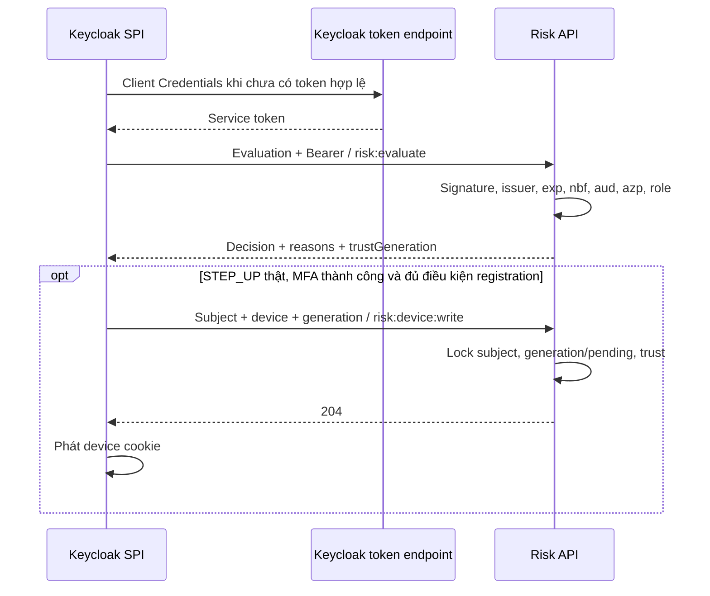

[Mục lục tài liệu](../README.md) · [Trang dự án](../../README.md)

# Bảo vệ Risk API và danh tính giữa các dịch vụ

**Ngày đối chiếu mã:** 2026-10-05.

**Trạng thái:** Cơ chế JWT/caller/role có trong mã và test. Realm, TLS, mạng và
service-account provisioning của môi trường đích phải được xác minh riêng.

## 1. Ai được gọi Risk?

Risk là API nội bộ, không dành cho browser/user token. Tất cả caller dùng audience
`zerotrust-risk-api`, nhưng `azp` và quyền khác nhau:

| Client | Trách nhiệm |
|---|---|
| zerotrust-risk-api | Resource/audience; chứa bốn client role Risk |
| zerotrust-risk-caller | Keycloak SPI/listener: evaluate, registration và events |
| zerotrust-portal-risk-admin | Portal: revoke/completion khi reset MFA |
| zerotrust-provisioner | Portal gọi Keycloak Admin API; không gọi Risk |
| zerotrust-spa | Public browser client; không secret và không quyền Risk |

Quyền theo route, tất cả thao tác ghi dùng POST:

| Route | azp bắt buộc | Client role | Thành công |
|---|---|---|---|
| /internal/v1/risk/evaluations | zerotrust-risk-caller | risk:evaluate | 200 JSON |
| /internal/v1/trusted-devices | zerotrust-risk-caller | risk:device:write | 204 |
| /internal/v1/authentication-failures | zerotrust-risk-caller | risk:events:write | 204 |
| /internal/v1/authentication-successes | zerotrust-risk-caller | risk:events:write | 204 |
| /internal/v1/subjects/{subjectId}/trusted-devices/revocations | zerotrust-portal-risk-admin | risk:device:revoke | 204 |
| Cùng route revoke + /completion | zerotrust-portal-risk-admin | risk:device:revoke | 204 |

`GET /actuator/health` không cần JWT; khi requireHttps bật vẫn phải dùng HTTPS.
Các method/path khác bị deny. Các role không thay thế cho nhau. Role cùng tên
trong realm hoặc client khác không cấp quyền Risk. Cấu hình có thể đổi client
ID/audience; bảng trên là tên baseline của repository.

## 2. Class bảo vệ request

| Class | Trách nhiệm |
|---|---|
| [RiskApiSecurityConfig](../../risk-scoring-service/src/main/java/com/zerotrust/risk/config/RiskApiSecurityConfig.java) | Dựng decoder/filter chain; stateless; deny mặc định; azp + authority theo route |
| [RiskApiSecurityProperties](../../risk-scoring-service/src/main/java/com/zerotrust/risk/config/RiskApiSecurityProperties.java) | Issuer, JWKS, audience, caller thường/revoke, yêu cầu HTTPS và validation URL |
| [RiskJwtAuthenticationConverter](../../risk-scoring-service/src/main/java/com/zerotrust/risk/security/RiskJwtAuthenticationConverter.java) | Lấy client role hợp lệ từ resource_access của configured audience |
| [ClientCredentialsTokenProvider](../../keycloak-risk-extension/src/main/java/com/zerotrust/keycloak/risk/client/ClientCredentialsTokenProvider.java) | SPI xin/cache service token, làm mới trước hạn |
| [HttpRiskScoringClient](../../keycloak-risk-extension/src/main/java/com/zerotrust/keycloak/risk/client/HttpRiskScoringClient.java) | Bearer + JSON, status/timeout/response limit/correlation, retry 401 một lần |
| [RiskDeviceAdminClient](../../src/main/java/com/zerotrust/zerotrust/risk/RiskDeviceAdminClient.java) | Client Portal riêng cho revoke/completion; không dùng token của provisioner |

Trước khi controller chạy, request phải có chữ ký hợp lệ qua JWKS, issuer đúng,
`exp` hiện diện/chưa hết hạn, `nbf` hợp lệ và audience chứa Risk. Sau đó route
kiểm `azp` và role. Thiếu/sai token thường 401; token hợp lệ nhưng sai quyền 403.
Body không hợp lệ 400; registration/lifecycle bị từ chối 409.
Khi requireHttps bật, plaintext bị 403 `HTTPS_REQUIRED` trước kiểm token; không
redirect POST mang credential/context sang HTTPS.

`server.forward-headers-strategy=none` là cấu hình Risk hiện có. Không mặc định
một header X-Forwarded-Proto sẽ làm request được xem là secure. Nếu dùng proxy
TLS termination, phải thiết kế và kiểm chứng TLS/backchannel phù hợp; profile
prod hiện bật TLS ngay tại Risk.

## 3. Service token và đường post-MFA

Ví dụ **claims**, không phải JWT dùng để gọi API:

```json
{
  "iss": "https://keycloak.example.test/realms/DoAn",
  "aud": ["zerotrust-risk-api"],
  "azp": "zerotrust-risk-caller",
  "exp": 1791162000,
  "resource_access": {
    "zerotrust-risk-api": {
      "roles": ["risk:evaluate", "risk:device:write", "risk:events:write"]
    }
  }
}
```

`exp` trong ví dụ là dữ liệu minh họa, không phải thời hạn dùng lại.
Với portal-risk-admin, đổi azp và chỉ cấp role `risk:device:revoke`.
Audience có thể từ audience mapper hoặc audience resolution, nhưng token cuối
cùng phải có đúng aud; sự tồn tại client/role không tự chứng minh mapper đúng.



SPI cache token và refresh trước hạn, mặc định 30 giây. Khi API trả 401, xóa
token bị từ chối, xin mới và retry đúng một lần. Không retry mọi timeout/5xx.
Lỗi response không ghi secret/token/body nhạy cảm vào log. MFA fallback do Risk
unavailable không được tạo trust; xem [luồng class](../development/CODE_FLOW_WALKTHROUGH.md).

## 4. Provisioning theo môi trường

Tạo resource client/roles, confidential caller và service account ở realm đích.
Tắt Full Scope Allowed, giới hạn role/scope mapper/audience đúng thao tác.
Cấp risk-caller ba role evaluation/device-write/events-write. Tạo secret khác
cho portal-risk-admin và chỉ cấp revoke. Không đưa secret vào SPA hoặc Git.

Sau provisioning, lấy token của từng caller để kiểm aud/azp/client roles và
kiểm route cho phép/từ chối. Test MockMvc không xác nhận live realm đã cấu hình.
Hướng dẫn riêng cho caller revoke nằm ở [MFA_RESET_LIFECYCLE](../authentication/MFA_RESET_LIFECYCLE.md).

## 5. Local: URL token và issuer

[LOCAL_SETUP](../operations/LOCAL_SETUP.md) là hướng dẫn chạy. Với topology
Keycloak Docker publish 8180 và Risk chạy trên Windows:

```text
Risk URL từ container: http://host.docker.internal:8081
Token URL trong container: http://localhost:8080/realms/DoAn/protocol/openid-connect/token
JWKS từ host: http://localhost:8180/realms/DoAn/protocol/openid-connect/certs
```

Issuer phải khớp **iss của token thực tế**, không suy ra chỉ từ JWKS URL.
Trong cấu hình start-dev có hostname động từng được ghi nhận, token xin từ port
8080 có issuer 8080, còn token xin từ 8180 có thể có issuer 8180. Issuer mismatch
được từ chối đúng bằng 401. Đây là ví dụ topology local, không bảo đảm mọi
Keycloak installation có cùng hành vi.

Portal-risk-admin thường xin token từ host. Nếu issuer khác issuer token SPI
do hostname động, cả hai caller không thể cùng được chấp nhận bằng một Risk
issuer duy nhất. Cần thống nhất canonical issuer/backchannel và kiểm token từ
cả hai nơi; không bỏ validation issuer hoặc cấp thêm caller để né lỗi.

`run-risk-local.ps1` nạp root .env cho Risk; Spring không tự nạp .env cho mọi
tiến trình. `RISK_BIND_ADDRESS=0.0.0.0` chỉ dùng khi container cần gọi host;
giới hạn firewall và không expose cổng Risk ra mạng không tin cậy.
Dev nới HTTPS, không bỏ JWT. Compose chỉ dựng Risk DB/Redis.

## 6. Production và giới hạn

Risk dùng profile prod, HTTPS và PKCS12:

```text
SPRING_PROFILES_ACTIVE=prod
RISK_JWT_ISSUER_URI=https://<keycloak-host>/realms/DoAn
RISK_JWT_JWK_SET_URI=https://<keycloak-host>/realms/DoAn/protocol/openid-connect/certs
RISK_JWT_AUDIENCE=zerotrust-risk-api
RISK_JWT_ALLOWED_CLIENT_ID=zerotrust-risk-caller
RISK_JWT_REVOKE_CLIENT_ID=zerotrust-portal-risk-admin
RISK_TLS_KEY_STORE=<path-to-pkcs12>
RISK_TLS_KEY_STORE_PASSWORD=<secret>
RISK_TLS_KEY_ALIAS=<alias>
```

Nguồn: [application-prod.properties](../../risk-scoring-service/src/main/resources/application-prod.properties).
Portal cần bộ PORTAL_RISK_* riêng. Keycloak phải có canonical HTTPS issuer,
forwarded-header trust phù hợp và service secret có rotation. Firewall/private
network phải cho phép đúng workload. Profile prod Risk không tự bật TLS MySQL,
dựng proxy hoặc secret manager; cấu hình datasource/TLS của từng data store cần
xác nhận riêng. Không đưa giá trị mặc định JDBC/HTTP local sang production.

## 7. Bằng chứng và việc còn phải kiểm tra

Các mô tả local ngày 15–21/09/2026 trước đây ghi nhận service token, OTP login,
registration và event thành công. Đó là mốc lịch sử, không xác nhận image/realm
hôm nay có Flyway V4 hoặc caller revoke. Xem [báo cáo 02/10](../reviews/ADAPTIVE_AUTH_REVIEW_2026-10-02.md).

Test mã: [RiskApiSecurityTests](../../risk-scoring-service/src/test/java/com/zerotrust/risk/security/RiskApiSecurityTests.java)
dùng RSA/JWKS giả lập để kiểm signature/issuer/aud/time/caller/role;
[RiskApiHttpsSecurityTests](../../risk-scoring-service/src/test/java/com/zerotrust/risk/security/RiskApiHttpsSecurityTests.java)
kiểm plaintext bị chặn; [revocation tests](../../risk-scoring-service/src/test/java/com/zerotrust/risk/controller/TrustedDeviceRevocationControllerTests.java)
kiểm quyền endpoint/lifecycle. JWT inject trong test revocation không tự chứng
minh signature decoder.

Staging cần xác minh cả hai caller, flow/MFA/recovery/enrollment, generation,
ba decision, outage, TLS và dữ liệu MySQL/Redis thật. Temporal/Network calculator
đã có mã; không còn là bước “chưa viết”, nhưng policy và runtime E2E vẫn cần kiểm
chứng. Device TRUSTED vẫn có thể MFA vì cold-start/nguồn thiếu/guardrail khác.
